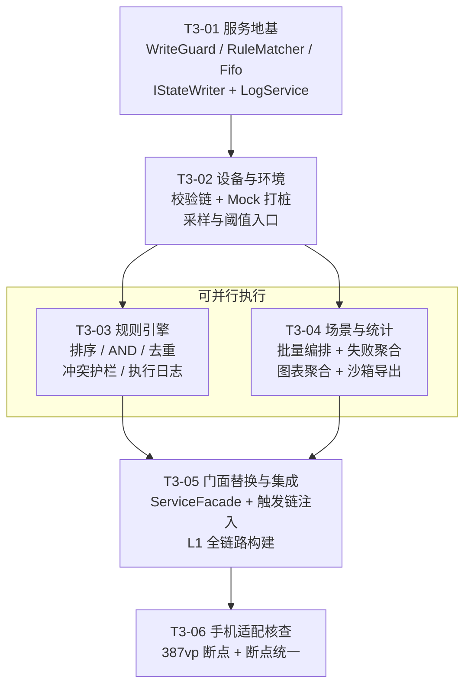

# 智寓——HarmonyOS 智能宿舍管家　第三阶段任务列表（核心业务逻辑）

> **文档性质**：`design/系统架构设计.md` V1.0.2 的配套**文件级**项目计划（Task Breakdown）
> **上游基线**：`docs/软件需求说明书.md` V1.1（已冻结，架构师不改）+ `design/系统架构设计.md` V1.0.2 + 阶段二**真实产出**（提交 `a5ebc7b` / `f3f13fa`，L1 构建通过）
> **适用范围**：PRD 第 18 章 **ST-03「核心业务逻辑」**
> **状态说明**：本表为**待执行任务**。不代表任何任务已完成、任何测试已通过、任何真机已运行。所有验收条件均为**未来应达成**的条件；L2 单测结果列与 PRD 第 16 章结果列**一律留空**。

---

## 文档控制信息

| 项目 | 内容 |
| --- | --- |
| 文档版本 | V1.0（阶段三文件级计划基线） |
| 编制日期 | 2026-11-09 |
| 编制人 | 高见远（架构师）· 团队 software-smartdorm |
| 审核人 | 齐活林（主理人）【待评审】 |
| 工程根目录 | `D:\SmartDormHarmonyOS`（分支 `main`） |
| 当前代码基线 | `entry/src/main/ets/` 共 **54 个 `.ets`**（model 14 / common 10 / service 1 / store 4 / mock 2 / components 12 / pages 10 / entryability 1） |
| 构建基线 | L1 已通过：`CompileArkTS` 14 s 582 ms、`BUILD SUCCESSFUL in 42 s 315 ms`、HAP 963,827 字节（设计文档 10.2.1） |
| 任务总数 | **6 个任务（T3-01 ~ T3-06）**＝ 5 个核心业务任务 + 1 个手机适配核查专项 |
| 分组依据 | 按**功能模块/层次**分组，不按单文件拆分（主理人任务书第二节 5 项必覆盖能力 → T3-01~T3-04；第四节手机适配 → T3-06；门面替换与集成 → T3-05） |
| 纪律 | 本阶段**不接持久化**（全部留阶段四）、**不伪造日志**、**不预置演示数据**、**不写任何测试结果**；架构师不执行 git 操作、不改 `docs/软件需求说明书.md`、不改 `entry/` 源码 |

---

## 1 阶段三的范围与边界

### 1.1 必须覆盖（主理人任务书第二节 5 项能力 → 任务映射）

| # | 必覆盖能力 | 承载任务 | 关键落地物 |
| --- | --- | --- | --- |
| 1 | 规则匹配与执行引擎：`priority↑ → createdAt↑ → id` 排序、AND 求值、**先执行者优先**、同 `(deviceId, paramKey)` → `SKIPPED_CONFLICT`、禁隐式覆盖、`WriteGuard` 护栏 B-1~B-8 | **T3-03** | `RuleMatcher` / `RuleEngine` / `RuleActionExecutor` / `WriteGuard` |
| 2 | 设备控制前置校验链：存在 → 在线 → 参数键适用于该类型 → 值类型与范围合法（+ `params.kind` 一致 + 幂等 `NO_CHANGE`） | **T3-02** | `DeviceService.validateChain()` / `MockDeviceAdapter` |
| 3 | 环境采样与阈值判定 + 自动化触发入口 | **T3-02**（采样/判定）+ **T3-03**（触发执行） | `EnvironmentSimulator.nextReading()` / `EnvironmentService.setEvaluationTrigger()` |
| 4 | 场景激活/退出批量编排 + 失败聚合 | **T3-04** | `SceneService.apply()` → `SceneApplyReport` |
| 5 | 三类日志写入 + 容量 FIFO（1000 / 1000 / 500，EnvironmentLog 2000） | **T3-01**（FIFO 内核 + 仓储写入口）+ **T3-02/03/04**（各日志真实写入方） | `common/Fifo.ets` / `IStateWriter` / `LogService` |

### 1.2 明确**不在**阶段三范围（防止越界与虚构）

| 项 | 归属 | 阶段三只做 |
| --- | --- | --- |
| `PreferencesStore` / `Serializer` / `SchemaMigration` / `WriteQueue` 真实持久化 | **ST-04** | 全部状态活在 `AppDataRepository` **内存态**；`flush()` 仍返回 `NO_CHANGE` 并注明「阶段四接串行写队列」 |
| 首次启动落盘、`schemaVersion` 迁移、重启恢复 | **ST-04** | 不实现；`MockDataFactory.createDefaultAppState()` 仍是唯一默认数据源 |
| TC-N / TC-B / TC-E 真实执行与结果填写、PRD 第 16 章结果列 | **ST-05** | 只保证纯函数**可被独立编译与单测**（零 `@kit.*`），**不写任何测试结果** |
| 真机安装、连续录屏、图 6.1 / 图 6.2 | ST-05~ST-07 + L4 | 只做 L1 构建 + 局部 L3 走查，如实标注 |
| 新增业务需求 / 改 PRD / 改页面业务逻辑 | 产品经理 / 架构师 | 页面仅做**门面标识符机械替换**（T3-05）与**断点来源统一**（T3-06），不改页面业务语义 |

### 1.3 阶段三结束时「可以说」与「不可以说」的话

| 可以说（需附证据） | 不可以说的 |
| --- | --- |
| 「规则引擎已实现，L1 构建通过，排序/去重/冲突纯逻辑已有可单测实现」 | 「规则引擎运行正常」「测试已通过」 |
| 「设备控制校验链已按 4 步前置校验落地」 | 「设备控制已真机验证」 |
| 「日志容量 FIFO 与三类日志写入已实现（内存态）」 | 「日志已持久化」 |
| 「手机断点核查清单已逐项走查，结论附 L3 截图 / 或标注未验证」 | 「已适配手机并真机验收」 |

---

## 2 任务总览

### 2.1 总览表

| 任务 ID | 任务名称 | 依赖 | 优先级 | 文件数（新建+修改） | 对应 PRD 需求 | 对应评分指标 |
| --- | --- | --- | --- | --- | --- | --- |
| **T3-01** | 服务层地基：纯逻辑内核 + 单一数据源写入口 + 日志服务 | 无（仅依赖阶段二产出） | **P0** | 4 + 3 = **7** | FR-06-01/04/06、FR-08-06、Q-12、MI-13/18 | SC-02、SC-04、SC-06 |
| **T3-02** | 设备控制前置校验链 + 环境采样与阈值判定 | T3-01 | **P0** | 4 + 2 = **6** | FR-02-02~10、FR-03-01~09、FR-04-13、Q-15、MI-02~09 | SC-02、SC-06、SC-07 |
| **T3-03** | 规则引擎：排序 / AND 求值 / 边沿去重 / 冲突护栏 / 执行日志 | T3-01、T3-02 | **P0** | 3 + 3 = **6** | FR-04-01~15、Q-10、MI-11/12 | **SC-02**、SC-06 |
| **T3-04** | 场景编排与失败聚合 + 统计聚合 + 沙箱导出 | T3-01、T3-02 | **P0** | 3 + 1 = **4** | FR-05-01~06、FR-06-02/03/05、FR-07-04、MI-14 | SC-02、SC-05、SC-07 |
| **T3-05** | 页面门面替换与全链路集成（切到真实服务 + 最小接线） | T3-02、T3-03、T3-04 | **P0** | 1 + 14 = **15** | FR-08-01/03/06、NFR-06、NFR-11 | SC-04、SC-06、SC-08 |
| **T3-06** | **手机适配核查**（387vp / sm 断点）+ 断点来源统一 | T3-05 | **P1** | 0 + 6~10 | NFR-10、FR-01-03、FR-06-02（布局可读性） | **SC-05**、SC-08 |

> **依赖链**：T3-01 → T3-02 → {T3-03, T3-04} → T3-05 → T3-06。最长链 5 步，无环形依赖；T3-03 与 T3-04 在 T3-02 完成后**可并行**（两者都只依赖 T3-01/T3-02，互不 import）。
>
> **为什么 T3-06 放在最后**：它与 T3-05 都要改 `pages/` 同一批文件，串行可避免同一文件的并发冲突；且断点核查需要页面已切到真实服务（否则看不到真实数据下的换行/溢出）。

### 2.2 文件清单增补与合并（对设计文档 2.2 节的差异裁决）

设计文档 V1.0.2 已在 2.2 节标注「阶段三增补 3 个 + 合并 1 个 → 实际 105 条」。逐条落位如下：

| 变化 | 文件 | 理由 | 归属任务 |
| --- | --- | --- | --- |
| **+ 新建** | `ets/service/RuleMatcher.ets` | 规则排序 / AND 求值 / 边沿去重必须**零 `@kit.*` 依赖**才能在 Node 侧单测（`RuleEngine` 要写日志→必然 import `IdGenerator`→`@kit.ArkTS`，不可 Node 解析）。把纯逻辑外置是 L2 验证路径（设计 10.2 L2 行）的**前提** | T3-01 |
| **+ 新建** | `ets/common/Fifo.ets` | 同上：日志 FIFO 裁剪是纯函数，外置后 4 类上限可单测 | T3-01 |
| **+ 新建** | `ets/service/ServiceFacade.ets` | 页面唯一门面。替代阶段二 `ServiceContracts.ets` 内的 `Stage2ServiceFacade`（该名字不得留在交付代码里） | T3-05 |
| **合并** | `ets/service/CommandResultFactory.ets`（原 #47） | 阶段二已把 `createResult/okResult/noChangeResult/failResult` 落在 `model/CommandResult.ets`，职责等价、无需第二份 | T3-01 起**直接复用**，不新建 |
| **口径修正** | `ets/service/ServiceContracts.ets`（原 #58） | 阶段二状态为「占位」；阶段三**保留 7 个 interface + `commandToParamKey`**，**删除 `Stage2ServiceFacade` 类**（实现迁至 `ServiceFacade.ets`） | T3-01 起逐任务收敛，T3-05 完成删除 |

---

## 3 任务详述

### T3-01　服务层地基：纯逻辑内核 + 单一数据源写入口 + 日志服务

| 项 | 内容 |
| --- | --- |
| **目标** | 把三件「纯逻辑内核」独立成零 `@kit.*` 依赖的模块（`WriteGuard` / `RuleMatcher` / `Fifo`）；为 `AppDataRepository` 开**唯一状态写入面** `IStateWriter`（页面不可调用）；落地 `LogService` 真实查询与三类日志追加，并在仓储内实现 Q-12 的 FIFO 淘汰。 |
| **依赖** | 无（阶段二 54 个 `.ets` 已就绪） |
| **优先级** | P0 |
| **对应需求** | FR-06-01/04/06（日志真实性与容量）、FR-08-06（四面一致）、Q-12、MI-13、MI-18 |
| **对应评分** | SC-02（核心逻辑）、SC-04（架构分层）、SC-06（接口约定） |

**涉及文件（7 个）**

| # | 相对路径 | 新建/修改 | 本任务内的职责 |
| --- | --- | --- | --- |
| 1 | `entry/src/main/ets/service/WriteGuard.ets` | **新建** | 护栏 B-1/B-3：本轮 `(deviceId, paramKey)` 写入登记表；**纯逻辑，零系统 API** |
| 2 | `entry/src/main/ets/service/RuleMatcher.ets` | **新建** | 确定性排序、AND 条件求值、边沿去重判定；**纯逻辑，仅 import `model/`** |
| 3 | `entry/src/main/ets/common/Fifo.ets` | **新建** | 4 类日志上限换算与 FIFO 裁剪；**纯函数** |
| 4 | `entry/src/main/ets/service/LogService.ets` | **新建** | MI-13：`query()` 真实过滤、`appendOperation/appendEnvironment/appendSceneSwitch`（**不暴露规则日志写入**） |
| 5 | `entry/src/main/ets/store/RepositoryContract.ets` | 修改 | 新增 `IStateWriter`（状态写入面）；`IAppDataRepository`（MI-01/15/16/17/18）**签名不动** |
| 6 | `entry/src/main/ets/store/AppDataRepository.ets` | 修改 | `implements IAppDataRepository, IStateWriter`；实现 7 个 `commit*` + 3 个 `append*Log` + FIFO + `notify`；`commitRuleLogs` 真实写入（含 1000 条上限） |
| 7 | `entry/src/main/ets/service/ServiceContracts.ets` | 修改 | 仅**注释更正**（说明 `commandToParamKey` 为 B-4 唯一映射、规则日志写入不在此声明）；`Stage2ServiceFacade` 暂留（T3-05 删除） |

**核心签名（最终，可直接照做）**

```ts
// 1) service/WriteGuard.ets —— 护栏 B-1/B-3，纯逻辑
export interface GuardEntry { deviceId: string; paramKey: string; ruleId: string; }
export class WriteGuard {
  reset(): void;                                        // 轮首调用，不跨轮持有（B-1）
  claim(deviceId: string, paramKey: string, ruleId: string): boolean;  // 首次 true，重复 false（先到先得）
  has(deviceId: string, paramKey: string): boolean;
  entries(): GuardEntry[];
  size(): number;
}

// 2) service/RuleMatcher.ets —— 纯逻辑，仅 import model/
export class RuleMatcher {
  static sortRules(rules: AutomationRule[]): AutomationRule[];       // priority↑ → createdAt↑ → id↑（不改原数组）
  static matchConditions(rule: AutomationRule, env: EnvironmentData): boolean;      // P0 固定 AND
  static matchedConditions(rule: AutomationRule, env: EnvironmentData): AutomationCondition[];
  static isEdgeTriggered(lastSatisfied: boolean, satisfied: boolean): boolean;      // 仅 false→true 触发（FR-04-10）
  static nextDedupFlag(prevSatisfied: boolean, satisfied: boolean): boolean;        // 恒等于 satisfied
  static resetDedup(rules: AutomationRule[]): AutomationRule[];      // 全部 lastSatisfied=false（编辑/启停/总开关用）
}

// 3) common/Fifo.ets —— 纯函数
export interface TimeStamped { timestamp: number; }
export class Fifo {
  static limitOf(kind: LogType, logLimit: number): number;   // OPERATION=logLimit, RULE_EXECUTION=logLimit,
                                                             // ENVIRONMENT=logLimit*2, SCENE_SWITCH=SCENE_LOG_LIMIT
  static trim<T extends TimeStamped>(list: T[], limit: number): T[];   // 保序，超限丢最旧（timestamp 最小）
  static append<T extends TimeStamped>(list: T[], item: T, limit: number): T[];  // 返回新数组
}

// 4) service/LogService.ets —— MI-13（实现 ILogService）
export class LogService {
  static getInstance(): LogService;
  query(filter: LogFilter): LogRecord[];          // [from,to] + types/deviceId/ruleId 真实过滤
  appendOperation(log: OperationLog): void;        // → repo.appendOperationLog()
  appendEnvironment(log: EnvironmentLog): void;    // → repo.appendEnvironmentLog()
  appendSceneSwitch(log: SceneSwitchLog): void;    // → repo.appendSceneSwitchLog()
  // ★ 不定义 appendRuleExecution（护栏 A-1）
}

// 5) store/RepositoryContract.ets —— 新增状态写入面（仅 service/ 可调用，页面禁止）
export interface IStateWriter {
  commitDevices(devices: Device[], reason: string): void;
  commitRules(rules: AutomationRule[], reason: string): void;
  commitScenes(scenes: Scene[], reason: string): void;
  commitEnvironment(environment: EnvironmentData, reason: string): void;
  commitSettings(settings: AppSettings, reason: string): void;
  commitCurrentScene(sceneId: string, mode: RunMode): void;
  commitReturnSnapshot(snapshot: DeviceStateSnapshot[]): void;
  appendOperationLog(log: OperationLog): void;      // 内部 FIFO（1000）
  appendEnvironmentLog(log: EnvironmentLog): void;  // 内部 FIFO（2000）
  appendSceneSwitchLog(log: SceneSwitchLog): void;  // 内部 FIFO（500）
}
// 既有：commitRuleLogs(report): Promise<CommandResult<void>>  → 内部 FIFO（1000），护栏 A-2 唯一入口
```

**验收条件**

| # | 条件 | 可核查证据 | 测性 |
| --- | --- | --- | --- |
| A1 | **L1 编译通过**（`CompileArkTS` 无 `ArkTS:ERROR`/`ArkTS:WARN`），HAP 重新产出 | `evidence/构建日志-阶段三.md` + HAP 字节数 | L1 |
| A2 | `WriteGuard`：`claim` 首次 `true`、同 `(deviceId,paramKey)` 再次 `false`；不同 `paramKey` 互不影响；`reset()` 后清空 | 单测可断言（纯逻辑） | **L2** |
| A3 | `RuleMatcher.sortRules` 三重排序稳定：`priority` 相同按 `createdAt`，再相同按 `id` 字典序；不改入参数组 | 单测可断言 | **L2** |
| A4 | `RuleMatcher.matchConditions` 支持 `GT/LT/IS_TRUE/IS_FALSE` 与 5 类传感器；`IS_TRUE/IS_FALSE` 只读 `humanPresence` | 单测可断言 | **L2** |
| A5 | `isEdgeTriggered(false,true)=true`，其余三组合均 `false`（去重语义） | 单测可断言 | **L2** |
| A6 | `Fifo.limitOf` 返回 1000/1000/2000/500；`trim` 超限丢最旧且保序 | 单测可断言 | **L2** |
| A7 | `grep -rn "appendRuleExecution" entry/src/main/ets/` **结果为空**（护栏 A-1） | grep 输出 | 走查 |
| A8 | `grep -rn "commitRuleLogs" entry/src/main/ets/` 仅出现在 `AppDataRepository.ets`（阶段三期间 `RuleEngine.ets` 由 T3-03 引入后合计 2 处） | grep 输出 | 走查 |
| A9 | 页面/组件**未** import `IStateWriter`；`grep -rn "commitDevices\|commitRules\|appendOperationLog" entry/src/main/ets/pages entry/src/main/ets/components` 为空 | grep 输出 | 走查 |
| A10 | `LogService` 无 `appendRuleExecution`；`query()` 对空数据集返回 `[]`（不是 `null`/`undefined`） | 源码走查 | 走查 |

> **不写测试结果**：A2~A6 只声明「逻辑可断言」。实际断言输出留阶段五，本节**不预填**任何通过/失败结论。

---

### T3-02　设备控制前置校验链 + 环境采样与阈值判定

| 项 | 内容 |
| --- | --- |
| **目标** | 落地 MI-02~05 设备控制的**四步前置校验链**与幂等语义；落地 MI-06 Mock 打桩（含 FAULT/OFFLINE 诊断，Q-15）；落地 MI-07/08 环境快照与手动调整、MI-09 环境模拟波动、MI-10 定时器真实驱动。**为 T3-03 预留自动化触发注入点**（不直接 import `RuleEngine`，避免环依赖）。 |
| **依赖** | T3-01 |
| **优先级** | P0 |
| **对应需求** | FR-02-02/03/04/05/08/09/10、FR-03-01/03/04/05/07/09、FR-04-13、Q-15、MI-02~09 |
| **对应评分** | SC-02、SC-06、SC-07 |

**涉及文件（6 个）**

| # | 相对路径 | 新建/修改 | 本任务内的职责 |
| --- | --- | --- | --- |
| 1 | `entry/src/main/ets/service/DeviceService.ets` | **新建** | MI-02~05 + 校验链 + `OperationLog` + 悬空引用清理（MI-05） |
| 2 | `entry/src/main/ets/mock/MockDeviceAdapter.ets` | **新建** | MI-06：命令打桩执行、`setDeviceStatus` / `setOnline`、离线/故障返回 `DEVICE_OFFLINE` |
| 3 | `entry/src/main/ets/service/EnvironmentService.ets` | **新建** | MI-07/08：快照、调整（钳制/拒绝 + `EnvironmentLog`）、**触发点注入** |
| 4 | `entry/src/main/ets/mock/EnvironmentSimulator.ets` | **新建** | MI-09：`nextReading()` 纯函数波动 + `tick()` 单步 |
| 5 | `entry/src/main/ets/mock/TimerHost.ets` | 修改 | `tick()` 真实遍历回调表（阶段二只计数）；保持**唯一** `setInterval` 句柄 |
| 6 | `entry/src/main/ets/entryability/EntryAbility.ets` | 修改 | `configure()` 从 `getState().settings` 读 `simulationEnabled` / `sampleIntervalMs`；注册模拟回调；`onWindowStageDestroy/onDestroy` 走 `pause/release` |

**核心签名**

```ts
// 1) service/DeviceService.ets —— MI-02~05（实现 IDeviceService）
export class DeviceService {
  static getInstance(): DeviceService;
  setPower(id: string, on: boolean, actor: LogActor): Promise<CommandResult<Device>>;
  setParam(id: string, key: ParamKey, value: ParamValue, actor: LogActor): Promise<CommandResult<Device>>;
  addDevice(type: DeviceType, name: string): Promise<CommandResult<Device>>;
  removeDevice(id: string): Promise<CommandResult<void>>;
  setDeviceStatus(id: string, status: DeviceStatus, actor: LogActor): Promise<CommandResult<Device>>;
  setOnline(id: string, online: boolean, actor: LogActor): Promise<CommandResult<Device>>;
  // 内部（private）
  // validateChain 顺序固定，任一不通过即 return，不产生部分写入：
  //   ① 存在性 → NOT_FOUND
  //   ② 在线/非故障 → DEVICE_OFFLINE
  //   ③ 参数键适用于该 type（DeviceParamsFactory.paramKeysOf）→ INVALID_PARAM
  //   ④ 值类型与范围（ParamSchema.validateParamValue）→ INVALID_PARAM
  //   ⑤ params.kind === device.type（AT-04）→ INVALID_PARAM
  //   ⑥ 幂等：目标态与现值相同 → NO_CHANGE（且不写日志，FR-02-08）
  // 校验通过后：MockDeviceAdapter.apply() → 写 OperationLog(actor) → repo.commitDevices() → notify()
}

// 2) mock/MockDeviceAdapter.ets —— MI-06
export class MockDeviceAdapter {
  static getInstance(): MockDeviceAdapter;
  apply(ctx: DeviceCommandContext): CommandResult<Device>;   // 返回**新对象**，不就地改权威态
  setDeviceStatus(id: string, status: DeviceStatus): CommandResult<Device>;
  setOnline(id: string, online: boolean): CommandResult<Device>;
}

// 3) service/EnvironmentService.ets —— MI-07/08
export type EvaluationTrigger = (snapshot: EnvironmentData) => Promise<void>;
export class EnvironmentService {
  static getInstance(): EnvironmentService;
  getSnapshot(): EnvironmentData;
  adjust(sensorType: SensorType, value: number | boolean, source: EnvSource): Promise<CommandResult<EnvironmentData>>;
  /** 由 T3-05 的 ServiceFacade 在初始化时注入 (env) => RuleEngine.getInstance().evaluate(env)；
   *  避免 EnvironmentService → RuleEngine 的直接 import（防环依赖）。 */
  setEvaluationTrigger(trigger: EvaluationTrigger): void;
  /** 模拟采样入口：由 TimerHost 回调驱动，写 EnvironmentLog(source=SIMULATED) 后触发求值。 */
  applySampled(next: EnvironmentData): Promise<void>;
}

// 4) mock/EnvironmentSimulator.ets —— MI-09
export class EnvironmentSimulator {
  static getInstance(): EnvironmentSimulator;
  start(intervalMs: number): void;
  stop(): void;
  tick(): EnvironmentData;                                   // start 后由 TimerHost 驱动
  /** 纯函数：给定当前读数与随机源，返回下一组**合法**读数（已在范围内钳制）。随机源可注入。
   *  注意：本函数虽为纯函数，但**所在文件整体不可在 Node 侧加载**（tick() 依赖 EnvironmentService），
   *  故按 2026-11-09 裁决由 L4 判定，见 §5.2。 */
  static nextReading(current: EnvironmentData, rnd: () => number, now: number): EnvironmentData;
}
```

**阈值判定归口（重要裁决）**：条件比对**只有一处实现**——`RuleMatcher.matchConditions()`（T3-01）。`EnvironmentService` **不做**阈值判断，只负责「产出读数 → 记日志 → 调用注入的触发函数」。避免「两处各判一次、结果不一致」的经典缺陷。

**悬空引用清理（MI-05，FR-02-05 明确要求）**

| 被删设备的下游引用 | 处理 | 是否记日志 |
| --- | --- | --- |
| 规则 `actions[]` 中 `targetDeviceId` 命中 | 移除该动作；若该规则动作被清空 → 规则置 `enabled=false` 且保留（**不静默删除用户规则**） | 记 `OperationLog(actor=SYSTEM)` |
| 场景 `deviceStates[]` 中 `deviceId` 命中 | 移除该项 | 不记（配置数据变更，非执行结果） |
| `AppState.returnSnapshot[]` 中命中 | 移除该项 | 不记 |

**验收条件**

| # | 条件 | 可核查证据 | 测性 |
| --- | --- | --- | --- |
| B1 | **L1 编译通过**，无 `ArkTS:ERROR`/`WARN` | `evidence/构建日志-阶段三.md` | L1 |
| B2 | 校验链**顺序固定**：`NOT_FOUND` 优先于 `DEVICE_OFFLINE`，`DEVICE_OFFLINE` 优先于 `INVALID_PARAM`；任一失败**不产生部分写入**（`state.devices` 不变） | 源码走查 + 单测（`validateParam` 纯函数部分） | **L2**（范围）/ L3（链顺序） |
| B3 | 幂等：`setPower(id, 当前值)` → `code=NO_CHANGE`、`changed=false`、**不写 `OperationLog`** | 源码走查 | L3 |
| B4 | `setParam` 越界（如亮度 101）→ `INVALID_PARAM`，`changed=false`，设备参数不变 | 单测（`ParamSchema`）+ 走查 | **L2** |
| B5 | 离线设备（`online=false`）任何控制 → `DEVICE_OFFLINE` | 源码走查 | L3 |
| B6 | `MockDeviceAdapter.apply()` **返回新对象**，不 mutate 传入的 `Device`（`Device`/`DeviceParams` 均复制） | 源码走查 | L3 |
| B7 | `EnvironmentSimulator.nextReading()` 输出恒在 PRD 4.4 范围内（温度 −10~50、湿度 0~100、光照 0~10000、AQI 0~500），且 `humanPresence` 为布尔 | 单测（注入固定 `rnd`） | **L2** |
| B8 | `TimerHost` 全程**只有 1 个** `setInterval` 句柄；`pause()` 后 `isRunning()===false`；`release()` 后 `callbackCount()===0` | 源码走查 + 运行时诊断 | L3 |
| B9 | `EnvironmentService` **未** import `RuleEngine`（防环依赖）；触发点仅经 `setEvaluationTrigger` 注入 | `grep -n "RuleEngine" service/EnvironmentService.ets` 为空 | 走查 |
| B10 | `removeDevice` 后：规则动作/场景项/returnSnapshot 无残留引用（可遍历断言） | 源码走查 + L3 | L3 |

---

### T3-03　规则引擎：排序 / AND 求值 / 边沿去重 / 冲突护栏 / 执行日志

| 项 | 内容 |
| --- | --- |
| **目标** | 落地 **SC-02 核心**：`MI-11` 规则 CRUD/启停（编辑后 `resetDedup()`）、`MI-12` 求值主流程（确定性排序 → AND 求值 → 边沿去重 → 逐动作 `guard.claim()` → 执行或 `SKIPPED_CONFLICT` → 汇总报告 → **规则状态回写 + 执行日志单点提交**）。**本任务是「先执行者优先」政策的唯一实现处**。 |
| **依赖** | T3-01（`WriteGuard` / `RuleMatcher` / `Fifo` / `IStateWriter`）、T3-02（`DeviceService` 供动作执行） |
| **优先级** | P0 |
| **对应需求** | FR-04-01~15、Q-10、MI-11、MI-12、DM-08 |
| **对应评分** | **SC-02**、SC-06 |

**涉及文件（6 个）**

| # | 相对路径 | 新建/修改 | 本任务内的职责 |
| --- | --- | --- | --- |
| 1 | `entry/src/main/ets/service/RuleService.ets` | **新建** | MI-11：`create/update/remove/toggle` + 编辑校验 + `resetDedup()` |
| 2 | `entry/src/main/ets/service/RuleEngine.ets` | **新建** | MI-12：求值主流程 + 报告组装 + 规则状态回写 + `commitRuleLogs()` |
| 3 | `entry/src/main/ets/service/RuleActionExecutor.ets` | **新建** | 护栏 B-2/B-4：`guard.claim()` **前置**，通过后才调 `DeviceService` |
| 4 | `entry/src/main/ets/service/RuleMatcher.ets` | 修改 | 补齐阈值判定细节、`isEdgeTriggered`、`resetDedup`（若 T3-01 留骨架） |
| 5 | `entry/src/main/ets/store/AppDataRepository.ets` | 修改 | `commitRuleLogs()` 真实写入 `newLogs`（FIFO 1000）+ `notify('rule-logs')` |
| 6 | `entry/src/main/ets/service/ServiceContracts.ets` | 修改 | `IRuleEngine` / `IRuleService` 注释与签名复核（**不改语义**） |

**核心签名**

```ts
// 1) service/RuleService.ets —— MI-11
export class RuleService {
  static getInstance(): RuleService;
  create(rule: AutomationRule): Promise<CommandResult<AutomationRule>>;   // 条件/动作非空、目标设备存在、值合法
  update(rule: AutomationRule): Promise<CommandResult<AutomationRule>>;   // updatedAt=now, lastSatisfied=false
  remove(id: string): Promise<CommandResult<void>>;
  toggle(id: string, enabled: boolean): Promise<CommandResult<AutomationRule>>;  // lastSatisfied=false
  /** 总开关切换时调用：全部规则 lastSatisfied=false（FR-04-10 配套） */
  resetAllDedup(): void;
}

// 2) service/RuleEngine.ets —— MI-12（实现 IRuleEngine）
export class RuleEngine {
  static getInstance(): RuleEngine;
  evaluate(snapshot: EnvironmentData): Promise<RuleEvaluationReport>;
  // 内部顺序（**不得调换**）：
  //   ① const guard = new WriteGuard(); guard.reset();                      // B-1
  //   ② settings.automationEnabled === false → 返回 skipReason 报告（无日志、无执行）
  //   ③ RuleMatcher.sortRules(enabledRules)                                  // priority↑→createdAt↑→id
  //   ④ 逐规则：satisfied = matchConditions(rule, snapshot)
  //        satisfied && !lastSatisfied → 触发：按 action.order 升序执行
  //        satisfied &&  lastSatisfied → skippedDedupRules（**不写日志**）
  //        !satisfied                   → 不记
  //   ⑤ 生成 RuleExecutionLog（仅「本轮真实尝试过动作」的规则才产出）
  //   ⑥ repo.commitRules(nextRules, 'rule-eval')      ← 回写 lastSatisfied / lastTriggeredAt / executionCount
  //   ⑦ await repo.commitRuleLogs(report)             ← 护栏 A-2 唯一入口（FIFO 1000）
  //   ⑧ report.durationMs = now - startedAt
  private buildExecutionLog(rule, snapshot, executed, skipped, status, err, dur): RuleExecutionLog;
}

// 3) service/RuleActionExecutor.ets —— 护栏 B-2 / B-4
export class RuleActionExecutor {
  constructor(deviceService: IDeviceService);
  /** 单动作执行：① paramKey = commandToParamKey(action.command)
   *              ② claimed = guard.claim(action.targetDeviceId, paramKey, ruleId)
   *                  false → 直接返回 ActionOutcome{ code: CONFLICT_SKIPPED }，**不得**调用 DeviceService（B-2）
   *              ③ true  → 按 command 分派 setPower / setParam / setDeviceStatus
   */
  execute(action: AutomationAction, guard: WriteGuard, ruleId: string): Promise<ActionOutcome>;
}
```

**`RuleEvaluationReport` 字段填充口径（与 `model/Reports.ets` 逐字段对齐）**

| 字段 | 填充规则 |
| --- | --- |
| `evaluatedAt` | `TimeUtil.now()` |
| `snapshot` | 入参 `snapshot`（触发时真实环境快照，供事后核查） |
| `automationEnabled` | `settings.automationEnabled` |
| `skipReason` | 总开关关闭时写明原因；开启时 `''` |
| `totalRules` | `state.rules.length`（含停用） |
| `triggeredRules` | 本轮**真实触发**的 `ruleId`（`false→true` 边沿） |
| `skippedDedupRules` | 满足但 `lastSatisfied===true` 的 `ruleId`（**不写日志**） |
| `skippedConflictRules` | 至少一个动作因冲突被跳过的 `ruleId` |
| `outcomes` | 每条触发规则的 `RuleOutcome`（含 `actionOutcomes[]`） |
| `newLogs` | **只有本引擎能生成**的 `RuleExecutionLog[]`（护栏 A-3） |
| `durationMs` | 真实耗时 `now - startedAt` |

**`RuleExecutionLog.status` 判定表（DM-08 / 4.2 节）**

| 动作结果组合 | `status` |
| --- | --- |
| 全部 `OK` | `SUCCESS` |
| 部分 `OK` + 部分 `INVALID_PARAM`/`DEVICE_OFFLINE` | `PARTIAL` |
| 全部失败（无 `OK`，且非全冲突） | `FAILED` |
| 全部动作均 `CONFLICT_SKIPPED` | `SKIPPED_CONFLICT` |
| 规则停用未参与（**不产生日志**） | —— |

**验收条件**

| # | 条件 | 可核查证据 | 测性 |
| --- | --- | --- | --- |
| C1 | **L1 编译通过**，无 `ArkTS:ERROR`/`WARN` | `evidence/构建日志-阶段三.md` | L1 |
| C2 | 排序确定性：2 条同 `priority` 同 `createdAt` 规则按 `id` 字典序稳定；多次求值顺序一致（TC-E-06 前提） | 单测（`RuleMatcher.sortRules`） | **L2** |
| C3 | 冲突策略：规则 A（高优先级）写灯亮度 80，规则 B 写灯亮度 40 → A 执行 `OK`，B 的该动作 `CONFLICT_SKIPPED`，`skippedActions[]` 有 1 条，`B.status=SKIPPED_CONFLICT`（或 `PARTIAL`），**最终设备亮度 = 80**（先执行者优先） | 单测（`WriteGuard` 部分）+ L3（端到端） | **L2** / L3 |
| C4 | 不同参数共存：同一设备 `powerOn` 与 `brightness` 由两条规则分别写 → **都执行**（不误判冲突） | 单测（`WriteGuard`） | **L2** |
| C5 | 边沿去重：环境持续满足条件时，第 1 轮触发、第 2 轮起进入 `skippedDedupRules` 且 **不新增 `RuleExecutionLog`**；条件消失后再满足 → 重新触发 | 单测（`isEdgeTriggered`）+ L3 | **L2** / L3 |
| C6 | `guard.claim()` 出现在**每一处** `DeviceService` 调用之前（B-2） | `grep -n "deviceService\.\|\.setPower(\|\.setParam(" service/RuleActionExecutor.ets` 每处上一行须有 `claim` | 走查 |
| C7 | 服务层**无** `force` / `overwrite` 参数（B-5） | `grep -rn "force\|overwrite" entry/src/main/ets/service/` 为空 | 走查 |
| C8 | `newLogs` 只在 `RuleEngine.buildExecutionLog()` 内构造；`grep -rn "newLogs" entry/src/main/ets/` 仅 3 个文件（`Reports.ets` / `RuleEngine.ets` / `AppDataRepository.ets`） | grep 输出 | 走查 |
| C9 | 总开关关闭：`automationEnabled=false` → 返回 `skipReason` 非空、`newLogs.length===0`、无 `DeviceService` 调用、无 `OperationLog` | 源码走查 + L3 | L3 |
| C10 | 单条规则/单个动作异常被 `try/catch` 捕获 → 记 `FAILED`，**不中断整轮**（其他规则照常求值） | 源码走查 | L3 |
| C11 | 报告回写顺序：`commitRules` **先于** `commitRuleLogs`（见 4.3 裁决） | 源码走查 | 走查 |
| C12 | `RuleService.update/toggle` 后目标规则 `lastSatisfied===false`（边沿重新武装） | 源码走查 | L3 |

---

### T3-04　场景编排与失败聚合 + 统计聚合 + 沙箱导出

| 项 | 内容 |
| --- | --- |
| **目标** | 落地 MI-14 场景切换：**离寝保存快照 / 回寝恢复快照**、逐设备下发、**失败项逐条聚合不静默**、写 `SceneSwitchLog`；落地 FR-06 的图表数据聚合（真实日志 → `ChartPoint[]` / `ChartBar[]` / 成功率）；落地 FR-07-04 沙箱导出（`filesDir/exports/`）。 |
| **依赖** | T3-01（`IStateWriter` / `Fifo`）、T3-02（`DeviceService` 供逐设备下发） |
| **优先级** | P0（`SceneService` / `StatisticsService`）；P1（`ExportService`，FR-07-04 为 P1） |
| **对应需求** | FR-05-01~06、FR-06-02/03/05、FR-07-04、MI-14 |
| **对应评分** | SC-02、SC-05、SC-07 |

**涉及文件（4 个）**

| # | 相对路径 | 新建/修改 | 本任务内的职责 |
| --- | --- | --- | --- |
| 1 | `entry/src/main/ets/service/SceneService.ets` | **新建** | MI-14 + `create/update/remove`；快照保存/恢复；逐设备下发；失败聚合；`SceneSwitchLog` |
| 2 | `entry/src/main/ets/service/StatisticsService.ets` | **新建** | `EnvironmentLog → ChartPoint[]`、`OperationLog → ChartBar[]`、`successRate` |
| 3 | `entry/src/main/ets/service/ExportService.ets` | **新建** | FR-07-04：JSON/CSV 写入 `context.filesDir/exports/`，返回路径与字节数 |
| 4 | `entry/src/main/ets/service/ServiceContracts.ets` | 修改 | `ISceneService` 补 `create/update/remove`；`IStatisticsService.buildBarModel(logs, devices)` 签名收敛 |

**核心签名**

```ts
// 1) service/SceneService.ets —— MI-14（实现 ISceneService + 场景 CRUD）
export class SceneService {
  static getInstance(): SceneService;
  apply(sceneId: string): Promise<SceneApplyReport>;
  create(name: string): Promise<CommandResult<Scene>>;
  update(scene: Scene): Promise<CommandResult<Scene>>;
  remove(sceneId: string): Promise<CommandResult<void>>;      // 预置场景不可删（isPreset 校验）
  // apply 内部顺序：
  //   ① 场景存在性（NOT_FOUND，返回空报告不抛异常）
  //   ② 若「当前 = AWAY 且目标 = RETURN」→ 恢复 repo 中的 returnSnapshot（恢复失败逐项记入 items）
  //   ③ 若「目标 = AWAY」→ 先把**当前**逐设备状态存为 returnSnapshot（FR-05-04 / KEY-10）
  //   ④ 按 deviceStates 逐条 setPower/setParam（actor=SCENE），**串行**，单条失败不中断
  //   ⑤ 聚合 applied/ failed/ noChange，items[] 逐条记录 code+message（失败项**不得静默**）
  //   ⑥ 写 SceneSwitchLog(fromSceneId, toSceneId, appliedCount, failedCount)
  //   ⑦ repo.commitCurrentScene(sceneId, mode) + repo.commitReturnSnapshot(...) + notify
  //   ⑧ 返回 SceneApplyReport（restoredFromSnapshot 标记回寝）
}

// 2) service/StatisticsService.ets —— FR-06-02/03
export class StatisticsService {
  static getInstance(): StatisticsService;
  buildLineModel(logs: EnvironmentLog[], sensorType: SensorType): LineChartModel;  // 按 timestamp 升序
  buildBarModel(logs: OperationLog[], devices: Device[]): BarChartModel;            // 按 deviceId → Device.type 分组计数
  successRate(logs: RuleExecutionLog[]): number;                                    // 0/0 定义为 0
  averageDuration(logs: RuleExecutionLog[]): number;                                // 平均执行耗时（ms）
}

// 3) service/ExportService.ets —— FR-07-04（沙箱，不跨应用）
export class ExportService {
  static getInstance(): ExportService;
  /** context 由 EntryAbility.onCreate 注入（与阶段四 PreferencesStore 同一注入点） */
  init(context: common.Context): void;
  exportToFilesDir(state: AppState, format: string): CommandResult<string>;  // 返回 filesDir/exports/export_<ts>.json
}
```

> **导出 API 依据**：`fs.openSync / writeSync / closeSync`（`api/@ohos.file.fs.d.ts` 3917 / 2864 / 2889 等已核验）；`context.filesDir`（`api/application/Context.d.ts` 432）。**不引入**跨应用分享（P2）。

**验收条件**

| # | 条件 | 可核查证据 | 测性 |
| --- | --- | --- | --- |
| D1 | **L1 编译通过**，无 `ArkTS:ERROR`/`WARN` | `evidence/构建日志-阶段三.md` | L1 |
| D2 | 不存在的 `sceneId` → 返回空 `SceneApplyReport`（`total=0`），**不抛异常** | 源码走查 | L3 |
| D3 | 单条设备下发失败（如离线）→ `items[]` 有该项且 `code=DEVICE_OFFLINE`，`failedCount` 正确，**其余设备继续下发**（失败聚合，不中断） | 源码走查 + L3 | L3 |
| D4 | 切换过程**不经过** `WriteGuard`（B-7），但**必须**经 `DeviceService` 统一校验与 `OperationLog` | `grep -n "WriteGuard" service/SceneService.ets` 为空 | 走查 |
| D5 | 离寝 → `returnSnapshot` 非空且与切换前设备态一致；回寝 → 设备态恢复到该快照，`restoredFromSnapshot===true` | 源码走查 + L3 | L3 |
| D6 | 每次切换写 **1 条** `SceneSwitchLog`（含 `fromSceneId`/`toSceneId`/计数） | 源码走查 | 走查 |
| D7 | `buildLineModel` 输出点数 == 传入日志条数（不补点、不插值造点）；空数组 → `series: []`；**禁止**硬编码演示点（FR-06-03） | 单测（纯函数，仅依赖 `model/`） | **L2** |
| D8 | `buildBarModel` 按设备类型分组计数，总数 == 传入 `OperationLog` 条数（可断言） | 单测 | **L2** |
| D9 | `successRate([]) === 0`；`successRate` 只统计 `SUCCESS`（不把 `PARTIAL` 计成功，口径见 4.6） | 单测 | **L2** |
| D10 | 导出：成功返回 `filesDir/exports/export_<ts>.json` 路径且文件字节数 > 0（**无真机时此项为 L4 待补测**，L1/L2 只验证序列化字符串内容） | 源码走查 + L4 补测 | L1/L4 |

---

### T3-05　页面门面替换与全链路集成

| 项 | 内容 |
| --- | --- |
| **目标** | 把页面/组件从阶段二占位门面 `Stage2ServiceFacade` **机械切换**到真实服务门面 `ServiceFacade`（页面业务逻辑 0 改动）；完成触发链注入、`ExportService` 上下文注入、`Statistics` 柱状图数据源接线；全链路 L1 构建通过。 |
| **依赖** | T3-02、T3-03、T3-04 |
| **优先级** | P0 |
| **对应需求** | FR-08-01（无装饰性按钮，反馈真实）、FR-08-03（页面与逻辑分离）、FR-08-06（四面一致）、NFR-06、NFR-11 |
| **对应评分** | SC-04、SC-06、SC-08 |

**涉及文件（15 个：新建 1 + 修改 14；其中 `Index.ets` 通常仅复核无改动）**

| # | 相对路径 | 新建/修改 | 本任务内的职责 |
| --- | --- | --- | --- |
| 1 | `entry/src/main/ets/service/ServiceFacade.ets` | **新建** | 页面唯一门面；方法名与阶段二**逐字相同**，内部委托真实服务/仓储 |
| 2 | `entry/src/main/ets/service/ServiceContracts.ets` | 修改 | **删除 `Stage2ServiceFacade` 类**，只留 7 个 interface + `commandToParamKey` |
| 3 | `entry/src/main/ets/entryability/EntryAbility.ets` | 修改 | `ExportService.init(this.context)`；`EnvironmentService.setEvaluationTrigger((env) => RuleEngine.getInstance().evaluate(env))`；按 `settings` 配置 `TimerHost` |
| 4 | `entry/src/main/ets/pages/Index.ets` | 复核（通常不改） | 无门面 import，仅确认 `AppDataRepository` 只读/订阅用法不变 |
| 5 | `entry/src/main/ets/pages/DeviceList.ets` | 修改 | `Stage2ServiceFacade` → `ServiceFacade`（1 行 import + 2 处调用） |
| 6 | `entry/src/main/ets/pages/DeviceDetail.ets` | 修改 | 同上（1 + 5） |
| 7 | `entry/src/main/ets/pages/Environment.ets` | 修改 | 同上（1 + 4） |
| 8 | `entry/src/main/ets/pages/RuleEdit.ets` | 修改 | 同上（1 + 1） |
| 9 | `entry/src/main/ets/pages/SceneEdit.ets` | 修改 | 同上（1 + 1） |
| 10 | `entry/src/main/ets/pages/Settings.ets` | 修改 | 同上（1 + 4） |
| 11 | `entry/src/main/ets/pages/Statistics.ets` | 修改 | 同上（1 + 1）+ **柱状图数据源**改为 `buildBarModel(state.logs.operations, state.devices)`（设备运行统计），环境实时读数图保留为第二张 |
| 12 | `entry/src/main/ets/components/device/DeviceCard.ets` | 修改 | 同上（1 + 1） |
| 13 | `entry/src/main/ets/components/env/SensorCard.ets` | 修改 | 同上（1 + 1） |
| 14 | `entry/src/main/ets/components/rule/RuleCard.ets` | 修改 | 同上（1 + 2：`toggleRule` / `removeRule`） |
| 15 | `entry/src/main/ets/components/scene/SceneCard.ets` | 修改 | 同上（1 + 2：`applyScene` / `removeScene`） |

> **实测基数（阶段二末）**：`grep -rc "Stage2ServiceFacade"` 命中 **11 个文件、35 处**（11 行 import + 24 处调用）：`DeviceDetail` 6 / `Settings` 5 / `Environment` 5 / `DeviceList` 3 / `RuleCard` 3 / `SceneCard` 3 / `RuleEdit` 2 / `SceneEdit` 2 / `Statistics` 2 / `DeviceCard` 2 / `SensorCard` 2。T3-05 完成后该 grep 必须为 **0**。

**门面签名（与阶段二完全兼容，页面调用语句无需改）**

```ts
export class ServiceFacade {
  static getInstance(): ServiceFacade;
  // —— 设备（→ DeviceService）——
  setPower(id: string, on: boolean, actor: LogActor): Promise<CommandResult<Device>>;
  setParam(id: string, key: ParamKey, value: ParamValue, actor: LogActor): Promise<CommandResult<Device>>;
  addDevice(type: DeviceType, name: string): Promise<CommandResult<Device>>;
  removeDevice(id: string): Promise<CommandResult<void>>;
  setDeviceStatus(id: string, status: DeviceStatus, actor: LogActor): Promise<CommandResult<Device>>;
  setOnline(id: string, online: boolean, actor: LogActor): Promise<CommandResult<Device>>;
  // —— 环境（→ EnvironmentService）——
  getEnvironmentSnapshot(): EnvironmentData;
  adjustEnvironment(sensorType: SensorType, value: number | boolean, source: EnvSource): Promise<CommandResult<EnvironmentData>>;
  // —— 规则（→ RuleService / RuleEngine）——
  createRule(rule: AutomationRule): Promise<CommandResult<AutomationRule>>;
  updateRule(rule: AutomationRule): Promise<CommandResult<AutomationRule>>;
  removeRule(id: string): Promise<CommandResult<void>>;
  toggleRule(id: string, enabled: boolean): Promise<CommandResult<AutomationRule>>;
  evaluateRules(snapshot: EnvironmentData): Promise<RuleEvaluationReport>;
  // —— 场景（→ SceneService）——
  applyScene(sceneId: string): Promise<SceneApplyReport>;
  createScene(name: string): Promise<CommandResult<Scene>>;
  updateScene(scene: Scene): Promise<CommandResult<Scene>>;
  removeScene(sceneId: string): Promise<CommandResult<void>>;
  // —— 日志与统计（→ LogService / StatisticsService）——
  queryLogs(filter: LogFilter): LogRecord[];
  buildLineModel(logs: EnvironmentLog[], sensorType: SensorType): LineChartModel;
  buildBarModel(logs: OperationLog[], groupBy: string): BarChartModel;   // 内部补 devices 后转调真实实现
  buildLiveEnvironmentBarModel(environment: EnvironmentData): BarChartModel;  // 保留（环境实时读数）
  successRate(logs: RuleExecutionLog[]): number;
  // —— 设置 / 导出 / 重置 / 持久化（→ AppDataRepository / ExportService）——
  updateSettings(settings: AppSettings): CommandResult<AppSettings>;   // → repo.commitSettings()
  exportState(state: AppState, format: string): CommandResult<string>; // → ExportService
  resetData(scope: ResetScope): Promise<CommandResult<AppState>>;      // → repo.reset()（阶段三仅内存态）
  flush(): Promise<CommandResult<void>>;                               // → repo.flush()（阶段四真实落盘）
}
```

**验收条件**

| # | 条件 | 可核查证据 | 测性 |
| --- | --- | --- | --- |
| E1 | **L1 编译通过**，无 `ArkTS:ERROR`/`WARN`，HAP 重新产出并拷贝到 `deliverables/build/` | `evidence/构建日志-阶段三.md` | L1 |
| E2 | `grep -rn "Stage2ServiceFacade" entry/src/main/ets/` **结果为空** | grep 输出 | 走查 |
| E3 | 页面/组件的**业务语句零改动**：`git diff` 中 11 个门面文件的变更仅限 import 行与门面标识符 | `git diff --stat` + 逐文件 diff | 走查 |
| E4 | 页面只调用 `ServiceFacade` 与 `AppDataRepository`（只读/订阅），**无**任何 `commit*`/`append*Log` 直接调用（延续护栏 A-4） | grep 输出 | 走查 |
| E5 | 触发链闭环：`EnvironmentService.adjust/applySampled` → 注入的 trigger → `RuleEngine.evaluate` → `commitRuleLogs`（可打断点或加临时日志核查**顺序**，核查完删除临时日志） | 源码走查 + L3 | L3 |
| E6 | `TimerHost` 由 `settings.simulationEnabled` 控制：关闭时 `isRunning()===false`；`onBackground` 后必 `false` | 源码走查 + L3 | L3 |
| E7 | 无装饰性按钮（FR-08-01）：每个按钮点击后都有真实 `CommandResult` 反馈（Toast 或界面态变化） | 页面走查 | L3 |
| E8 | **不虚构**：页面无「已完成/已通过」等假状态文案；失败项仍走真实 `code`/`message` | 文案走查 | 走查 |

---

### T3-06　手机适配核查（387vp / sm 断点）+ 断点来源统一

| 项 | 内容 |
| --- | --- |
| **目标** | 按「**手机为第一交付目标**」逐页核查布局，并把 3 处 `mediaquery` 手写断点 + 2 处 `GridRow({columns:2})` 硬编码**统一到已核验的 `GridRowColumnOption` / `BreakPoints` 显式配置**；产出**逐项核查结论表**（每项：达标 / 已修 / 未验证 + 证据）。 |
| **依赖** | T3-05（页面已切真实服务，数据非空才能看出换行/溢出） |
| **优先级** | P1（不达标则影响 SC-05 视觉与交互 15 分，故实际按 P0 执行） |
| **对应需求** | NFR-10（现代化控制中心风格）、FR-01-03（≥6 类设备卡片）、FR-06-02（图表可读） |
| **对应评分** | **SC-05**、SC-08 |

**目标设备换算（必须写进核查表首行）**

| 项 | 值 | 换算 |
| --- | --- | --- |
| 分辨率 | 1260 × 2720 px | 用户下载的手机模拟器镜像 |
| 像素密度 | 520 dpi | `vp = px / (dpi / 160) = px / 3.25` |
| 逻辑尺寸 | **≈ 387.7vp × 836.9vp** | 属 **`sm`** 区间（320~600vp），**不是**平板 |
| 横屏逻辑尺寸 | ≈ 836.9vp × 387.7vp | 跨入 `md` 区间，须单独核查 |

**涉及文件（6~10 个）**

| # | 相对路径 | 新建/修改 | 本任务内的职责 |
| --- | --- | --- | --- |
| 1 | `entry/src/main/ets/common/ThemeTokens.ets` | 修改 | 断点常量语义化：新增 `BREAKPOINT_SM_VP=600` / `MD_VP=840` / `LG_VP=1200`；新增 `gridColumns(): GridRowColumnOption` 工厂统一列数；保留旧常量并标注 `@deprecated`（不破坏引用） |
| 2 | `entry/src/main/ets/pages/Index.ets` | 修改 | 设备卡片栅格：`mediaquery` → `GridRow({ columns: ThemeTokens.gridColumns(), breakpoints: ... })` |
| 3 | `entry/src/main/ets/pages/DeviceList.ets` | 修改 | 同上（列表 + 空态两处 `GridRow`） |
| 4 | `entry/src/main/ets/pages/Statistics.ets` | 修改 | 141 行 `GridRow({columns:2})` → 断点驱动（387vp 下**单列**，避免双图表并排挤压） |
| 5 | `entry/src/main/ets/pages/DeviceDetail.ets` | 修改 | 294 行 `GridRow({columns:2})` → 断点驱动（387vp 下参数行单列或 `xs:1/sm:2`） |
| 6 | `entry/src/main/ets/pages/Environment.ets` | 核查（必要时修改） | 5 传感器卡片在 387vp 下的列数与最小高度 |
| 7 | `entry/src/main/ets/pages/RuleEdit.ets` | 核查（必要时修改） | 条件/动作列表行在 387vp 下的横向溢出与删除按钮可达性 |
| 8 | `entry/src/main/ets/pages/SceneEdit.ets` | 核查（必要时修改） | 逐设备目标状态行（label + 控件）宽度 |
| 9 | `entry/src/main/ets/pages/Settings.ets` | 核查（必要时修改） | 开关行、重置按钮（危险操作二次确认）在窄屏的排布 |
| 10 | `entry/src/main/module.json5` | **仅建议，不擅自改** | `deviceTypes` 裁决（见 4.10），需主理人/用户确认后才动 |

**已核验 API 依据（断点统一的技术前提）**

| 声明 | 文件 | 行号 | 用法 |
| --- | --- | --- | --- |
| `interface GridRowOptions { gutter?: Length \| GutterOption; columns?: number \| GridRowColumnOption; breakpoints?: BreakPoints; }` | `component/grid_row.d.ts` | 768 / 796 / 824 / 852 | `GridRow({ columns: ..., breakpoints: ... })` |
| `interface GridRowColumnOption { xs?; sm?; md?; lg?; xl?; xxl?: number }` | 同 | 243 | `{ xs: 1, sm: 2, md: 3, lg: 4 }` |
| `interface BreakPoints { value?: Array<string>; reference?: BreakpointsReference }` | 同 | 683 / 711 | `{ value: ['600vp','840vp','1200vp'] }` |
| `interface GridColOptions { span?: number \| GridColColumnOption; offset?: ... }` | `component/grid_col.d.ts` | 243 / 271 | `GridCol({ span: 1 })` |

> **断点取值原则**：**显式传 `breakpoints.value`**，不依赖框架默认值（避免「387vp 落在哪个默认区间」在不同版本上漂移）。`values` 长度 3 → 对应 `xs / sm / md / lg` 四段。

**核查清单（13 项，逐项给结论）**

| # | 核查项 | 判定标准 | 结论（阶段三填） | 证据 |
| --- | --- | --- | --- | --- |
| P1 | 窗口逻辑宽度与断点归属 | 1260px@520dpi → ≈387.7vp，落 `sm`；写进核查表 | | 换算表 + Previewer 截图 |
| P2 | 断点来源唯一化 | `grep -rn "matchMediaSync\|tabletQuery()" pages/` 结果为空（或仅 1 处集中封装） | | grep 输出 |
| P3 | 栅格列数 | `sm` 下设备卡片 2 列时每列 ≈ 176vp，卡片内「名称 + 参数摘要 + 徽标」**不换行不截断**；若截断 → 改 1 列 | | L3 截图 |
| P4 | 双列布局挤压 | `DeviceDetail` 参数行、`Statistics` 双图表：387vp 下无 ≥2 处横向滚动或文字重叠 | | L3 截图 |
| P5 | 字号可读 | 最小 `FONT_CAPTION=12fp`；正文 15fp；标题 26fp（`FONT_TITLE_LARGE`）不与右侧操作按钮重叠 | | L3 截图 |
| P6 | 触控目标 | 所有 `Button` / 可点 `Row` 高度 ≥ **44vp**；相邻可点区间距 ≥ 8vp | | 源码走查 |
| P7 | 横向溢出 | 长文本（设备名/规则名）用 `layoutWeight(1)` + `maxLines` + `TextOverflow.Ellipsis` | | 源码走查 |
| P8 | 滚动与安全区 | 每页最外层 `Scroll`；底部留 ≥ 24vp；`expandSafeArea` 不遮挡内容 | | 源码走查 |
| P9 | 数值控件可用性 | `Slider`/`Stepper`/`TextInput` 在 387vp − 2×20vp 内可完整操作 | | L3 截图 |
| P10 | 键盘遮挡 | `TextInput` 聚焦后提交按钮仍可达（`Scroll` 可滚到底） | | L3 |
| P11 | 横屏 | ≈836.9vp（`md`）下布局不崩、无重叠（可降级为「未验证」，但不得声称已适配） | | L3 / 未验证 |
| P12 | 平板回归 | 840vp+ 下原 3 列布局仍生效（不得为手机牺牲平板，除非确认只交付手机） | | L3 |
| P13 | `deviceTypes` 裁决 | 见 4.10；若维持三端，需在报告中写明「第一目标为手机」 | | 决策记录 |

> **纪律**：P1~P13 的「结论」列**只在真实走过 L3 或源码后填写**；未实跑项一律写「未验证」，禁止写「已适配」。

---

## 4 关键设计裁决（落地细则，必须照做）

### 4.1 页面门面替换：`Stage2ServiceFacade` → `ServiceFacade`

| 项 | 规定 |
| --- | --- |
| 为什么换 | `Stage2ServiceFacade` 是阶段二占位类，名字与职责都属临时物；交付代码里不得出现 |
| 怎么换 | **方法名逐字保留**，页面只改 2 处：① import 路径 `../service/ServiceContracts` → `../service/ServiceFacade`；② 标识符 `Stage2ServiceFacade` → `ServiceFacade`（可用 `replace_all`） |
| 改动面 | **11 个文件、35 处标识符出现**（11 行 import + 24 处调用点）：`DeviceDetail` 6 / `Settings` 5 / `Environment` 5 / `DeviceList` 3 / `RuleCard` 3 / `SceneCard` 3 / `RuleEdit` 2 / `SceneEdit` 2 / `Statistics` 2 / `DeviceCard` 2 / `SensorCard` 2；`Index` / `RuleList` / `SceneList` 无门面依赖 |
| 验收 | `grep -rn "Stage2ServiceFacade" entry/src/main/ets/` 为空；`git diff` 中页面无业务语句变更 |

### 4.2 状态写入唯一入口（新增 `IStateWriter`）

| 规则 | 说明 |
| --- | --- |
| 谁能写状态 | **只有** `service/` 层（`DeviceService` / `EnvironmentService` / `RuleService` / `RuleEngine` / `SceneService`）+ `AppDataRepository` 自身 |
| 谁不能写 | `pages/` / `components/` / `mock/` / `entryability/`（护栏 A-4 延伸）——页面只 `subscribe` + `getState()` 读快照 |
| 为什么加 `IStateWriter` 而不改 `IAppDataRepository` | MI-01/15/16/17/18 是与 PRD 8.x 对齐的**对外契约**，不能膨胀；状态写入面是**层内契约**，拆成第二个 interface 更诚实，也让「页面禁止写」在类型层可检查 |
| 每个 `commit*` 的内部动作 | ① 写内存态 → ② `notify(reason, partitions)` 通知订阅者 → ③ 标记分区 dirty（阶段四 `WriteQueue` 消费）。**阶段三不落盘** |

### 4.3 报告回写顺序（`commitRules` 先、`commitRuleLogs` 后）

```
evaluate() → 计算 → repo.commitRules(nextRules,'rule-eval') → await repo.commitRuleLogs(report)
```

**理由**：`RuleExecutionLog.executedActions` 必须与**最终设备态**一致（FR-08-06「四面一致」）。若先写日志再写规则状态，中途异常会出现「日志说执行了、`lastSatisfied` 还是 false」（下轮重复触发刷屏）；反之最多丢一轮日志，不会产生假状态。

### 4.4 `WriteGuard` 生命周期与作用域

| 规则 | 说明 |
| --- | --- |
| 生命周期 | **每轮 `evaluate()` 内 `new WriteGuard()` + `reset()`**，方法返回即丢弃，**不跨轮、不做单例**（B-1） |
| 登记键 | `(deviceId, paramKey)` 二元组；`paramKey` 由 `commandToParamKey(command)` **唯一映射**（B-4），禁止第二处映射表 |
| 覆盖范围 | **仅** `RuleEngine` 同轮求值（B-7）：场景切换与手动控制**不经过** `WriteGuard`，但都必须走 `DeviceService` 统一校验 + `OperationLog` |
| 冲突返回 | `claim()===false` → `ActionOutcome{ code: CONFLICT_SKIPPED }`，**不得**调用 `DeviceService`（B-2）；该动作进 `skippedActions[]` |

### 4.5 日志容量与 FIFO 落点

| 日志 | 上限 | FIFO 落点 | 唯一写入方 |
| --- | --- | --- | --- |
| `OperationLog` | `settings.logLimit`（默认 **1000**） | `repo.appendOperationLog()` 内 | `DeviceService`（`actor` 区分 USER/RULE/SCENE/SYSTEM） |
| `RuleExecutionLog` | `settings.logLimit`（默认 **1000**） | `repo.commitRuleLogs()` 内 | **仅** `RuleEngine`（护栏 A-2） |
| `EnvironmentLog` | `logLimit × 2` = **2000** | `repo.appendEnvironmentLog()` 内 | `EnvironmentService` |
| `SceneSwitchLog` | **500**（固定） | `repo.appendSceneSwitchLog()` 内 | `SceneService` |

> 合计 ≤ 4500 条（Q-12）。`trim` 语义：按 `timestamp` 升序保序，超限**丢最旧**。淘汰后标记分区 dirty，阶段四串行 flush。

### 4.6 派生指标口径

| 指标 | 口径 | 理由 |
| --- | --- | --- |
| 规则成功率 | `SUCCESS` 条数 / 总条数；`PARTIAL` **不计**成功 | 与 PRD 9.8 状态语义一致，避免「部分失败算成功」美化数据 |
| 空集成功率 | `0`（不是 `NaN`、不是 `1`） | 可断言、可显示 |
| 平均耗时 | 只对 `RuleExecutionLog` 的 `durationMs` 求均值，空集 `0` | 真实耗时，非估算 |

### 4.7 环境 → 规则触发链（注入式，防环依赖）

```
TimerHost.tick() → EnvironmentSimulator.tick() → EnvironmentService.applySampled(next)
                                                   ├→ 写 EnvironmentLog(source=SIMULATED)
                                                   └→ 调用**注入的** trigger(next)
                                                        → RuleEngine.evaluate(next) → commitRules → commitRuleLogs
手动调整：EnvironmentService.adjust() ─────────────┘（同一 trigger）
```

**为什么注入**：若 `EnvironmentService` 直接 `import { RuleEngine }`，而 `RuleEngine` 又经 `RuleService`/`DeviceService` 间接依赖环境类型，会形成 service 层环依赖，且让 `EnvironmentService` 无法单独编译验证。注入点由 **T3-05 的 `EntryAbility` / `ServiceFacade` 一次性设置**。

### 4.8 阈值判定只有一处

`RuleMatcher.matchConditions()` 是**唯一**阈值判定实现。`EnvironmentService`、页面、图表**都不得**自行比较阈值。这样「改阈值口径」只改一处，且 L2 单测能覆盖全部 4 个运算符 × 5 类传感器。

### 4.9 场景与规则的责任边界

| 能力 | 归属 | 不进的地方 |
| --- | --- | --- |
| 场景切换逐设备下发 | `SceneService`（`actor=SCENE`） | 不进 `WriteGuard`（B-7）、不进 `RuleEngine` |
| 场景 CRUD | `SceneService` | 不进 `RuleService` |
| 规则 CRUD / 启停 | `RuleService` | 不改 `Scene` |
| 回寝快照恢复 | `SceneService` 读 `AppState.returnSnapshot`（KEY-10 独立分区） | 不复用 `Scene.returnSnapshot`（那是「离寝前用户预设」，语义不同） |

### 4.10 `deviceTypes` 裁决（**建议，不擅自改配置**）

| 方案 | 内容 | 影响 | 建议 |
| --- | --- | --- | --- |
| **A（推荐）** | 保留 `["tablet","phone","2in1"]`，把**手机（387vp / sm）确立为第一目标**，断点显式化 | 三端均可安装；平板上仍是 3 列（需 P12 回归）；报告写明「第一目标为手机」 | ✅ **采纳** |
| B | 收窄为 `["phone"]` | 手机表现最优、无平板回归负担；但平板/2in1 **直接安装失败**（若评分者在 2in1 上打开就装不上） | 仅在用户明确「只用手机演示且要规避平板次优布局」时采纳 |
| C | 收窄为 `["phone","tablet"]` | 折中；2in1 不可装 | 不推荐（无收益） |

> 决定权在主理人/用户；**架构师只给建议，不动 `module.json5`**。若采纳 A，T3-06 必须完成 P12 平板回归核查。

---

## 5 可测性分级清单（L2 Node 单测 vs L3/L4 运行验证）

> **口径（2026-11-09 阶段五实测校正，阶段五执行者必须按这五条走）**：
> 1. **准入**：只有**零 `@kit.*` 依赖**的模块才能被 L2 单测（Node 侧无法解析 `@kit.ArkTS` 等）。因此纯逻辑必须**物理外置**到 `RuleMatcher` / `WriteGuard` / `Fifo` / `ParamSchema` / `StatisticsService` / `MockDeviceAdapter`。服务编排层（含 id 生成、日志写入、通知）**不在 L2 范围**，由 L3 走查 + 阶段五 `tests/` 覆盖。
> 2. **编译工具**：走 **DevEco Studio 自带的 tsc 4.9.5** —— `D:\DevEco Studio\tools\hvigor\hvigor\node_modules\typescript\lib\tsc.js`（另有 `tools\ohpm\node_modules\typescript`、`tools\hvigor\hvigor-ohos-plugin\node_modules\typescript`、`plugins\openharmony\ace-server\node_modules\typescript` 三处副本）。**零 npm、零 `package.json`、零 devDependency**，不要为跑单测引入任何依赖。
> 3. **不改 import 说明符**：生成物把 `.ets` **逐字节复制**为 `.ts` 后**保持无扩展名相对导入**，交给 tsc 解析；补 `.ts` 扩展名反而会让 CommonJS `require` 解析失败。
> 4. **两条禁令**：① 不要用 `node --experimental-transform-types` 直跑生成物（**实测在本库不可行**，原因见 5.1.1 注 ①）；② **不要**在 `tests/` 里手写第二实现（双实现必然漂移，测的就不再是产品代码）。
> 5. `EnvironmentSimulator.nextReading` **已划归 L4**（主理人裁决，2026-11-09：不改签名），理由见 5.1.1 注 ②。

### 5.1 L2 可单测项（13 项；阶段五真实执行，此处只登记「准入状态」，不填任何结果）

| # | 被测函数 | 文件 | 对应 PRD 用例（编号仅指向，不填结果） | L2 状态（实测） |
| --- | --- | --- | --- | --- |
| 1 | `RuleMatcher.sortRules` | `service/RuleMatcher.ets` | TC-N 排序类 / TC-E-06 前提 | ✅ 可测 |
| 2 | `RuleMatcher.matchConditions`（`GT/LT/IS_TRUE/IS_FALSE` × 5 传感器） | 同 | TC-N 条件判定类 / TC-B | ✅ 可测 |
| 3 | `RuleMatcher.isEdgeTriggered` / `nextDedupFlag` | 同 | TC-N 边沿去重（FR-04-10） | ✅ 可测 |
| 4 | `RuleMatcher.resetDedup` | 同 | FR-04-09/10 | ✅ 可测 |
| 5 | `WriteGuard.claim/has/reset/entries` | `service/WriteGuard.ets` | **TC-E-06**（Q-10 冲突） | ✅ 可测 |
| 6 | `commandToParamKey`（12 命令全映射） | `service/ServiceContracts.ets` | 护栏 B-4（TC-B） | ⚠️ **条件可测**：当前不可复制，T3-05 删除 `Stage2ServiceFacade` 后转可测（见 5.1.1 注 ③） |
| 7 | `Fifo.limitOf` / `trim` / `append` | `common/Fifo.ets` | TC-N 日志容量（Q-12） | ✅ 可测 |
| 8 | `validateParamValue` / `validateParam` / `validateSensorValue` / `clampToRange` / `isInRange` | `common/ParamSchema.ets` | TC-B 参数校验（FR-02-10 / FR-03-09） | ✅ 可测。**签名注意**：`validateParamValue(key, value)` 是**两参**并返回 `ResultCode`；三参的是 `validateParam(type, key, value)` |
| 9 | ~~`EnvironmentSimulator.nextReading`（注入固定随机源）~~ | `mock/EnvironmentSimulator.ets` | FR-03-04 波动合法性 | ❌ **已划归 L4**（不改签名，见 5.2 与 5.1.1 注 ②） |
| 10 | `StatisticsService.buildLineModel` / `buildBarModel` / `successRate` / `averageDuration` | `service/StatisticsService.ets` | TC-N 图表数据真实性（FR-06-02/03） | ⚠️ **待方法落地**（T3-04 未完成；文件本身纯净） |
| 11 | `DeviceParamsFactory.defaults` / `paramKeysOf` / `describe` | `model/DeviceParams.ets` | AT-04 / SC-01 | ✅ 可测 |
| 12 | `createResult` / `okResult` / `noChangeResult` / `failResult` | `model/CommandResult.ets` | 失败语义（4.2 节） | ✅ 可测 |
| **13** | **`MockDeviceAdapter.apply` / `setDeviceStatus` / `setOnline`**（注入 `DeviceLookup`） | `mock/MockDeviceAdapter.ets` | TC-N-01 / TC-E-01 的补充证据（命令写入内核、幂等 `NO_CHANGE`） | ✅ **可测**（新增，阶段五补登） |

> **净计**：13 项中 ✅ 可测 10、⚠️ 条件可测 1、⚠️ 待落地 1、❌ 划归 L4 1。

#### 5.1.1 L2 最小复制集合：**20 个文件**（依赖闭包实测，非估算）

> 求法：从被测根沿**相对导入**做传递闭包，再剔除命中 `@kit.*` 的路径；逐文件确认零 `@kit`、零装饰器、无未解析导入。

| 目录 | 文件 | 数量 |
| --- | --- | --- |
| `model/` | `Enums`、`Device`、`DeviceParams`、`CommandResult`、`AutomationRule`、`AutomationCondition`、`AutomationAction`、`EnvironmentData`、`Logs`、`ChartModels` | 10 |
| `common/` | `Constants`、`ParamSchema`、`Fifo`、`ResultMessage`、`TimeUtil`、`ThemeTokens` | 6 |
| `service/` | `RuleMatcher`、`WriteGuard`、`StatisticsService` | 3 |
| `mock/` | `MockDeviceAdapter` | 1 |
| **合计** | 复制到 `tests/.gen/src/**`（仅改扩展名），tsc 输出 `tests/.gen/out/**` | **20** |

**tsc 关键参数**（`tests/tsconfig.json`）：`module: CommonJS`、`target: ES2021`、`moduleResolution: Node`、`strict: true`、`skipLibCheck: true`、`rootDir: .gen/src`、`outDir: .gen/out`。实测该组合下 20 个文件**编译 0 错误**、产物可 `require`。

**三条注（都来自实测，不要省略）**：

- **注 ①（为什么不能用 `node --experimental-transform-types`）**：`model/` 层实体以 `interface` 为主，而引用方写的是**按值导入**（如 `AutomationRule.ets` 的 `import { AutomationAction } from './AutomationAction'`，而 `AutomationAction` 是 `export interface`）。类型剥离会擦掉接口声明、**但不擦导入语句里的具名绑定**，于是 ESM 链接期直接报 `SyntaxError: The requested module './AutomationAction.ts' does not provide an export named 'AutomationAction'`。这是贯穿整层的系统性障碍，**调参无解**；tsc 做类型级导入消解，才正确擦除纯类型导入。
- **注 ②（`nextReading` 为何不改签名）**：① `EnvironmentSimulator` 的基准快照取 `EnvironmentService.getSnapshot()` 是提交 `6fee3e3` 刚修掉的真实缺陷（旧实现持私有基准，会把用户手调的温度悄悄拉回旧值），为测一个纯函数去改入参形态＝拿已修复的行为正确性换测试便利；② FR-03-04「数值随时间合理变化」是运行时特性，单点断言「下一次读数在合法区间」证据力弱，L4 观测才是对的判定层；③ 阶段五时间应投在能提分的 16 条 L4 与持久化专项上。
- **注 ③（`ServiceContracts` 的窗口期）**：该文件第 45 行 `import { MockDataFactory }`，而 `MockDataFactory → common/IdGenerator.ets → @kit.ArkTS`；该导入仅被 `Stage2ServiceFacade` 使用。**T3-05 删除该门面后**，文件只剩 `model/*` 与 `common/{ParamSchema,ResultMessage,StateChangeTypes,TimeUtil,ThemeTokens}`，全部纯净 → 转可测，届时复制集合 **+5**（`AppSettings`、`AppState`、`Scene`、`Reports`、`StateChangeTypes`）。此条为**待验证预测**，T3-05 完成后须复核。

### 5.2 只能 L3 / L4 验证（不在 L2 范围）

| 能力 | 为什么不能 L2 | 替代验证 |
| --- | --- | --- |
| `RuleEngine.evaluate` 端到端（含 `commitRules` → `commitRuleLogs` 时序） | 依赖 `IdGenerator`（`@kit.ArkTS`）、仓储单例、通知 | L3 Previewer 实跑 + 阶段五设备侧测试 |
| `DeviceService` 校验链**顺序**（存在 → 在线 → 键适用 → 值合法） | 依赖仓储与 `MockDeviceAdapter` 单例 | L3 + 源码走查 |
| `SceneService.apply` 批量下发与失败聚合 | 同上（依赖 `DeviceService`） | L3 |
| `ExportService` 真实写文件 | 依赖 `context.filesDir` 与 `fs` | **L4**（无 API 17 载体时标「未验证」） |
| `TimerHost` 生命周期无泄漏 | 依赖真实 `setInterval` | L3 + 设备侧测试 |
| `EnvironmentSimulator.nextReading`（原 5.1 第 9 项，2026-11-09 主理人裁决划归 L4） | **文件级**依赖，而非函数本身不纯：`nextReading(current, rnd, now)` 的三个入参都是标量/对象，**它本身是纯函数**；但同文件的 `tick()`（第 63 行）**按值调用** `EnvironmentService.getInstance().getSnapshot()`，这个值导入把 `EnvironmentService → common/IdGenerator.ets → @kit.ArkTS` 拉进**整个模块**，Node 侧连加载都会失败（`import type` 也救不了，因为是值调用）。要让它进 L2 只有两条路：①把 `nextReading` 拆到独立文件；②改 `tick()` 的取基准方式——两者都动已合入代码 | **L4**：真实定时采样下观测「读数随时间变化且始终落在合法区间」。**不改签名、不拆分文件**（理由见 5.1.1 注 ②） |
| 手机断点布局 | 依赖真实渲染 | L3 Previewer 截图 |

---

## 6 阶段三「不做」清单（越界即视为缺陷）

| # | 不做 | 归属 | 若被要求提前做，须先经主理人确认 |
| --- | --- | --- | --- |
| 1 | 不实现 `PreferencesStore` / 读写 `preferences` / 不建 `Serializer` / `SchemaMigration` / `WriteQueue` | ST-04 | 不得以「顺手做了」为由提前实现（会导致阶段四无验收内容） |
| 2 | 不做首次启动落盘、重启恢复、`schemaVersion` 迁移 | ST-04 | 同上 |
| 3 | 不预置任何演示规则 / 演示日志 / 演示图表数据点（`rules: []`、`ruleExecutions: []` 保持不变） | 永久纪律 | **不可**提前「造」数据 |
| 4 | 不写任何测试结果、不填 PRD 第 16 章结果列、不写「测试通过」 | ST-05 | **不可** |
| 5 | 不做真机安装、录屏、图 6.1/6.2 | L4 | 不可 |
| 6 | 不改 PRD、不改 `.gitignore`、不改 `scripts/`、不执行 git 操作 | 主理人 | 不可 |
| 7 | 不修改页面**业务逻辑**（仅允许 T3-05 的机械改名与 T3-06 的断点来源统一） | 架构师 | 需说明理由并留 diff 证据 |
| 8 | 不引入任何第三方运行时依赖（保持零依赖） | 设计 7.1 | 不可 |
| 9 | 不引入未核验的 HarmonyOS API（一律以设计第 9 章核验清单为准） | 设计 9.1 | 不可 |
| 10 | 不擅自改 `module.json5` 的 `deviceTypes` / `build-profile.json5` 的 SDK 字段 | 主理人/用户 | 见 4.10 与设计 10.3 ENV-B2 |

---

## 7 任务依赖图



> 说明：T3-03 与 T3-04 在 T3-02 完成后可并行（互不 import：`RuleEngine` 不认识 `SceneService`，`SceneService` 不认识 `RuleEngine`，两者都只依赖 `DeviceService` 与 `IStateWriter`）。渲染上「可并行」子图仅表意，不影响构建顺序。

---

## 8 建议的 Commit 切分（仅建议，架构师不执行 git 操作）

| 建议序号 | 对应任务 | 建议 Commit 主题（语义化） | 应包含产物 | 前置条件 |
| --- | --- | --- | --- | --- |
| C3-01 | T3-01 | `feat(service): add pure-logic core (guard/matcher/fifo) and state writer` | `WriteGuard` / `RuleMatcher` / `Fifo` / `LogService` / `IStateWriter` + 仓储写入 | L1 通过 |
| C3-02 | T3-02 | `feat(device): add validation chain, mock adapter and environment sampling` | `DeviceService` / `MockDeviceAdapter` / `EnvironmentService` / `EnvironmentSimulator` / `TimerHost` | L1 通过 |
| C3-03 | T3-03 | `feat(rule): implement deterministic rule engine with write guard` | `RuleService` / `RuleEngine` / `RuleActionExecutor` | L1 通过 + 护栏 grep 通过 |
| C3-04 | T3-04 | `feat(scene): add scene orchestration, chart aggregation and sandbox export` | `SceneService` / `StatisticsService` / `ExportService` | L1 通过 |
| C3-05 | T3-05 | `refactor(ui): route pages through ServiceFacade with real services` | `ServiceFacade` + 9 文件改名 + 注入接线 | L1 通过 + `Stage2ServiceFacade` grep 为空 |
| C3-06 | T3-06 | `fix(ui): unify breakpoints for 387vp phone target` | `ThemeTokens` 断点 + 4 页面 + 核查表 | L3 截图或如实标「未验证」 |

**纪律**：每次提交必须对应真实产物；**禁止**把 `build/`、HAP、日志、`local.properties` 提交；**禁止**一次性打包提交（DL-02 / SC-10 / SC-12）。

---

## 9 验收门禁汇总

| 门禁 | 条件 | 不满足时的处置 |
| --- | --- | --- |
| **G1 编译门禁** | 每个任务结束时 `CompileArkTS` 无 `ArkTS:ERROR` / `ArkTS:WARN`，HAP 可产出 | 不得进入下一任务；先修类型问题（AT-01~AT-10） |
| **G2 护栏 A 门禁** | `appendRuleExecution` grep 为空；`commitRuleLogs` 仅 2 处；`newLogs` 仅 3 文件；`ruleExecutions:` 仅 `[]` | 视为**架构违规**，必须改回 |
| **G3 护栏 B 门禁** | `RuleActionExecutor` 每处 `DeviceService` 调用前有 `guard.claim`；`service/` 无 `force`/`overwrite` | 视为**政策违规**（Q-10） |
| **G4 分层门禁** | 页面/组件无写状态、无 `IStateWriter`、无 `ruleExecutions` 写路径；`grep Stage2ServiceFacade` 为空 | 修完再提 |
| **G5 真实门禁** | 无预置演示规则/日志/图表数据点；无「测试通过」类文案；L2 结果列留空 | 立即删除虚假内容 |
| **G6 阶段门禁（ST-03 → ST-04）** | 五层目录逻辑闭环：设备控制、规则求值、场景切换、日志记录、图表聚合均走真实服务；但**持久化仍未接入**（阶段四） | 不得宣称「阶段三完成」提前进入阶段四；更不得宣称「持久化通过」 |

---

## 10 纪律与禁止事项

| # | 禁止 / 必须 |
| --- | --- |
| 1 | 禁止虚构构建成功、测试通过、真机运行、截图、录屏；L1 通过只能写「HAP 构建成功」，不得延伸为「运行正常」 |
| 2 | 禁止预置演示规则 / 演示日志 / 演示图表数据；`MockDataFactory` 的 `rules` 与 `logs.ruleExecutions` 必须保持空数组 |
| 3 | 禁止绕过 `DeviceService` 直接改状态；禁止在页面/组件中出现 `commit*` / `append*Log` 调用 |
| 4 | 禁止让 `EnvironmentService` / `SceneService` import `RuleEngine`（防环依赖）；触发链只经注入 |
| 5 | 禁止第二处阈值判定、第二处 `commandToParamKey` 映射表、第二个 `setInterval` 句柄 |
| 6 | 禁止把日志/证据写进工程根 `build\`（设计 10.3 ENV-B3）；构建前必须 `DEVECO_SDK_HOME` 指向 SDK 根 |
| 7 | 禁止预填 PRD 第 16 章「实际结果 / 是否通过 / 证据路径」与本文 5.1 的任何结果 |
| 8 | 必须保持报告图 2.1 中 `★ 本人负责部分 · 个人独立完成 · 全部模块 100%` 标注原样保留 |
| 9 | 所有 HarmonyOS 系统 API 以 `design/系统架构设计.md` 第 9 章核验清单为准，未核验的一律不写 |
| 10 | 架构师本阶段**不执行 git 操作、不改 PRD、不改 `entry/` 源码、不改 `.gitignore` 与 `scripts/`**；任务分派与跨成员沟通经主理人中转 |

---

> **文档结束**。本表为待执行计划，不代表任何任务已完成。所有实现、构建、测试、截图、录屏与 Git 记录以各阶段真实产出为准；L2 单测与 PRD 第 16 章结果列一律留空，待阶段五真实执行后填写。
