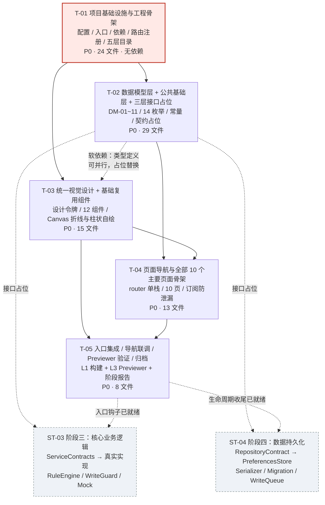

# 智寓——HarmonyOS 智能宿舍管家　第二阶段任务列表（基础工程与 UI 开发）

> **文档性质**：第一阶段架构设计的配套项目计划（Task Breakdown）
> **上游基线**：`docs/软件需求说明书.md` V1.0 + `design/系统架构设计.md` V1.0
> **适用范围**：**ST-02 阶段二「基础工程与 UI 开发」**；同时为 ST-03 核心业务逻辑、ST-04 数据持久化预留接口占位
> **状态说明**：本表为**待执行任务**，不代表任何任务已完成、任何构建已成功、任何 Commit 已存在。所有验收条件均为**未来应达成**的条件。

---

## 文档控制信息

| 项目 | 内容 |
| --- | --- |
| 文档版本 | V1.0（第一阶段计划基线版） |
| 编制日期 | 2026-11-09 |
| 编制人 | 架构师（角色化工作流，非真实人员） |
| 审核人 | 齐活林（主理人）【待评审】 |
| 目标平台 | HarmonyOS SDK 5.0.5 / API 17；DevEco Studio 5.0.13.240；hvigor 5.17.6 |
| 工程根目录 | `D:\SmartDormHarmonyOS` |
| 对应 PRD 阶段 | PRD 第 18 章 **ST-02**：「创建 DevEco 工程、五层目录落地、7 个页面与复用组件、统一设计语言、Ability Kit 入口」 |
| 任务总数 | **5 个任务（T-01 ~ T-05）**，按功能模块 / 层次分组，不按单文件拆分 |
| 硬约束 | ① 任务数不超过 5；② 每任务至少 3 个相关文件；③ 配置类文件全部集中在 T-01；④ 尽量让任务仅依赖 T-01 或彼此并行 |
| 纪律 | 不做任何 git 操作、不伪造 Commit、不虚构构建/运行/测试结论；阶段二只做工程与 UI 骨架，**业务实现留阶段三、持久化实现留阶段四** |

---

## 1 阶段二范围与边界

### 1.1 必须覆盖（PRD ST-02 逐项映射）

| ST-02 交付项 | 本表承载任务 | 说明 |
| --- | --- | --- |
| 创建 HarmonyOS 原生工程（Stage 模型 / API 17） | T-01 | 基于官方模板创建，五层目录落地 |
| 配置依赖（零第三方运行时依赖 + 官方 devDependencies） | T-01 | `oh-package.json5` / `build-profile.json5` / `hvigor/` |
| 页面导航（10 个页面注册 + 单栈路由） | T-01（注册）+ T-04（实现） | `main_pages.json` + `RouteMap` / `RouteParams` |
| 全部主要页面 | T-04 | 10 个 `.ets` 页面骨架（含首页 6 类设备卡片布局） |
| 基础组件 | T-03 | 12 个复用组件（含 Canvas 折线/柱状图自绘组件） |
| 统一视觉设计 | T-03 | `ThemeTokens` + `resources` 颜色/尺寸令牌 + `SectionCard` / `StatusBadge` |
| Ability Kit 入口 | T-01（骨架）+ T-05（集成） | `EntryAbility` 六生命周期钩子 |
| 阶段二报告与证据 | T-05 | `stages/` 阶段报告、`evidence/`、`screenshots/`（Previewer 标注） |

### 1.2 明确不在阶段二范围（避免越界与虚构）

| 项 | 归属 | 阶段二只做 |
| --- | --- | --- |
| 规则引擎真实求值、边沿去重、`WriteGuard` 冲突、错误日志 | ST-03 | `ServiceContracts.ets` 接口占位 + `RuleEngine.ets` 空壳（方法签名齐全、返回安全默认值） |
| 设备/环境/场景/统计服务实现 | ST-03 | 同上，契约占位 |
| `PreferencesStore` 读写、序列化、迁移、串行写队列 | ST-04 | `AppDataRepository.ets` 契约占位（提供内存态 `AppState` 的最小可读实现供页面渲染） |
| Mock 打桩与环境模拟真实逻辑 | ST-03 | `TimerHost.ets` 生命周期骨架 + `EnvironmentSimulator` 契约占位 |
| 10.4 八步持久化验收 / TC-N/TC-B/TC-E 真实执行 / 表 5.1 填写 | ST-05 | **结果列一律留空**，禁止预填 |
| 真机运行、连续录屏、图 6.1 / 图 6.2 | ST-05~ST-07 + L4 真机补测 | 当前 `hdc list targets=[Empty]`、已部署镜像最高 API 12；只做 L1 构建 / L3 Previewer，如实标注局限 |
| Git 仓库初始化、Commit、Push、README 13 项、Word 报告 | ST-06 / ST-07 | 本表第 6 章仅给**建议**，不执行 |

---

## 2 任务总览

| 任务 ID | 任务名称 | 依赖 | 优先级 | 涉及文件数 | 对应 PRD 需求 | 对应评分指标 |
| --- | --- | --- | --- | --- | --- | --- |
| **T-01** | 项目基础设施与工程骨架 | 无 | **P0** | 24 | ENV-01/02/04、DL-06、NFR-06/07、FR-08-03 | SC-04、SC-08、SC-09 |
| **T-02** | 数据模型层 + 公共基础层 + 三层接口占位 | T-01 | **P0** | 29 | DM-01~11、第 9 章、FR-08-03/05、MI-15/18/19 | SC-01、SC-04、SC-06 |
| **T-03** | 统一视觉设计 + 基础复用组件（含 Canvas 图表） | T-01（软依赖 T-02 类型，可并行） | **P0** | 15 | NFR-10、FR-06-02/03、FR-01-03、FR-08-01 | SC-05、SC-08、SC-07 |
| **T-04** | 页面导航与全部 10 个主要页面骨架 | T-01、T-02、T-03 | **P0** | 13 | FR-01~FR-07、FR-01-08、Q-02 | SC-05、SC-08 |
| **T-05** | 入口集成、导航联调、Previewer 验证与阶段二归档 | T-03、T-04 | **P0** | 8 | NFR-04、FR-03-07、DL-06、ST-02 验收条件 | SC-05、SC-08、SC-11 |

> 依赖链说明：T-01 为唯一硬前置；T-02 与 T-03 可在 T-01 后**并行**（T-03 若需 `Device`/`Enums` 类型，可先用 T-02 定义的占位类型或直接引用 T-02 产出，T-02 完成后替换）；T-04 需 T-02（类型）+ T-03（组件）；T-05 做最终集成与验证。**无超过 3 层的长线性依赖链**。
>
> 文件数口径：合计 **89 个文件条目**为「任务涉及文件次数」（24 + 29 + 15 + 13 + 8），含跨任务复用与复核项（`ThemeTokens.ets`、`color.json` / `float.json`、`RouteMap.ets` / `RouteParams.ets`、`main_pages.json`、`EntryAbility.ets` 在不同任务中分别「创建 / 补完 / 复核 / 集成」）；去重后阶段二**新建文件约 70 余个**（含骨架与占位），与 `design/系统架构设计.md` 2.2 节 103 条规划清单一致，其余为阶段三 / 四 / 五产出。

---

## 3 任务详述

### T-01　项目基础设施与工程骨架

| 项 | 内容 |
| --- | --- |
| **目标** | 基于 DevEco Studio 官方 Stage 模板创建可在 **API 17** 编译的工程骨架；一次性落地全部配置文件、入口文件、依赖声明、五层目录与页面路由注册表；`EntryAbility` 六生命周期钩子留可执行骨架。 |
| **依赖** | 无 |
| **优先级** | P0 |
| **对应需求** | ENV-01 / ENV-02 / ENV-04、DL-06、NFR-06（五层分离）、NFR-07（API 17 兼容）、FR-08-03（页面与逻辑分离） |
| **对应评分** | SC-04（整体架构）、SC-08（Ability Kit）、SC-09（工程运行） |

**涉及文件（相对路径 · 24 个）**

| # | 相对路径 | 本任务内的职责 |
| --- | --- | --- |
| 1 | `AppScope/app.json5` | `bundleName` / `vendor` / `versionCode=1000000` / `versionName=1.0.0` / `icon` / `label` |
| 2 | `AppScope/resources/base/element/string.json` | `app_name` 等应用级字符串 |
| 3 | `AppScope/resources/base/media/app_icon.png` | 应用图标 |
| 4 | `AppScope/resources/base/media/layered_image.json` | API 11+ 分层图标配置 |
| 5 | `build-profile.json5` | `targetSdkVersion` / `compatibleSdkVersion` / `runtimeOS: "HarmonyOS"` / `strictMode.caseSensitiveCheck` / `modules[]` 注册 entry |
| 6 | `hvigorfile.ts` | 工程级 `appTasks` |
| 7 | `oh-package.json5` | `modelVersion`；`devDependencies` 仅 `@ohos/hypium` / `@ohos/hamock`；**运行时 dependencies 为空** |
| 8 | `code-linter.json5` | 禁 `any`、命名与复杂度检查规则 |
| 9 | `hvigor/hvigor-config.json5` | hvigor 5.17.6 配置 |
| 10 | `hvigor/hvigor-wrapper.js` | wrapper 启动脚本 |
| 11 | `local.properties` | 本机 SDK 路径（.gitignore 排除） |
| 12 | `.gitignore` | 排除 `build/` / `oh_modules/` / `local.properties` / 密钥 / IDE 配置 |
| 13 | `entry/build-profile.json5` | `apiType: stageMode` + `targets` |
| 14 | `entry/hvigorfile.ts` | 模块级 `hapTasks` |
| 15 | `entry/oh-package.json5` | entry 依赖声明（空运行时依赖） |
| 16 | `entry/src/main/module.json5` | `mainElement=EntryAbility`、`deviceTypes`（tablet/phone/2in1）、`"pages": "$profile:main_pages"`、`abilities[]` |
| 17 | `entry/src/main/resources/base/profile/main_pages.json` | **路由注册表**：`src` 列出 10 个页面，首项 `pages/Index` |
| 18 | `entry/src/main/resources/base/element/string.json` | 页面/按钮/提示文案 |
| 19 | `entry/src/main/resources/base/element/color.json` | 设计令牌颜色 |
| 20 | `entry/src/main/resources/base/element/float.json` | 圆角/间距/字号令牌 |
| 21 | `entry/src/main/ets/entryability/EntryAbility.ets` | `UIAbility` 六钩子骨架（见下方验收） |
| 22 | `entry/src/main/resources/base/media/.gitkeep` | 资源目录占位（**不含任何图表静态图**） |
| 23 | `entry/src/main/resources/rawfile/.gitkeep` | 预留目录占位 |
| 24 | `entry/src/ohosTest/module.json5` | 设备侧测试模块配置（占位，用例留 ST-05） |

**验收条件**

| # | 条件 | 可核查证据 |
| --- | --- | --- |
| A1 | DevEco Studio 能识别为 **Stage 模型 / API 17** 工程，`runtimeOS` 为 HarmonyOS，`targetSdkVersion` / `compatibleSdkVersion` 与 SDK 5.0.5 一致 | 配置文件内容 + IDE 工程识别截图 |
| A2 | 全部配置类文件集中在 `T-01` 一次性落地，无分散到后续任务 | 文件清单核对 |
| A3 | 五层目录 `pages / components / service / model / store / mock / common / entryability` 全部存在 | 目录树截图 |
| A4 | `main_pages.json` 的 `src` 含 10 项且首项为 `pages/Index`，与模块 `pages` 引用一致 | 文件内容 |
| A5 | `EntryAbility.ets` 六钩子齐全：`onCreate` / `onWindowStageCreate`（`loadContent('pages/Index')`）/ `onForeground` / `onBackground` / `onWindowStageDestroy` / `onDestroy`；**此时仅留空实现 + TODO 注释，不写业务逻辑** | 源码走查 |
| A6 | `oh-package.json5` 运行时 `dependencies` 为空；`devDependencies` 仅官方随 SDK 的 hypium / hamock；**无任何需联网下载的第三方包** | 文件内容 |
| A7 | **L1 构建产物验证**：hvigor 构建执行并保存完整编译日志与 HAP 产物；若 `@kit.*` 导入解析异常，按设计文档 R-08 回退 `@ohos.*` 直连并如实记录 | `build/` 产物 + `evidence/构建日志-阶段二.md` |
| A8 | 无虚构：不得出现「已真机运行」「已通过测试」等表述 | 阶段报告措辞走查 |

**注意事项**：本任务**不**创建任何页面组件实现（页面文件在 T-04），**不**实现 `PreferencesStore` / `RuleEngine`（占位在 T-02）。`local.properties` 与 `.gitignore` 必须同步落地，防止密钥/构建产物入库（DL-03）。

---

### T-02　数据模型层 + 公共基础层 + 三层接口占位

| 项 | 内容 |
| --- | --- |
| **目标** | 一次性落地 `model/` 全部 ArkTS 类型（DM-01~11 + 8 类补充类型 + 14 个枚举）、`common/` 全部工具类与设计令牌、`store/` 与 `service/` 的**接口占位**（供页面编译通过，业务实现留 ST-03/04）。 |
| **依赖** | T-01 |
| **优先级** | P0 |
| **对应需求** | 第 9 章 DM-01~11、FR-08-03/05（分层、禁硬编码）、FR-04-10（lastSatisfied）、FR-04-12（WriteGuard 占位）、MI-15/18/19、Q-10/Q-12 |
| **对应评分** | SC-01（ArkTS 建模 5）、SC-04、SC-06（接口约定 10） |

**涉及文件（相对路径 · 25 个）**

| # | 相对路径 | 本任务内的职责 |
| --- | --- | --- |
| 1 | `ets/model/Enums.ets` | 11 个 PRD 枚举 + `ACMode` / `RunMode` / `ParamKey` 共 14 个 string enum |
| 2 | `ets/model/DeviceParams.ets` | `DeviceParams` 判别联合 + 6 个参数接口 + `DeviceParamsFactory` 默认值 |
| 3 | `ets/model/Device.ets` | DM-01 `Device` |
| 4 | `ets/model/EnvironmentData.ets` | DM-02 |
| 5 | `ets/model/AutomationRule.ets` | DM-03（含 `lastSatisfied` / `executionCount`） |
| 6 | `ets/model/AutomationCondition.ets` | DM-04 |
| 7 | `ets/model/AutomationAction.ets` | DM-05 |
| 8 | `ets/model/Scene.ets` | DM-06 + `DeviceStateSnapshot` |
| 9 | `ets/model/Logs.ets` | DM-07~10 + `LogBundle` / `LogRecord` / `ActionExecutionDetail` |
| 10 | `ets/model/AppSettings.ets` | DM-11 |
| 11 | `ets/model/CommandResult.ets` | `CommandResult<T>` + `ResultCode` |
| 12 | `ets/model/Reports.ets` | `RuleEvaluationReport` / `RuleOutcome` / `ActionOutcome` / `SceneApplyReport` / `SceneApplyItem` |
| 13 | `ets/model/AppState.ets` | 单一数据源顶层 `AppState` |
| 14 | `ets/model/ChartModels.ets` | `ChartPoint` / `ChartBar` / `LineChartModel` / `BarChartModel` / `ChartSeries` |
| 15 | `ets/common/Constants.ets` | `SCHEMA_VERSION=1` / `STORE_NAME` / 参数上下界 / 日志上限 / 默认采样间隔 4000 |
| 16 | `ets/common/ParamSchema.ets` | `ParamKey` 合法范围表 + `validateParam()` 纯函数 |
| 17 | `ets/common/ThemeTokens.ets` | 颜色 / 圆角 / 间距 / 字号令牌 |
| 18 | `ets/common/RouteMap.ets` | 10 个页面 url 常量 + `push()` 封装 |
| 19 | `ets/common/RouteParams.ets` | `router.getParams()` 严格解析（`Record<string,string>` + 默认值） |
| 20 | `ets/common/IdGenerator.ets` | `util.generateRandomUUID()` + 前缀 |
| 21 | `ets/common/TimeUtil.ets` | epoch ms ⇄ 本地展示 / ISO 8601 UTC |
| 22 | `ets/common/ResultMessage.ets` | `ResultCode` → 中文提示映射 |
| 23 | `ets/common/AppStorageKeys.ets` | 仅放全局单例引用键 |
| 24 | `ets/common/StateChangeTypes.ets` | `StateChangeHandler` / `ChangeSet` / `LogFilter` |
| 25 | `ets/service/ServiceContracts.ets` + `ets/store/RepositoryContract.ets` + `ets/store/StorageKeys.ets` + `ets/store/PreferencesOptions.ets` + `ets/mock/MockDataFactory.ets`（占位） | **三层接口占位**：Service 契约、`AppDataRepository` 契约、KEY-01~10 常量、`PreferencesOptions` 包装、默认数据工厂（返回静态 `AppState`，供页面渲染，**不写持久化**） |

> 说明：第 25 行为「一组占位文件」合并计数，实际物理文件 5 个；本任务**物理文件总数 = 24 + 5 = 29 个**，满足「每任务 ≥3 文件」。

**验收条件**

| # | 条件 | 可核查证据 |
| --- | --- | --- |
| B1 | DM-01~11 全部齐全，11 个核心对象与 8 类补充类型字段与 `design/系统架构设计.md` 第 3 章逐字段一致 | 源码逐字段核对 + 报告表 3.1 可填写 |
| B2 | **零 `any` / 零 `as any` / 零 `Object` 参数类型**；`DeviceParams` 为判别联合且 `params.kind` 与 `Device.type` 有校验说明 | `code-linter` + `grep -rn ": any\|as any\|: Object" ets/` |
| B3 | 所有枚举为 string enum；`ResultCode.CONFLICT_SKIPPED` 与 `RuleExecStatus.SKIPPED_CONFLICT` 明确分属不同枚举 | 源码走查 |
| B4 | `CommandResult<T>`、`RuleEvaluationReport.newLogs`、`SceneApplyReport`、`AppState` 齐全，可直接支撑 MI-01~19 签名 | 与系统设计 4.1 节逐项比对 |
| B5 | 三层占位：`ServiceContracts.ets` 声明各 Service 方法签名（**返回安全默认值，不产生真实业务结果**）；`RepositoryContract.ets` 声明 `load/flush/reset/subscribe/commitRuleLogs`；`StorageKeys.ets` 含 KEY-01~10；`PreferencesOptions.ets` 包装 `{name, dataGroupId?}` | 源码走查 + TODO 注释 |
| B6 | `MockDataFactory` 产出的 `logs.ruleExecutions` 恒为 `[]`（**禁止预置演示执行日志**） | `grep -rn "ruleExecutions" mock/` |
| B7 | 常量范围与 PRD 4.3 / 4.4 逐项一致（亮度 0–100、空调 16–30、窗帘 0–100、风扇 1–3、功率 0–2500、温度 −10–50、湿度 0–100、光照 0–10000、AQI 0–500） | `Constants.ets` 与 PRD 对照表 |
| B8 | ArkTS 严格类型检查通过（L1 构建） | `evidence/构建日志-阶段二.md` |

---

### T-03　统一视觉设计 + 基础复用组件（含 Canvas 图表自绘）

| 项 | 内容 |
| --- | --- |
| **目标** | 落地统一设计语言（卡片 / 圆角 / 层次 / 留白 / 状态色）与 12 个复用组件；其中 `LineChart` / `BarChart` 用 ArkUI `Canvas` **真实自绘**，只接收数据数组、无静态图片、无联网。 |
| **依赖** | T-01（硬）；**软依赖 T-02**（需 `Device` / `Enums` / `ChartModels` 类型，可先引用 T-02 产出或临时占位类型，因此可与 T-02 并行启动） |
| **优先级** | P0 |
| **对应需求** | NFR-10（现代化智能家居控制中心风格）、FR-01-03（≥6 类设备卡片）、FR-06-02/03（真实图表、禁静态图）、FR-08-01（无装饰性按钮）、Q-03 |
| **对应评分** | SC-05（页面设计与交互 15）、SC-08（ArkUI 组件 15）、SC-07（创新表达 5） |

**涉及文件（相对路径 · 15 个）**

| # | 相对路径 | 本任务内的职责 |
| --- | --- | --- |
| 1 | `ets/common/ThemeTokens.ets` | 与 T-02 协同：颜色/圆角/间距/字号令牌最终值（若 T-02 已建则本任务补齐视觉取值） |
| 2 | `resources/base/element/color.json` | 主色 / 背景 / 状态色（RUNNING/IDLE/FAULT/OFFLINE） |
| 3 | `resources/base/element/float.json` | 圆角、间距、字号尺寸 |
| 4 | `ets/components/common/PageHeader.ets` | 统一页头（标题 / 返回 / 右侧操作槽） |
| 5 | `ets/components/common/SectionCard.ets` | 统一圆角卡片容器 |
| 6 | `ets/components/common/StatusBadge.ets` | 四态状态徽标（明显视觉反馈） |
| 7 | `ets/components/common/EmptyView.ets` | 空数据占位（含真实引导入口，非装饰性） |
| 8 | `ets/components/common/ConfirmDialog.ets` | 二次确认弹窗（`promptAction.showDialog`） |
| 9 | `ets/components/common/ToastHost.ets` | `ResultCode` → 中文 Toast 封装（`promptAction.showToast`） |
| 10 | `ets/components/device/DeviceCard.ets` | 设备卡片：状态、参数摘要、进详情、快速开关 |
| 11 | `ets/components/env/SensorCard.ets` | 传感器卡片：当前值 / 单位 / 合法范围 / 手动调整控件 |
| 12 | `ets/components/rule/RuleCard.ets` | 规则卡片：条件/动作摘要、启停、优先级 |
| 13 | `ets/components/scene/SceneCard.ets` | 场景卡片：类型 / 目标设备数 / 切换按钮 |
| 14 | `ets/components/chart/LineChart.ets` | **Canvas 自绘折线图**：props `LineChartModel`，`onReady` + `@Watch` 重绘 |
| 15 | `ets/components/chart/BarChart.ets` | **Canvas 自绘柱状图**：props `BarChartModel`，`onReady` + `@Watch` 重绘 |

**验收条件**

| # | 条件 | 可核查证据 |
| --- | --- | --- |
| C1 | 12 个组件全部可独立 `@Preview` 渲染；统一设计令牌（颜色/圆角/间距/字号）全局复用，无硬编码散落色值 | Previewer 走查 + `grep` 硬编码色值 |
| C2 | `LineChart` / `BarChart` **只接收** `ChartPoint[]` / `ChartBar[]` 数据数组；组件内**无任何 `Image` / `$r('app.media...')` 图表静态资源、无内嵌预置数据点** | `grep -rn "Image(\|\$r('app.media" components/chart/` 应为空 |
| C3 | Canvas 绘图仅使用已核验 API：`Canvas` / `CanvasRenderingContext2D` / `RenderingContextSettings` / `onReady` / `clearRect` / `beginPath` / `moveTo` / `lineTo` / `stroke` / `fillRect` / `fillText` / `fillStyle` / `strokeStyle` / `lineWidth` / `font` | 源码与 `design/系统架构设计.md` 9.1 第 25/26 项比对 |
| C4 | 组件每个可点击控件都有明确真实回调（`onXxx`），**无装饰性按钮**；空态有真实引导 | 逐控件走查表 |
| C5 | `StatusBadge` 对 FAULT / OFFLINE 有明显视觉区分（支撑 FR-01-06 / TC-E-05） | Previewer 截图（标注为 Previewer） |
| C6 | 组件入参全部为 `model/` 中已定义类型，无 `any` / `Object` | 源码走查 |
| C7 | 平板断点：`GridRow` / `GridCol`（已核验）用于列表列数自适应，横竖屏均不留大片空白 | Previewer 多尺寸走查 |

---

### T-04　页面导航与全部 10 个主要页面骨架

| 项 | 内容 |
| --- | --- |
| **目标** | 实现 `@ohos.router` 单栈导航与 10 个页面骨架；页面只订阅 `AppDataRepository` 契约占位并渲染真实结构，交互事件暂调用契约方法（阶段三替换为真实 Service），**页面内不写业务算法、不直接读写持久化、不写日志**。 |
| **依赖** | T-01、T-02、T-03 |
| **优先级** | P0 |
| **对应需求** | FR-01~FR-07、FR-01-08（六模块入口）、FR-08-03（页面与逻辑分离）、Q-02（路由裁决） |
| **对应评分** | SC-05、SC-08 |

**涉及文件（相对路径 · 13 个）**

| # | 相对路径 | 路由 url / 职责 |
| --- | --- | --- |
| 1 | `ets/common/RouteMap.ets` | 落地 10 个 url 常量与 `push(url, params)` 封装（T-02 已建骨架则本任务补完） |
| 2 | `ets/common/RouteParams.ets` | 落地 `getParams()` 严格解析（T-02 已建骨架则本任务补完） |
| 3 | `ets/pages/Index.ets` | `pages/Index`：4 项环境概览、在线/异常设备数、规则数、当前运行模式、≥6 类设备卡片、六模块入口 |
| 4 | `ets/pages/DeviceList.ets` | `pages/DeviceList`：设备列表、增删入口、状态徽标、跳详情 |
| 5 | `ets/pages/DeviceDetail.ets` | `pages/DeviceDetail`：全参数、开关/参数控件、历史操作记录、**Mock 诊断区（Q-15 置 FAULT/OFFLINE/online）** |
| 6 | `ets/pages/Environment.ets` | `pages/Environment`：5 类传感器、手动调整、模拟开关、环境历史 |
| 7 | `ets/pages/RuleList.ets` | `pages/RuleList`：规则列表、启停、编辑/删除、执行记录入口 |
| 8 | `ets/pages/RuleEdit.ets` | `pages/RuleEdit`：多条件 AND、多动作有序、优先级、目标设备、参数校验 |
| 9 | `ets/pages/SceneList.ets` | `pages/SceneList`：4 预置 + 自定义场景、切换、编辑/删除 |
| 10 | `ets/pages/SceneEdit.ets` | `pages/SceneEdit`：逐设备目标状态编辑 |
| 11 | `ets/pages/Statistics.ets` | `pages/Statistics`：4 类记录与筛选、温度/湿度折线、设备运行柱状、派生指标 |
| 12 | `ets/pages/Settings.ets` | `pages/Settings`：两个总开关、采样间隔、日志上限、数据重置（二次确认）、应用信息、持久化管理入口、导出入口、降级提示 |
| 13 | `resources/base/profile/main_pages.json` | 与 `RouteMap` 逐字核对 10 项注册（T-01 已建则本任务复核） |

**路由栈结构（锁定）**

| 场景 | 调用 | 参数 |
| --- | --- | --- |
| 首页 → 六模块入口 | `router.pushUrl({ url, params })` | 无或 `{}` |
| 列表 → 详情 | `router.pushUrl({ url: 'pages/DeviceDetail', params: { deviceId } })` | `{ deviceId: string }` |
| 列表 → 编辑（新建） | `router.pushUrl({ url: 'pages/RuleEdit', params: { mode: 'create' } })` | `{ mode, ruleId? }` |
| 列表 → 编辑（修改） | `router.pushUrl({ url: 'pages/RuleEdit', params: { mode: 'edit', ruleId } })` | 同上 |
| 保存 / 取消返回 | `router.back()` | — |
| 设置页数据重置后 | `router.clear()` + `router.pushUrl({ url: 'pages/Index' })` | 重建单栈 |
| **禁止** | 用 `replaceUrl` 破坏返回链；在 `build()` 内跳转；传入未解析的 `Object` | — |

**验收条件**

| # | 条件 | 可核查证据 |
| --- | --- | --- |
| D1 | 10 个页面全部存在、`main_pages.json` 注册 10 项、首项 `pages/Index`，`RouteMap` url 与注册表**逐字一致** | 文件与内容比对 |
| D2 | 每个页面 `aboutToAppear()` 订阅并保存 `unsubscribe`，`aboutToDisappear()` 取消订阅；**禁止在 `build()` 内订阅 / 注册定时器 / 写日志** | 源码走查（对应 SK-01~SK-03、AT-09） |
| D3 | 页面不出现任何规则求值算法、不 `import PreferencesStore`、不 `new` 任何日志对象；所有数据来自 `AppDataRepository` 契约占位 | 分层走查（PRD 6.2 / FR-08-03） |
| D4 | 首页展示 ≥6 类设备卡片且各自独立状态；六模块入口全部可跳转，**无装饰性按钮** | Previewer 逐控件走查表 |
| D5 | `DeviceDetail` 有标注「模拟/调试」的 Mock 诊断区（Q-15），控件回调真实存在 | 源码 + 走查 |
| D6 | `Statistics` 页面引用 `LineChart` / `BarChart` 并传入数据模型（阶段二可为契约占位返回的空数组/样例结构，**但不得硬编码演示数据点**） | 源码走查 + 注释 |
| D7 | 平板断点布局在 Previewer 多尺寸下适配（横竖屏） | Previewer 截图（标注为 Previewer） |
| D8 | L1 构建通过（ArkTS 严格类型）；页面间跳转在 Previewer 中不崩溃 | 构建日志 + Previewer 走查 |

---

### T-05　入口集成、导航联调、Previewer 验证与阶段二归档

| 项 | 内容 |
| --- | --- |
| **目标** | 把 `EntryAbility` 生命周期钩子与 `AppDataRepository` 契约占位、`TimerHost` 骨架接通；完成全链路导航联调；执行 **L1 构建产物验证 + L3 Previewer UI 验证**；如实归档阶段二证据与阶段报告。 |
| **依赖** | T-03、T-04 |
| **优先级** | P0 |
| **对应需求** | NFR-04（生命周期）、FR-03-07（定时器无泄漏）、DL-06（按目录归档）、PRD 第 18 章 ST-02 验收条件 |
| **对应评分** | SC-05、SC-08、SC-11（展示，当前仅 Previewer） |

**涉及文件（相对路径 · 8 个）**

| # | 相对路径 | 本任务内的职责 |
| --- | --- | --- |
| 1 | `ets/entryability/EntryAbility.ets` | 接通：`onCreate` → 仓储契约初始化（占位）；`onWindowStageCreate` → `loadContent('pages/Index')`；`onForeground/onBackground` → `TimerHost.resume()/pause()` **骨架调用**；`onWindowStageDestroy/onDestroy` → pause / release + 末次 flush 占位 |
| 2 | `ets/mock/TimerHost.ets` | 生命周期骨架：唯一 `number` 句柄、`register/release/pause/resume` 签名齐全；**本阶段不启动真实采样**，`resume()` 依 `simulationEnabled` 决定是否 `setInterval`（真实 tick 逻辑留 ST-03） |
| 3 | `ets/store/AppDataRepository.ets` | 契约占位最小可读实现（内存 `AppState` + `subscribe/notify/listDevices/getState`），**不接 `PreferencesStore`**（留 ST-04） |
| 4 | `stages/阶段二报告.md` | ST-02 阶段报告：完成项、未完成项、L1/L3 证据、**明确写「未进行真机运行验证」** |
| 5 | `evidence/构建日志-阶段二.md` | hvigor 构建命令、输出、产物路径、ArkTS 类型检查结果（真实记录） |
| 6 | `evidence/Previewer走查-阶段二.md` | 10 页逐页走查、断点适配、无装饰性按钮核对表；截图注明「Previewer 截图，非真机运行」 |
| 7 | `screenshots/` | Previewer 截图（带性质标注），**不得冒充图 6.1 真机运行效果** |
| 8 | `evidence/阶段二接口占位清单.md` | 汇总为 ST-03 / ST-04 预留的接口占位（ServiceContracts / RepositoryContract / StorageKeys / PreferencesOptions / TimerHost / WriteGuard 待实现位） |

**验收条件**

| # | 条件 | 可核查证据 |
| --- | --- | --- |
| E1 | `EntryAbility` 六钩子与 `TimerHost` / 仓储契约调用链完整；`onBackground` 一定调用 `pause()`，`onDestroy` 一定调用 `release()` | 源码走查 |
| E2 | **反复进出环境监测页 10 次不产生多个定时器**（TC-E-08 的骨架级保证）：页面不注册定时器，唯一句柄在 `TimerHost` | 源码走查 + Previewer 观察；真实计时断言留 ST-05 |
| E3 | L1：hvigor 构建产物（HAP）+ 完整编译日志归档 `build/` 与 `evidence/`，如实记录成功或失败 | 产物 + 日志 |
| E4 | L3：10 页 Previewer 逐页截图与走查表齐备，截图明确标注性质 | `screenshots/` + 走查记录 |
| E5 | 阶段二报告逐项对照 PRD ST-02 验收条件；**如实标注未完成项**（业务实现、持久化实现、真机运行、测试结论） | 阶段报告 |
| E6 | 表 5.1 / 第 16 章「实际结果 / 是否通过 / 证据路径」**保持空白**，不预填 | 文档走查 |
| E7 | 全部交付物按 `docs / design / evidence / screenshots / build / stages` 分类归档（DL-06） | 目录核对 |
| E8 | **无虚构**：不出现「真机运行成功 / 测试通过 / 已提交 Commit」等表述；不伪造任何 Git 记录 | 全文措辞走查 |

---

## 4 Mermaid 依赖图与实现顺序说明

**实现顺序说明**

1. **先 T-01**：所有配置文件、入口、依赖声明、路由注册表、五层目录一次性落地，随后立即做一次 L1 构建，确认 Stage/API 17 工程骨架可被工具链识别（同时验证 `@kit.*` 导入解析，异常按 R-08 回退）。
2. **再并行 T-02 与 T-03**：T-02 产出类型与契约占位，T-03 产出设计令牌与组件；两者仅通过「类型引用」软耦合，T-03 可先用临时类型、待 T-02 完成后替换，避免长线性等待。
3. **然后 T-04**：依赖 T-02 的类型与 T-03 的组件，实现 10 个页面与路由单栈；完成后全链路导航联调。
4. **最后 T-05**：入口生命周期接通、L1 构建产物与 L3 Previewer 走查、阶段报告与证据归档。
5. **阶段三 / 四接口占位交接**：T-02 的 `ServiceContracts.ets` / `RepositoryContract.ets` / `StorageKeys.ets` / `PreferencesOptions.ets`、T-02 的 `WriteGuard` 类型位、T-05 的 `TimerHost` 骨架与 `EntryAbility` 钩子，构成 ST-03 / ST-04 的**替换式接入面**：阶段三、四只替换实现，不改页面与组件，满足 NFR-06「页面与逻辑分离」与 NFR-11「Mock 可注入」。

---

## 5 为阶段三 / 阶段四预留的接口占位清单

| 占位文件（T-02 / T-05 产出） | 阶段二状态 | 阶段三替换目标 | 阶段四替换目标 |
| --- | --- | --- | --- |
| `ets/service/ServiceContracts.ets` | 声明 MI-01~14 方法签名，返回安全默认值（不产生真实业务结果） | `DeviceService` / `EnvironmentService` / `RuleService` / `RuleEngine` / `RuleActionExecutor` / `WriteGuard` / `SceneService` / `StatisticsService` / `LogService` / `ExportService` 真实实现 | — |
| `ets/store/RepositoryContract.ets` | `load/flush/reset/subscribe/commitRuleLogs/getState/listDevices` 契约 | — | `AppDataRepository` 完整实现 |
| `ets/store/AppDataRepository.ets` | 最小内存态占位（不接 `PreferencesStore`） | — | 接 `PreferencesStore` + `Serializer` + `SchemaMigration` + `WriteQueue` |
| `ets/store/StorageKeys.ets` | KEY-01~10 常量（已定稿） | — | 直接复用 |
| `ets/store/PreferencesOptions.ets` | `{name, dataGroupId?}` 包装（已定稿） | — | `toSdkOptions()` 补齐 |
| `ets/mock/TimerHost.ets` | 六钩子调用骨架、唯一句柄、不启动真实采样 | 接 `EnvironmentSimulator.tick()` + `setInterval` | — |
| `ets/mock/MockDataFactory.ets` | 返回静态默认 `AppState`（规则执行日志恒为 `[]`） | — | 接首次启动落盘（KEY-01 缺失判定） |
| `ets/model/Reports.ets` 的 `RuleEvaluationReport.newLogs` | 类型已定稿 | `RuleEngine` 唯一写入（护栏 A） | `commitRuleLogs()` 单点提交 |
| `ets/service/WriteGuard`（`RuleActionExecutor` 位） | 类型/映射函数签名占位 | 实现 `claim()` 前置检查（护栏 B） | — |
| `ets/entryability/EntryAbility.ets` | 钩子已接通契约占位 | `onForeground/onBackground` 驱动真实采样 | `onWindowStageDestroy/onDestroy` 末次 flush、`onCreate` 真实 `load()` |
| `ets/components/chart/LineChart / BarChart` | 只接收 `ChartPoint[]` / `ChartBar[]`（阶段二可为空数组） | `StatisticsService` 聚合真实日志后注入 | 重启恢复后图表随日志恢复 |

> **护栏在占位阶段即生效**：`ServiceContracts.ets` 中**不得**声明 `appendRuleExecution`（护栏 A）；`RepositoryContract.ets` 中 `commitRuleLogs` 参数必须是完整 `RuleEvaluationReport`；`WriteGuard` 占位须注明「`RuleActionExecutor` 调用 `DeviceService` 前必须 `claim()`」（护栏 B）。

---

## 6 分阶段真实 Commit 切分建议（仅建议，架构师不执行任何 git 操作）

> 依据 DL-02「分阶段、真实、有意义 Commit，禁止伪造、禁止一次性打包提交」与 SC-10 / SC-12「提交时间分布与阶段产物对应」。以下为**建议的提交边界**，实际提交由阶段六在仓库初始化后按真实产出执行；**本文不创建仓库、不做任何 Commit、不虚构任何提交记录**。

| 建议序号 | 对应任务 | 建议 Commit 主题（语义化） | 应包含的产物 | 前置条件 |
| --- | --- | --- | --- | --- |
| C-01 | T-01 | `chore: init HarmonyOS API17 stage project skeleton` | 配置文件、入口骨架、`main_pages.json`、`.gitignore`、`hvigor/` | 工程可被 DevEco 识别 + L1 构建日志 |
| C-02 | T-02 | `feat(model): add ArkTS domain models, enums and service contracts` | `model/`（DM-01~11 + 补充类型）、`common/`、三层契约占位 | 零 `any` 检查通过 |
| C-03 | T-03 | `feat(ui): add design tokens and reusable canvas chart components` | 设计令牌、12 个组件、`LineChart` / `BarChart` | Canvas 组件无静态图、可 `@Preview` |
| C-04 | T-04 | `feat(pages): add 10 router pages with single-stack navigation` | 10 个页面、`RouteMap` / `RouteParams`、路由注册复核 | 页面订阅/取消订阅规范、无装饰性按钮 |
| C-05 | T-05 | `chore(stage2): integrate ability lifecycle and archive previewer evidence` | `EntryAbility` / `TimerHost` 骨架接通、阶段二报告、构建日志、Previewer 走查与截图 | L1 + L3 证据齐备、如实标注未真机验证 |

**跨阶段提交切分建议（供阶段六编排参考，非本表任务）**

| 阶段 | 建议 Commit 主题 | 说明 |
| --- | --- | --- |
| ST-01（阶段一，已产出文档） | `docs: add SRS, system design and stage-2 task breakdown` | PRD、本设计文档、任务列表、API 核验归档 |
| ST-03 | `feat(core): implement device, environment, rule engine and scene services` | 建议按「模型 → 设备/环境服务 → 规则引擎（含 WriteGuard）→ 场景/统计/日志」拆 2~3 次真实提交，体现独立开发过程 |
| ST-04 | `feat(store): implement preferences persistence and serial write queue` | 持久化封装 → 序列化/迁移 → 串行队列与生命周期收尾 |
| ST-05 | `test: execute TC-N/TC-B/TC-E and record real results` | 测试结果**真实执行后**填写，禁止预填；失败项另起 `fix:` 提交 |
| ST-06 | `docs: add README 13 sections, report and runtime evidence` | README、Word 报告、录屏（L4 具备后）；**不含任何凭据** |
| ST-07 | `chore: final delivery checklist (P0-00 verified)` | 一票否决项核对留痕 |

**Commit 纪律**

1. 每次提交必须对应**真实且可核查**的阶段产物，提交时间分布与产物对应（SC-10 / SC-12 核验依据）。
2. **禁止**把 Token / 密码 / `local.properties` / 构建产物 / 密钥写入源码、配置、日志或提交记录（DL-03）。
3. **禁止**伪造提交、伪造时间、一次性打包提交、回改历史。
4. 当前阶段一实测：工程 Git 仓库**尚未初始化**（ENV-12），GitHub CLI 未安装、shell 直连 github.com 不通（Q-04 / Q-09）；推送方案留阶段六实施前再次核验。

---

## 7 验收条件汇总（任务 → PRD 需求编号 → 评分指标）

| 任务 | 验收条件编号 | 对应 PRD 需求编号 | 评分指标 |
| --- | --- | --- | --- |
| T-01 | A1~A8 | ENV-01/02/04、DL-03、DL-06、NFR-06/07、FR-08-03 | SC-04、SC-08、SC-09 |
| T-02 | B1~B8 | 第 9 章 DM-01~11、9.9 枚举、FR-08-03/05、FR-04-10/12、MI-15/18/19、Q-10/Q-12 | SC-01、SC-04、SC-06 |
| T-03 | C1~C7 | NFR-10、FR-01-03、FR-06-02/03、FR-08-01、FR-02-06、Q-03/Q-15 | SC-05、SC-08、SC-07 |
| T-04 | D1~D8 | FR-01~FR-07、FR-01-08、FR-08-03、Q-02、NFR-07 | SC-05、SC-08 |
| T-05 | E1~E8 | NFR-04、FR-03-07、DL-06、DL-07、第 18 章 ST-02 验收条件 | SC-05、SC-08、SC-11 |

> **阶段二总门禁**（PRD ST-02）：页面可在 API 17 编译、卡片布局与状态反馈到位、**无装饰性按钮**、页面与逻辑已分离。未达成前不得宣称阶段二完成；**ST-03 未完成前不得宣称「规则引擎可用」，ST-04 未完成前不得宣称「持久化通过」，ST-05 结果必须真实执行后填写**。

---

## 8 纪律与禁止事项

| # | 禁止 / 必须 |
| --- | --- |
| 1 | 禁止虚构构建成功、真机运行、测试通过、运行截图、录屏或任何 Commit 记录；`hdc list targets=[Empty]`、已部署镜像最高 API 12 的限制必须如实写入阶段报告 |
| 2 | 禁止把 Previewer 截图冒充真机运行截图，禁止用静态图片代替图表，禁止预置演示数据 / 伪造执行日志 |
| 3 | 禁止在阶段二实现阶段三 / 四业务逻辑；占位方法必须返回安全默认值并带 `TODO(ST-03/ST-04)` 注释，不得产生「看起来像真执行」的效果 |
| 4 | 禁止把任何未核验的 HarmonyOS 系统 API 名称写入源码 / 报告 / README；所有 API 以 `design/系统架构设计.md` 第 9 章核验清单为准 |
| 5 | 禁止使用 Android API / 浏览器 API / 旧版废弃接口；禁止引入需联网下载的运行时第三方依赖 |
| 6 | 禁止预填 PRD 第 16 章「实际结果 / 是否通过 / 证据路径」；禁止在表 4.1 伪造 Git 提交记录 |
| 7 | 必须保持 `★ 本人负责部分 · 个人独立完成 · 全部模块 100%` 标注在报告图 2.1 中原样保留 |
| 8 | 必须保持封面学生姓名 / 学号 / 班级【待填写】标记，禁止编造 |
| 9 | 必须按 `docs / design / evidence / screenshots / videos / build / stages / deliverables` 分类归档（DL-06） |
| 10 | 架构师本阶段**不执行任何 git / GitHub 操作、不创建 HarmonyOS 工程、不写实现代码、不修改 PRD 原文**；PRD 修订由产品经理执行（见设计文档第 12 章建议清单） |

---

> **文档结束**。本表为待执行计划，不代表任何任务已完成。所有实现、构建、测试、截图、录屏与 Git 记录以各阶段真实产出为准。
