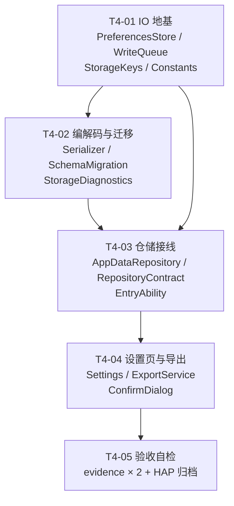

# 智寓 · 阶段四（ST-04 数据持久化）任务分解

> **文档性质**：阶段四的**设计裁决 + 任务分解**，供工程师独立派单、独立提交。本文不代表任何代码已实现、任何验收已通过。
>
> | 项 | 内容 |
> | --- | --- |
> | 版本 | V1.0 |
> | 日期 | 2026-11-09 |
> | 作者 | 架构师（角色化工作流） |
> | 上游基线 | `docs/软件需求说明书.md`（PRD v1.1，**只读**）第 10 章、10.4 八步验收、FR-07-03/06/08、FR-08-06、TC-B-05/TC-E-07；`design/系统架构设计.md`（V1.0.3）§2.2 第 75~78 项、§8.6、MI-15~19、FLOW-03 |
> | 代码基线 | `main` @ `f97e5b1`（阶段三 T3-01~T3-04 已落地：`649f200`、`6e4e5b4`、`6fee3e3`、`1988661`、`bc37d8f`；T3-05 / T3-06 未做） |
> | 本轮范围 | **只做持久化**：把 `AppDataRepository` 从「内存态 + `flush()` 返回 `NO_CHANGE` 占位」改成真实落盘。不改阶段三任何业务语义 |
> | 纪律 | 不写「已实现 / 已验证」；不预置演示数据；不新增 service 层写入口；不碰 `docs/软件需求说明书.md`、阶段三任务列表、两张 `.mermaid` |

---

## 0 一句话目标与现状差距

**目标**：让这条链路真实可跑——`启动 → 改设备状态 → 建规则 → 保存 → 退出 → 重启 → 设备/规则/场景/设置/日志全部恢复，且日志连续`。

| 现状（`f97e5b1`） | 阶段四要变成 |
| --- | --- |
| `AppDataRepository.flush()` 返回 `NO_CHANGE`，只写一句「阶段四接入串行写队列后真实落盘」 | 真实 `put` + `flush`，返回 `OK` 或 `STORAGE_ERROR` |
| `load()` 直接 `return this.state`（构造时即默认态） | 首次启动生成默认并落盘；非首次按分区读回 + 迁移 + 降级 |
| `reset()` 只**返回**一个默认态对象，不动内存态也不动存储 | 内存态 + 存储 + 默认态三者都真实重置 |
| `markDirty()` 只把分区塞进 `Set`，没人消费 | `WriteQueue` 消费：合并 → 串行 → 单批落盘 |
| `PreferencesStore` / `Serializer` / `SchemaMigration` / `WriteQueue` 四个类**均不存在**（§2.2 第 75~78 项标「四」） | 四个类落地，签名见第 4 章 |

> ⚠️ **一条必须先说清的硬约束**（下节 Q1 详述）：`preferences` 的**单值上限是 8192 字符**。本工程日志满载时 JSON 约 **1.30 MB**。所以「一个分区一个键」这个最自然的写法**在日志累积到约 55 条时就开始抛 401**，而且是在后台 flush 里抛——**静默、滞后、难复现**。阶段四的分块设计不是优化，是**可行性前提**。

---

## 1 七个必答裁决

### 1.1 Q1 写入粒度：**按分区 + 分块（chunk）**，否决整体 blob 与「一分区一键」

**实测依据（本轮亲自打开声明文件核验，非转述）**

| 事实 | 声明文件位置 | 实测值 |
| --- | --- | --- |
| 单值上限 | `api/@ohos.data.preferences.d.ts` **第 145 行** `const MAX_VALUE_LENGTH: number;`（注释第 114/121/129 行） | **8192 字符**（string） |
| 键名上限 | 同文件 **第 112 行** `const MAX_KEY_LENGTH: number;` | **80 字符** |
| `put` 超限后果 | 同文件 **第 1371 行** `put(key: string, value: ValueType): Promise<void>;`，`@throws 401 Parameter verification failed` | 抛 `BusinessError 401` |

**体积测算**（按真实字段用 `JSON.stringify` 逐条量得，非拍脑袋）

| 分区 | 单条字符 | 上限条数（Q-12） | 满载字符 | 7000/块 → 块数 |
| --- | --- | --- | --- | --- |
| `ENVIRONMENT_LOGS` | 148 | 2000 | 296,000 | **43** |
| `OPERATION_LOGS` | 292 | 1000 | 292,000 | **42** |
| `RULE_EXEC_LOGS` | 658 | 1000 | 658,000 | **94** |
| `SCENES`（含 500 条 `SceneSwitchLog`，同区序列化，见设计 §8.6.1） | 场景 ~500 / 切换日志 115 | 4 预置 + 自定义 / 500 | ≈ 60,000 | **9** |
| 其余（`DEVICES` / `RULES` / `SETTINGS` / `ENVIRONMENT` / `RETURN_SNAPSHOT`） | — | — | ≈ 20,000 | 各 1~2 |
| **合计** | — | — | **≈ 1,303,500** | **≈ 188 块** |

**裁决**

1. **按分区序列化**（不整体 blob）：单分区损坏时只丢该分区（Q4），整体 blob 一处坏则全丢；且高频分区（环境日志）不该牵动规则/设备一起重写。
2. **每个分区再按块落盘**：块大小 `CHUNK_MAX_CHARS = 7000`（对 8192 留 14.6% 余量，容纳不同 JSON 转义/中文），**按条目边界装块**——块内永远是完整的条目，绝不切断一条日志。
3. **块 + 块头（两把键，不是一个自描述块）**：每个分区写 1 个**块头键** `<base>.hdr` = `{"p":"<partition>","n":<块数>,"t":<savedAt>,"v":1}`，再写 `n` 个**块键** `<base>.c0000` … `<base>.c(n-1)` = `{"p":"<partition>","i":<块序>,"t":<savedAt>,"d":[<条目>...]}`。块头是**提交点**（commit marker），块内不再重复 `n`（省体积、职责单一）。
4. **单条守卫**：单条目序列化后 > `ENTRY_GUARD_CHARS = 6500` → **该条不落盘**（内存态保留）+ 记诊断。理由：宁可丢 1 条超长日志，也不能让 `put` 抛 401 把**整个分区**写失败。
5. **否决方案**：
   - **整体 blob**（`AppState` 一个 JSON 一个键）：1.30 MB ≫ 8192，**直接不可行**；
   - **一分区一键**：日志累积到 ~55 条即超限，且要等用户跑到那个量才暴露；
   - **按条一条一键**（`log.<id>`）：2000+ 键 × 每次 `flush` 全文重写，键名 40+ 字符接近 80 上限，且无顺序保证——否决。

#### 1.1.1 写入顺序：数据 → 提交点 → 回收（先写块，再写块头，最后删旧块）

单个分区的一次写入固定四步，**顺序不可调换**：

| 步 | 动作 | 被杀在此步的后果 |
| --- | --- | --- |
| 1 | `put(<base>.c0000 .. c(M-1))` 写新块 | 块头仍是旧 `n_old`，加载时读旧块 → **旧数据完好**，新块成为孤儿，下次写入清理 |
| 2 | `put(<base>.hdr, {"n":M,...})` ← **提交点** | 块头已指向 M 块且 M 块已齐 → **新数据生效**，孤儿块残留待清理 |
| 3 | `delete(<base>.cM .. cMax)` 删孤儿块 | 同上，数据正确，仅多几个死键，下次写入继续清 |
| 4 | 本批次所有分区完成 1~3 后，**只调用一次 `preferences.flush()`** | 整批回滚到上一份落盘状态（`dirty` 保持，见 1.2.1） |

`cMax` = `max(旧 n, 加载期观测到的最大多余块序号)`。**为什么删除必须放在块头之后**：先删后写若被杀，索引必然缺失 → 分区判损坏 → 真丢数据；而先写后删最坏只留死键。这是典型的 shadow-paging / commit-marker 语义。

#### 1.1.2 孤儿块清理（缺口 1 裁决：**选「删旧块」，不选代际前缀**）

**裁决：方案 A —— 块头 `n` 驱动 + 写后删 `[n_new, cMax)` 区间，不引入代际前缀。**

| 对比项 | 方案 A：删旧块（**选它**） | 方案 B：代际前缀 `g3.c0001`（否） |
| --- | --- | --- |
| 需要的状态 | 只要块头的 `n` | 额外一个「当前代」指针键 + 扫描未知代 |
| 回收是否幂等 | **是**：任何一次成功写入都清 `[n_new, cMax)`，加载期发现的多余块下次写入顺带清 | 否：回收本身可被中断，中断即留下整代孤儿 |
| 问题是否被消除 | 是（多余块由加载期兜住，不判损坏） | 否：**只是把同一个问题搬到另一层**，还多一个键、多一次全表扫描 |
| 键长 | 最长 37 字符 | 加 `g3.` 后 40+，且需要再定代际编号规则 |

**验收（可 grep）**：连续两次写入（第二次条目更少）后，`preferences` 中该分区的键数 **= 块头 `n` + 1**，不多不少；`list()` 出的键名集合里不存在索引 ≥ `n` 的 `cNNNN`。

#### 1.1.3 加载期三级一致性校验（缺口 2）

| # | 现象 | 判定 | 处理 |
| --- | --- | --- | --- |
| ① | 有块键但**块头缺失** | **损坏** | 只丢该分区（Q4 降级）+ `WARN` 诊断 |
| ② | 块头 `n` **> 实际存在的块数**（索引 < `n` 有缺失） | **损坏** | 只丢该分区 + `ERROR` 诊断（记缺失的索引列表） |
| ③ | 块头 `n` **< 实际存在的块数**（索引 ≥ `n` 的多余块） | **不算损坏** | 按 `n` 截断加载 + `INFO` 诊断 + 下次写入清理（1.1.1 步 3） |
| ④ | 块齐全，但拼接后 JSON 解析失败 / 字段类型不符 | **损坏** | 只丢该分区 + `ERROR` 诊断 |
| ⑤ | 单条因 `ENTRY_GUARD_CHARS` 被丢 | **不算损坏** | 正常加载 + `INFO` 诊断 `skipped=<n>` + `EncodeResult.droppedEntries` 计数 |

> **对主理人原口径的一处收窄，必须说明理由**：你写的是「块头 `n` 与实际块数不等 → 判该分区损坏」。我把它拆成 ② 与 ③ 两种：**缺少**块（②）数据确实残缺，判损坏；**多余**块（③）恰恰是 1.1.1 步 1~3 之间被杀留下的**孤儿**，数据本身完整——若也判损坏，一次进程被杀就会丢掉整个分区日志，比不判更糟。这条收窄让「先写块后删块」这套顺序安全，否则缺口 1 的方案 A 根本不敢用。
>
> 第 ⑤ 条是新加的一条**独立通道**：`ENTRY_GUARD_CHARS` 丢弃是**设计内行为**，但如果不计数，「少了几条日志」永远查不出来——所以诊断里必须有 `skipped` 计数，且设置页可见（T4-04）。

### 1.2 Q2 flush 的触发与合并：**两车道 debounce + 单链串行 + 执行期取快照**（本项目最容易做错的一处）

**A. 触发分两车道**

| 车道 | 分区 | 合并窗口 | 理由 |
| --- | --- | --- | --- |
| **用户车道** | `DEVICES` / `RULES` / `SCENES` / `SETTINGS` / `RETURN_SNAPSHOT` / `META` | `FLUSH_DEBOUNCE_USER_MS = 200` | 用户点一下按钮就期待落盘（FR-07-07、10.4 步骤 5）；200 ms 足以合并同一次交互里的多分区写 |
| **日志车道** | `OPERATION_LOGS` / `RULE_EXEC_LOGS` / `ENVIRONMENT_LOGS` | `FLUSH_DEBOUNCE_LOG_MS = 30000` 或累计 `FLUSH_MAX_PENDING_LOG_WRITES = 20` 次写（先到者） | 采样每 4 s 就 append 一条环境日志；若每次落盘都要重写 ~43 块 ≈ 296 KB，会把 UI 拖死 |

强制 flush（不受 debounce 约束）：`onBackground`、`onWindowStageDestroy`、`onDestroy`、`reset()` 完成后、迁移完成后、手动「手动触发保存」。

**B. `WriteQueue` 语义（写死，不留解释空间）**

| 维度 | 规定 |
| --- | --- |
| 并发 | **单链串行**：内部维护一条 `Promise` 尾指针，任何时刻只有 1 个写任务在执行 |
| 合并 | **按分区合并**：待执行集合是 `Set<StoragePartition>`；同分区重复 dirty 只保留一次（天然「最后一次胜出」，因为取的是执行期的状态） |
| 快照时点 | **执行期取**：任务内部才调用 `stateProvider()` 拿 `AppState` 并序列化，**入队时不取** |
| 批次 | **一个 flush 周期 = 先把所有 dirty 分区的 `put` 全部完成，最后只调用一次 `preferences.flush()`** |
| 重入 | `inFlight` 去重：同一时刻的第二次 `flush()` 返回**同一个** `Promise`，不排队重复写 |
| 失败 | 该分区**保持 dirty**（下次重试），返回 `STORAGE_ERROR`，写 1 条诊断；**不阻断其他分区** |

**C. 为什么「批次」这条是硬性的**

`RuleEngine.evaluate()` 的顺序是 `commitRules(nextRules)` → `await commitRuleLogs(report)`（`service/RuleEngine.ets` 第 186/188 行）。若两个分区各自独立 `flush()`，中间崩溃就会留下「执行日志有、`lastSatisfied` 没有」或反之 —— 重启后表现为**规则重复执行**（阶段五方案 §3.4 风险①）。`preferences.flush()` 是把整份文件一次落盘，**只要两次 `put` 都在同一次 `flush()` 之前完成，跨分区就落在同一次文件写里**。这条把风险①在机制层消掉，不依赖代码走查。

**D. 被否方案**：**「入队时序列化快照 + 允许多个 flush 并发」**。看似省事，实则经典数据损坏：任务 A 捕获旧快照 → 任务 B 捕获新快照 → B 先写完 → A 后完成，用**旧数据覆盖新数据**，且日志上看不出任何异常。这一条必须写进 code review 检查点。

#### 1.2.1 `flush()` 失败路径（缺口 3）：内存不动、dirty 不清、错误必须上抛

`preferences.flush()` 会因磁盘满、权限、底层 IO 失败抛 `BusinessError`。失败时**必须**同时满足五条：

| # | 规定 | 为什么 |
| --- | --- | --- |
| 1 | **本批次所有分区保持 dirty**（`dirty` 集合一个都不删，删只在 `flush()` resolve 之后做） | 否则会出现「flush 失败但 dirty 已清 → 数据永远不落盘」的静默丢数据 |
| 2 | 内存态**不做任何回滚**（本来就没动 `this.state`） | 内存是权威，存储是副本；回滚内存等于丢用户操作 |
| 3 | 返回 `CommandResult` 的 `STORAGE_ERROR`（**不抛异常穿透到页面**） | 与全项目「异常包成 ResultCode」一致（设计 8.4） |
| 4 | `stats().failures += 1`、`stats().lastError = String(err.code)`，`StorageDiagnostics.record(ERROR, 'FLUSH_FAILED', ...)` | 让设置页与证据文件都能查到失败次数与错误码 |
| 5 | 连续失败 ≥ `FLUSH_FAIL_WARN_STREAK = 3` → 设置页常驻警告条（用**现有** `messageOf(STORAGE_ERROR)` 文案，不新造） | 偶发失败静默重试即可；连续失败必须让用户看见 |

**重试语义**：失败后无需专门的重试定时器——下一次 `mark()`（用户操作或日志车道窗口到）会自然重触发；若距上次失败已超过 debounce 窗口，`mark()` 立即写。**禁止**在 `catch` 里做 `dirty.clear()`、**禁止**把失败吞成 `OK`、**禁止**在 `flushNow()` 内部 `while(true)` 重试（会把单链卡死）。

### 1.3 Q3 序列化格式与版本

| 项 | 裁决 |
| --- | --- |
| 块格式 | 见 1.1 第 3 条：块头 `{p,n,t,v}` + 块 `{p,i,t,d}`，字段名全短以减少体积 |
| 块格式版本 | 块头带 `v`（当前 `1`）。`v > 1` → 按 1.1.3 ④ 判损坏（不猜格式）；`v === 1` 或缺失（视为 1）→ 正常解析。**升级块格式必须同时升 `SCHEMA_VERSION`**，不允许「`SCHEMA_VERSION` 不变而块格式变」 |
| `schemaVersion` 存哪 | **`KEY-01 = String(SCHEMA_VERSION)`，标量字符串，不是 JSON**。理由：迁移第一步必须能用一次 `getSync` 判版本，若版本号埋在 JSON 里，解析失败时连「数据是哪个版本」都不知道 |
| 运行时元信息存哪 | **新增 `KEY-11 smartdorm.meta.runtime`**，JSON：`{v:1, currentSceneId, currentMode, firstLaunchAt, lastLaunchAt, bootCount}`（`v` 为元信息结构版本，缺失视为 1，用于将来加字段时判断）。理由见 §2.3 偏差 ② |
| 迁移时点 | `load()` 内，**全部 decode 完成之后、装入内存态之前**；不在 `init`、不在页面 |
| 迁移方式 | `fromVersion < SCHEMA_VERSION` → `migrate_vN_to_vN+1` **逐级链式**；每级只做字段增删改与默认值补齐 |
| 迁移失败 | **保留原数据**（不写回 `KEY-01`，避免把旧数据标成新版本）+ 记诊断 + 以 decode 出的原态继续运行（不崩溃、不重置） |
| 版本倒退（`fromVersion > SCHEMA_VERSION`） | 保留原数据 + 记诊断 + 不强行降级（设计 8.6 步骤 5），不崩溃 |
| 迁移后 | `put(KEY-01, String(SCHEMA_VERSION))` 进同一批次 flush |

### 1.4 Q4 损坏降级：**只丢该分区，保留其余**

| 项 | 裁决 |
| --- | --- |
| 范围 | 逐分区 `try/catch`；某分区任一块 JSON 解析失败 / 字段类型不符 / 块数 ≠ `n` → **该分区**回退默认值（日志型分区回退空数组） |
| 其余分区 | **照常载入**，不牵连 |
| 理由 | 单分区损坏的典型成因是「写到一半被杀进程」或「单块超限」，属**局部**故障。整体重置会让一个块的坏字节毁掉用户的全部规则与设备配置——收益为负 |
| 用户可见反馈 | `ResultCode.STORAGE_ERROR` + `messageOf(ResultCode.STORAGE_ERROR)`（现文案「数据保存失败，已降级处理」，`common/ResultMessage.ets` 第 18 行）+ 设置页诊断区（FR-07-08）。**不得新造文案**，不得引入新的 `ResultCode` |
| 系统日志 | 写 `StorageDiagnostics`（内存环形 50 条，**不落盘**）——见 Q5 与 §1.5 说明 |

> **为什么不把降级日志也落盘**：持久化失败还要再写持久化，会形成自噬循环（写失败 → 记日志 → 写失败）。诊断只存内存，进程存活期间设置页可见，符合 FR-07-08「展示降级提示」的最小语义。

### 1.5 Q5 派生数据禁令：**统计 / 图表 / 视图模型一律不落盘**（可 grep 检查）

| # | 禁令 | grep 检查命令（结果必须为空） |
| --- | --- | --- |
| 1 | `store/` 下不得出现图表/统计/视图模型类型 | `grep -rn "ChartModels\|LineChartModel\|BarChartModel\|ChartPoint\|ChartBar" entry/src/main/ets/store/` |
| 2 | `store/` 下不得 import 统计服务 | `grep -rn "StatisticsService" entry/src/main/ets/store/` |
| 3 | `store/` 下不得出现 `DeviceStatusView`（展示元数据） | `grep -rn "DeviceStatusView" entry/src/main/ets/store/` |
| 4 | `Serializer` 的入参只能是 `AppState`，出参只能是 `string[]` / `DecodeResult` | 源码走查 + 类型签名 |
| 5 | 诊断（`DiagnosticEntry`）与运行时元信息**不得**混入 8 个业务分区 | `grep -rn "diagnostics" entry/src/main/ets/store/Serializer.ets` 只允许出现在注释 |

> 理由：派生数据落盘即「双数据源」，重启后统计与原始日志一旦不一致就无法判定谁对（FR-06-03「图表数据须可与日志逐条对应」会被破坏）。统计与图表在页面侧由 `StatisticsService` 现算，这是阶段三已定的架构。

### 1.6 Q6 `load()` 的时机与幂等

| 项 | 裁决 |
| --- | --- |
| 时机 | `EntryAbility.onCreate`，**同步**调用，顺序：`PreferencesStore.init(this.context)` → `AppDataRepository.load()` → `ExportService.init(this.context)` → 按 `settings` 配置 `TimerHost`（沿用现有 onCreate 尾部逻辑） |
| 前置未就绪 | `PreferencesStore` 未 `init`（`isReady() === false`）→ `load()` 返回 `MockDataFactory.createDefaultAppState()` + 记诊断 + **不抛异常** |
| 幂等 | 内部 `private loaded: boolean`；第二次及以后调用**直接返回 `this.state`**，不重新读盘、不重新生成默认态、不重复 `put`。理由：重复调用若重新生成默认态，会换掉全部 `devices[].id`，使「重启恢复」与「重新初始化」无法区分（直接毁掉 TC-N-07 的判据） |
| 首次启动判据 | `PreferencesStore.has(KEY_01) === false` → 默认态 + **立即落盘全部标量键与各分区首块** + `firstLaunchAt = now`、`bootCount = 1` |
| 非首次 | `bootCount += 1`、`lastLaunchAt = now`，与载入同批 flush |
| 默认态生产次数 | 全生命周期内**只调用一次** `createDefaultAppState()`（首次启动或存储全损时），不得多次 |

### 1.7 Q7 `reset()` 的真实语义

**顺序（不可调换）**

| 步 | 动作 | 说明 |
| --- | --- | --- |
| 1 | 计算目标态 | `ALL` → `MockDataFactory.createDefaultAppState()`；`LOGS_ONLY` → **保留** devices / rules / scenes / settings / environment / returnSnapshot / runtime，仅把四类日志清空 |
| 2 | 替换内存态 | `this.state = next`（`LOGS_ONLY` 时只换 `state.logs`） |
| 3 | 标 dirty | `ALL` → 全部 10 个分区（`META` 一个分区同批写 `KEY-01` 与 `KEY-11` 两个标量键，**不新增分区枚举**）；`LOGS_ONLY` → `OPERATION_LOGS` / `RULE_EXEC_LOGS` / `ENVIRONMENT_LOGS` / `SCENES`（`SceneSwitchLog` 随 `SCENES`） |
| 4 | 逐键覆写 | 对每个分区 `put` 新块；`KEY-01` **保持写入当前 `SCHEMA_VERSION`**（不清空、不 `deletePreferences`） |
| 5 | **批量收缩** | 目标块数 < 旧块数时，`delete` 掉尾部多余块（见 1.1 第 3 条） |
| 6 | 一次 flush | 与第 4/5 步同批；`flush()` 失败 → 返回 `STORAGE_ERROR` |
| 7 | 广播 | `notify('reset', partitions)` |

**失败处理**：内存态**不回滚**（已重置就不假装没重置，避免「界面显示重置、实际没重置」的双态）；分区保持 dirty，下次 flush 自动重试；返回 `STORAGE_ERROR` + 诊断。

**明确不做（写进代码注释，防越界）**：`reset()` 内**不**调用 `TimerHost.pause()`、**不**清 `WriteGuard`、**不**遍历规则把 `lastSatisfied` 置 false。理由：① `WriteGuard` 由 `RuleEngine.evaluate()` **每轮新建**（`service/RuleEngine.ets` 第 66~68 行），本就跨轮不保留；② `lastSatisfied` 随规则数组重建天然归零（`ALL` 时 `rules: []`）；③ `store/` 若 import `mock/TimerHost` 会造成反向依赖，破坏五层结构。`TimerHost` 的暂停/恢复由**调用方**（设置页在 `reset()` 前后自行 `pause`/`resume`）负责，本文 §5 的 T4-04 里写明该衔接点。

### 1.8 七条裁决一览

| # | 问题 | 裁决一句话 | 关键代价 |
| --- | --- | --- | --- |
| Q1 | 写入粒度 | 按分区 + 按条目边界分块（7000 字符/块）；块头 `<base>.hdr` 作提交点 + `cNNNN` 数据块；写入顺序「块 → 块头 → 删旧块」 | 最坏 ~188 块 + 9 个块头 |
| Q2 | flush 触发与合并 | 两车道 debounce（用户 200 ms / 日志 30 s 或 20 次）+ 单链串行 + 按分区合并 + 执行期取快照 + **一批只 flush 一次**；失败时 dirty 不清、内存不回滚 | 强杀可能丢 ≤30 s 日志 |
| Q3 | 格式与版本 | 块 JSON；`KEY-01` 存标量版本号；新增 `KEY-11` 存运行时元信息；迁移在 `load()` 内、失败不写回版本 | 多一把键 |
| Q4 | 损坏降级 | 只丢该分区；`STORAGE_ERROR` + 现有文案 + 内存诊断 | 诊断不持久化 |
| Q5 | 派生数据禁令 | 统计/图表/视图模型一律不落盘，5 条 grep 检查 | — |
| Q6 | `load()` | `onCreate` 同步、带 `loaded` 幂等、未就绪返回默认态不抛 | — |
| Q7 | `reset()` | 内存→存储→默认态 7 步；失败不回滚；副作用交给调用方 | — |

---

## 2 键、常量与三处需要回报的偏差

### 2.1 键（`store/StorageKeys.ets`）

| 键 | 用途 | 形态 |
| --- | --- | --- |
| `KEY-01` `smartdorm.meta.schemaVersion` | 版本号 | **标量字符串** `"1"`，不分块、无块头 |
| `KEY-11` `smartdorm.meta.runtime` | `{v, currentSceneId, currentMode, firstLaunchAt, lastLaunchAt, bootCount}` | JSON 单键，不分块（< 200 字符） |
| `KEY-02` `smartdorm.devices` | 设备 | 基键 + 块头 + 块 |
| `KEY-03` `smartdorm.rules` | 规则（含 `lastSatisfied`，FR-04-10 跨重启） | 基键 + 块头 + 块 |
| `KEY-04` `smartdorm.scenes` | 场景 + `SceneSwitchLog` | 基键 + 块头 + 块 |
| `KEY-05` `smartdorm.settings` | 设置 | 基键 + 块头 + 块 |
| `KEY-06` `smartdorm.environment` | 环境快照 | 基键 + 块头 + 块 |
| `KEY-07` `smartdorm.logs.operation` | 操作日志 | 基键 + 块头 + 块 |
| `KEY-08` `smartdorm.logs.ruleExec` | 规则执行日志 | 基键 + 块头 + 块 |
| `KEY-09` `smartdorm.logs.environment` | 环境日志 | 基键 + 块头 + 块 |
| `KEY-10` `smartdorm.state.returnSnapshot` | 离寝前快照 | 基键 + 块头 + 块 |

> **「基键」不落任何值**。`KEY-02`~`KEY-10` 只作为**命名基**；实际写入的是 `<base>.hdr` 与 `<base>.cNNNN` 两类派生键。`KEY-01` / `KEY-11` 是真正的标量键，直接写基键本身。

**键名规范（写死；`MAX_KEY_LENGTH = 80`，第 112 行）**

| 类别 | 形式 | 示例 | 长度 |
| --- | --- | --- | --- |
| 标量键 | `smartdorm.meta.<项>` | `smartdorm.meta.schemaVersion` | 29 |
| 运行时键 | `smartdorm.meta.runtime` | — | 25 |
| 分区基键 | `smartdorm.<域>.<项>` | `smartdorm.state.returnSnapshot`（最长基键） | 31 |
| **块头键** | `<base>.hdr` | `smartdorm.logs.ruleExec.hdr` | ≤ 35 |
| **块键** | `<base>.c` + **4 位零填充** | `smartdorm.logs.ruleExec.c0093` | ≤ 37 |
| 自定预算 | 任何新键名 **≤ 60 字符**（为将来加后缀留 20 字符余量） | — | 60 |

- 块序号范围 `c0000` ~ `c9999`（`CHUNK_INDEX_MAX = 9999`）。超过 → **拒绝写入该分区并记 `ERROR` 诊断**（不得用 5 位序号，否则 `chunkIndexOf` 解析规则被破坏）；按 7000 字符/块，9999 块 ≈ 70 MB，远超本项目 1.30 MB 的量级。
- **禁止**在块键里加时间戳、代际前缀（`g3.c0001`）——见 1.1.2 的否决理由，且会顶到 60 字符预算。
- `chunkIndexOf(key, base)` 必须做到：`<base>.hdr` → `-1`；`<base>.c12`（位数不足）→ `-1`；`<otherBase>.c0001` → `-1`；只有 4 位数字后缀才返回序号。

### 2.2 常量（`common/Constants.ets` 追加，共 8 个）

```ts
export const CHUNK_MAX_CHARS: number = 7000;          // 每块 JSON 上限（对 8192 留余量）
export const ENTRY_GUARD_CHARS: number = 6500;        // 单条目上限，超过则不落盘
export const CHUNK_INDEX_MAX: number = 9999;          // 块序号上限（c0000~c9999）
export const FLUSH_DEBOUNCE_USER_MS: number = 200;    // 用户车道合并窗口
export const FLUSH_DEBOUNCE_LOG_MS: number = 30000;   // 日志车道合并窗口
export const FLUSH_MAX_PENDING_LOG_WRITES: number = 20; // 日志车道按次数兜底
export const FLUSH_FAIL_WARN_STREAK: number = 3;      // 连续 flush 失败几次后常驻告警
export const DIAGNOSTIC_CAPACITY: number = 50;        // 诊断环形缓冲上限
```

### 2.3 与既有设计文档的 **3 处偏差**（已获主理人确认，**已在设计文档 V1.0.4 落地**）

| # | 既有口径 | 阶段四实际需要 | 为什么必须改 |
| --- | --- | --- | --- |
| ① | 设计 §8.6 步骤 1「立即落盘**全部 10 键**」、FLOW-03 的 `put(KEY-01..KEY-10, json)` | 9 个分区块头键（`<base>.hdr`）+ 分块键（最坏 ~188 个） | `MAX_VALUE_LENGTH = 8192`（1.1 实测），日志满载 1.30 MB |
| ② | 设计「KEY-01~10」十键口径 | 新增 **`KEY-11 smartdorm.meta.runtime`** | `commitCurrentScene()` 已存在并标 `META` dirty，但 `KEY-01` 是标量版本号，**没有承载 `currentSceneId` / `currentMode` 的键**；且 `bootCount` 是 TC-N-07「恢复 vs 重生成」的最强判据 |
| ③ | MI-16「经 `WriteQueue` 串行」 | 追加「**一个 flush 周期只调用一次 `preferences.flush()`**」 | 否则 `commitRules` / `commitRuleLogs` 跨分区不一致 → 重启后规则重复执行（1.2-C） |

> 三处都属**设计层实现细化**，不改 PRD 任何需求条目（与 `buildBarModel` 签名那次同口径）。
>
> **V1.0.4 已同步落地的位置**：设计 §8.6 步骤 1/3/6 + 新增 **§8.6.1 分块写读约定**（含块头提交点、写入顺序、收缩清理、加载期三级校验、`flush()` 失败路径）；§8.1 命名规范（分块键/块头键）；§5 类图与 `design/class-diagram.mermaid`（四个阶段四类改为最终签名 + 补 `StorageDiagnostics`）；FLOW-03 两处（设计 §6 内嵌 + `design/sequence-diagram.mermaid`）；§9.3 Q-01 / Q-12 的容量与上限口径；**§2.2 #73** 与 **MI-16 / MI-19**。
>
> **阶段五 §3.2 的 P0 判据已同步**（同一提交）：改为「11 个逻辑键齐备 + 每个块头 `n` 等于实际块数；缺块判失败，多余块不算失败；基键本身不落值、`has(base)` 为 false 属正常」。

---

## 3 文件清单（本轮涉及代码文件 13 个：新建 5 / 修改 8；另 T4-05 产出 2 份证据文档）

| # | 路径 | 动作 | 职责 | 任务 |
| --- | --- | --- | --- | --- |
| 1 | `entry/src/main/ets/store/PreferencesStore.ets` | **新建** | MI-19：句柄获取（同步）、启动同步读、运行异步写、收尾同步写；所有 `BusinessError` 收口 | T4-01 |
| 2 | `entry/src/main/ets/store/WriteQueue.ets` | **新建** | 单链串行 + 按分区合并 + 执行期取快照 + 单批 flush + 两车道 debounce | T4-01 |
| 3 | `entry/src/main/ets/store/StorageKeys.ets` | 修改 | 加 `KEY_11`、块键工具、分区→基键映射、标量/分块分组 | T4-01 |
| 4 | `entry/src/main/ets/common/Constants.ets` | 修改 | 加 §2.2 六个常量 | T4-01 |
| 5 | `entry/src/main/ets/store/Serializer.ets` | **新建** | 8 个业务分区 + runtime 的编码/解码（**纯函数，零 `@kit`**） | T4-02 |
| 6 | `entry/src/main/ets/store/SchemaMigration.ets` | **新建** | `SCHEMA_VERSION` 链式迁移 + 版本倒退 + 失败不写回（**纯**） | T4-02 |
| 7 | `entry/src/main/ets/store/StorageDiagnostics.ets` | **新建** | 降级/迁移/持久化失败的**内存**诊断环形缓冲（**纯**） | T4-02 |
| 8 | `entry/src/main/ets/store/AppDataRepository.ets` | 修改 | 真实 `load/flush/reset` + `markDirty`→`WriteQueue.mark([partition])` + `saveNowSync` + 两个只读访问器 | T4-03 |
| 9 | `entry/src/main/ets/store/RepositoryContract.ets` | 修改 | `IAppDataRepository` 加 `getDiagnostics()` / `getRuntimeMeta()`；补 flush 批次语义注释 | T4-03 |
| 10 | `entry/src/main/ets/entryability/EntryAbility.ets` | 修改 | `init(context)` → `load()` 顺序；`onBackground` / `onWindowStageDestroy` / `onDestroy` 接真实落盘 | T4-03 |
| 11 | `entry/src/main/ets/pages/Settings.ets` | 修改 | 持久化状态区（`bootCount`/`lastLaunchAt`/分区块数）、手动保存真实结果、降级诊断列表、重置二次确认 | T4-04 |

> 另需修改：`entry/src/main/ets/service/ExportService.ets`（导出前强制 flush，T4-04）、`components/common/ConfirmDialog.ets`（重置二次确认文案，T4-04）——合计 13 个文件。

---

## 4 最终函数签名（实现以本节为准）

### 4.1 `store/PreferencesStore.ets`（MI-19 真实实现）

```ts
import { preferences } from '@kit.ArkData';
import { common } from '@kit.AbilityKit';

export class PreferencesStore {
  static getInstance(): PreferencesStore;
  /** 取句柄（getPreferencesSync）；任何 BusinessError 都被吞掉并置 isReady=false，绝不抛到 UI。 */
  init(context: common.Context): void;
  isReady(): boolean;
  /** 启动同步读：hasSync；未就绪返回 false。 */
  has(key: string): boolean;
  /** 启动同步读：getSync(key, '')；非 string 值返回 ''（防 ValueType 联合类型泄漏）。 */
  getRaw(key: string): string;
  /** 运行异步写：put。 */
  put(key: string, json: string): Promise<void>;
  /** 运行异步删：delete（收缩块用）。 */
  del(key: string): Promise<void>;
  /** 收尾同步写：putSync（仅 onDestroy / onWindowStageDestroy 路径）。 */
  putSync(key: string, json: string): void;
  /** 收尾同步删：deleteSync。 */
  delSync(key: string): void;
  /** 落盘：flush（一个批次只调用一次，由 WriteQueue 控制）。 */
  flushAsync(): Promise<void>;
  /** 收尾同步落盘：flushSync（@since 14，本工程 API 17 可用）。 */
  flushSyncNow(): void;
  /** 最近一次失败的 BusinessError.code（0 表示无），供诊断记录。 */
  lastErrorCode(): number;
}
```

> 核验记录（本轮实测）：`getPreferencesSync` 第 416 行 `@since 11`、`@throws 401/801/15500000/15501001/15501002`；`getSync` 第 1068 行、`hasSync` 第 1265 行、`put` 第 1371 行、`delete` 第 1500 行、`clear` 第 1592 行、`flush` 第 1665 行、`putSync` 第 1406 行、`deleteSync` 第 1531 行、`flushSync` 第 1675 行（`flushSync` 为 `@since 14`，低于本工程 API 17，可用）。**`clear()` 不用于重置**（设计 8.6：逐键覆写）。
>
> **一处签名陷阱**：`getPreferencesSync` **只有 `(context, options: Options)` 这一个重载**（第 416 行），**没有** `(context, name)` 同步版（`name` 版只有异步 `getPreferences`，第 336 行）。因此 `init()` 必须传 `defaultPreferencesOptions().toSdkOptions()`（`store/PreferencesOptions.ets` 已有该转换），不能传 `STORE_NAME` 字符串——这一步写错会在编译期就报错，但报错信息指向 `Options` 类型不匹配，容易被误判成 SDK 版本问题。

### 4.2 `store/WriteQueue.ets`

```ts
import { AppState } from '../model/AppState';
import { StoragePartition, ChunkHeader } from './StorageKeys';

/** 执行期取快照（禁止入队时取，见 1.2-B）。 */
export type StateProvider = () => AppState;
/** 落盘动作拆成四个显式方法，**写入顺序因此可在 L2 用 fake writer 断言**（1.1.1）。
 *  实现方 = AppDataRepository 内部的一个 writer 对象（内部转调 PreferencesStore）。 */
export interface PartitionWriter {
  /** 步 1：写 c0000..c(n-1) */
  writeChunks(p: StoragePartition, chunks: string[]): Promise<void>;
  /** 步 2：写 <base>.hdr（提交点，必须最后写头） */
  writeHeader(p: StoragePartition, header: ChunkHeader): Promise<void>;
  /** 步 3：保证该分区「只保留前 keepCount 块」，删除所有索引 ≥ keepCount 的残块；
   *  实现方自行跟踪「已知最大序号」（加载期观测值 ∪ 历次写入值），本方法必须**幂等**。 */
  trimChunks(p: StoragePartition, keepCount: number): Promise<void>;
  /** 步 4：整批一次落盘（等价 preferences.flush）；**一批只调用一次**。 */
  flushOnce(): Promise<void>;
}

export interface QueueStats {
  pendingPartitions: string[];
  running: boolean;
  writeCycles: number;
  failures: number;
  lastError: string;
}

export class WriteQueue {
  static getInstance(): WriteQueue;
  configure(provider: StateProvider, writer: PartitionWriter): void;
  /** 标记分区待写：按车道合并 + 起 debounce 定时器；不返回 Promise。 */
  mark(partitions: StoragePartition[]): void;
  /** 强制立即落盘（可选指定分区，未指定则写全部 dirty）；重入返回同一 Promise。 */
  flushNow(partitions?: StoragePartition[]): Promise<void>;
  /** 收尾同步落盘：不经队列，直接由 provider 取快照同步写（onDestroy 用）。 */
  flushNowSync(): void;
  /** 等当前链清空（L2 单测与收尾用）。 */
  drain(): Promise<void>;
  pendingPartitions(): StoragePartition[];
  stats(): QueueStats;
}
```

> **执行顺序契约（写死，见 1.1.1）**：一个批次内，对每个 dirty 分区依次 `writeChunks` → `writeHeader` → `trimChunks`；**全部分区完成后只调用一次 `flushOnce()`**。任一分区在步 1~3 失败 → 该分区**保持 dirty**、其余分区继续，本批次结束时整体返回 `STORAGE_ERROR`（不 throw）。

### 4.3 `store/Serializer.ets`（**纯函数，零 `@kit`，可 L2 单测**）

```ts
import { StoragePartition, ChunkHeader } from './StorageKeys'; // ChunkHeader 定义在 StorageKeys（T4-01），避免 T4-01 反向依赖 T4-02
export interface EncodeResult {
  header: ChunkHeader;    // 序列化成 <base>.hdr
  chunks: string[];       // 序列化成 <base>.c0000..c(n-1)，顺序即 i
  totalEntries: number;
  droppedEntries: number; // 触发 ENTRY_GUARD_CHARS 被丢弃的条目数
  error: string;          // 空串表示无错
}
export interface DecodeResult<T> {
  ok: boolean;
  data?: T;
  error: string;
  dropped: number;        // 逐条校验失败被丢弃的条目数
}
export interface RuntimeMeta {
  currentSceneId: string;
  currentMode: RunMode;
  firstLaunchAt: number;
  lastLaunchAt: number;
  bootCount: number;
}
export interface ScenePartition {
  scenes: Scene[];
  sceneSwitches: SceneSwitchLog[];
}

export class Serializer {
  static encodePartition(partition: StoragePartition, state: AppState): EncodeResult;
  static encodeHeader(header: ChunkHeader): string;
  static decodeHeader(raw: string): DecodeResult<ChunkHeader>;
  static encodeRuntime(meta: RuntimeMeta): string;

  static decodeDevices(raws: string[]): DecodeResult<Device[]>;
  static decodeRules(raws: string[]): DecodeResult<AutomationRule[]>;
  static decodeScenes(raws: string[]): DecodeResult<ScenePartition>;
  static decodeSettings(raws: string[]): DecodeResult<AppSettings>;
  static decodeEnvironment(raws: string[]): DecodeResult<EnvironmentData>;
  static decodeOperationLogs(raws: string[]): DecodeResult<OperationLog[]>;
  static decodeRuleExecLogs(raws: string[]): DecodeResult<RuleExecutionLog[]>;
  static decodeEnvironmentLogs(raws: string[]): DecodeResult<EnvironmentLog[]>;
  static decodeReturnSnapshot(raws: string[]): DecodeResult<DeviceStateSnapshot[]>;

  static decodeRuntime(raw: string): DecodeResult<RuntimeMeta>;
  static decodeSchemaVersion(raw: string): number; // 解析失败返回 0（→ 视为首次启动）
  static defaultRuntime(now: number): RuntimeMeta;  // firstLaunchAt=now, bootCount=1

  /** 读路径编排（纯函数，不含 IO）：校验块头 n 与块序完整性 → 按 i 升序拼接 → 调 decodeXxx。
   *  三级校验按 1.1.3 执行；返回 dropped 为「被丢弃的条目数」累计，error 非空即判损坏。 */
  static assemblePartition<T>(partition: StoragePartition, headerRaw: string, chunkRaws: string[]): DecodeResult<T>;
}
```

> **为什么用「每分区一个类型化方法」而不是泛型分发**：ArkTS 严格子集禁 `any` / `Object`，泛型分发器最终必然退化成 `Object` 强转（AT 红线），且会让「字段级校验」散落。逐分区方法虽然啰嗦，但每个都能独立单测、类型闭合。

**分区 → 源字段对应表**（实现时照这张表取，不要自己猜）

| 分区 | 编码源 | 解码落点 |
| --- | --- | --- |
| `META` | 不经 `encodePartition`（`writeMeta()` 分支）：`KEY-01 = String(SCHEMA_VERSION)`、`KEY-11 = encodeRuntime(meta)` | `decodeSchemaVersion` + `decodeRuntime` |
| `DEVICES` | `state.devices` | `state.devices` |
| `RULES` | `state.rules`（含每条的 `lastSatisfied`，FR-04-10） | `state.rules` |
| `SCENES` | `state.scenes` **+ `state.logs.sceneSwitches`**（设计 §8.6.1：切换日志随场景分区） | `state.scenes` + `state.logs.sceneSwitches` |
| `SETTINGS` | `state.settings` | `state.settings` |
| `ENVIRONMENT` | `state.environment` | `state.environment` |
| `OPERATION_LOGS` | `state.logs.operations` | `state.logs.operations` |
| `RULE_EXEC_LOGS` | `state.logs.ruleExecutions` | `state.logs.ruleExecutions` |
| `ENVIRONMENT_LOGS` | `state.logs.environment` | `state.logs.environment` |
| `RETURN_SNAPSHOT` | `state.returnSnapshot` | `state.returnSnapshot` |

> 字段名以上表为准（`LogBundle` 的四个数组是 `operations` / `ruleExecutions` / `environment` / `sceneSwitches`，见 `model/Logs.ets` 第 64~69 行）。`currentMode` / `currentSceneId` **不在**任何业务分区里，只在 `KEY-11`。

### 4.4 `store/SchemaMigration.ets`（**纯**）

```ts
export interface MigrationResult {
  state: AppState;
  fromVersion: number;
  toVersion: number;
  migrated: boolean;
  error: string; // 非空表示迁移失败（此时不得写回 KEY-01）
}
export class SchemaMigration {
  static readonly TARGET: number; // = SCHEMA_VERSION
  static migrate(state: AppState, fromVersion: number): MigrationResult;
  static migrateV0ToV1(state: AppState): AppState; // 补齐缺失字段 + 清空演示残留
}
```

### 4.5 `store/StorageDiagnostics.ets`（**纯**）

```ts
export enum DiagnosticLevel { INFO = 'INFO', WARN = 'WARN', ERROR = 'ERROR' }
export interface DiagnosticEntry {
  seq: number; timestamp: number; level: DiagnosticLevel; code: string; detail: string;
}
export class StorageDiagnostics {
  static getInstance(): StorageDiagnostics;
  record(level: DiagnosticLevel, code: string, detail: string): void; // 环形，超 DIAGNOSTIC_CAPACITY 丢最旧
  list(): DiagnosticEntry[]; // 副本，时间升序
  size(): number;
  clear(): void;
}
```

> 用**自增 `seq`** 而非 `IdGenerator`，否则会引入 `@kit.ArkTS`（`util.generateRandomUUID`），本类就失去 L2 可测性。

### 4.6 `store/AppDataRepository.ets` 变更点（签名不变，语义变）

```ts
load(): AppState;                                        // 真实现：首次默认+落盘 / 非首次读回+迁移+降级；loaded 幂等
flush(partition?: StoragePartition): Promise<CommandResult<void>>; // 委托 WriteQueue.flushNow；OK / STORAGE_ERROR
reset(scope: ResetScope): Promise<CommandResult<AppState>>;        // 7 步（1.7）
saveNowSync(): CommandResult<void>;                      // 收尾同步落盘（onDestroy 用）
getDiagnostics(): DiagnosticEntry[];                     // 只读，设置页用
getRuntimeMeta(): RuntimeMeta;                           // 只读，设置页 + 阶段五证据用
```

`IStateWriter` 的 7 个 commit + 3 个 append **签名一律不变**，只把 `markDirty()` 的实现从「塞进 Set」改为「`WriteQueue.mark([partition])`」。

### 4.7 `store/StorageKeys.ets` 追加

```ts
/** 块头结构（提交点）。放在 StorageKeys 而非 Serializer，保证 T4-01 不反向依赖 T4-02。 */
export interface ChunkHeader {
  p: StoragePartition;  // 分区
  n: number;            // 块数（提交点）
  t: number;            // savedAt（epoch ms）
  v: number;            // 块格式版本（当前 1）
}

export class StorageKeys {
static readonly KEY_11_RUNTIME: string;                       // 'smartdorm.meta.runtime'
static readonly SCALAR_KEYS: string[];                        // [KEY_01, KEY_11]
static readonly CHUNKED_BASES: string[];                      // [KEY_02..KEY_10]
static baseOfPartition(p: StoragePartition): string;          // 分区 → 基键（META 返回 KEY_01，仅作防御性默认）
static headerKey(base: string): string;                       // base + '.hdr'
static chunkKey(base: string, index: number): string;         // base + '.c' + 4 位补零（index > CHUNK_INDEX_MAX 抛/拒写）
static chunkIndexOf(key: string, base: string): number;       // 非本基键的块返回 -1
static isChunked(p: StoragePartition): boolean;               // META → false，其余 → true
```

> **`StoragePartition` 枚举不扩值**（保持阶段三那 10 个，`store/StorageKeys.ets` 第 8~19 行）。`META` 是**标量键组**而非单键：它固定写 `KEY_01`（版本号，`string`）与 `KEY_11`（运行时元信息，JSON 字符串）两把键，因此 `META` **不走** `baseOfPartition` / `chunkKey` / 分块收缩路径，实现里对 `META` 单独一个 `writeMeta()` 分支。这样做的好处是 `commitCurrentScene()` 现有的 `markDirty(StoragePartition.META)`（`store/AppDataRepository.ets` 第 229~231 行）**一行都不用改**，符合「不改阶段三任何业务语义」的边界。

---

## 5 任务分解（T4-01 ~ T4-05）

### T4-01　IO 地基：PreferencesStore + WriteQueue + 键/常量扩展

| 项 | 内容 |
| --- | --- |
| **任务号** | T4-01 |
| **优先级** | **P0** |
| **目标** | 落地「同步读 / 异步写 / 收尾同步写」三套 IO 原语，以及带合并与串行的写队列；后续三个任务都依赖它 |
| **依赖** | 无 |
| **文件** | ① `store/PreferencesStore.ets`（新建）② `store/WriteQueue.ets`（新建）③ `store/StorageKeys.ets`（修改，§4.7）④ `common/Constants.ets`（修改，§2.2 六常量） |
| **关键签名** | §4.1、§4.2、§4.7 |
| **不接受的做法** | `PreferencesStore` 里出现业务判断（只做 IO 收口）；`WriteQueue` 出现 `import ... @kit`（会丢失 L2 可测性）；`mark` / `flushNow` **不得在入队时序列化**（必须执行期取快照，1.2-B） |

**验收判据**

| # | 判据 | 层 |
| --- | --- | --- |
| A1 | `hvigorw assembleHap` 通过，无 `ArkTS:ERROR / WARN` | **L1** |
| A2 | `StorageKeys.chunkKey('smartdorm.logs.operation', 3) === 'smartdorm.logs.operation.c0003'`；`chunkIndexOf` 对非本基键返回 -1 | **L2** |
| A3 | `WriteQueue` 连续 `mark([DEVICES])` 5 次 → 只产生 1 个写周期（合并生效）；`flushNow()` 重入返回同一 `Promise` | **L2** |
| A4 | 写任务抛出异常 → 该分区仍在 `pendingPartitions()` 中（保持 dirty），`stats().failures` +1，其他分区不受影响 | **L2** |
| A5 | `PreferencesStore.init` 传入非法 context → `isReady() === false`，后续 `getRaw` 返回 `''`，**不抛异常** | **L4** |
| A6 | 任意 `put` 的 value 长度均 ≤ 8192（写侧单点断言，超限即由 `ENTRY_GUARD_CHARS` 拦截，不得触发 401） | **L4** |
| A7 | 注入 fake `PartitionWriter` 记录调用序列：单分区写入必须是 `writeChunks` → `writeHeader` → `trimChunks`，且**整批只在末尾出现 1 次** `flushOnce()`（顺序反了即判失败，见 1.1.1） | **L2** |
| A8 | 同一分区连续写两次（第二次条目更少）→ fake writer 侧键集合中该分区键数 **= 块头 `n` + 1**，且不存在索引 ≥ `n` 的残块（缺口 1 的 grep 判据，见 1.1.2） | **L2** |

---

### T4-02　编解码与迁移：Serializer + SchemaMigration + StorageDiagnostics

| 项 | 内容 |
| --- | --- |
| **任务号** | T4-02 |
| **优先级** | **P0** |
| **目标** | 把 `AppState` 与「块字符串数组」互转（含逐条校验、单条守卫、块数校验），并把版本迁移与诊断缓冲落地 |
| **依赖** | T4-01 |
| **文件** | ① `store/Serializer.ets`（新建）② `store/SchemaMigration.ets`（新建）③ `store/StorageDiagnostics.ets`（新建）④ `store/StorageKeys.ets`（修改：如需块元数据辅助）⑤ `common/Constants.ets`（修改：`CHUNK_MAX_CHARS` / `ENTRY_GUARD_CHARS` 归属本任务） |
| **关键签名** | §4.3、§4.4、§4.5 |
| **硬约束** | 三个新文件**零 `@kit.*` 依赖**（不得 import `IdGenerator` / `preferences` / `common`）；`Serializer` 只做「对象 ↔ 字符串」，不做 IO、不读写 `state` |

**验收判据**

| # | 判据 | 层 |
| --- | --- | --- |
| B1 | `grep -rn "@kit" store/Serializer.ets store/SchemaMigration.ets store/StorageDiagnostics.ets` 为空 | **L2**（可 grep） |
| B2 | 2000 条 `EnvironmentLog` 编码后，**每一块** `length ≤ CHUNK_MAX_CHARS`，且所有块解码回去与原文逐条相等（无截断、无乱序） | **L2** |
| B3 | 单条序列化 > `ENTRY_GUARD_CHARS` → 该条被丢，`droppedEntries === 1`，其余条目完整 | **L2** |
| B4 | 块数被篡改（删掉中间一块）→ `decodeXxx().ok === false` 且 `error` 非空，**不抛异常** | **L2** |
| B5 | 损坏 JSON / 类型不符 / 缺字段 → 该分区 `ok === false`，其余分区不受影响（逐分区独立调用） | **L2** |
| B6 | `decodeSchemaVersion('')` → 0；`'1'` → 1；`'abc'` → 0；`'-1'` → 0 | **L2** |
| B7 | `SchemaMigration.migrate(state, 1)` → `migrated === false`、`error === ''`；`migrate(state, 0)` → `toVersion === 1`；`migrate(state, 99)` → 保留数据、`error` 非空、`migrated === false` | **L2** |
| B8 | `StorageDiagnostics` 写 60 条 → `size() === 50`，`list()` 时间升序且保留最新的 50 条 | **L2** |
| B9 | 块头 `n = 5` 但只提供 4 块 → `assemblePartition().ok === false`、`error` 非空，**不抛异常**（1.1.3 ②：缺块＝损坏） | **L2** |
| B10 | 块头 `n = 3` 但提供 5 块（尾部多 2 个孤儿）→ `ok === true`、只解析前 3 块、`error === ''`，并产生 1 条 `INFO` 诊断（1.1.3 ③：多余块**不判损坏**） | **L2** |
| B11 | 块头缺失（`headerRaw === ''`）但有块 → `ok === false`（1.1.3 ①） | **L2** |
| B12 | 混入 1 条超长条目 → `ok === true`、`dropped === 1`、其余条目完整，且诊断里 `skipped` 计数为 1（1.1.3 ⑤） | **L2** |
| B13 | 块头 `v = 2`（未来格式）→ `ok === false`（不猜格式，1.3 块格式版本行） | **L2** |

---

### T4-03　仓储接线与生命周期收尾

| 项 | 内容 |
| --- | --- |
| **任务号** | T4-03 |
| **优先级** | **P0** |
| **目标** | 让 `AppDataRepository` 真正落盘：`load` 读回 / `flush` 委托队列 / `reset` 七步 / `markDirty` 改走队列；`EntryAbility` 在 `onCreate` 按正确顺序初始化，三个生命周期点接真实落盘 |
| **依赖** | T4-01、T4-02 |
| **文件** | ① `store/AppDataRepository.ets`（修改）② `store/RepositoryContract.ets`（修改）③ `entryability/EntryAbility.ets`（修改） |
| **关键签名** | §4.6 |
| **不做** | 不改 `IStateWriter` 任何签名；不在 `store/` 里 import `service/` 或 `mock/`（除既有 `MockDataFactory`） |

**验收判据**

| # | 判据 | 层 |
| --- | --- | --- |
| C1 | `hvigorw assembleHap` 通过；`entry\build\...\*.hap` 重新产出 | **L1** |
| C2 | 首次启动（清数据）→ 关应用 → 再启动：`getRuntimeMeta().bootCount === 2`、`firstLaunchAt` 不变 | **L4** |
| C3 | `devices[0].id` 与 `createdAt` 重启前后**完全一致**（证明是读回而非重新生成） | **L4** |
| C4 | 建 1 条规则、触发 1 次执行、正常退出、重启：`rules[0].lastSatisfied === true` **且** `ruleExecutions.length ≥ 1`，两者同时成立（跨分区一致，见 1.2-C） | **L4** |
| C5 | 关闭环境模拟后重启，手动把温度调到仍满足条件的区间：`ruleExecutions` **不新增**（`lastSatisfied` 已持久化，FR-04-10） | **L4** |
| C6 | 手工把 `KEY-08` 的某块写坏后重启：应用不崩溃，规则执行日志回退为空，**其余分区数据保留** | **L4** |
| C7 | `flush()` 返回值：成功为 `OK`，写失败为 `STORAGE_ERROR`（不得再返回 `NO_CHANGE`） | **L4** |
| C8 | `saveNowSync()` 走 `putSync`/`flushSync`，`onDestroy` 调用后不残留未写分区（`pendingPartitions()` 为空） | **L4** |
| C9 | `commitRules` 与 `commitRuleLogs` 在同一 flush 周期内落盘（源码走查：两个 commit 之间无 `await flush()`） | **走查** |
| C10 | 注入会抛错的 writer：`flush()` 返回 `STORAGE_ERROR`（不 throw）、内存态与 `getState()` 前后**完全一致**、`pendingPartitions()` **仍含该分区**（dirty 未被清，见 1.2.1） | **L2** |
| C11 | 连续 3 次 flush 失败 → 设置页出现常驻告警条，文案为现有 `messageOf(STORAGE_ERROR)`；`stats().failures === 3` | **L3 / L4** |

---

### T4-04　设置页持久化入口与导出联动

| 项 | 内容 |
| --- | --- |
| **任务号** | T4-04 |
| **优先级** | **P0**（手动保存 / 重置）/ P1（诊断展示） |
| **目标** | 让用户在界面上能真实验证持久化：手动保存返真实结果、看到持久化状态与降级诊断、重置走真实七步、导出前强制 flush |
| **依赖** | T4-03 |
| **文件** | ① `pages/Settings.ets`（修改）② `service/ExportService.ets`（修改：导出前强制 `flush()`）③ `components/common/ConfirmDialog.ets`（修改：重置二次确认文案去掉「阶段二占位」） |
| **界面要求** | ①「持久化管理」区显示 `bootCount` / `lastLaunchAt`（`TimeUtil.format`）/ 各分区块数；②「手动触发保存」调 `flush()` 并把 `code` 显示出来（不得再写死「尚未手动保存」）；③ 诊断列表按 `WARN/ERROR` 前缀展示，空列表显示 `EmptyView`；④ 重置前后 `TimerHost.pause()` / `resume()` |
| **不做** | 不新增设置项；不新增 `ResultCode`；不改 `AppSettings` 字段 |

**验收判据**

| # | 判据 | 层 |
| --- | --- | --- |
| D1 | 手动保存后 `flushNote` 显示真实 `code`（`OK` 或 `STORAGE_ERROR`），不再是硬编码文案 | **L3**（Previewer 可见） |
| D2 | 重置二次确认弹窗文案不再出现「阶段二」字样 | **L3** |
| D3 | 重置（`ALL`）后：设备 6 类 + 场景 4 预置 + 规则 0 + 日志空，且重启后仍是该状态 | **L4** |
| D4 | 重置（`LOGS_ONLY`）后：设备/规则/场景/设置保持不变，仅四类日志清空 | **L4** |
| D5 | 导出成功前必然已落盘（`exportToFilesDir` 内部先 `await flush()`，源码走查 + `evidence`） | **走查 + L4** |
| D6 | 无诊断时诊断区显示 `EmptyView`，有 `WARN` 时列表可见（可用人为写坏一个块复现） | **L4** |

---

### T4-05　阶段四验收自检与证据归档

| 项 | 内容 |
| --- | --- |
| **任务号** | T4-05 |
| **优先级** | **P0** |
| **目标** | 把「落盘确实成立」变成可核查证据；对 L4 未具备条件的项如实标注，不预填 |
| **依赖** | T4-03、T4-04 |
| **文件** | ① `evidence/持久化实现自检-阶段四.md`（新建）② `evidence/构建日志-阶段四.md`（新建）③ `deliverables/build/entry-default-unsigned.hap`（拷贝，遵 ENV-B3） |
| **内容要求** | 自检表逐项：块数/单块最大长度/`bootCount`/`flush` 返回码/降级路径/诊断条数；每项写明「实测值」或「未具备条件（L4）」，**不得写「已验证」** |

**验收判据**

| # | 判据 | 层 |
| --- | --- | --- |
| E1 | `evidence/构建日志-阶段四.md` 含 `BUILD SUCCESSFUL` 与 `CompileArkTS` 耗时实测行 | **L1** |
| E2 | HAP 已拷贝出 `entry\build\`（ENV-B3），`deliverables/build/` 下有该文件 | **L1** |
| E3 | 自检表 6 项全部有结论（实测值或「未具备条件」），无空行 | 走查 |
| E4 | 报告 5.3「问题与修复」至少登记本阶段真实遇到并修复的 1 个问题（若确实没有，写「未发现」，不得编造） | 走查 |

---

## 6 可观测点：怎么证明「恢复了」而不是「重新生成了默认值」

### 6.1 三级证据（缺一条都不算恢复）

| 级别 | 观测点 | 通过判据 | 为什么它能区分 |
| --- | --- | --- | --- |
| **一级（主判据）** | `devices[i].id` 与 `devices[i].createdAt` | 重启前后**逐台相等** | id 是 `dev_` + **随机 UUID**，`createdAt` 是 epoch ms。重新生成必然全变 |
| **二级（过程证据）** | `getRuntimeMeta()` 的 `bootCount` / `firstLaunchAt` / `lastLaunchAt` | `bootCount` 每次冷启动 +1；`firstLaunchAt` 永不变化；`lastLaunchAt` 递增 | 证明走的是「读回 + 元信息累加」分支，而不是「首次启动」分支 |
| **三级（内容证据）** | `rules[0].lastSatisfied`、`ruleExecutions.length`、`settings.*`、`scenes[].updatedAt`、四类日志条数 | 与退出前逐项相等 | 证明**分区级**内容真的往返了，而不是只恢复了设备表 |

> **禁止**用「重启后看到 6 个设备」作为恢复判据——首次启动同样是 6 个设备，这正是 TC-B-05 与 TC-N-07 最容易混淆的地方。

### 6.2 与阶段五持久化专项（`design/测试执行方案-阶段五.md` P0~P11）的对照

| 阶段五步骤 | 阶段四提供的支撑 |
| --- | --- |
| P0（`flush()` 不再是 `NO_CHANGE`） | T4-03 判据 C7 |
| P2（首次初始化） | T4-03 判据 C2、Q6 首次判据 |
| P3~P5（改状态 / 建规则 / 触发） | 无改动（阶段三已具备），但 T4-01 用户车道 200 ms 保证「改完就落」 |
| P6（三个生命周期收尾点各触发一次 flush） | T4-03 判据 C8（`saveNowSync` 走 `putSync` / `flushSync`）+ §5 T4-03 `EntryAbility` 改动项 |
| P7（恢复分支） | 6.1 二级证据 `bootCount` |
| P8（六类数据逐项） | 6.1 一/三级证据 + §2.1 十一把键（`KEY-01` ~ `KEY-11`）与分块键 |
| P9（`lastSatisfied` 跨重启） | T4-03 判据 C5 |
| P10（日志容量跨重启） | `Serializer` 分块 + FIFO 在内存态裁剪后落盘，块数随之收缩（1.1 第 3 条） |
| P11（归档） | T4-05 产物（`evidence/持久化实现自检-阶段四.md` + HAP 拷贝），阶段五只需补截图/录屏 |

### 6.3 日志连续性判据

| 判据 | 观测方法 |
| --- | --- |
| 条数连续 | 退出前记 `logs.operations.length = N`，重启后仍为 `N`（未满上限时） |
| 内容连续 | 末条 `id` 与 `timestamp` 与退出前**逐字段相等** |
| 无重复 | 重启后 `logs.*` 中 `id` 无重复（分块拼接不得重复追加） |
| 无丢失 | 满载时重启后条数仍为上限值（1000/1000/2000/500），且最早条被淘汰 |

---

## 7 L2 可单测增量（阶段五可直接用，接 `design/任务列表-第三阶段.md` §5.1）

| # | 被测单元 | 文件 | 依赖闭包 | 说明 |
| --- | --- | --- | --- | --- |
| 14 | `StorageKeys.chunkKey` / `chunkIndexOf` / `baseOfPartition` / `isChunked` | `store/StorageKeys.ets` | 无（该类零 import） | 键拼接与解析，最易写错 |
| 15 | `Serializer.encodePartition` + 全部 `decodeXxx` | `store/Serializer.ets` | `model/*` + `common/Constants` | 分块边界、单条守卫、块数校验、损坏降级 |
| 16 | `SchemaMigration.migrate` | `store/SchemaMigration.ets` | `model/*` | v0/v1/版本倒退三象限 |
| 17 | `WriteQueue.mark` / `flushNow` / `drain` / `stats` | `store/WriteQueue.ets` | `model/AppState` + `store/StorageKeys` + `common/Constants`（均零 `@kit`） | 合并、串行、失败保 dirty、重入去重 |

> 四个单元**必须保持零 `@kit.*`**，否则上述清单作废。`PreferencesStore` 因 `@kit.ArkData` 不可 L2，其行为只能 L4 验证——这是设计上可接受的取舍：IO 原语本身极薄，风险集中在编解码与队列语义，而它们都可 L2。
>
> 届时 L2 复制集合会从 20 个文件增加（阶段四新增 `store/` 5 个：`StorageKeys` / `WriteQueue` / `Serializer` / `SchemaMigration` / `StorageDiagnostics`；`model/` 与 `common/Constants` 已在原集合内），**具体增量由工程师按阶段三列表 §5.1.1 的闭包方法重算后回报，架构师复核**，本文不预先写死数字。

---

## 8 阶段四「不做」清单（越界即视为缺陷）

| # | 不做 | 归属 / 理由 |
| --- | --- | --- |
| 1 | 不做云同步、不做加密、不做多设备、不做跨端迁移 | PRD 无此需求 |
| 2 | 不改阶段三任何业务语义：规则排序、冲突策略（`WriteGuard`）、日志上限（Q-12）、去重语义（`lastSatisfied`） | 只加持久化，不动业务 |
| 3 | 不新增 service 层写入口；`IStateWriter` 仍是唯一状态写面 | 设计 4.2 |
| 4 | 不新增 `ResultCode`、不新造提示文案 | 8.4：提示唯一来源 `RESULT_MESSAGE` |
| 5 | 不把诊断 / 图表 / 统计 / `DeviceStatusView` 落盘 | 1.5 |
| 6 | 不改 `docs/软件需求说明书.md`、阶段三任务列表、两张 `.mermaid` | 本轮边界 |
| 7 | 不预置任何演示规则 / 日志 / 图表数据点 | 永久纪律 |
| 8 | 不写任何测试结果、不填 PRD 第 16 章结果列 | ST-05 |
| 9 | 不在 `store/` 里 import `service/` 或 `mock/`（`MockDataFactory` 为既有例外） | 五层依赖方向 |
| 10 | 不实现 `ResetScope.SETTINGS_ONLY`（P2 候选） | PRD 13.3 |

---

## 9 门禁（每道不过不得进入下一任务）

| 门禁 | 条件 |
| --- | --- |
| **G4-1**（T4-01 后） | L1 通过；A2/A3/A4 三个 L2 断言有结果 |
| **G4-2**（T4-02 后） | B2（2000 条环境日志分块往返）、B4（块数篡改降级）、B5（损坏分区隔离）三条必须**先过**——它们直接决定 TC-N-07 / TC-E-07 能不能成立 |
| **G4-3**（T4-03 后） | C4 与 C5 必须**同时**成立（`lastSatisfied` 与执行日志跨重启一致、且不重复执行）；任一不过则视为「持久化未闭环」 |
| **G4-4**（T4-04 后） | D3/D4 两种重置粒度都要验证，不能只验 `ALL` |
| **G4-5**（T4-05 后） | 证据文件齐备；L4 未具备条件的项**如实标注**，不得写成通过 |

---

## 10 任务依赖图



---

## 11 风险与回退

| # | 风险 | 触发征兆 | 预案 |
| --- | --- | --- | --- |
| R4-1 | 分块收缩漏删 → 重启后**日志变多**（删掉的又回来了） | 重启后 `logs.*` 条数 > 退出前 | 块 `n` 字段做块数校验（B4）；每次写完后按 `[新块数, 旧块数)` 逐键 `delete`；验收加「删到只剩 10 条再重启」用例 |
| R4-2 | 两个分区不在同一 `flush` 批次 → 规则重复执行 | 重启后 `ruleExecutions` 多 1 条且 `lastSatisfied` 曾为 false | 1.2-C 的批次约束 + C4 交叉核对 |
| R4-3 | 单块超 8192 → `put` 抛 401，整分区写失败 | `lastErrorCode() === 401` | `ENTRY_GUARD_CHARS` 单条守卫 + 块内 `CHUNK_MAX_CHARS` 断言（B2） |
| R4-4 | 30 s debounce 期间被强杀 → 丢日志 | 重启后日志条数少于退出前 | 可接受（只影响日志，不影响设备/规则）；`onBackground` 已强制 flush，正常退出不丢 |
| R4-5 | `flushSync` 在 API 17 不可用 | 编译报错 | 已核验 `flushSync` 为 `@since 14`，API 17 可用（§4.1）；若实测异常，回退为 `onBackground` 的异步 flush + 记录「存在丢失窗口」 |
| R4-6 | 孤儿块累积撑大存储（缺口 1） | 该分区键数 > 块头 `n` + 1 | 写入顺序「块 → 头 → 删」+ `trimChunks(keepCount)` 幂等 + 加载期多余块不判损坏但下次写入清理；判据 A8 直接查键数 |
| R4-7 | `flush()` 失败后 dirty 被清 → 数据永不落盘（缺口 3） | 设置页 `failures` 增长但日志条数不再变化 | 1.2.1 五条规定；判据 C10 用抛错 writer 断言 `pendingPartitions()` 仍含该分区 |
| **回退总闸** | 任何一项导致 L1 构建失败且 30 min 内无法定位 | — | 保留 `PreferencesStore`/`Serializer` 骨架，先把 `AppDataRepository.flush()` 恢复为返回 `NO_CHANGE` 占位，**如实标注「阶段四未闭环」**，不得以半成品宣称持久化可用 |

---

## 12 自检

| 检查项 | 结果 |
| --- | --- |
| 任务数 | 5（T4-01 ~ T4-05），依赖链 `T4-01 → T4-02 → T4-03 → T4-04 → T4-05`，另 `T4-01 → T4-03` 直连 |
| 文件数 | 代码文件 13（新建 5：`PreferencesStore` / `WriteQueue` / `Serializer` / `SchemaMigration` / `StorageDiagnostics`；修改 8：`StorageKeys` / `Constants` / `AppDataRepository` / `RepositoryContract` / `EntryAbility` / `Settings` / `ExportService` / `ConfirmDialog`），逐条给到相对路径；另 T4-05 产出 `evidence/持久化实现自检-阶段四.md`、`evidence/构建日志-阶段四.md` |
| 七问裁决 | 7 条全部给出裁决 + 被否方案或代价，**无「待定」** |
| 主理人补充三项 | 缺口 1（孤儿块清理，选「删旧块」不选代际前缀）→ 1.1.2；缺口 2（加载期三级校验）→ 1.1.3（其中「多余块不判损坏」为**刻意收窄**并写明理由）；缺口 3（flush 失败路径）→ 1.2.1 |
| 判据密度 | T4-01 A1~A8、T4-02 B1~B13、T4-03 C1~C11、T4-04 D1~D6、T4-05 E1~E4，每条标 L1/L2/L3/L4/走查 |
| API 核验 | `getPreferencesSync` 416 / `getSync` 1068 / `hasSync` 1265 / `put` 1371 / `delete` 1500 / `clear` 1592 / `flush` 1665 / `putSync` 1406 / `deleteSync` 1531 / `flushSync` 1675；`MAX_VALUE_LENGTH` 145（8192 字符）/ `MAX_KEY_LENGTH` 112（80 字符）—— 均由本轮亲自打开 `.d.ts` 核验 |
| 与设计文档偏差 | 3 处（§2.3），已标注「须主理人确认、本轮不改设计文档」 |
| 结果类字样 | 全文无「已实现 / 已验证 / 测试通过」；验收判据只写「判据」，不写结论 |
| 文档同步（V1.0.4） | 设计文档升 V1.0.4（8.6.1 新增 + 8.6 步骤 + MI-16/MI-19 + §2.2 #73 + §8.1 + §5 类图 + §9.3 Q-01/Q-12）、`class-diagram.mermaid`、`sequence-diagram.mermaid`（FLOW-02/03）、阶段五 V1.2（§3.2 P0 判据）——**同一提交**落地，避免文档与代码分叉 |
