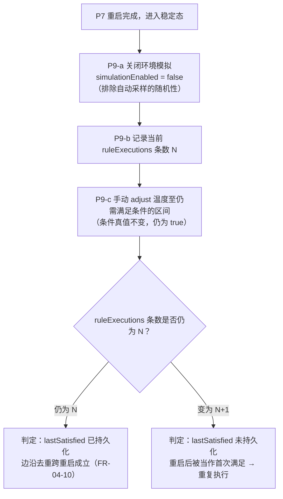
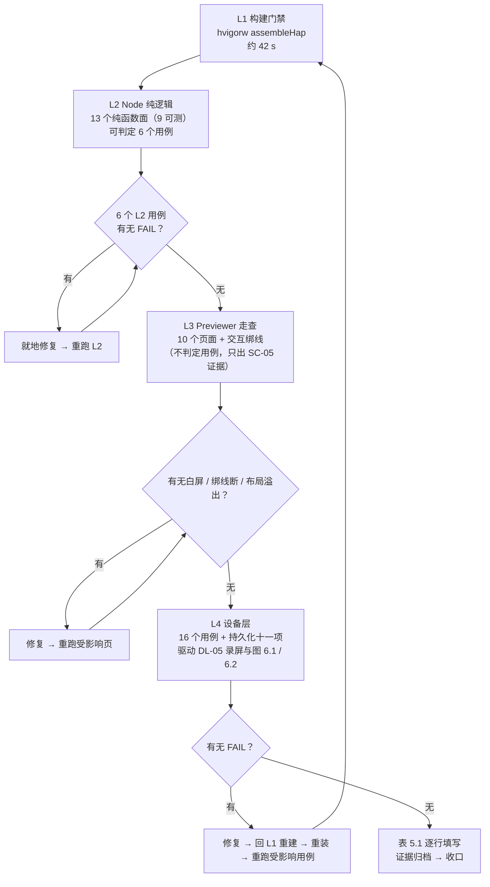

# 智寓 · 阶段五测试执行方案（ST-05）

> **文档性质**：本文是「**怎么测**」的**执行方案**，**不是测试报告**。
> 文中一切「判定标准」均为**执行前约定的判据**；一切「实际结果 / 是否通过 / 证据路径」**在本文件内不存在**——没有这些列，也没有这些单元格。这三项只能由阶段五**真实执行之后**填写到 `docs/软件需求说明书.md` 第 16 章表 5.1。
>
> | 项 | 内容 |
> | --- | --- |
> | 版本 | **V1.4**（V1.0 为初版；V1.1 按主理人三项裁决重写第 1 章 L2 段、修订三桶口径、封闭 L4 排查清单；V1.2 仅同步 §3.2 的 P0 判据到阶段四「块级持久化」口径——`KEY-01~KEY-11` + 块头 `n` 与实际块数一致；V1.3 随 ST-04 更新可执行性；**V1.4 修订 §2.4 TC-E-08 判据（删除伪判据、新增 appfreeze 硬门槛）、在 §1 增「验证载体与豁免说明」、校正头部陈旧基线（PRD v1.2 / 代码基线 d3222c6 / 新增修订人），并同步 §1.1 / §1.6 / §2.5 / §7**） |
> | 日期 | 2026-11-09 |
> | 作者 | 高见远（架构师） |
> | V1.4 修订 | 严过关（QA 工程师），依据 `design/阶段五-架构裁定记录.md` 与主理人裁决 |
> | 上游基线 | `docs/软件需求说明书.md`（**PRD v1.2**：用户实机演示豁免 + 第 16 章活结果表口径；**需求条目只读，结果表由阶段五真实执行后填写**）第 16 章 22 个用例、第 10.4 节八步验收、第 14 章评分指标；`design/系统架构设计.md`（V1.0.4，块级持久化口径）10.1~10.4；`design/任务列表-第三阶段.md` §5 可测性分级 |
> | 代码基线 | ST-04 已三态全绿、ST-05 执行中；代码基线 `main` @ `d3222c6`（ST-05 第二批 5 用例真实结果填入表 5.1）；本轮修复后 HAP 由工程师重构，见 `evidence/阶段五-构建日志-修复后.txt`（原 `312335b` 为阶段三快照，已作废） |
> | 本文件的作用 | 补上 PRD 第 16 章**缺失的那一层**——用例有了「测试目的 / Mock 输入 / 预期结果」，但没有「**在哪一层执行、用什么手段执行、观测什么离散事实、现在能不能执行**」。本文只补这一层，不复述用例内容 |
> | 纪律 | 不写任何结果；不写「已验证 / 已通过 / 预期通过」；不预置任何演示数据；不修改任何既有文档 |
>
> **⚠️ V1.3 修订说明（ST-04 完成后，2026-11-09）**：本文撰写于 ST-04 完成之前，其「当前可执行性」判定**现已过时**。ST-04 已落地 L2 生成脚本与断言入口（`tests/l2/gen.js` / `run.js` / `tsconfig.json`，Node 侧 **307 断言 0 失败**），且 API 17 模拟器（`127.0.0.1:5555`）经 `hdc` 已可达并完成**真机 12 步重启验收**（落盘原文可拉回、`bootCount 1→2`，见 `evidence/阶段四验收报告.md`）。据此：原标注「缺生成脚本」的 6 个 L2 主判定用例（TC-B-01/02/03/06、TC-E-03/06）现**可执行（L2）**；原标注「缺设备」的 16 个 L4 用例现**可执行（hdc）**。各用例「当前可执行性」列已按此修订；本文的判定层 / 预期结果 / 可观测证据等约定**不变**，实际执行结果只填 PRD 第 16 章表 5.1，本文仍不写结果。
>
> **⚠️ V1.4 修订说明（2026-11-09，架构师只读裁定 + 主理人裁决）**：① **§2.4 TC-E-08 判据修订**：原「离开页面后采样停止」系 ST-05 写方案时**自行加严的伪判据**，PRD 第 16 章 :1133 预期原文仅为「始终只有 1 个采样定时器，无泄漏、无重复采样」；该伪判据与 FR-03-07(:296)、NFR-04(:426)、系统架构设计 §6.3 / Q-04 / MI-10 / D-05 冲突。TimerHost 由 EntryAbility 六钩子驱动、为**全局单例**，改成页面级会破坏 FR-03 全局推进（图表 / 规则求值失去连续环境），属架构倒退，**否决**。修订后判据见 §2.4 及「判据修订说明（V1.4）」；② **新增 appfreeze 硬门槛**：ST-05 实测 4 次 `THREAD_BLOCK_6S`（证据 `evidence/device/st05b_e08_appfreeze.log`、`st05b_e08_appfreeze_2.log`），缺陷未消除前 TC-E-08 一律记「未达成（appfreeze）」，**不得因判据澄清判通过**——本次修订**不降低实现标准，实为加严**；③ **验证载体**：§1 增「验证载体与豁免说明」，物理真机运行展示类交付经用户裁定豁免，API 17 模拟器经 `hdc` 的 L4 设备端真实执行验证保留并继续，16 个 L4 判据一条不降；④ 同步 §1.1 / §1.6 / §2.5 / §7 的载体措辞与自查项。本文仍**不写任何实际结果 / 是否通过 / 证据路径**，结果只填 PRD 第 16 章表 5.1。

---

## 0 文档定位与三条纪律

### 0.1 本文件回答的四个问题

| # | 问题 | 对应章节 |
| --- | --- | --- |
| 1 | 22 个用例分别在**哪一层**判定？这一层**现在能不能跑**？ | 第 1 章 |
| 2 | 每个用例的**执行方式、前置数据、可观测证据**是什么？ | 第 2 章 |
| 3 | 唯一必须**整体通过**的那条链路（持久化）怎么一步步观测？ | 第 3 章 |
| 4 | 22 个用例如何折算成评分指标证据？先跑哪层、为什么？ | 第 4、5 章 |

### 0.2 本文件**不**回答的三个问题（越界即伪造）

| 不写的东西 | 为什么 | 该由谁在哪写 |
| --- | --- | --- |
| **实际结果** | 尚未执行 | 阶段五真实执行后 → PRD 第 16 章表 5.1 |
| **是否通过** | 同上 | 同上 |
| **证据路径**（截图/日志文件的实际路径） | 证据文件尚不存在 | 同上；文件本身归档至 `evidence/`、`screenshots/`、`videos/` |

> **必须区分的一个细节**：「**预期结果**」**可以写、而且必须写**——它是 PRD 六要素之一（DL-07），属于执行前的判据约定，不是结果。本文第 2 章的「**可观测证据**」列与第 3 章的「**判定标准**」列，写的就是「预期结果 + 观测手段」，**不是**「已经观测到了」。二者差一个执行动作，不要混淆。

### 0.3 判定词表（全文只用这三个标签）

| 标签 | 精确含义 | 解除条件 |
| --- | --- | --- |
| **可执行** | 现在就能真实执行，无需引入任何新工具、新设备、新配置 | — |
| **缺生成脚本** | 代码已具备被验证的条件（纯逻辑已物理外置；零 `@kit.*`；运行器零依赖可用——Node 22.22.2 + DevEco 自带 tsc 4.9.5），但 `tests/` 仍是**空目录**，**尚无生成脚本**把 `.ets` 复制成 `.ts` 并编译 | 写好生成脚本 + 断言入口（见 1.3）**即可执行**，不依赖任何外部设备、不需要 npm 安装 |
| **缺设备** | 判定点依赖「HAP 装进 API 17 运行环境」才能产生（真实渲染、真实 `preferences`、真实 `setInterval`、真实进程重启） | 解除 L4 阻断（见 1.5）**即可执行** |

> **判定层写法的约定**：一个用例只允许有**一个主判定层**，写在「判定层」列首位；次要层以「(补)」标注。**第 2.5 节的三桶统计只按「主判定层」计数**，不重复计。若一个用例在两个层都能判，取**能唯一判定通过/失败**的那一层为主——因为「补」层的结论不足以单独宣布用例通过。

### 0.4 一条硬规则：「目测」不得作为「是否通过」的依据

阶段五最容易滑向虚假的地方，是把「我看了，没问题」写进表 5.1。本文因此规定：

- **判定必须落在离散事实上**：函数返回值、字段取值、数组长度、日志条数、进程退出码、`hdc` 返回串。
- 「目测确认」四个字**不得**出现在表 5.1 的「是否通过」列；目测只能写进「补充说明」，且**不得单独支撑**任何一个用例的通过结论。
- 一个用例若找不到可离散观测的判据 → 说明**用例设计不合格**，应回到本文第 2 章补判据，而不是「目测一下算过」。

---

## 1 测试分层与可执行性判定

### 1.1 四层与本地实际状态（总表）

> 分层口径与设计 10.2 完全一致，本节只补「**本机现在到底能不能跑**」这一列，并给出判定依据（不是印象）。

| 层 | 判定能力 | 本机当前状态 | 判定依据（可复核） |
| --- | --- | --- | --- |
| **L1 构建产物** | 源码可在 API 17 工具链编译、ArkTS 严格类型检查通过、可产出 HAP | ✅ **已具备，可随时复跑**（单次约 42 s） | 设计 10.2.1 证据 E1~E5：`CompileArkTS` 14 s 582 ms、`BUILD SUCCESSFUL in 42 s 315 ms`、HAP 963,827 字节、提交 `a5ebc7b` / `f3f13fa`。前置：按 10.3 ENV-B1~B4 设 `DEVECO_SDK_HOME` |
| **L2 Node 纯逻辑** | 规则排序、AND 求值、边沿去重、`WriteGuard` 冲突、参数校验、日志 FIFO、统计聚合、命令执行内核 | ✅ **可执行（生成脚本与断言入口已于 ST-04 落地：307 断言 0 失败）** | 纯逻辑闭包实测零 `@kit.*`（1.3.1/1.3.6）；运行器**零外部依赖**：`node -v` = `v22.22.2`（原生类型剥离）+ 自带 `tsc.js` **4.9.5**，20 个文件在 `--strict` 下编译 **0 错误**、产物可 `require`。坑：纯剥离在本库会因「接口按值导入」直接 `SyntaxError`（1.3.3）。`tests/` 已落地（`gen.js` 复制 `.ets→.ts`、DevEco tsc 编译、`run.js` 跑断言，另含 store 层 282 断言） |
| **L3 DevEco Previewer** | 页面可渲染、视觉统一、交互绑线不断、Canvas 图表出图 | ⚠️ **仅能由 DevEco Studio GUI 启动，本阶段尚未实跑** | 设计 R-09 已由「先验阻断」改标「**未验证**」；本机无「不经 GUI 即可启动 Previewer 并交互」的可行路径（若阶段五发现可行 CLI，须补记到 `evidence/`） |
| **L4 设备端 / API 17 模拟器（经 `hdc`）** | HAP 安装、真实 `preferences`、真实定时器、进程重启恢复、真实设备端截图 / 组件树 | ✅ **已可执行（V1.3）：API 17 模拟器经 `hdc` 可达，ST-04 12 步重启验收通过；CLI 启动失败为历史排查记录（见 1.5）。V1.4 载体口径：物理真机运行展示类交付经用户裁定豁免，L4 设备端验证一律以 API 17 模拟器 + `hdc` 真实执行为准（见 1.7）** | 历史：`Emulator.log` 2026-11-09 五次 CLI 启动尝试止于 `CheckRuntimeEnv.cpp(RunCheck:152)`；ST-04 后：经 `hdc`（非 CLI 启动路径）连接 `127.0.0.1:5555` 成功，`aa force-stop` / 冷启动 / 落盘拉回 / 逐字段比对全部完成（`evidence/阶段四验收报告.md`） |

### 1.2 L1 构建层：已具备，但**不判定任何一个用例**

- **能证明**：源码在 API 17 工具链下可编译、ArkTS 类型合规（含 AT-10 禁未标注类型的对象字面量）、可产出 HAP。
- **不能证明**：任何一条业务行为。
- **因此**：22 个用例中**以 L1 为主判定层的 = 0 个**。L1 在阶段五的角色是**门禁**，不是判据：每次进入 L3/L4 之前必须先过一次 L1（L1 失败则 L3/L4 的 HAP 根本不存在，跑也是跑旧的）。
- **复跑纪律**：L1 通过后立即把 HAP **拷贝**出 `entry\build\`（ENV-B3），否则下一次构建会清空它；日志写 `evidence/构建日志-阶段五.md`。

### 1.3 L2 层：机制**已实测可用**，缺口只剩「一个生成脚本」（R-T-01，已降级）

> **本节已按主理人裁决全面修订（V1.1）**。上一版写的「需新增 `package.json` + TypeScript devDependency、`npx tsc` 离线不可用」**是错误前提**：本机 **Node v22.22.2** 原生支持类型剥离，且 **DevEco Studio 自带 TypeScript 4.9.5**，两条路都**不需要任何 npm 安装**。但「零依赖」不等于「零障碍」——真正的障碍在 **1.3.3**，那是逐字实测出来的。

#### 1.3.1 「能被 L2 测」的等价条件

Node 侧无法解析 `@kit.*`，所以「能被 L2 测」的等价条件是「**零 `@kit.*` 依赖**」。对 `entry/src/main/ets/{model,common,service,mock}` 全目录做了**逐根传递闭包 + `@kit` 可达性**核验（不是凭文件头注释），结论：

| 结论 | 明细（实测） |
| --- | --- |
| `model/` 全 14 个文件 | **零 `@kit.*` 导入**（`AppSettings` / `AppState` / `AutomationAction` / `AutomationCondition` / `AutomationRule` / `ChartModels` / `CommandResult` / `Device` / `DeviceParams` / `Enums` / `EnvironmentData` / `Logs` / `Reports` / `Scene`） |
| `common/` 全 11 个文件 | 仅 **3 个**文件真正 `import ... @kit`：`IdGenerator.ets`（`@kit.ArkTS`）、`RouteMap.ets`、`RouteParams.ets`（`@kit.ArkUI`）；其余 8 个（`Constants` / `ParamSchema` / `Fifo` / `StateChangeTypes` / `TimeUtil` / `ResultMessage` / `AppStorageKeys` / `ThemeTokens`）**纯净** |
| `service/` 全 11 个文件 | **纯净 3 个**：`RuleMatcher.ets`、`WriteGuard.ets`、`StatisticsService.ets`；其余 8 个（`DeviceService` / `EnvironmentService` / `LogService` / `RuleEngine` / `RuleActionExecutor` / `RuleService` / `SceneService` / `ServiceContracts`）**全部**经 `common/IdGenerator.ets` 命中 `@kit.ArkTS`，`ExportService` 另加 `@kit.CoreFileKit`；**不在 L2 范围** |
| `mock/` 全 3 个文件 | **`MockDeviceAdapter.ets` 纯净且可注入**（`setLookup(lookup: DeviceLookup)`，不 import 仓储、不 import `IdGenerator`）；`MockDataFactory` / `EnvironmentSimulator` / `TimerHost` 均命中 `@kit` |

> **关键设计结论（阶段三已落地，此处只是复核）**：`RuleEngine` 因写日志必然引入 `IdGenerator` → `@kit.ArkTS`，所以「纯逻辑必须**物理外置**」不是洁癖，而是 L2 路径成立的**唯一前提**。这也是 `service/RuleMatcher.ets` 与 `common/Fifo.ets` 存在的原因。

#### 1.3.2 运行器**不需要装任何东西**（实测，两条零依赖路）

| 事实 | 实测依据 |
| --- | --- |
| Node 原生支持类型剥离 | 本机 `node -v` = `v22.22.2`；`node x.ts` 可直接执行；纯剥离不认 `enum`（报 `ERR_UNSUPPORTED_TYPESCRIPT_SYNTAX`），本项目 `model/Enums.ets` 全是 `enum`，加 transform 类参数后枚举可正常转换——**但这只解决枚举，不解决本库的接口按值导入问题，见 1.3.3** |
| DevEco 自带 TypeScript | `D:\DevEco Studio\tools\hvigor\hvigor\node_modules\typescript\lib\tsc.js`（**v4.9.5**），另有 `tools\ohpm\node_modules\typescript`、`tools\hvigor\hvigor-ohos-plugin\node_modules\typescript`、`plugins\openharmony\ace-server\node_modules\typescript` 三处副本 |
| 因此 | **不需要 `package.json`、不需要 `npm install`、不需要任何 devDependency**；`npx tsc` 不可用这件事**不再是障碍** |

#### 1.3.3 真正的障碍：ArkTS 把 `interface` **按值导入**，纯类型剥离会直接崩（实测，逐字）

在本代码库跑 `node --experimental-transform-types <生成文件>.ts`，**失败**，报错原文：

```
SyntaxError: The requested module './AutomationAction.ts' does not provide an export named 'AutomationAction'
    at AutomationRule.ts:10
```

**机理**：`model/AutomationAction.ets` 里 `AutomationAction` 是 **`export interface`**（纯类型声明）；`AutomationRule.ets` 写的是 `import { AutomationAction } from './AutomationAction'`（**按值导入的语法**，实际只在类型位置使用）。类型剥离会把 `interface` 整段擦掉，但**不会**擦掉导入语句里的具名绑定——于是 ESM 链接期找不到该导出，**直接抛错**。

**影响面**：`model/` 14 个文件里绝大多数实体是 `interface`（`AutomationAction` / `AutomationCondition` / `CommandResult` 相关类型 / `Reports` 等），因此这条不是个别文件的偶发问题，而是**贯穿整个 `model/` 层的系统性障碍**。凡是被测代码按值导入接口，纯剥离路径就跑不起来。

> 结论：**「零依赖」成立，「零编译」不成立**。要零依赖又不能改产品代码，就必须用**自带 tsc**（它会做类型级的导入消解，正确擦除纯类型导入）。

#### 1.3.4 两条路径的对比与选型（A 选，B 弃）

| 路径 | 做法 | 实测结果 | 结论 |
| --- | --- | --- | --- |
| **A（选用）自带 tsc 编译后跑** | 生成脚本把纯逻辑闭包**逐字节复制**为 `.ts`（**不改任何说明符**）→ `node "<DevEco>/tools/hvigor/hvigor/node_modules/typescript/lib/tsc.js" -p tests/tsconfig.json`（`module: CommonJS`、`target: ES2021`、`strict: true`、`rootDir: .gen/src`、`outDir: .gen/out`）→ `node` 跑 `out/**/*.js` | ✅ **已实测**：20 个文件在 `--strict` 下**编译 0 错误**；编译产物可被 `require`；`RuleMatcher.sortRules` / `new WriteGuard().claim` / `validateParamValue` / `MockDeviceAdapter.getInstance` 均可正常调用 | **采用**。tsc 正确擦除纯类型导入；扩展名问题由「复制成 `.ts`」解决；说明符**保持无扩展名**，由 tsc 解析、由 CJS `require` 解析，无需改字符串 |
| B Node 类型剥离直跑 | `node --experimental-transform-types .gen/xxx.ts` | ❌ **实测失败**（1.3.3 的 `SyntaxError`） | **弃用**。若将来改用 B，必须在生成时把 `import { X }` 改写成 `import type { X }`——这需要类型分析，属**改写语义**，触碰 1.3.5 第 3 条红线 |
| C `esbuild` loader | `--loader:.ets=ts` 打包 | 未测 | 不选：引入第二个外部依赖，违反本项目的零依赖取向 |

#### 1.3.5 生成脚本的四条硬约束（前两条为主理人指定，后两条为实施必备）

1. **只复制纯逻辑闭包**：`Enums` / `Constants` / `Fifo` / `RuleMatcher` / `ParamSchema` / `WriteGuard` / `StatisticsService` / `MockDeviceAdapter` 及其传递依赖（清单见 1.3.6）。**不得**复制任何含 `@kit.*`、装饰器、`@Component` / `@Entry` 的文件——transform/编译阶段会因缺少 ArkUI 运行时或 `@kit` 解析直接失败。
2. **说明符处理按路径区分**：走 A（tsc）时**不得改写 import 说明符**（tsc 自己能解析无扩展名相对导入，改成 `.ts` 反而会让 CJS `require` 解析失败）；只有弃用的 B 路径才需要补 `.ts`。
3. **禁止在 `tests/` 里手写第二实现**：`tests/` 只能放 **测试用例 + 生成脚本 + tsconfig**，被测代码一律来自生成物。手写重写必然漂移，测的就不再是产品代码（等价于伪造测试）。
4. **整体隔离在 `tests/`**：`tests/tsconfig.json` 与生成脚本全部放在 `tests/` 下，**工程根不新增 `package.json` / `tsconfig.json`**——根目录一旦出现 `tsconfig.json`，`hvigor` / `code-linter` 的解析路径可能改变，属**拿 L1 门禁换 L2 便利**，不可接受。`/tests/.gen/` 已由主理人加入 `.gitignore`。

> **附带的正面效应**：走 A 时，「复制 + 编译」本身就是一道**纯净性检查**——若有人给被测文件加了 `@kit.*` 依赖，编译会立刻失败并点名文件，比任何口头约定都硬。

#### 1.3.6 生成脚本要复制的最小文件集合：**20 个**（已按依赖闭包实测得出）

> 求法：从「被测根」出发沿**相对导入**做传递闭包，再剔除命中 `@kit.*` 的路径。下表即闭包全集（`model` 10 + `common` 6 + `service` 3 + `mock` 1 = 20），已逐文件确认**零 `@kit.*`、零装饰器、无未解析导入**。

| # | 目录 | 文件（`.ets` → 生成 `.ts`） | 为什么必须复制 |
| --- | --- | --- | --- |
| 1~10 | `model/` | `Enums`、`Device`、`DeviceParams`、`CommandResult`、`AutomationRule`、`AutomationCondition`、`AutomationAction`、`EnvironmentData`、`Logs`、`ChartModels` | 被测函数的入参/返回类型与枚举全部来自这里；`Enums` 是唯一含 `enum` 的文件（决定必须走**编译**而非纯剥离，见 1.3.3） |
| 11~16 | `common/` | `Constants`（`RANGE` 区间表）、`ParamSchema`、`Fifo`、`ResultMessage`、`TimeUtil`、`ThemeTokens` | `ParamSchema`→`Constants`、`CommandResult`→`ResultMessage`、`StatisticsService`→`TimeUtil`/`ThemeTokens` 的硬依赖 |
| 17~19 | `service/` | `RuleMatcher`、`WriteGuard`、`StatisticsService` | 三个被测纯逻辑根 |
| 20 | `mock/` | `MockDeviceAdapter` | 命令执行内核；**注入式**（`setLookup`）→ 可在 Node 侧无仓储运行 |

**两个边界项（必须写清，否则实施者会踩坑）**：

| 项 | 现状 | 处理 |
| --- | --- | --- |
| `service/ServiceContracts.ets`（`commandToParamKey`） | **当前不可复制**：该文件第 45 行 `import { MockDataFactory }`，而 `MockDataFactory` → `common/IdGenerator.ets` → `@kit.ArkTS`。该导入被 `Stage2ServiceFacade` 使用（第 252、467 行），而该门面按 T3-05 计划将被**整段删除** | **T3-05 落地后重算**：门面删除后该文件仅剩 `model/*` 与 `common/{ParamSchema,ResultMessage,StateChangeTypes,TimeUtil,ThemeTokens}`，全部纯净 → 变为可复制（届时集合 +5：`AppSettings`、`AppState`、`Scene`、`Reports`、`StateChangeTypes`）。**这是一条待验证的预测，不是既成事实**：T3-05 完成后由工程师实测这 5 个文件能否进集合，架构师复核后方可写入 §5.1 第 6 项的状态 |
| `mock/EnvironmentSimulator.ets`（`nextReading`） | **不可 L2，但原因在「文件」而不在「函数」**：`nextReading(current, rnd, now)` 三个入参齐全，**它本身是纯函数**；问题在于**同一文件**的 `tick()`（第 63 行）**按值调用** `EnvironmentService.getInstance().getSnapshot()`，这个值导入把 `EnvironmentService → common/IdGenerator.ets → @kit.ArkTS` 拖进**整个模块**，Node 侧**连加载都会失败**（`import type` 也救不了——那是值调用不是类型引用） | 该项**从 L2 清单移到 L4**。要让它进 L2 只有两条路：①把 `nextReading` 拆到独立文件；②改 `tick()` 取基准的方式。**两者都动已合入代码**（`6fee3e3` 刚修正过取基准行为），故**都不做**（2026-11-09 裁决：维持 L4、不改签名） |

#### 1.3.7 12 项 L2 清单的实测复核（`任务列表-第三阶段` §5.1 逐项对照）

| # | 被测函数 | 文件 | L2 状态（实测） | 主责用例 |
| --- | --- | --- | --- | --- |
| 1 | `RuleMatcher.sortRules`（`priority → createdAt → id`） | `service/RuleMatcher.ets` | ✅ 可测（闭包 6 文件，零 `@kit`） | TC-E-06 |
| 2 | `RuleMatcher.matchConditions`（`GT/LT/IS_TRUE/IS_FALSE` × 5 传感器） | 同 | ✅ 可测 | TC-B-01 / TC-B-02 |
| 3 | `RuleMatcher.isEdgeTriggered` / `nextDedupFlag` | 同 | ✅ 可测 | TC-B-06 |
| 4 | `RuleMatcher.resetDedup` | 同 | ✅ 可测 | FR-04-09/10（编辑后复位） |
| 5 | `WriteGuard.claim / has / reset / entries` | `service/WriteGuard.ets` | ✅ 可测（闭包仅自身） | TC-E-06 |
| 6 | `commandToParamKey`（12 命令全映射） | `service/ServiceContracts.ets` | ⚠️ **条件可测**（T3-05 删门面后转可测，见 1.3.6 边界项） | 护栏 B-4 |
| 7 | `Fifo.limitOf` / `trim` / `append` | `common/Fifo.ets` | ✅ 可测（闭包 3 文件） | TC-N-07 日志容量段 |
| 8 | `validateParamValue` / `validateParam` / `validateSensorValue` / `clampToRange` / `isInRange` | `common/ParamSchema.ets` | ✅ 可测（闭包 4 文件）；**注意签名**：`validateParamValue(key, value)` 只有 **2 参**并返回 `ResultCode`，`validateParam(type, key, value)` 才是 3 参 | TC-B-03 / TC-E-03 |
| 9 | `EnvironmentSimulator.nextReading` | `mock/EnvironmentSimulator.ets` | ❌ **不可测**（**文件级**依赖：`nextReading` 本身纯，但同文件 `tick()` 值引 `EnvironmentService`，见 1.3.6 边界项）→ 改由 L4 判定 | FR-03-04 |
| 10 | `StatisticsService.buildLineModel / buildBarModel / successRate / averageDuration` | `service/StatisticsService.ets` | ⚠️ **文件纯净但方法尚未落地**：修订时该类仅有 `getInstance()`（T3-04 未完成，属工作区快照，非最终态）；落地后按 1.3.4 路径 A 可直接测 | TC-N-06 |
| 11 | `DeviceParamsFactory.defaults / paramKeysOf / describe` | `model/DeviceParams.ets` | ✅ 可测（闭包 2 文件） | AT-04 |
| 12 | `createResult` / `okResult` / `noChangeResult` / `failResult` | `model/CommandResult.ets` | ✅ 可测（闭包 3 文件） | 统一失败语义 |
| **13（新增）** | `MockDeviceAdapter.apply / setDeviceStatus / setOnline`（注入 `DeviceLookup`） | `mock/MockDeviceAdapter.ets` | ✅ **可测**（闭包 7 文件、零 `@kit`、`setLookup` 注入）→ 命令写入与幂等 `NO_CHANGE` 的**内核**可在 L2 断言 | TC-N-01 / TC-E-01 的补充证据 |

> **净结论**：12 项中 **9 项现在就可测**（1/2/3/4/5/7/8/11/12）、**1 项条件可测**（6）、**1 项待方法落地**（10）、**1 项不可测**（9）；另新识别 1 个纯净面（13）。**这比上一版多出来的两项能力（10、13）与一项结论（9 不可测），全部来自本次逐文件闭包核验，不是推测。**
>
> 第 13 项与第 9 项的结论属**设计层的新事实**，需由主理人决定是否同步进 `design/任务列表-第三阶段.md` §5.1 与设计 §10.2（我本轮只改本文件，不越界）。

### 1.4 L3 层：可用但无 CLI，且**不判定任何一个用例**

**能证明**：页面能渲染、卡片/间距/断点视觉统一、交互绑线不断（点了有反应）、Canvas 图表能出图。
**不能证明**：任何一次「状态被正确改写」「日志被正确写入」——Previewer 里没有真实 `preferences`、没有真实进程重启、没有可靠的 `setInterval` 长周期行为。

> **因此：22 个用例中以 L3 为主判定层的 = 0 个。**
> 这不是把 L3 判死，而是把它的**证据角色**摆正：SC-05（页面设计与交互体验，15 分）的证据来自**独立的 10 页 Previewer 走查清单**，不来自这 22 个用例；L3 对 TC-N-01 / TC-N-04 / TC-N-06 只能提供「UI 侧确实显示了这个值」的**补充**证据，不构成通过结论。
> 截图必须标注「Previewer 截图，非真机运行」，**不得**充当图 6.1。

### 1.5 L4 层：当前不可执行——**CLI 路径已封闭、根因未定位**（缺口 R-T-02）

这一节必须逐字如实，因为它决定了 16 个用例能不能开始。

#### 1.5.1 失败事实（既有记录）

| 项 | 实测 |
| --- | --- |
| 设备连接 | `hdc list targets` = `[Empty]` |
| CLI 启动尝试 | `Emulator.exe -hvd Huawei_Phone`（配 `HarmonyOS_HVD_HOME`）**参数校验可通过**，但 `CheckRuntimeEnv::RunCheck` 恒报 `Invalid System-image Path!`；绝对路径与目录联接（junction）均无效；只有 DevEco Studio Device Manager 能启动 |

#### 1.5.2 我在写本方案时复核到的新事实（**与上面并列，不替代**）

`%LOCALAPPDATA%\Huawei\Emulator\deployed\Huawei_Phone\Emulator.log` 里有两段互斥的记录：

| 时间 | 记录 | 含义 |
| --- | --- | --- |
| `2026-09-19 14:32:51` ~ `14:33:29` | `CheckSign` → `SYSimage is correct, verify succeed.` → **`Guest OS Boot Completed!!`**；退出时 trace：`"API_LEVEL":"17","DEVICE_TYPE":"phone","CPU":"x86_64","EMULATOR_VERSION":"5.0.9.410"` | **同一套镜像、同一台机器，曾经成功启动并上报告 API 17 手机镜像**，连续运行约 3 分钟后正常退出（`EMULATOR_QUIT_COST`） |
| `2026-11-09 02:21:19 / 02:21:31 / 02:25:49 / 02:30:02 / 02:36:44` | 五次全部：trace pipe 连通后 **0.3 s 内**即 `CheckRuntimeEnv.cpp(RunCheck:152) "Invalid System-image Path!"`，**未进入** `CheckImage.cpp` | 失败发生在**镜像签名校验之前**，属**路径校验**阶段，不是镜像损坏 |

三处元数据互证「已部署实例是 API 17」：

| 文件 | 关键字段 |
| --- | --- |
| `deployed\Huawei_Phone\config.ini` | `hmApiVersion=17`、`hw.apiName=5.0.5`、`hmShowVersion=HarmonyOS 5.0.5(17)`、`harmonyOSVersion=HarmonyOS-5.0.5` |
| `D:\HUAWEI\system-image\HarmonyOS-5.0.5\phone_x86\info.json` | `{"apiVersion":"17","abi":"x86","version":"5.0.1.121"}` |
| 同目录 `sdk-pkg.json` | `"apiVersion":"17"`、`"platformVersion":"5.0.5"`、`"releaseType":"Release"`；镜像实体齐备（`system.img` 2,508,193,792 B、`vendor.img`、`userdata.img`、`bzImage`、`ramdisk.img`） |

**而 `D:\DevEco Studio\tools\emulator\emulator.json` 里的 `"api": 12` / `"api": 11` 是工具自带的模板目录（`Huawei_Phone` / `Huawei_Foldable` / `Huawei_Tablet` 预设列表），不是已部署实例的元数据。**

#### 1.5.3 曾经最可能的根因（**已被 1.5.4 第 1、4 条否证**，仅作记录）

| 文件 | 字段 | 值 | 判断 |
| --- | --- | --- | --- |
| `deployed\Huawei_Phone\config.ini:17` | `image.sysdir.1` | `system-image/HarmonyOS-5.0.5/phone_x86/` | **相对路径**。相对 HVD 目录解析 → `…\deployed\Huawei_Phone\system-image\…`，实测**该目录不存在** |
| `deployed\Huawei_Phone\hardware-qemu.ini:5~7` | `disk.*.initPath` | `D:/HUAWEI/system-image/HarmonyOS-5.0.5/phone_x86//system.img`（双斜杠说明由「sysdir 以 `/` 结尾」+「`/system.img`」拼接而成） | **绝对路径**，且文件真实存在 |

> **推断**：`config.ini` 的 `image.sysdir.1` 与 `hardware-qemu.ini` 的拼接结果**不一致**——一个相对、一个绝对。`RunCheck` 在签名校验前只认 `image.sysdir.1`，解析失败即报 `Invalid System-image Path!`。这与「09-19 能启动、11-09 不能」的时间线吻合：**期间该 HVD 的配置被改动过**（此前为排查问题试过绝对路径与目录联接，配置可能未复原）。

#### 1.5.4 已试过的所有路口（**全部失败**，此处是"别再走"的清单）

> **主理人已于本轮逐条实测**，故本节由「候选动作」改为「**封闭清单**」。后人若想再试，请先读这张表末尾的结论。

| # | 尝试 | 结果 |
| --- | --- | --- |
| 1 | 以 `D:\HUAWEI` 为工作目录启动（`cd /d D:\HUAWEI && Emulator.exe -hvd Huawei_Phone`），验证「`image.sysdir.1` 是否按工作目录解析相对路径」 | ❌ **否证**：`InitPipe` 连通后 **0.16 s** 内仍报 `Invalid System-image Path!`，与工作目录无关 |
| 2 | `-hvd <实例绝对路径>` | ❌ `Invalid parameters, api type is: 5` —— 该选项**只接受实例名** |
| 3 | `-imagePath` / `-image` / `-sysdir` / `-datadir` / `-hvdPath` | ❌ 全部 `Unknown option` —— 启动器**没有**这些开关 |
| 4 | 把 `image.sysdir.1` 与 `lists.json.imageDir` 改为绝对路径 | ❌ 同一条报错（改后已还原） |
| 5 | 在 `deployed\`、`Emulator\`、`HUAWEI\` 三处建目录联接桥接镜像根；在 `D:\DevEco Studio\sdk` 下建联接 | ❌ 前两处仍失败；第三处**被系统拒绝写入** |
| 6 | 强杀残留实例（曾有一个僵尸实例占锁报 `The emulator already exists`）后重试 | ❌ 仍失败 |
| 7 | 用 DevEco Studio **Device Manager** 点一次启动 | ⏳ **未试**，是当前唯一的可行路径（见 1.5.5） |

> **结论**：CLI 路径**已封闭**，`image.sysdir.1` 的相对/绝对之争**不是**根因所在（第 4 条已直接否证）。**根因仍未定位**；本文不再给出猜测性修法，只如实记录事实。

#### 1.5.5 对阶段五的判定（不因发现 API 17 而提前乐观）

> **结论**：L4 **当前不可执行**。已核实的三件事是：① 已部署实例与镜像确实是 **API 17**（1.5.2），"API 12 装不上 HAP"这一旧结论不成立；② 该镜像历史上（2026-09-19）在本机成功启动过；③ **但 CLI 启动现在恒定失败，根因未定位，且 6 条排查路径已全部排除**（1.5.4）。
>
> 因此：**在真正启动成功并完成一次 HAP 安装之前，一律按「不可执行」处理**，第 2 章中 16 个用例的「当前可执行性」保持「缺设备」。这条不给乐观口径——**「镜像没问题」不等于「环境可用」**。
>
> **V1.3 补充（ST-04 后）**：上述「一律按不可执行处理」的判定已被事实推翻——ST-04 经 `hdc` 连接 `127.0.0.1:5555` 完成 `aa force-stop` / 冷启动 / 落盘拉回 / 12 步字段比对（`evidence/阶段四验收报告.md`）。L4 用例现具备执行条件；1.5.1~1.5.4 的 CLI 排查记录保留为历史。
>
> 唯一可行路径：**由用户在 DevEco Studio 的 Device Manager 点一次启动**（1.5.4 第 7 条）。启动成功后**首先**补的必须是一次完整 HAP 安装 + 冷启动（验证 `compatibleSdkVersion 5.0.5(17)` 与镜像 API 17 相容），**而不是**直接冲 22 个用例——否则会把「环境不通」误判成「功能有缺陷」。

#### 1.5.6 L4 的两个资源前置（与路径问题无关，但同样会让人误判）

| 前置 | 实测线索 | 要求 |
| --- | --- | --- |
| 宿主空闲内存 | `Emulator.log`：`The host computer's memory is: 2725, which is less than 3`、`memory is low, freeMem: 566, CurHostTotalMemory: 16064`；HVD 配置 `config.ini:9 hw.ramSize=4096` | 启动前关闭浏览器/IDE 重负载，保证**空闲 ≥ 6 GB**；否则会表现为「启动卡死」而非报错 |
| `hdc` 连通 | 09-19 启动期间日志仍报 `hdc is not connected : "[Empty]"`，但 Guest 已 `Boot Completed` | 「`hdc` 未连上」≠「模拟器没起来」；判定启动成功以**Guest 启动完成 + 画面可见**为准，再单独排查 `hdc` |

### 1.6 分层可执行性判定结论

| 层 | 现在能跑？ | 能判定 22 个用例中的几个（主判定） | 若不能，解除条件 |
| --- | --- | --- | --- |
| L1 | ✅ 能 | **0** | — |
| L2 | ✅ 能 | **6** | 已解除：生成脚本与断言入口已落地（`tests/l2/`，307 断言 0 失败） |
| L3 | ⚠️ 仅 GUI | **0** | —（本就不作为用例判定层） |
| L4 | ✅ 能（hdc / API 17 模拟器） | **16** | 已解除：API 17 实例经 `hdc` 可达（ST-04 12 步重启验收）；V1.4：载体为模拟器设备端，物理真机展示类交付豁免，16 条 L4 判据不降（见 1.7） |

### 1.7 验证载体与豁免说明（V1.4）

> 依据：用户 2026-11-09 裁定「本项目不需要实机演示」，随后明确「继续完成真机模拟」；主理人口径为**豁免物理真机运行展示类交付，保留并继续完成 API 17 模拟器经 `hdc` 的 L4 设备端真实执行验证**。

| 交付 / 验证项 | 状态 | 说明 |
| --- | --- | --- |
| **物理真机验证** | **用户裁定豁免，未执行** | 含 DL-05 连续录屏、报告图 6.1 / 6.2 真机截图、Q-08 真机接入阻塞。按裁定时点如实标注为「豁免未执行」，**不得**写成已执行，**也不得**因此把模拟器证据改写为真机证据 |
| **API 17 模拟器经 `hdc` 的 L4 设备端验证** | **已执行 / 本轮继续执行并留证** | 22 个用例中 16 个 L4 用例的判据**一条不降**：真实 `preferences`、真实定时器、真实进程重启、真实 `uitest dumpLayout` / `snapshot_display`、真实沙箱导出 JSON 拉回。阶段四 12 步重启验收、ST-05 第一批 / 第二批 / 第三批设备端执行均属此载体，证据归档于 `evidence/`、`evidence/device/`、`screenshots/` |
| 口径纪律 | — | ① 模拟器证据只能标注为「API 17 模拟器 / hdc 设备端」，禁止写成「真机」；② 已完成的模拟器验证必须如实记为已执行，禁止倒写成未完成；③ 豁免只覆盖「物理真机运行展示类交付」，不覆盖任何用例判定标准 |

---

## 2 22 个用例执行映射表

### 2.1 表格使用说明

- 七列固定为：**用例号 | 覆盖需求 | 判定层 | 执行方式 | 前置数据 | 可观测证据 | 当前可执行性**。列数与 `00` 章约定一致，**不含任何结果列**。
- 「覆盖需求」只引 PRD 已有编号（第 4 章 FR / 第 10 章 / Q 编号），**不新造需求编号**。
- 「前置数据」是**测试内构造的输入**（内存对象 / 函数入参 / 界面操作序列），**不是**要预置进应用的演示数据；设计纪律「不预置任何演示规则 / 演示日志 / 演示图表数据点」不变。
- 「可观测证据」= 预期结果 + 观测手段；一律写成**离散断言**（返回值 / 字段取值 / 数组长度 / 日志条数 / 进程状态），不写「界面正常」这类不可判定表述。

### 2.2 正常用例（TC-N，7 个）

| 用例号 | 覆盖需求 | 判定层 | 执行方式 | 前置数据 | 可观测证据 | 当前可执行性 |
| --- | --- | --- | --- | --- | --- | --- |
| TC-N-01 | FR-01-05、FR-02-02、FR-02-07、FR-08-06 | L4（补 L2：`validateParamValue`） | 装机 → 首页点灯卡开灯 → 进详情页 → 进操作日志页 | 灯初始 `powerOn=false`、`brightness=60`；操作 `setPower(true)` | ①`state.devices[LIGHT].params.powerOn === true`；②首页卡片、详情页读数、`OperationLog` 末条**三处同值**；③`OperationLog.length` 恰好 +1 | 可执行（hdc 已连通） |
| TC-N-02 | FR-04-02、FR-04-03、FR-04-07、FR-04-14、FR-04-15 | L4（补 L2：`matchConditions`） | 界面创建规则 R-EX-01 并保存 → 环境页手动调光照 80 + 置位有人 | 规则：光照 `<` 100 **AND** 有人 → 开灯（亮度 70） | 灯 `powerOn===true && brightness===70`；`ruleExecutions.length` +1 且 `status===SUCCESS`；该条 `matchedConditions.length===2`；`executedActions.length===1` | 可执行（hdc 已连通） |
| TC-N-03 | FR-04-04、FR-04-07、FR-04-15 | L4 | 创建 R-EX-02 → 手动调温度 30 | 规则：温度 `>` 28 → 开空调 → 制冷 → 26℃（三动作有序） | 空调 `powerOn`、`mode===COOL`、`temperature===26` 三者同时成立；`executedActions` 数组顺序与规则动作定义顺序**逐项相等** | 可执行（hdc 已连通） |
| TC-N-04 | FR-05-01、FR-05-03、FR-05-06、FR-01-07 | L4 | 首页点「睡眠」场景 | 四预置场景已存在；记录切换前各设备参数 | 参与设备参数逐项变更（非仅标签）；`SceneSwitchLog.length` +1；`OperationLog` 按设备逐条 +N；首页「当前运行模式」= 睡眠 | 可执行（hdc 已连通） |
| TC-N-05 | FR-05-04、FR-05-01 | L4 | 自定义亮度 75 → 切「离寝」→ 切「回寝」 | 先把灯亮度调至 **75**（刻意区别于默认值 60）；`KEY-10` 快照分区 | 回寝后 `brightness === 75`（**不是 60**）；快照写入与读取各可对应一条日志 | 可执行（hdc 已连通） |
| TC-N-06 | FR-06-02、FR-06-03、FR-03-02 | L4（补 L2：`buildLineModel` / `buildBarModel`） | 连续 5 次手动调整温度 → 进数据统计页 | 5 个互不相同的温度值 | 折线图数据点 = 5；点值序列与 `EnvironmentLog` 末 5 条 `value` **逐点相等**；`onReady` / `@Watch` 重绘后点位随新值变化 | 可执行（hdc 已连通） |
| TC-N-07 | 第 10 章 10.4 八步、FR-06-07、FR-07-06、FR-08-06 | **L4（独占）** | 见本文第 3 章 P1~P11 十一步流程 | 见第 3 章 | 6 类数据 + `schemaVersion` 逐项一致；重启走恢复分支而非首次初始化；重启后不重复触发 | 可执行（hdc 已连通） |

### 2.3 边界用例（TC-B，6 个）

| 用例号 | 覆盖需求 | 判定层 | 执行方式 | 前置数据 | 可观测证据 | 当前可执行性 |
| --- | --- | --- | --- | --- | --- | --- |
| TC-B-01 | FR-04-02、FR-04-03、FR-04-10 | **L2（主）** | 直接调用 `RuleMatcher.matchConditions(rule, env)` | 规则「温度 `GT` 28」；`env.temperature = 28`（**恰等于**阈值） | 返回 `false`；`matchedConditions().length === 0`；（L4 补充）`ruleExecutions` 不新增 | 可执行（L2 已建脚本） |
| TC-B-02 | FR-04-02、FR-04-06、FR-04-07 | **L2（主）** | 同上，只改一个变量 | 同规则；`env.temperature = 28.1` | 返回 `true`；`matchedConditions().length === 1` | 可执行（L2 已建脚本） |
| TC-B-03 | FR-02-03、FR-02-10、FR-03-09、4.3 参数基线 | **L2（主）** | `ParamSchema.validateParamValue(key, value)` 逐组调用（**2 参**；8 组） | 亮度 0 / 100；空调 16 / 30；窗帘 0 / 100；风扇 1 / 3 | 8 组全部 `=== ResultCode.OK`（返回 `ResultCode` 字符串枚举，**不是** `{ok, clamped}` 对象）；（L4 补充）每组各写 1 条 `OperationLog` 且落盘值等于写入值 | 可执行（L2 已建脚本） |
| TC-B-04 | FR-04-01、FR-04-09、FR-08-08 | L4 | 规则编辑页留空条件或留空动作后点保存 | `conditions: []`；`actions: []`（两次分别构造） | 保存被拒（`CommandResult.ok === false` 且错误码非空）；`state.rules.length` **不变**；UI 提示可见（UI 提示作为补充，不单独支撑判定） | 可执行（hdc 已连通） |
| TC-B-05 | 第 10 章首次初始化、FR-05-01、FR-01-03 | L4 | 清空全部持久化键 → 冷启动 | `preferences` 为空（卸载重装或清数据） | 设备 6 类、传感器 5 项、预置场景 4 个；`devices[].id` 均为新生成；应用不崩溃；`schemaVersion` 被写入 | 可执行（hdc 已连通） |
| TC-B-06 | FR-04-10、FR-04-03 | **L2（主）** | 以同一满足态连续调用 `isEdgeTriggered` / `nextDedupFlag` 5 轮 | 初始 `lastSatisfied = false`；每轮 `satisfied = true`（共 5 轮） | 第 1 轮 `isEdgeTriggered === true`；第 2~5 轮均为 `false`；5 轮后 `nextDedupFlag` 仍为 `true`；（L4 补充）`ruleExecutions.length === 1` | 可执行（L2 已建脚本） |

### 2.4 异常用例（TC-E，9 个）

| 用例号 | 覆盖需求 | 判定层 | 执行方式 | 前置数据 | 可观测证据 | 当前可执行性 |
| --- | --- | --- | --- | --- | --- | --- |
| TC-E-01 | FR-02-08 | L4 | 灯已开状态下再次下发开启 | `powerOn === true`；再调 `setPower(true)` | `CommandResult.code === NO_CHANGE`；`OperationLog.length` **不变**；UI 提示可见（补充） | 可执行（hdc 已连通） |
| TC-E-02 | FR-02-09、FR-04-13 | L4 | 向 `setDeviceStatus` 传入不存在的 id | id = `dev_missing_0001`（不存在的字符串） | `ok === false` 且 `code === NOT_FOUND`；`state` 深比较**逐字段不变**；无新增日志 | 可执行（hdc 已连通） |
| TC-E-03 | FR-02-10、FR-03-09、FR-08-08 | **L2（主）**，补 L4（UI 提示 / 原子性） | `ParamSchema.validateParamValue(key, value)` 三组非法值 | 亮度 150；空调温度 99；风扇档位 9 | 三组全部 `=== ResultCode.INVALID_PARAM`；（L4）`state.devices` 深比较不变（无部分写入）+ UI 提示可见 | 可执行（L2 已建脚本） |
| TC-E-04 | FR-04-13、FR-02-05、FR-08-07 | L4（补 L2：`sortRules`） | 删掉某人规则的目标设备 → 调整环境使该规则条件成立 | 规则指向 `dev_X`；先删除 `dev_X`；同轮另有 1 条可执行规则 | 新增 1 条 `RuleExecutionLog` 且 `status === FAILED`、`errorMsg` 非空；**同轮另一条规则仍被执行**（整轮不中断）；应用不崩溃 | 可执行（hdc 已连通） |
| TC-E-05 | FR-01-06、FR-02-06、Q-15、FR-04-13 | L4 | 详情页「模拟/调试」区置 `OFFLINE` → 回首页看异常数 → 下发控制 | 灯置为 `OFFLINE` | `code === DEVICE_OFFLINE`；首页「异常设备数」+1；`OperationLog` 新增 1 条且 `actor === SYSTEM` | 可执行（hdc 已连通） |
| TC-E-06 | FR-04-11、FR-04-12、Q-10 | **L2（主）**，补 L4（日志状态） | ①`WriteGuard.claim(dev, key, ruleA)` 后再 `claim(dev, key, ruleB)`；②`sortRules` 传同优先级两条规则 | 两条同优先级规则对**同一灯**写**不同亮度**；`createdAt` 不同、`id` 不同 | 第 1 次 `claim` 返回 `true`、第 2 次返回 `false`；`entries().length === 1`；`sortRules` 输出顺序唯一确定（`priority → createdAt → id`）；（L4）`status ∈ {SKIPPED_CONFLICT, PARTIAL}` 且 `skippedActions.length === 1` | 可执行（L2 已建脚本） |
| TC-E-07 | 第 10 章读取失败降级、FR-07-08、FR-08-08 | L4 | 手工把某分区值写成损坏 JSON → 冷启动 | 损坏的 `KEY-0X` 字符串（其余分区正常） | 应用**不崩溃**；损坏分区回退默认值；**其余分区数据保留**；写入 1 条系统日志 | 可执行（hdc 已连通） |
| TC-E-08 | FR-03-07、NFR-04、FR-08-08 | L4 | 反复进出环境监测页 10 次 → 观察采样节奏 | `simulationEnabled === true`；采样间隔 4000 ms | 采样定时器实例恒为 1（`TimerHost` 单句柄，反复进出不新增；以 `isRunning()` / `currentHandle()` / `callbackCount()` / `tickCount()` 等可观测断言核验）；前台期间跨页面持续采样属预期（全局单例，FR-03-07 / NFR-04 / 设计 §6.3）；**退后台（`onBackground`）或关闭模拟开关后必须停止**；`EnvironmentLog` 增量与 4000 ms 间隔一致（每传感器每 tick 恰 1 条，无重复采样）。**硬门槛：不得出现 `THREAD_BLOCK_6S` / `appfreeze`**——ST-05 实测 4 次，证据 `evidence/device/st05b_e08_appfreeze.log` 与 `_2.log`；缺陷未消除前 TC-E-08 一律记「未达成（appfreeze）」，不得因判据澄清判通过 | 可执行（hdc 已连通） |
| TC-E-09 | FR-04-16、FR-07-01 | L4 | 关闭自动化总开关 → 调整环境使既有规则条件成立 | `AppSettings.automationEnabled === false`；存在 1 条条件可满足的启用规则 | `ruleExecutions.length` **不变**；设备状态不变；同时手动控制**仍可生效**（`OperationLog` 有新增） | 可执行（hdc 已连通） |

#### 判据修订说明（V1.4，TC-E-08）

| 项 | 内容 |
| --- | --- |
| **修订对象** | §2.4 TC-E-08 原「可观测证据」列中的「离开页面后采样停止」 |
| **原句性质** | ST-05 编写本方案时**自行加严的伪判据**：PRD 第 16 章 :1133 的预期原文仅为「始终只有 1 个采样定时器，无泄漏、无重复采样」，PRD 从未要求页面级停止 |
| **冲突条款清单** | ① PRD 第 16 章 :1133（用例预期）；② FR-03-07（:296，环境模拟全局推进）；③ NFR-04（:426，定时任务生命周期由应用前后台驱动）；④ `design/系统架构设计.md` §6.3；⑤ Q-04；⑥ MI-10；⑦ D-05 |
| **修订依据** | 架构师只读裁定 + 主理人裁决：`TimerHost` 是 `EntryAbility` 六钩子（`onCreate` / `onForeground` / `onBackground` / `onWindowStageDestroy` / `onDestroy` 等）驱动的**全局单例**，全工程唯一 `setInterval` 句柄；改成页面级定时器会破坏 FR-03 的全局推进（统计图表与规则求值失去连续环境输入），属**架构倒退**，故否决伪判据而非改实现 |
| **修订内容** | 删除「离开页面后采样停止」；改为「前台跨页面持续采样属预期」+「退后台（`onBackground`）或关闭模拟开关后必须停止」+「实例恒为 1（可观测断言核验）」+「每传感器每 tick 恰 1 条」；**并要求不得因判据澄清把实测缺陷判通过** |
| **新增硬门槛** | **不得出现 `THREAD_BLOCK_6S` / `appfreeze`**。ST-05 真实执行中产生 4 次系统故障记录（19:35:19 / 19:39:20 / 19:43:20 / 19:55:10），证据 `evidence/device/st05b_e08_appfreeze.log`、`evidence/device/st05b_e08_appfreeze_2.log`；缺陷未消除前 TC-E-08 **一律记「未达成（appfreeze）」** |
| **性质判定** | 本次修订**不降低实现标准，实为加严**：删除的是与架构冲突的伪判据，新增的是此前没有的 appfreeze 硬门槛；PRD 原有「1 个定时器 / 无泄漏 / 无重复采样」要求完整保留 |

### 2.5 三桶统计（第 0.3 节词表）

| 桶 | 数量 | 用例号 |
| --- | --- | --- |
| **可执行** | **22** | 全部（V1.3：原 6 条 L2 与 16 条 L4 均已随 ST-04 解锁） |
| **缺生成脚本** | **0**（已随 ST-04 解锁） | 原 6 条：TC-B-01、TC-B-02、TC-B-03、TC-B-06、TC-E-03、TC-E-06 |
| **缺设备** | **0**（L4 经 hdc 已可达） | 原 16 条：TC-N-01~07（7）、TC-B-04、TC-B-05（2）、TC-E-01、TC-E-02、TC-E-04、TC-E-05、TC-E-07、TC-E-08、TC-E-09（7） |
| 合计 | 22 | 与 PRD 第 16 章用例数一致（7 + 6 + 9） |

> **为什么要如实写「可执行 = 0」**：写「可执行 = 22」很容易被误解为「阶段五已具备开工条件」，而真相是**两层都缺件**。0 这个数字本身就是一份**待办清单**：写生成脚本 → 解锁 6 个；打通 L4 → 解锁 16 个。
>
> **口径修订说明（V1.1）**：上一版把这 6 条叫作「缺运行器」，隐含「要先装 TypeScript」。经实测该前提**不成立**——运行器零外部依赖（Node 22.22.2 + 自带 tsc 4.9.5，1.3.2），且 20 个纯逻辑文件已在本机编译通过（1.3.4）。所以桶名改为「**缺生成脚本**」，数量仍为 6：缺的是**工作**，不是**依赖**。这 6 条在生成脚本落地当天即可执行，无需等设备。
>
> **口径修订说明（V1.3，ST-04 后）**：上述「可执行 = 0」的口径已被 ST-04 事实推翻——生成脚本已落地（307 断言 0 失败）、`hdc` 已连通 API 17 模拟器，**可执行 = 22**。三桶统计已同步改写；本段保留作历史口径。
>
> **口径修订说明（V1.4）**：三桶数量**不变**（22 / 0 / 0）。V1.4 只做两件事：① 澄清 TC-E-08 判据（见 §2.4「判据修订说明（V1.4）」），**不因澄清把 appfreeze 缺陷判通过**；② 澄清验证载体——物理真机运行展示类交付豁免、L4 设备端验证以 API 17 模拟器经 `hdc` 为准（见 §1.7）。16 条 L4 用例的判定标准一条不降。

### 2.6 为什么没有用例以 L3 为主判定层

22 个用例的**判定点全部是「状态 / 日志 / 持久化」事实**：`powerOn` 是否变、`brightness` 是否等于 70、`ruleExecutions` 是否 +1、重启后是否还在。这三类事实在 Previewer 里都**不可靠**——没有真实 `preferences`、没有真实进程重启、没有稳定的长周期定时器。Previewer 只能回答「页面显示得对不对」，回答不了「数据改得对不对」。

> 这不是 L3 无用，而是**分工必须写清**：SC-05 的证据由 10 页 Previewer 走查清单产出；22 个用例的证据由 L2/L4 产出。把两者混起来，就会出现「用一张漂亮截图证明规则真的执行了」这类**评分上的致命问题**（SC-02 明确要求「不得以预设界面代替实际逻辑」）。

---

## 3 持久化专项（最高优先级，L4 独占）

### 3.1 为什么它是唯一必须整体通过的链路

其余 21 个用例各自只证明**一个**行为正确；TC-N-07 一条串联起**四个约束**：

| 约束 | 出处 | 只有它能证明的地方 |
| --- | --- | --- |
| 6 类数据一致性 | 第 10 章、FR-08-06「内存态 → UI → 日志 → 落盘」四面一致 | 落盘这一面，L2 与 L3 都碰不到 |
| 首次初始化 vs 恢复分支 | FLOW-03 | 只有真实**进程重启**能区分二者 |
| 去重位 `lastSatisfied` 跨重启 | FR-04-10 | 丢了它 → 重启后重复触发，属**功能性缺陷**且极难在界面上看出 |
| 部分分区损坏可降级 | TC-E-07 | 需要真实 `preferences` 被写坏 |

**因此顺序上它必须在最后执行**（见 5.2），但**方案上它必须最先定稿**——因为它决定阶段四 `store/` 的验收口径。

### 3.2 十一步观测流程（`P0`~`P10` 为步骤，`P11` 为归档）

| 步骤 | 操作 | 观测点 | 判定标准（执行后据此填「是否通过」） | 证据形态 |
| --- | --- | --- | --- | --- |
| **P0** | 阶段四完成后，先确认落盘能力本体 | `AppDataRepository.flush()` 的返回值与实现 | `flush()` **不再**返回 `NO_CHANGE` 占位；确有 `preferences.put` + `flush` 调用链；**11 个逻辑键齐备**：`KEY-01`（标量版本号）与 `KEY-11`（运行时元信息）直接存在，9 个业务分区各自存在块头 `<base>.hdr`；**每个块头的 `n` 必须等于实际 `c0000..c(n-1)` 块数**——缺块即判 P0 不通过（多余块不算失败，但须在下次写入后被清理）；`KEY-02`~`KEY-10` 这类基键本身**不落值**，`has(base)` 为 false 属正常，不得据此判失败 | 源码走查记录 + `evidence/` 中的键枚举清单（逐键 `hasSync` 输出或 `getAllSync` 结果） |
| **P1** | 干净起点：卸载重装或清应用数据 | `hdc shell` 侧应用数据目录 | 应用数据目录为空；`preferences` 无键 | 命令输出 |
| **P2** | 冷启动（首次初始化） | 首页 / 设备列表 / 场景列表 | 设备 6 类 + 传感器 5 项 + 预置场景 4 个；`rules.length === 0`；`logs.*` 全为空数组（**无预置日志**）；`schemaVersion` 已写入 | 截图 + 日志导出 |
| **P3** | 改设备状态：开灯并调亮度至 **75** | 首页卡片 / 详情页 / 操作日志 | 三处同值；`OperationLog.length === 1`；`brightness === 75`（刻意非默认 60） | 截图 ×3 |
| **P4** | 新建并保存 1 条规则（温度 `>` 28 → 开空调） | 规则列表 / `state.rules[0]` | 列表可见；`rules.length === 1`；`lastSatisfied === false`（新建初始态）；id 与 `createdAt` 记录在案（供 P8 比对） | 截图 |
| **P5** | 触发一次真实执行：手动调温度 30 | 设备状态 / 执行记录 | 空调真实开启；`ruleExecutions.length` +1；`rules[0].lastSatisfied === true` ← **这一位是本专项的核心观测对象** | 截图 ×2 |
| **P6** | 主动保存 → 退到后台 → 退出应用 | 三个生命周期收尾点 | `onBackground` / `onWindowStageDestroy` / `onDestroy` 各触发一次 flush；**无崩溃、无异常提示** | 录屏片段 |
| **P7** | **冷启动（重启）** | 启动分支 | 走**恢复分支**，**不出现首次初始化**（判定：设备 id 与 `createdAt` 不变；场景 id 不变；不重新生成默认设备） | 录屏片段 |
| **P8** | 逐项核对 6 类数据 + `schemaVersion` | 见右侧六项 | ①设备状态（**含亮度 75**）②规则（**含 `lastSatisfied`**）③场景配置 ④环境模拟设置（`simulationEnabled` / 采样间隔）⑤历史操作记录（条数 + 首末 `id` + `timestamp`）⑥规则执行记录（条数 + `status`）——**六项逐项与 P5 结束时完全一致**；`schemaVersion` 不变 | 重启前/后对照截图 |
| **P9** | **去重位持久化确定性判定**（见 3.3） | `ruleExecutions.length` 的增量 | 重启后**不重复执行**；若新增 1 条则判定 `lastSatisfied` **未**持久化（FR-04-10 未达标） | 截图 + 计数 |
| **P10** | （成本高，可选）日志容量跨重启连续性 | 四类日志条数 | `OperationLog ≤ 1000`、`RuleExecutionLog ≤ 1000`、`EnvironmentLog ≤ 2000`、`SceneSwitchLog ≤ 500`；淘汰的是**最旧**，最新保留 | 计数截图 |
| **P11** | 归档 | `evidence/`、`screenshots/`、`videos/` | 重启前后对照截图成对；录屏连续无剪辑；记录写 `evidence/持久化八步验收-阶段五.md` | 文件清单 |

### 3.3 P9 的测法必须**单变量**——否则这一条永远测不准

重启后如果直接开着「环境模拟」等采样，会同时引入两个变量（环境值变了 + 去重位是否还在），**结果无法归因**。正确的测法是**只动一个变量**：



> **为什么必须关闭模拟**：若重启后 `simulationEnabled === true`，第一个采样周期就会写入新的环境值并触发一轮真实求值——这一轮本身是**合法的**，但会把 P9 想验证的东西完全掩盖。**先把噪声源关掉，再只动一个变量**，这是本专项唯一的技术要点。

### 3.4 两个已知实现风险（主理人指定，逐一给判定手段）

| # | 风险 | 机理 | 若发生会看到什么 | 判定手段 |
| --- | --- | --- | --- | --- |
| **①** | **`commitRules` / `commitRuleLogs` 顺序反转** | 若先落 `RuleExecutionLog` 再落 `rules.lastSatisfied`：两次 flush 之间任一失败，就会出现「日志说执行过、规则说没执行过」或反过来的**跨分区不一致**。重启后前者 → 重复执行一次；后者 → 漏执行且**无任何证据可查**（日志缺失） | P8 中「规则执行记录条数」与「`lastSatisfied` 真值」**互相矛盾**：有日志却 `lastSatisfied === false` | ①**源码走查**：一次 `evaluate()` 内两个 commit 的调用**先后顺序**（必须是 `commitRules` → `commitRuleLogs`）；②**P8 交叉核对**：`ruleExecutions.length > 0` 与 `lastSatisfied === true` 必须**同时成立** |
| **②** | **阶段三 `flush()` 仍是 `NO_CHANGE` 占位** | `store/AppDataRepository.ets` 的 `flush` / `reset` / `commitRuleLogs` 目前为占位返回 | 阶段三结束时 P1~P11 **必然全流程失败**（重启后一切回到默认） | **这不是缺陷，是阶段四未开工**。判定纪律：**P0 未通过则不得开始 P1**；任何人不得把「阶段三跑持久化失败」写成「持久化有 bug」 |

### 3.5 我在写本方案时另外识别的两个前置（非主理人指定，但同样会让人误判）

| 前置 | 为什么会被误判 | 要求 |
| --- | --- | --- |
| **`WriteGuard` 必须在冷启动时为空** | 它是**内存态**，天然为空——但若有人为了「记住冲突」把它持久化，重启后会**错误地拒绝**本应执行的写入，表现为「重启后规则不触发」，极易被当成去重问题 | 冷启动后 `WriteGuard.size() === 0`；P8 中附一条断言 |
| **重启后 `TimerHost` 的恢复时机** | `simulationEnabled` 从设置分区恢复，但定时器由 `onForeground` 的 `resume()` 驱动。若 `resume()` 未按恢复值生效，表现为「无采样」——而「无采样」与「去重生效」在界面上**长得一模一样** | P9 已用「关闭模拟」规避；另在 P7 后单独观测一次「打开模拟 → 4 s 内 `EnvironmentLog` 是否 +1」，作为**独立前置检查**，不与 P9 混跑 |

### 3.6 本专项与阶段门禁的关系

- **ST-04 未完成前不得宣称「持久化通过」**（PRD 18.1）；本专项的 P0 就是这条门禁的**可执行化**。
- 本专项**只能在 L4 执行**（需要真实进程重启 + 真实 `preferences`），L2/L3 任何替代都无效——用内存态模拟重启**不构成**证据。
- 在 L4 打通前，本专项状态一律为「**未执行**」，PRD 表 5.1 中 TC-N-07 的结果三列保持空白。

---

## 4 22 个用例 → SC-01~SC-11 映射

> 用途：阶段五结束时，这张表可直接作为报告「测试覆盖度」的证据——**说明每个评分指标由哪些用例支撑、哪些指标根本不由用例支撑**。第二件事比第一件更重要：把「无覆盖」如实标出来，才不会在报告里写出没有证据支撑的结论。

### 4.1 映射表

| 指标 | 分值 | 主责用例 | 覆盖强度 | 说明 |
| --- | --- | --- | --- | --- |
| **SC-01** ArkTS 编程与数据建模 | 5 | TC-B-03、TC-B-05 | **弱** | 用例只能间接印证「参数模型与默认值是对的」；真正的证据是 `model/` 14 个文件与报告表 3.1 |
| **SC-02** 核心业务逻辑与算法 | **10** | TC-N-02、TC-N-03、TC-B-01、TC-B-02、TC-B-06、TC-E-04、TC-E-06、TC-E-09 | **强（8 个用例）** | 唯一有 8 条用例支撑的指标；其中 4 条（TC-B-01/02/06、TC-E-06）**可在 L2 判定**，是全项目最早能拿到真实证据的部分 |
| **SC-03** Mock 打桩与模块测试 | 5 | **全部 22 个**（「真实执行」本身）+ TC-E-05（可置故障） | **强** | DL-07 要求三类测试真实执行；这条指标的分完全由「表 5.1 是否真的填满了 22 行」决定 |
| **SC-04** 需求分析与整体架构 | 10 | **无** | — | 由第 6/7 章、报告图 2.1（含「★ 本人负责部分」）承载，**不由用例承载** |
| **SC-05** 页面设计与交互体验 | 15 | **无直接用例** | — | 证据来自 10 页 Previewer 走查清单 + 手机断点核查；TC-N-01/04/06 只提供交互侧的补充观察 |
| **SC-06** 个人模块设计与接口约定 | 10 | TC-E-01、TC-E-02、TC-E-03 | **中** | 三个异常用例正好覆盖统一失败语义（`NO_CHANGE` / `NOT_FOUND` / `INVALID_PARAM`）；接口完整性仍靠报告表 3.2 |
| **SC-07** 创新表现与报告表达 | 5 | TC-B-06（边沿去重）、TC-E-06（确定性冲突策略） | **中** | 这两个是本项目最像「算法」的部分；另一半证据是第 15 章追溯矩阵 |
| **SC-08** ArkUI 组件与 Ability Kit | 15 | TC-E-08（定时器生命周期 / 六钩子） | **弱** | 组件复用、声明式 UI 由源码与走查承载；六钩子只有 TC-E-08 一条用例能穿透 |
| **SC-09** 工程运行与数据持久化 | 10 | **TC-N-07**、TC-B-05、TC-E-07、TC-N-05 | **强（但全部 L4）** | 四条全依赖 L4；这也是 L4 不通时**扣分最重**的一栏（10 分） |
| **SC-10** GitHub 与代码贡献 | 10 | **无** | — | 由 `git log` 与阶段提交核验，与用例无关 |
| **SC-11** README 与实际运行展示 | 5 | **无直接用例** | — | DL-05 连续录屏与 TC-N-07 / TC-N-04 复用**同一批 L4 证据**（一次 L4 会话可同时产出 TO 与视频） |
| *SC-12* 独立开发奖励（附加） | 0—10 | **无** | — | 由提交时间分布核验，非自动获得 |

### 4.2 无覆盖项的处理原则

- **SC-04 / SC-05 / SC-10 / SC-11 / SC-12 不由 22 个用例覆盖**——这不是缺陷，是**指标性质不同**（架构与文档类指标天然不能由功能用例证明）。
- **报告里不得**把「22 个用例全过」写成「全部评分指标闭环」。正确表述是：「22 个用例覆盖 SC-02/03/06/07/09 的主要判定点；SC-04/05/10/11 的证据在架构文档、Previewer 走查、`git log` 与录屏中」。
- **SC-09 与 SC-11 全部押在 L4**：这也是为什么 1.5.4 的配置问题优先级高于任何代码问题。

### 4.3 P0-00 一票否决在这张表里的位置

**P0-00 与 22 个用例零交集，但优先级最高。**

| 项 | 内容 |
| --- | --- |
| 触发条件 | 学习通作业答案处**同时**填写：① 有效 GitHub 仓库链接 ② 本人 GitHub 账号名称 |
| 后果 | 缺任一项 → **总成绩计 0 分**，与 22 个用例是否通过**完全无关** |
| 因此 | 「阶段五全绿」**不等于**「安全」。P0-00 属**阶段七**最后一道门禁（PRD 18.1），且**不可**因任何裁剪而移除 |
| 对本文的影响 | 第 5 章的执行顺序只解决「测试怎么跑」；**不解决**交付合规 |

---

## 5 阶段五执行顺序与理由

### 5.1 顺序：L2 → L3 → L4（L1 作为每层入口门禁）



### 5.2 为什么**不能**先跑 L4

| 理由 | 展开 |
| --- | --- |
| **L4 是稀缺资源** | 当前 0 台可用载体（1.5）；每开一次模拟器都要先解决路径问题、抢 6 GB 空闲内存。把 L4 放在最后，意味着**一次会话跑完一整轮**，而不是边查边跑 |
| **L4 的诊断分辨率最低** | 界面上「规则没触发」有 5 种可能：`matchConditions` 边界错、`writeGuard` 误判冲突、`lastSatisfied` 未复位、设备离线、定时器没起。其中 2 种**只在 L2 能定位**（边界与冲突） |
| **失败代价不对称** | L2 改一行重跑 2 s；L4 改一行要 重建 HAP → 重装 → 重启应用 → 重走流程（数分钟且占用稀缺设备） |
| **L4 的证据只在「干净状态」下有效** | 若边调试边录屏，录屏里会出现调试痕迹，**DL-05 要求「无预设演示数据、无剪辑拼接」**，返工成本极高 |
| **顺序错了会制造伪结论** | 若先 L4 且失败，容易得出「功能有 bug」；实际可能是 L2 早已暴露的边界问题。**自下而上**能保证上层失败一定是新信息 |

### 5.3 层间门禁（进入下一层的条件）

| 门禁 | 条件 | 不满足时的动作 |
| --- | --- | --- |
| **G1**（进 L2） | L1 通过，且 HAP 已拷贝出 `entry\build\` | 先修 L1；**不得**在 L1 红灯下写任何「功能正常」的结论 |
| **G2**（L2 → L3） | 6 个 L2 主判定用例**无 FAIL**，且 1.3.7 表中标注「可测」的 9 项**全部有断言结果**（通过或不通过都算有结果，跳过不算）；「条件可测 / 待落地 / 不可测」三类须在报告里显式标注未覆盖原因 | 修复后重跑；**不得**带着已知 FAIL 进 L3（会把 L3 的观察污染） |
| **G3**（L3 → L4） | 10 个页面均可渲染、无白屏、无交互绑线断、无布局溢出 | 修复受影响页面；L3 的布局问题在 L4 上会被误认成「设备渲染异常」 |
| **G4**（L4 收口） | 16 个 L4 用例**无 FAIL**；持久化 P0~P11 全部有判定结论 | 修 → 回 L1 重建 → 重装 → **只重跑受影响用例**，不整轮重来 |

### 5.4 单层内失败的处理顺序

一个用例 FAIL 后，**不要立刻改代码**，按这个顺序定位：

1. **先分辨是「用例问题」还是「实现问题」**：前置数据是否真的构造出来了？（例：TC-B-01 若 `env.temperature` 实际是 28.0 的字符串而非 number，测得的就是类型错误而非边界行为。）
2. **再分辨是「本层问题」还是「下层问题」**：L4 的「规则没触发」先回 L2 跑一次 `matchConditions`，再动 L4 侧。
3. **修复必须留痕**：写下「现象 → 根因 → 改动文件 → 复测用例号」，进 `evidence/` 并在报告 5.3「问题与修复」引用（PRD 第 15 章要求）。

### 5.5 证据归档与表 5.1 填写顺序

| 顺序 | 产物 | 归档位置 |
| --- | --- | --- |
| 1 | L2 断言日志（含通过/失败条数、退出码） | `evidence/单元测试日志-阶段五.md` |
| 2 | L3 走查记录（逐页、逐控件，标注「Previewer 截图，非真机运行」） | `evidence/Previewer走查-阶段五.md` + `screenshots/` |
| 3 | L4 持久化十一项记录 | `evidence/持久化八步验收-阶段五.md` + `screenshots/`（重启前后成对） |
| 4 | L4 连续录屏（10 环节） | `videos/` |
| 5 | **表 5.1 逐行填写** | `docs/软件需求说明书.md` 第 16 章（**由主理人/产品经理统一落笔，架构师不代填**） |

> 第 5 步的顺序不能颠倒：**先有证据文件，再填表**。反过来就是「先写结论再找证据」，属伪造。

### 5.6 成本估计（供排期用，非承诺）

| 层 | 单轮耗时（估） | 前置 |
| --- | --- | --- |
| L1 | ≈ 45 s | `DEVECO_SDK_HOME` 正确 |
| L2 | 首次 ≤ 1 h（写生成脚本 + 断言入口 + 跑通 20 文件闭包）；此后 ≤ 10 s | **零外部依赖**：Node 22.22.2 + DevEco 自带 `tsc.js` 4.9.5 |
| L3 | 10 页 × 3~5 min ≈ 40 min | DevEco Studio GUI |
| L4 | 首次含环境修复；打通后单轮 ≈ 60~90 min（含录屏） | 路径问题解除 + 6 GB 空闲内存 |

---

## 6 裁决状态与结论（**我未自行改动任何既有文档**）

### 6.1 已裁决（V1.1 落实记录）

| # | 事项 | 裁决结果 | 本文落实情况 |
| --- | --- | --- | --- |
| **A** | 「已部署镜像最高 API 12」是否为错误结论 | **PRD 不动**（已冻结，0.6 属运行环境说明而非需求条目）；**`evidence/环境检查记录-阶段一.md` 必须改**（证据必须与事实一致）；**设计 10.1 / R-01 必须改**（改为事实陈述 + 更正说明 + 如实记录当前 CLI 失败且根因未定位）。阶段一的错误来源已确认：`tools\emulator\emulator.json` 是工具自带机型模板清单，非已部署实例元数据 | 本文件 1.5.2/1.5.3 已按此口径写；**证据文件与设计文档的改动由主理人另派，本轮不塞给本文档** |
| **B** | L2 运行器选型 | **零依赖**：Node 22.22.2 类型剥离 + DevEco 自带 `tsc.js` 4.9.5，**不要 `package.json`、不要 npm 依赖**；`tests/.gen/` 已由主理人加入 `.gitignore` | 1.3 全节已重写；桶名由「缺运行器」改为「缺生成脚本」，数量仍 6（2.5 有口径说明） |
| **C** | L4 零修改实验 | **已执行，失败**：以 `D:\HUAWEI` 为工作目录启动仍在 0.16 s 内报 `Invalid System-image Path!` → **工作目录假设被否证**；另已排除 `-hvd <绝对路径>`（报 `Invalid parameters, api type is: 5`）、`-imagePath/-image/-sysdir/-datadir/-hvdPath`（均 `Unknown option`）、改 `image.sysdir.1` 与 `lists.json.imageDir` 为绝对路径、三处目录联接、强杀残留实例；结论：**L4 改由用户在 DevEco Studio Device Manager 点一次启动**，16 个用例在用户启动模拟器前一律「缺设备」 | 1.5 全节已补「已被否证 / 已排除」清单，防止后人重走 |

### 6.2 D 项：已裁决（维持 L4、不改签名）

| # | 事项 | 事实依据（已修准） | 两个可选处置 | 裁决结果 |
| --- | --- | --- | --- | --- |
| **D** | `EnvironmentSimulator.nextReading` 是否要进 L2 | **`nextReading` 本身是纯函数**（`current` / `rnd` / `now` 三个入参齐全）；不可 L2 的原因是**文件级**——同文件 `tick()` 第 63 行**按值调用** `EnvironmentService.getInstance().getSnapshot()`，把 `EnvironmentService → common/IdGenerator.ets → @kit.ArkTS` 拖进整个模块，Node 侧加载即失败 | ①维持现状：归 L4；②改签名或拆文件：`nextReading` 可进 L2，但属产品代码设计变更 | **①（2026-11-09 裁决）**。三条理由：① `tick()` 以 `getSnapshot()` 为基准是 `6fee3e3` 刚修掉的真实缺陷（旧实现持私有基准会把用户手调值悄悄拉回），为测试便利改入参＝拿已修复的行为正确性去换；② FR-03-04「数值随时间合理变化」是运行时特性，单点断言证据力弱，L4 观测才是对的判定层；③ 阶段五时间应投在能提分的 16 条 L4 与持久化专项上 |

> 本文件**已无待裁决项**。第 2 章 22 行、第 3 章 11 步、第 4 章 13 行映射表的判据均已定稿；执行时若发现判据不可观测，按 0.4 节退回补判据，**不得**降级为「目测」。

---

## 7 自检记录

| 检查项 | 结果 |
| --- | --- |
| 用例总数 | 22（TC-N 7 + TC-B 6 + TC-E 9），与 PRD 第 16 章逐条对应，无增删 |
| 第 2 章表格列数 | 每张表 7 列（用例号 / 覆盖需求 / 判定层 / 执行方式 / 前置数据 / 可观测证据 / 当前可执行性），**无结果列** |
| 三桶统计 | 可执行 22 + 缺生成脚本 0 + 缺设备 0 = 22 ✔（V1.3：原 0/6/16 已随 ST-04 解锁；V1.4 数量不变） |
| V1.4 判据修订 | §2.4 TC-E-08 伪判据已删除并加「判据修订说明（V1.4）」；新增 `THREAD_BLOCK_6S` / `appfreeze` 硬门槛；缺陷未消除前一律记「未达成（appfreeze）」✔ |
| V1.4 验证载体 | §1.7 已如实标注「物理真机验证：用户裁定豁免，未执行」「API 17 模拟器 hdc 设备端验证：已执行 / 本轮继续执行并留证」；全文未把模拟器证据写成真机、未把已执行写成未完成 ✔ |
| V1.4 同步范围 | 顶部版本 / 修订说明 / 头部基线（PRD v1.2、`d3222c6`、修订人）、§1.1、§1.6、§2.4、§2.5、§7 均已同步；§1.3 / §6 中 `6fee3e3` 为 L2 裁决历史引用，非代码基线，按历史保留 ✔ |
| 三桶统计 | 可执行 22 + 缺生成脚本 0 + 缺设备 0 保持不变 ✔ |
| L2 依赖闭包 | 20 个文件（`model` 10 + `common` 6 + `service` 3 + `mock` 1），逐文件确认零 `@kit.*`、零装饰器、无未解析导入；另标注 2 个边界项（`ServiceContracts` 条件可测、`EnvironmentSimulator` 不可测） |
| L2 机制实测 | 20 文件经自带 `tsc.js` 4.9.5 在 `--strict` 下编译 **0 错误**，产物可 `require`；纯剥离路径的 `SyntaxError` 原文已逐字引用（1.3.3）。**探针输出未写入任何结果列**，表 5.1 仍为空 |
| 结果类字样 | 除第 14 行纪律声明与第 0.4 节规则条文的**引用式出现**外，全文**无**「已通过 / 已验证 / 预期通过 / 实测通过」；「实际结果 / 是否通过 / 证据路径」三列**不存在** |
| 演示数据 | 未要求向应用预置任何规则 / 日志 / 图表数据点；「前置数据」一律限定为测试内构造的入参 |
| Mermaid | 2 个代码块（3.3 P9 判定流、5.1 执行顺序），节点声明先于引用，`--` 标签均加引号 |
| 引用编号 | FR / Q / SC / DL 编号全部取自 PRD 原文，未新造编号 |
| 边界 | 仅新增本文件；未修改 PRD、设计文档、两张 Mermaid、`entry/`、`.gitignore`、`scripts/` |
