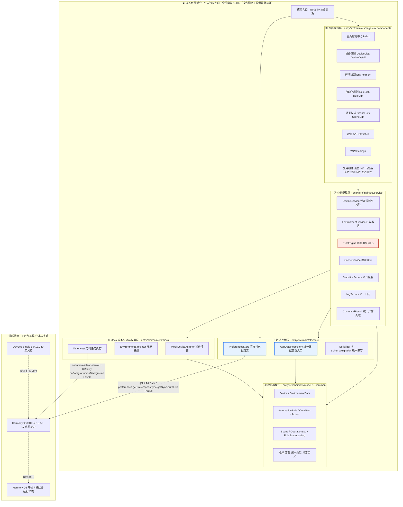
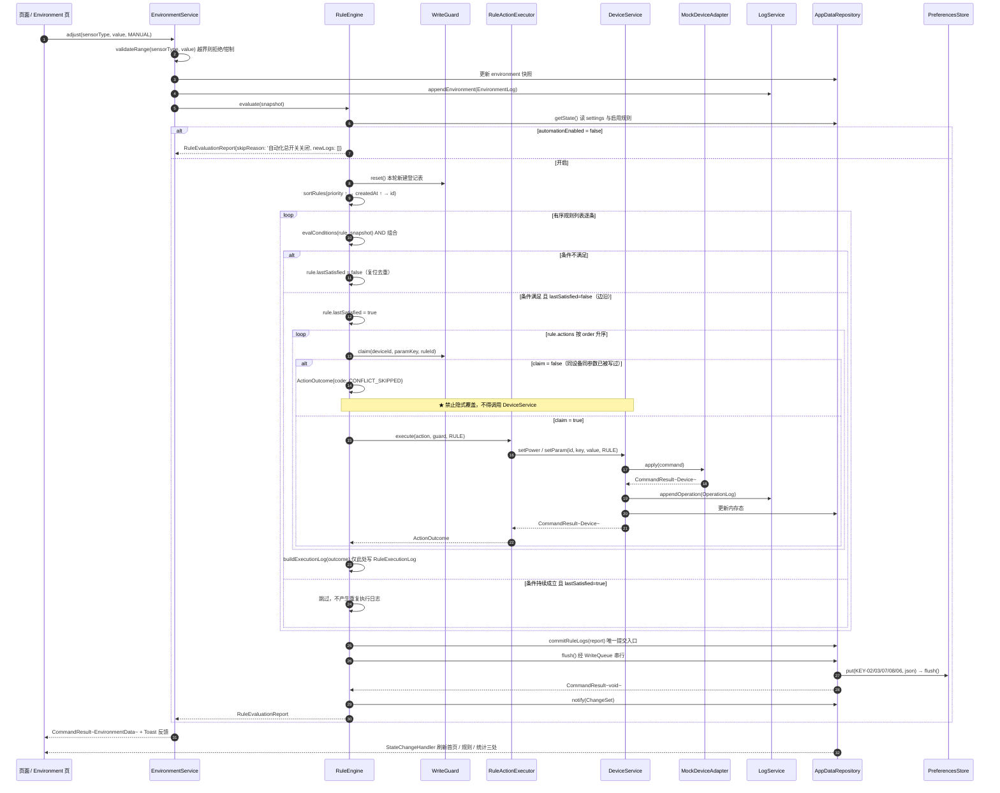
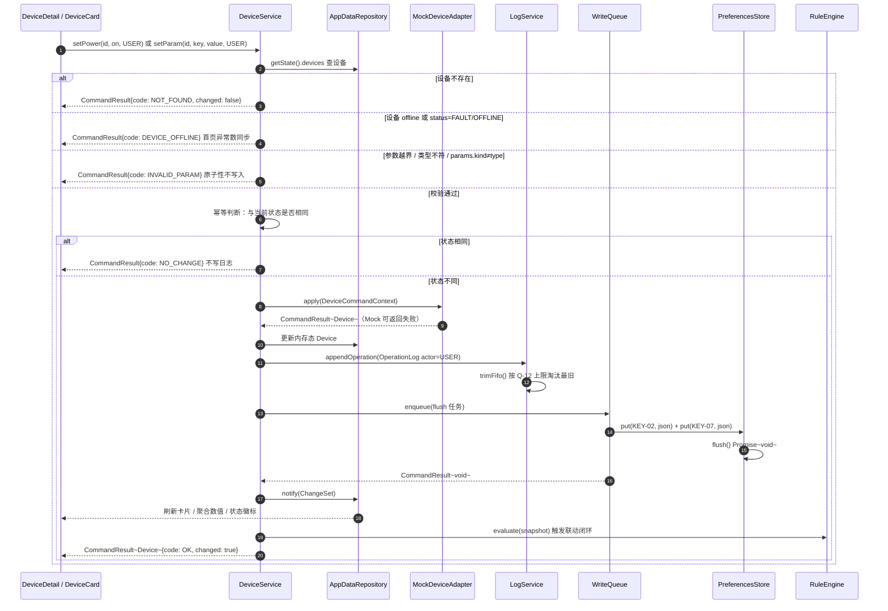
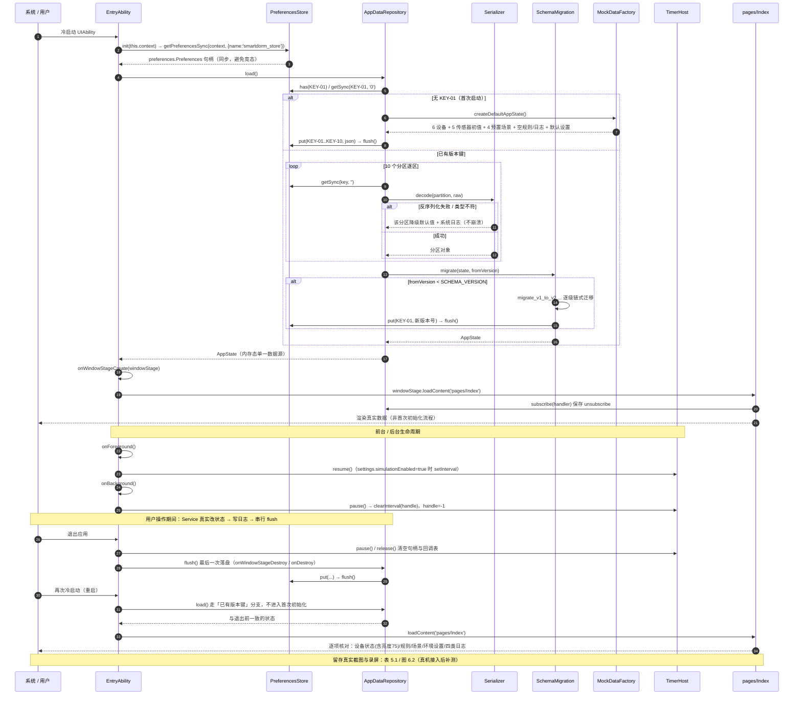
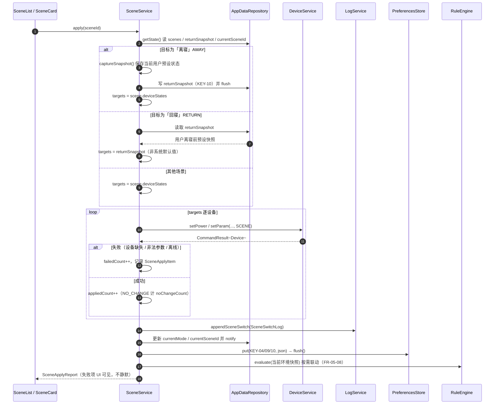

# 智寓——HarmonyOS 智能宿舍管家　系统架构设计

> **文档性质**：第一阶段架构设计交付物（System Design Document，SDD）
> **上游基线**：`docs/软件需求说明书.md` V1.0（许清楚 · 产品经理）
> **适用范围**：期末大作业「主题三：智能场景规则编排与交互仿真系统」，个人独立完成
> **状态说明**：本文档描述**必须如何设计与实现**，**不代表已实现**。所有构建结果、测试结论、真机运行、Git 提交记录均以各阶段真实产出为准；本文档不作任何已完成声明。

---

## 文档控制信息

| 项目 | 内容 |
| --- | --- |
| 文档名称 | 智寓——HarmonyOS 智能宿舍管家　系统架构设计 |
| 文档版本 | V1.0（第一阶段架构基线版） |
| 编制日期 | 2026-11-09 |
| 编制人 | 高见远（架构师）· 团队 software-smartdorm |
| 审核人 | 齐活林（主理人）、许清楚（产品经理）【待评审】 |
| 文档状态 | 待评审 / 供阶段二至阶段四编码照做 |
| 目标平台 | HarmonyOS 平板，HarmonyOS SDK 5.0.5 / API 17（`sdk-pkg.json` 实测 `apiVersion=17`，`version=5.0.5.165`） |
| 开发工具 | DevEco Studio 5.0.13.240；hvigor `@ohos/hvigor` 5.17.6；Node v22.22.2 |
| 开发语言 | ArkTS（Stage 模型）+ ArkUI（声明式）+ Ability Kit |
| 工程根目录 | `D:\SmartDormHarmonyOS` |
| API 核验基准目录 | `D:\DevEco Studio\sdk\default\openharmony\ets\`（`api/` 439 个 `.d.ts`、`kits/`、`component/`、`application/`） |
| 对应报告模板 | 表 2.1 系统模块及接口关系、表 3.1 主要数据模型、表 3.2 模块接口、图 2.1 系统架构图、图 3.1 模块业务流程图、图 6.2 数据恢复与集成 |
| 变更纪律 | 本文所有 HarmonyOS 系统 API 名称与签名**均来自本机 SDK 声明文件实测**（证据见第 9 章），未核验能力一律不写入源码 / 报告 / README；后续方案变更须回头更新本文与 PRD 并递增版本号 |

### 与 PRD 的关系及本文职责边界

| 项 | 归属 |
| --- | --- |
| 「必须做成什么样」（功能、非功能、流程、测试基线、评分映射） | PRD（`docs/软件需求说明书.md`） |
| 「具体怎么做」（系统 API 选型与 import、目录与文件、ArkTS 类型定义、方法签名、护栏、时序、状态管理、常量） | **本文** |
| PRD 第 19 章 Q-01 / Q-02 / Q-03 / Q-04 / Q-05 / Q-10 / Q-12 / Q-15 的裁决 | **本文第 9.3 节**（只出结论与影响，不直接改 PRD 原文） |
| PRD 原文修订 | 交主理人转**产品经理**执行；本文第 12 章仅给出修订建议清单 |
| 源码实现、构建、真机调试、GitHub 操作、Word 报告撰写 | 不在本文范围（分别由阶段二~七执行） |

---

## 1 实现方案与框架选型

### 1.1 技术栈与版本锁定

| 层次 | 选型 | 版本 / 依据 | 说明 |
| --- | --- | --- | --- |
| 操作系统 SDK | HarmonyOS SDK 5.0.5 / API 17 | `sdk-pkg.json` 实测 `apiVersion=17`、`version=5.0.5.165`、`Release` | 所有方案必须可在 API 17 实施 |
| 开发语言 | ArkTS（Stage 模型，静态类型严格子集） | `@kit.ArkTS.d.ts`（`ets/kits/@kit.ArkTS.d.ts` 全文） | 禁 `any`、禁松散对象字面量、联合类型访问前须收窄 |
| UI 框架 | ArkUI 声明式 UI | `ets/component/*.d.ts`（`canvas.d.ts`、`grid_row.d.ts`、`grid_col.d.ts` 等） | `@State` / `@Link` / `@Provide` / `@Watch` 状态驱动 |
| 应用框架 | Ability Kit · `UIAbility`（Stage 模型） | `@ohos.app.ability.UIAbility.d.ts` 259 行 | 生命周期驱动初始化、定时器托管、持久化收尾 |
| 页面路由 | `@ohos.router`（Kit 化导入 `import { router } from '@kit.ArkUI'`） | `@kit.ArkUI.d.ts` 68 行；`@ohos.router.d.ts` 450/624/713/924 行 | 见 Q-02 裁决 |
| 持久化 | 用户首选项 `preferences`（Kit 化导入 `import { preferences } from '@kit.ArkData'`） | `@kit.ArkData.d.ts` 28/37 行；`@ohos.data.preferences.d.ts` 416/1068/1371/1665 行 | 见 Q-01 裁决；**不启用关系型存储** |
| 图表 | ArkUI `Canvas` + `CanvasRenderingContext2D` 自绘 | `ets/component/canvas.d.ts` 5978/5039/5936 行 | 离线、真实数据驱动、零静态图片，见 Q-03 |
| 定时器 | 全局 `setInterval` / `clearInterval` | `ets/api/@internal/full/global.d.ts` 573/641 行 | 由 `TimerHost` 单例封装并绑定 UIAbility 生命周期，见 Q-04 |
| 数据导出 | `fileIo`（= `@ohos.file.fs`）+ `Context.filesDir` | `@kit.CoreFileKit.d.ts` 26/34 行；`application/Context.d.ts` 196 行 | 仅沙箱内导出，见 Q-05 |
| 序列化 | `@ohos.util.json`（Kit 化 `import { JSON } from '@kit.ArkTS'`） | `@kit.ArkTS.d.ts` 42/48 行；`@ohos.util.json.d.ts` 59/78 行 | 分区 JSON 字符串 |
| 唯一 ID | `util.generateRandomUUID()` | `@ohos.util.d.ts` 329 行 | 前缀 + UUID |
| 平板适配 | `@ohos.mediaquery.matchMediaSync` + `GridRow` / `GridCol` | `@ohos.mediaquery.d.ts` 334 行；`grid_row.d.ts` 1048 行；`grid_col.d.ts` 535 行 | 响应式断点（sm / md / lg）切换列数 |
| 构建 | hvigor 5.17.6 + ohpm | 环境实测记录 `evidence/环境检查记录-阶段一.md` 第 74 行 | 产物 HAP 归档 `build/` |
| 运行时第三方依赖 | **零** | — | 见第 7 章 |

### 1.2 核心技术难点与对策

| 编号 | 难点 | 对策 | 对应需求 / 评分 |
| --- | --- | --- | --- |
| D-01 | 核心规则必须**真实执行**，不得以预设界面替代 | 五层分离；`RuleEngine.evaluate(snapshot)` 由环境/设备/场景变更事件真实触发；每轮产出 `RuleEvaluationReport`；`RuleExecutionLog` 仅由引擎写入 | FR-04、FR-08-02、SC-02 |
| D-02 | 条件持续成立时**不重复执行** | 每条规则持久化 `lastSatisfied` 边沿标记；规则编辑 / 启停 / 总开关切换时显式 `resetDedup()`；不满足时复位 | FR-04-10、TC-B-06 |
| D-03 | 多规则**确定性顺序**与**冲突不隐式覆盖** | 排序 `priority↑ → createdAt↑ → id 字典序`；引入 `WriteGuard`（`deviceId + paramKey` 登记），`claim()` 通过才允许调用 `DeviceService`，否则记 `SKIPPED_CONFLICT` | FR-04-11/12、FLOW-01、TC-E-06、Q-10 |
| D-04 | **四面一致**（内存态 → UI → 日志 → 落盘） | `AppDataRepository` 单一入口 + 串行 `WriteQueue`（Promise 链）；一次逻辑事务内完成三步并 `notify()` | FR-08-06、NFR-03 |
| D-05 | **定时器泄漏**与后台采样 | `TimerHost` 唯一持有 `number` 句柄；页面只订阅不注册；UIAbility `onForeground/onBackground` 恢复/暂停 | FR-03-07、NFR-04、TC-E-08、SC-08 |
| D-06 | **启动竞态**：页面渲染前数据必须就绪 | `getPreferencesSync` 同步取句柄 + `getSync` 同步读 10 个分区构建内存态（放在 `onCreate`），`onWindowStageCreate` 才 `loadContent`；运行时写入走 Promise 异步队列 | Q-01、FLOW-03、SC-09 |
| D-07 | **读取失败不崩溃**、版本迁移 | 分区级 `try/catch` + 逐区降级默认值；`SCHEMA_VERSION` 逐级迁移函数链；迁移后回写版本号 | NFR-02、TC-E-07、NFR-08 |
| D-08 | 图表**禁止静态图片**、必须离线 | Canvas 自绘组件只接收 `ChartPoint[]` / `ChartBar[]`；`onReady` 与 `@Watch` 数据变更时重绘；无图片资源、无网络 | FR-06-02/03、NFR-13 |
| D-09 | **运行载体不可用**（镜像最高 API 12，SDK API 17） | 分层验证：hvigor 构建产物 / Node 侧纯逻辑单测 / Previewer UI / 真机补测；不虚构真机成功 | ENV-06、Q-08、NFR-07 |
| D-10 | **ArkTS 严格类型**下不能用 `any` 堆领域模型 | 11+3 枚举、`DeviceParams` 判别联合、`CommandResult<T>` 泛型、`Record<string, string>` 替代 `Object` | SC-01、NFR-06 |

### 1.3 架构模式与分层

采用 **Stage 模型下的五层单向分层 + 单一数据源（Single Source of Truth）+ 观察者订阅**：

- **L1 页面展示层**（`pages/`、`components/`）：ArkUI 声明式 UI，只做渲染、交互事件、订阅变更；不含业务算法、不直接写日志、不直接读写持久化。
- **L2 业务逻辑层**（`service/`）：设备控制校验、环境更新、规则求值、场景编排、统计聚合、统一日志；统一返回 `CommandResult<T>`。
- **L3 数据模型层**（`model/`、`common/`）：ArkTS `interface` / `class` / `enum` / `type`、常量、统一结果类型；最内层，不反向依赖。
- **L4 数据存储层**（`store/`）：`AppDataRepository` 单一入口、`PreferencesStore` 官方能力封装、`Serializer`、`SchemaMigration`、`WriteQueue`。
- **L5 Mock 层**（`mock/`）：`MockDeviceAdapter`、`EnvironmentSimulator`、`TimerHost`；可注入、可置故障，但**不得伪造执行结果**。
- **应用入口**（`entryability/`）：UIAbility 生命周期，负责初始化仓储、绑定 context、定时器托管、退出收尾。

依赖方向严格单向：**① → ② →（③ / ④ / ⑤）；④ → ③；⑤ → ③**；禁止反向依赖（PRD 6.2）。

### 1.4 系统架构图（对应报告图 2.1）

> **★ 本人负责部分 · 个人独立完成 · 全部模块 100%（报告图 2.1 须保留此标注）** —— 该边界标注与 PRD 第 6.1 节**逐字一致、原样保留**；边界外的 HarmonyOS 系统能力、DevEco Studio 工具链与设备运行环境为平台依赖，非本人实现。本文在 PRD 图基础上把「具体 API 待架构师核验」两处替换为第 9 章已实测的 API 名称。



### 1.5 分层职责与依赖方向（设计侧确认）

| 层 | 目录 | 允许依赖 | 禁止 | 设计侧补充约束 |
| --- | --- | --- | --- | --- |
| ① 页面展示层 | `pages/`、`components/` | ②、③ | 直接读写持久化、直接写日志、内嵌规则算法 | 页面只持有 `AppDataRepository` 引用与 `unsubscribe` 句柄；参数经 `RouteParams` 解析 |
| ② 业务逻辑层 | `service/` | ③、④、⑤ | 直接持有 UI 组件、硬编码预设结果 | `RuleEngine` 是唯一可写 `RuleExecutionLog` 的类；`DeviceService` 不提供 `force` 覆盖参数 |
| ③ 数据模型层 | `model/`、`common/` | 无（最内层） | 反向依赖其他层、包含业务逻辑 | 全部 `export` 类型，禁 `any`；枚举用 string enum 便于 JSON 序列化 |
| ④ 数据存储层 | `store/` | ③、官方 `preferences` | 被页面层直接调用 | `commitRuleLogs()` 仅接受 `RuleEvaluationReport.newLogs`；`WriteQueue` 串行 |
| ⑤ Mock 层 | `mock/` | ③ | 伪造执行结果、绕过业务逻辑直接改 UI | 置故障/离线必须经 `DeviceService` 统一入口并写 `OperationLog` |
| 应用入口 | `entryability/` | ④、② | 承载页面业务代码 | `onCreate` 同步完成 load；`onForeground/onBackground` 驱动 `TimerHost` |

---

## 2 工程目录与完整文件列表

### 2.1 工程目录树（Stage 模型，根目录 `D:\SmartDormHarmonyOS`）

```text
SmartDormHarmonyOS/
├── AppScope/                                  # 应用级配置与资源
├── build-profile.json5                        # 工程级构建配置（products / modules）
├── hvigorfile.ts                              # 工程级构建插件入口
├── oh-package.json5                           # 根依赖声明（devDependencies 仅官方测试工具）
├── code-linter.json5                          # ArkTS 静态检查规则
├── local.properties                           # 本地 SDK 路径（.gitignore 排除，不入仓）
├── .gitignore                                 # 排除 build/、local.properties、密钥、产物
├── README.md                                  # DL-04 十三项
├── hvigor/                                    # hvigor wrapper 与配置
├── entry/                                     # 唯一 HAP 模块
│   ├── build-profile.json5
│   ├── hvigorfile.ts
│   ├── oh-package.json5
│   └── src/
│       ├── main/
│       │   ├── module.json5
│       │   ├── ets/
│       │   │   ├── entryability/
│       │   │   ├── pages/
│       │   │   ├── components/
│       │   │   ├── service/
│       │   │   ├── model/
│       │   │   ├── store/
│       │   │   ├── mock/
│       │   │   └── common/
│       │   └── resources/
│       ├── test/                              # 本地单元测试（Node 侧可复用）
│       └── ohosTest/                          # 设备侧测试（hypium）
├── tests/                                     # Node 侧纯逻辑测试脚本与用例表
├── design/                                    # 本文与任务列表、可编辑 Mermaid 图源
├── docs/                                      # PRD 与阶段文档
├── evidence/                                  # 环境检查、API 核验、验收记录
├── screenshots/                               # Previewer / 真机截图
├── videos/                                    # 连续录屏
├── build/                                     # hvigor 构建产物（HAP）
├── stages/                                    # 各阶段报告
└── deliverables/                              # 最终交付包
```

### 2.2 完整文件清单（相对路径 · 职责 · 模块 · 产出阶段）

> 阶段列：二 = 阶段二「基础工程与 UI 开发」；三 = 阶段三「核心业务逻辑」；四 = 阶段四「数据持久化」；五 = 阶段五「测试与修复」；六/七 = 文档与交付。**阶段二只创建文件并留接口占位，不实现阶段三/四业务逻辑**。

#### 2.2.1 工程级配置与入口（15 个文件）

| # | 相对路径 | 职责 | 模块 | 阶段 |
| --- | --- | --- | --- | --- |
| 1 | `AppScope/app.json5` | 应用级 `bundleName`、`vendor`、`versionCode/versionName`、`icon`、`label` | MOD-08 | 二 |
| 2 | `AppScope/resources/base/element/string.json` | 应用名等字符串资源（`app_name`） | MOD-08 | 二 |
| 3 | `AppScope/resources/base/media/app_icon.png` | 应用图标资源 | MOD-08 | 二 |
| 4 | `AppScope/resources/base/media/layered_image.json` | API 11+ 分层图标配置（模板基线） | MOD-08 | 二 |
| 5 | `build-profile.json5` | 工程级 products：`targetSdkVersion` / `compatibleSdkVersion` / `runtimeOS=HarmonyOS` / `strictMode`；modules 注册 | MOD-08 | 二 |
| 6 | `hvigorfile.ts` | 工程级 `appTasks` 插件注册 | MOD-08 | 二 |
| 7 | `oh-package.json5` | 根 `modelVersion`；`devDependencies` 仅 `@ohos/hypium` / `@ohos/hamock`（官方随 SDK，离线） | MOD-08 | 二 |
| 8 | `code-linter.json5` | ArkTS 代码检查规则（禁 `any`、命名、复杂度） | MOD-07 | 二 |
| 9 | `hvigor/hvigor-config.json5` | hvigor 版本与依赖配置（`@ohos/hvigor` 5.17.6） | MOD-08 | 二 |
| 10 | `hvigor/hvigor-wrapper.js` | hvigor wrapper 启动脚本 | MOD-08 | 二 |
| 11 | `local.properties` | 本机 SDK 路径（**不入仓**） | MOD-08 | 二 |
| 12 | `.gitignore` | 排除 `build/`、`oh_modules/`、`local.properties`、密钥、IDE 配置、大体积产物 | MOD-08 | 二 |
| 13 | `entry/build-profile.json5` | `apiType: stageMode`、targets、`ohosTest` target | MOD-08 | 二 |
| 14 | `entry/hvigorfile.ts` | 模块级 `hapTasks` 插件注册 | MOD-08 | 二 |
| 15 | `entry/oh-package.json5` | entry 模块依赖声明（运行时依赖为空） | MOD-08 | 二 |

#### 2.2.2 module 配置与资源（8 个文件）

| # | 相对路径 | 职责 | 模块 | 阶段 |
| --- | --- | --- | --- | --- |
| 16 | `entry/src/main/module.json5` | `mainElement=EntryAbility`、`deviceTypes`（tablet / phone / 2in1）、`"pages": "$profile:main_pages"`、abilities 声明 | MOD-08 | 二 |
| 17 | `entry/src/main/resources/base/profile/main_pages.json` | **路由页面注册表**：`src` 数组列出 10 个页面，首项 `pages/Index` | MOD-01 | 二 |
| 18 | `entry/src/main/resources/base/element/string.json` | 页面标题、按钮文案、提示语（简体中文） | MOD-07 | 二 |
| 19 | `entry/src/main/resources/base/element/color.json` | 设计令牌颜色（主色 / 背景 / 状态色） | MOD-07 | 二 |
| 20 | `entry/src/main/resources/base/element/float.json` | 圆角、间距、字号等尺寸令牌 | MOD-07 | 二 |
| 21 | `entry/src/main/resources/base/media/` | 图标与状态徽标所需矢量/图片资源（**不含任何图表静态图**） | MOD-07 | 二 |
| 22 | `entry/src/main/resources/rawfile/` | 预留：导出模板 / 说明文本（可空目录，以 `.gitkeep` 占位） | MOD-07 | 二 |
| 23 | `entry/src/ohosTest/module.json5` | 设备侧测试模块配置 | MOD-09 | 五 |

#### 2.2.3 应用入口 `entryability/`（1 个文件）

| # | 相对路径 | 职责 | 模块 | 阶段 |
| --- | --- | --- | --- | --- |
| 24 | `entry/src/main/ets/entryability/EntryAbility.ets` | `UIAbility` 子类：`onCreate` 同步初始化 `PreferencesStore` + `AppDataRepository.load()`；`onWindowStageCreate` → `windowStage.loadContent('pages/Index')`；`onForeground` → `TimerHost.resume()`；`onBackground` → `TimerHost.pause()`；`onWindowStageDestroy` → pause + 末次 flush；`onDestroy` → `TimerHost.release()` + 末次 flush | MOD-08 | 二（骨架）/ 四（完整收尾） |

#### 2.2.4 页面展示层 `pages/`（10 个文件）

| # | 相对路径 | 职责 | 路由 url | 对应需求 | 阶段 |
| --- | --- | --- | --- | --- | --- |
| 25 | `entry/src/main/ets/pages/Index.ets` | 首页控制中心：4 项环境概览、在线/异常设备数、规则数、当前运行模式、≥6 类设备卡片、六模块入口 | `pages/Index` | FR-01 | 二 |
| 26 | `entry/src/main/ets/pages/DeviceList.ets` | 设备列表、添加/删除入口、状态徽标、跳转详情 | `pages/DeviceList` | FR-02 | 二 |
| 27 | `entry/src/main/ets/pages/DeviceDetail.ets` | 单设备全参数、开关/参数控件、历史操作记录、**Mock 诊断区（置 FAULT/OFFLINE/online，Q-15）** | `pages/DeviceDetail` | FR-01-04 / FR-02 / Q-15 | 二 |
| 28 | `entry/src/main/ets/pages/Environment.ets` | 5 类传感器卡片、手动调整、模拟变化开关、环境历史记录 | `pages/Environment` | FR-03 | 二 |
| 29 | `entry/src/main/ets/pages/RuleList.ets` | 规则列表、启用/停用、编辑/删除入口、执行记录入口 | `pages/RuleList` | FR-04 | 二 |
| 30 | `entry/src/main/ets/pages/RuleEdit.ets` | 规则创建/编辑：多条件 AND、多动作有序、优先级、目标设备、参数校验 | `pages/RuleEdit` | FR-04-01~05 | 二 |
| 31 | `entry/src/main/ets/pages/SceneList.ets` | 4 预置场景 + 自定义场景列表、切换、编辑/删除入口 | `pages/SceneList` | FR-05 | 二 |
| 32 | `entry/src/main/ets/pages/SceneEdit.ets` | 场景目标设备状态集合编辑（逐设备） | `pages/SceneEdit` | FR-05-02/05 | 二 |
| 33 | `entry/src/main/ets/pages/Statistics.ets` | 4 类记录查询与筛选、温度/湿度折线图、设备运行柱状图、派生指标 | `pages/Statistics` | FR-06 | 二 |
| 34 | `entry/src/main/ets/pages/Settings.ets` | 自动化总开关、环境模拟开关、采样间隔、日志上限、数据重置（二次确认）、应用信息、持久化管理入口、数据导出入口、降级提示 | `pages/Settings` | FR-07 | 二 |

#### 2.2.5 复用组件 `components/`（12 个文件）

| # | 相对路径 | 职责 | 模块 | 阶段 |
| --- | --- | --- | --- | --- |
| 35 | `entry/src/main/ets/components/common/PageHeader.ets` | 统一页头（标题、返回、右侧操作槽） | MOD-02 | 二 |
| 36 | `entry/src/main/ets/components/common/SectionCard.ets` | 统一圆角卡片容器（背景、阴影、内边距令牌） | MOD-02 | 二 |
| 37 | `entry/src/main/ets/components/common/StatusBadge.ets` | 设备/规则状态徽标（RUNNING/IDLE/FAULT/OFFLINE 配色） | MOD-02 | 二 |
| 38 | `entry/src/main/ets/components/common/EmptyView.ets` | 空数据占位（非装饰性，含真实引导入口） | MOD-02 | 二 |
| 39 | `entry/src/main/ets/components/common/ConfirmDialog.ets` | 二次确认弹窗（数据重置、删除），基于 `promptAction.showDialog` | MOD-02 | 二 |
| 40 | `entry/src/main/ets/components/common/ToastHost.ets` | 统一反馈封装（`promptAction.showToast`），按 `ResultCode` 出中文提示 | MOD-02 | 二 |
| 41 | `entry/src/main/ets/components/device/DeviceCard.ets` | 设备卡片：状态、参数摘要、点击进详情、快速开关 | MOD-02 | 二 |
| 42 | `entry/src/main/ets/components/env/SensorCard.ets` | 传感器卡片：当前值、单位、合法范围、手动调整控件 | MOD-02 | 二 |
| 43 | `entry/src/main/ets/components/rule/RuleCard.ets` | 规则卡片：条件摘要、动作摘要、启停开关、优先级 | MOD-02 | 二 |
| 44 | `entry/src/main/ets/components/scene/SceneCard.ets` | 场景卡片：类型、目标设备数、切换按钮 | MOD-02 | 二 |
| 45 | `entry/src/main/ets/components/chart/LineChart.ets` | **Canvas 自绘折线图**（温度/湿度/空气质量） | MOD-02 | 二 |
| 46 | `entry/src/main/ets/components/chart/BarChart.ets` | **Canvas 自绘柱状图**（设备运行/规则执行统计） | MOD-02 | 二 |

#### 2.2.6 业务逻辑层 `service/`（12 个文件）

| # | 相对路径 | 职责 | 模块 | 阶段 |
| --- | --- | --- | --- | --- |
| 47 | `entry/src/main/ets/service/CommandResultFactory.ets` | `ok/noChange/fail` 构造 `CommandResult<T>`，统一 message 映射 | MOD-03 | 三 |
| 48 | `entry/src/main/ets/service/DeviceService.ets` | MI-02~05：校验、`MockDeviceAdapter` 执行、`OperationLog`、通知、`flush` | MOD-03 | 三 |
| 49 | `entry/src/main/ets/service/EnvironmentService.ets` | MI-07/08：快照、调整、合法性钳制、`EnvironmentLog`、触发求值 | MOD-03 | 三 |
| 50 | `entry/src/main/ets/service/RuleService.ets` | MI-11：规则 CRUD / 启停，编辑后 `resetDedup()` | MOD-03 | 三 |
| 51 | `entry/src/main/ets/service/RuleEngine.ets` | **MI-12 核心**：排序、AND 求值、边沿去重、错误处理、`WriteGuard`、产出 `RuleEvaluationReport` | MOD-03 | 三 |
| 52 | `entry/src/main/ets/service/RuleActionExecutor.ets` | `RuleEngine` 私有执行器：`guard.claim` 通过后才调用 `DeviceService`（护栏 B） | MOD-03 | 三 |
| 53 | `entry/src/main/ets/service/WriteGuard.ets` | 本轮 `(deviceId, paramKey)` 写入登记表；`claim/reset/entries` | MOD-03 | 三 |
| 54 | `entry/src/main/ets/service/SceneService.ets` | MI-14：离寝快照保存、回寝快照恢复、逐设备下发、`SceneSwitchLog`、`SceneApplyReport` | MOD-03 | 三 |
| 55 | `entry/src/main/ets/service/StatisticsService.ets` | 图表数据聚合：`EnvironmentLog → ChartPoint[]`、`OperationLog → ChartBar[]`、成功率/时长 | MOD-03 | 三 |
| 56 | `entry/src/main/ets/service/LogService.ets` | MI-13：四类日志查询、三类日志 append（**不暴露规则日志写入**）、FIFO 淘汰 | MOD-03 | 三 |
| 57 | `entry/src/main/ets/service/ExportService.ets` | FR-07-04：导出 JSON/CSV 到 `context.filesDir`，返回路径与字节数 | MOD-03 | 三 |
| 58 | `entry/src/main/ets/service/ServiceContracts.ets` | **阶段二接口占位**：各 Service 的最小契约声明（不含实现），供页面编译通过 | MOD-03 | 二（占位）/ 三（替换） |

#### 2.2.7 数据模型层 `model/`（14 个文件）

| # | 相对路径 | 职责 | 模块 | 阶段 |
| --- | --- | --- | --- | --- |
| 59 | `entry/src/main/ets/model/Enums.ets` | 11 个 PRD 枚举 + 3 个补充枚举（`ACMode`、`RunMode`、`ParamKey`） | MOD-04 | 二 |
| 60 | `entry/src/main/ets/model/DeviceParams.ets` | `DeviceParams` 判别联合 + 6 个参数接口 + `DeviceParamsFactory` 默认值 | MOD-04 | 二 |
| 61 | `entry/src/main/ets/model/Device.ets` | DM-01 `Device` + `DeviceStatus` 相关辅助类型 | MOD-04 | 二 |
| 62 | `entry/src/main/ets/model/EnvironmentData.ets` | DM-02 `EnvironmentData` | MOD-04 | 二 |
| 63 | `entry/src/main/ets/model/AutomationRule.ets` | DM-03 `AutomationRule` | MOD-04 | 二 |
| 64 | `entry/src/main/ets/model/AutomationCondition.ets` | DM-04 `AutomationCondition` | MOD-04 | 二 |
| 65 | `entry/src/main/ets/model/AutomationAction.ets` | DM-05 `AutomationAction` | MOD-04 | 二 |
| 66 | `entry/src/main/ets/model/Scene.ets` | DM-06 `Scene` + `DeviceStateSnapshot`（DM-06 关联） | MOD-04 | 二 |
| 67 | `entry/src/main/ets/model/Logs.ets` | DM-07~10：`OperationLog` / `RuleExecutionLog` / `EnvironmentLog` / `SceneSwitchLog` / `LogBundle` / `LogRecord` | MOD-04 | 二 |
| 68 | `entry/src/main/ets/model/AppSettings.ets` | DM-11 `AppSettings` | MOD-04 | 二 |
| 69 | `entry/src/main/ets/model/CommandResult.ets` | `CommandResult<T>` + `ResultCode` + 结果码中文映射 | MOD-04 | 二 |
| 70 | `entry/src/main/ets/model/Reports.ets` | `RuleEvaluationReport` / `RuleOutcome` / `ActionOutcome` / `SceneApplyReport` / `SceneApplyItem` | MOD-04 | 二 |
| 71 | `entry/src/main/ets/model/AppState.ets` | `AppState` 单一数据源顶层结构 | MOD-04 | 二 |
| 72 | `entry/src/main/ets/model/ChartModels.ets` | `ChartPoint` / `ChartBar` / `LineChartModel` / `BarChartModel` / `ChartSeries` | MOD-04 | 二 |

#### 2.2.8 数据存储层 `store/`（7 个文件）

| # | 相对路径 | 职责 | 模块 | 阶段 |
| --- | --- | --- | --- | --- |
| 73 | `entry/src/main/ets/store/StorageKeys.ets` | KEY-01~10 十个持久化键常量 + `StoragePartition` 枚举 | MOD-05 | 二 |
| 74 | `entry/src/main/ets/store/PreferencesOptions.ets` | 包装 SDK `preferences.Options`：`PreferencesOptions{ name, dataGroupId? }` | MOD-05 | 二 |
| 75 | `entry/src/main/ets/store/PreferencesStore.ets` | MI-19：`getPreferencesSync` 取句柄、`getSync/hasSync` 启动读、`put/flush/delete/clear` 运行写 | MOD-05 | 四 |
| 76 | `entry/src/main/ets/store/Serializer.ets` | 分区 JSON 序列化 / 反序列化，逐区 `try/catch` 降级 | MOD-05 | 四 |
| 77 | `entry/src/main/ets/store/SchemaMigration.ets` | `SCHEMA_VERSION` 逐级迁移函数链、迁移后回写 KEY-01 | MOD-05 | 四 |
| 78 | `entry/src/main/ets/store/WriteQueue.ets` | 串行写入队列（Promise 链），同一时刻仅一个 flush | MOD-05 | 四 |
| 79 | `entry/src/main/ets/store/AppDataRepository.ets` | MI-01/15/16/17/18：单一数据源、订阅通知、`commitRuleLogs` 单点提交 | MOD-05 | 二（占位）/ 四（完整） |

#### 2.2.9 Mock 层 `mock/`（4 个文件）

| # | 相对路径 | 职责 | 模块 | 阶段 |
| --- | --- | --- | --- | --- |
| 80 | `entry/src/main/ets/mock/MockDataFactory.ets` | 首次启动默认数据：6 类设备、5 传感器初值、4 预置场景 + 1 自定义位、空规则/日志/设置 | MOD-06 | 四 |
| 81 | `entry/src/main/ets/mock/MockDeviceAdapter.ets` | MI-06：设备命令打桩执行；`setDeviceStatus` / `setOnline` 支撑故障/离线模拟（Q-15） | MOD-06 | 三 |
| 82 | `entry/src/main/ets/mock/EnvironmentSimulator.ets` | MI-09：按采样间隔产生合理波动，`tick()` 单步 | MOD-06 | 三 |
| 83 | `entry/src/main/ets/mock/TimerHost.ets` | MI-10：全局单例，唯一 `setInterval` 句柄，`register/release/pause/resume` | MOD-06 | 二（骨架）/ 三（完整） |

#### 2.2.10 公共基础层 `common/`（10 个文件）

| # | 相对路径 | 职责 | 模块 | 阶段 |
| --- | --- | --- | --- | --- |
| 84 | `entry/src/main/ets/common/Constants.ets` | `SCHEMA_VERSION`、`STORE_NAME`、设备/传感器参数上下界、日志上限、默认采样间隔 | MOD-07 | 二 |
| 85 | `entry/src/main/ets/common/ParamSchema.ets` | `ParamKey` 合法范围表与 `validateParam(type,key,value)` 纯函数 | MOD-07 | 二 |
| 86 | `entry/src/main/ets/common/ThemeTokens.ets` | 颜色/圆角/间距/字号设计令牌（与 `resources` 对齐） | MOD-07 | 二 |
| 87 | `entry/src/main/ets/common/RouteMap.ets` | 10 个页面 url 常量与 `push(url, params)` 封装（`router.pushUrl`） | MOD-07 | 二 |
| 88 | `entry/src/main/ets/common/RouteParams.ets` | `router.getParams()` 的严格类型解析（`Record<string,string>` + 默认值） | MOD-07 | 二 |
| 89 | `entry/src/main/ets/common/IdGenerator.ets` | `util.generateRandomUUID()` + 前缀生成唯一 id | MOD-07 | 二 |
| 90 | `entry/src/main/ets/common/TimeUtil.ets` | epoch 毫秒 ⇄ 本地展示字符串、ISO 8601 UTC 字符串（纯函数） | MOD-07 | 二 |
| 91 | `entry/src/main/ets/common/ResultMessage.ets` | `ResultCode` → 简体中文提示映射表 | MOD-07 | 二 |
| 92 | `entry/src/main/ets/common/AppStorageKeys.ets` | `AppStorage` 键常量（仅放全局单例引用，不放领域数据） | MOD-07 | 二 |
| 93 | `entry/src/main/ets/common/StateChangeTypes.ets` | `StateChangeHandler`、`ChangeSet`、`LogFilter` 等跨层回调类型 | MOD-07 | 二 |

#### 2.2.11 测试与证据归档（10 个文件）

| # | 相对路径 | 职责 | 模块 | 阶段 |
| --- | --- | --- | --- | --- |
| 94 | `entry/src/test/LocalUnit.test.ets` | 本地单元测试入口（模板基线） | MOD-09 | 五 |
| 95 | `entry/src/test/DomainLogic.test.ets` | 领域纯逻辑用例（规则排序、去重、冲突、参数校验） | MOD-09 | 五 |
| 96 | `entry/src/ohosTest/ets/test/Ability.test.ets` | UIAbility 生命周期与持久化恢复设备侧测试 | MOD-09 | 五 |
| 97 | `tests/README.md` | Node 侧纯逻辑测试运行说明（真实执行后填写结果） | MOD-09 | 五 |
| 98 | `tests/run-domain-tests.mjs` | 编译后纯逻辑模块的 Node 侧测试驱动（真实输出日志） | MOD-09 | 五 |
| 99 | `tests/cases/测试用例表.md` | 对应 PRD 第 16 章 TC-N/TC-B/TC-E，结果列留空 | MOD-09 | 五 |
| 100 | `evidence/环境检查记录-阶段一.md` | 已存在（主理人产出） | MOD-09 | 一 |
| 101 | `evidence/API17核验清单.md` | 本文第 9 章核验表的可核查归档（含声明文件路径与行号） | MOD-09 | 一 |
| 102 | `evidence/阶段验收记录.md` | 10.4 八步验收、图表真实性、定时器生命周期等真实记录（结果留空） | MOD-09 | 五 |
| 103 | `design/系统架构设计.md` / `design/任务列表-第二阶段.md` / `design/class-diagram.mermaid` / `design/sequence-diagram.mermaid` | 本文、任务列表、可编辑 Mermaid 图源 | MOD-09 | 一 |

> **文件总数统计**：正文规划 **103 个条目**，其中：工程/配置/资源/入口/页面/组件/模型/公共层等**源码与配置文件 93 个**（#1~#93），测试与证据归档 **10 个**（#94~#103）；另有 `screenshots/`、`videos/`、`build/`、`stages/`、`deliverables/`、`docs/` 等**目录型归档**（按 DL-06 分类，内容在阶段五~七真实产生，不预造文件）。阶段二按 `design/任务列表-第二阶段.md` 的 T-01~T-05 落地，涉及 **89 个文件条目**（含跨任务复用与复核项，如 `ThemeTokens.ets`、`color.json` / `float.json`、`RouteMap.ets` / `RouteParams.ets`、`main_pages.json`、`EntryAbility.ets` 在不同任务中分别「创建 / 补完 / 复核 / 集成」），去重后**新建文件约 70 余个**（含骨架与占位）；阶段三/四补齐业务与持久化实现。

### 2.3 关键配置文件要点（均来自 DevEco 官方模板实测）

| 文件 | 关键字段 | 证据来源 |
| --- | --- | --- |
| `build-profile.json5` | `app.products[].targetSdkVersion`、`compatibleSdkVersion`、`runtimeOS: "HarmonyOS"`、`buildOption.strictMode.caseSensitiveCheck`、`useNormalizedOHMUrl`；`modules[]` 注册 entry | `templates/project/New Project/code template/build-profile.json5.ftl` 1~42 行 |
| `AppScope/app.json5` | `bundleName`、`vendor`、`versionCode`、`versionName`、`icon`、`label` | 同模板 `AppScope/app.json5.ftl` 1~15 行 |
| `entry/src/main/module.json5` | `"pages": "$profile:main_pages"`、`mainElement`、`deviceTypes`、`abilities[]` | `templates/module/New Module/code template/module.json5.ftl` 1~14 行 |
| `main_pages.json` | `{"src":["pages/Index", ...]}` 共 10 项 | `templates/ability/Empty Ability/code template/res/profile/main_pages.json` 1~5 行 |
| `oh-package.json5` | `modelVersion`；`devDependencies: { "@ohos/hypium", "@ohos/hamock" }` | `templates/project/New Project/code template/oh-package.json5.ftl` 1~13 行 |
| `entry/build-profile.json5` | `apiType: "stageMode"`、`targets[]`（`default` / `ohosTest`） | `templates/module/New Module/code template/module-build-profile.json5.ftl` 1~41 行 |

---

## 3 数据结构设计（对应报告表 3.1）

> **纪律**：以下为可直接照做的 ArkTS 类型定义草案。全部使用 `interface` / `class` / `enum` / `type` / 泛型 / 判别联合；**禁止 `any`、禁止 `Object` 作为参数类型、禁止未标注类型的对象字面量**。枚举统一用 string enum，保证 JSON 序列化后可读、可迁移。

### 3.1 数据模型总览（对应报告表 3.1）

| 编号 | 名称 | 类型形态 | 所在文件 | 对应需求 |
| --- | --- | --- | --- | --- |
| DM-01 | `Device` | interface | `model/Device.ets` | FR-02、FR-01-03 |
| DM-02 | `EnvironmentData` | interface | `model/EnvironmentData.ets` | FR-03 |
| DM-03 | `AutomationRule` | interface | `model/AutomationRule.ets` | FR-04 |
| DM-04 | `AutomationCondition` | interface | `model/AutomationCondition.ets` | FR-04-01/02 |
| DM-05 | `AutomationAction` | interface | `model/AutomationAction.ets` | FR-04-01/04 |
| DM-06 | `Scene` | interface | `model/Scene.ets` | FR-05 |
| DM-07 | `OperationLog` | interface | `model/Logs.ets` | FR-06-01 |
| DM-08 | `RuleExecutionLog` | class（受护栏约束） | `model/Logs.ets` | FR-04-14/15 |
| DM-09 | `EnvironmentLog` | interface | `model/Logs.ets` | FR-03-06 |
| DM-10 | `SceneSwitchLog` | interface | `model/Logs.ets` | FR-05-06 |
| DM-11 | `AppSettings` | interface | `model/AppSettings.ets` | FR-07、KEY-05 |
| 补充 | `CommandResult<T>` / `ResultCode` | interface / enum | `model/CommandResult.ets` | 8.5 节 |
| 补充 | `RuleEvaluationReport` / `RuleOutcome` / `ActionOutcome` | interface | `model/Reports.ets` | MI-12、FR-04-15 |
| 补充 | `SceneApplyReport` / `SceneApplyItem` | interface | `model/Reports.ets` | MI-14 |
| 补充 | `AppState` | interface | `model/AppState.ets` | MI-15、单一数据源 |
| 补充 | `DeviceParams`（判别联合） | type + 6 interface | `model/DeviceParams.ets` | SC-01、DM-01 |
| 补充 | `DeviceStateSnapshot` | interface | `model/Scene.ets` | DM-06、KEY-10 |
| 补充 | `PreferencesOptions` | interface | `store/PreferencesOptions.ets` | Q-01、MI-19 |
| 补充 | `ChartPoint` / `ChartBar` / `LineChartModel` / `BarChartModel` / `ChartSeries` | interface | `model/ChartModels.ets` | FR-06、Q-03 |

### 3.2 枚举定义（PRD 9.9 的 11 个 + 设计补充 3 个）

```ts
// entry/src/main/ets/model/Enums.ets —— 全部 string enum，便于 JSON 序列化
export enum DeviceType {
  LIGHT = 'LIGHT',
  AIR_CONDITIONER = 'AIR_CONDITIONER',
  CURTAIN = 'CURTAIN',
  DOOR_LOCK = 'DOOR_LOCK',
  FAN = 'FAN',
  SOCKET = 'SOCKET'
}

export enum DeviceStatus {
  RUNNING = 'RUNNING',
  IDLE = 'IDLE',
  FAULT = 'FAULT',
  OFFLINE = 'OFFLINE'
}

export enum DeviceCommand {
  POWER_ON = 'POWER_ON',
  POWER_OFF = 'POWER_OFF',
  SET_BRIGHTNESS = 'SET_BRIGHTNESS',
  SET_TEMPERATURE = 'SET_TEMPERATURE',
  SET_MODE = 'SET_MODE',
  SET_OPEN_PERCENT = 'SET_OPEN_PERCENT',
  LOCK = 'LOCK',
  UNLOCK = 'UNLOCK',
  SET_FAN_SPEED = 'SET_FAN_SPEED',
  SET_POWER = 'SET_POWER',
  SOCKET_ON = 'SOCKET_ON',
  SOCKET_OFF = 'SOCKET_OFF'
}

export enum SensorType {
  TEMPERATURE = 'TEMPERATURE',
  HUMIDITY = 'HUMIDITY',
  ILLUMINANCE = 'ILLUMINANCE',
  AIR_QUALITY = 'AIR_QUALITY',
  HUMAN_PRESENCE = 'HUMAN_PRESENCE'
}

export enum Operator {
  GT = 'GT',
  LT = 'LT',
  IS_TRUE = 'IS_TRUE',
  IS_FALSE = 'IS_FALSE'
}

export enum ConditionLogic {
  AND = 'AND'          // OR 为 P2-01 扩展，P0 固定 AND
}

export enum SceneType {
  STUDY = 'STUDY',
  SLEEP = 'SLEEP',
  AWAY = 'AWAY',
  RETURN = 'RETURN',
  CUSTOM = 'CUSTOM'
}

export enum LogActor {
  USER = 'USER',
  RULE = 'RULE',
  SCENE = 'SCENE',
  SYSTEM = 'SYSTEM'
}

export enum RuleExecStatus {
  SUCCESS = 'SUCCESS',
  PARTIAL = 'PARTIAL',
  FAILED = 'FAILED',
  SKIPPED_DEDUP = 'SKIPPED_DEDUP',
  SKIPPED_CONFLICT = 'SKIPPED_CONFLICT',
  SKIPPED_DISABLED = 'SKIPPED_DISABLED'
}

export enum EnvSource {
  MANUAL = 'MANUAL',
  SIMULATED = 'SIMULATED',
  INIT = 'INIT'
}

export enum ResultCode {
  OK = 'OK',
  NO_CHANGE = 'NO_CHANGE',
  NOT_FOUND = 'NOT_FOUND',
  INVALID_PARAM = 'INVALID_PARAM',
  DEVICE_OFFLINE = 'DEVICE_OFFLINE',
  CONFLICT_SKIPPED = 'CONFLICT_SKIPPED',
  STORAGE_ERROR = 'STORAGE_ERROR',
  UNKNOWN = 'UNKNOWN'
}

// —— 设计补充 3 个枚举（PRD 9.9 未列，但 4.3 / FR-01-07 / setParam 需要；见第 12 章 PRD 修订建议）——
export enum ACMode {              // 空调模式，PRD 4.3「制冷/制热/送风/除湿/自动」
  COOL = 'COOL',
  HEAT = 'HEAT',
  FAN = 'FAN',
  DRY = 'DRY',
  AUTO = 'AUTO'
}

export enum RunMode {             // 首页「当前运行模式」FR-01-07
  STUDY = 'STUDY',
  SLEEP = 'SLEEP',
  AWAY = 'AWAY',
  RETURN = 'RETURN',
  CUSTOM = 'CUSTOM',
  MANUAL = 'MANUAL'
}

export enum ParamKey {            // setParam 的强类型键，替代 PRD 8.1 的 `key: string`
  BRIGHTNESS = 'brightness',
  TEMPERATURE = 'temperature',
  MODE = 'mode',
  OPEN_PERCENT = 'openPercent',
  LOCKED = 'locked',
  FAN_SPEED = 'fanSpeed',
  POWER_WATT = 'powerWatt'
}
```

> **命名消歧（重要）**：`ResultCode.CONFLICT_SKIPPED`（命令结果码，PRD 8.5）与 `RuleExecStatus.SKIPPED_CONFLICT`（执行日志状态，PRD 9.8）是**两个不同枚举的不同成员**，不得混用；冲突动作返回前者、日志状态用后者。已列入第 12 章 PRD 修订建议。

### 3.3 DM-01 `Device` 与 `DeviceParams` 判别联合

```ts
// entry/src/main/ets/model/DeviceParams.ets
import { DeviceType, ACMode, ParamKey } from './Enums';

export interface LightParams {
  kind: DeviceType.LIGHT;
  brightness: number;                 // 0—100，整数，%
}
export interface AirConditionerParams {
  kind: DeviceType.AIR_CONDITIONER;
  temperature: number;                // 16—30，整数，℃
  mode: ACMode;
}
export interface CurtainParams {
  kind: DeviceType.CURTAIN;
  openPercent: number;                // 0—100，整数，%
}
export interface DoorLockParams {
  kind: DeviceType.DOOR_LOCK;
  locked: boolean;                    // true=上锁
}
export interface FanParams {
  kind: DeviceType.FAN;
  fanSpeed: number;                   // 1—3，整数
}
export interface SocketParams {
  kind: DeviceType.SOCKET;
  powerWatt: number;                  // 0—2500，W
}

export type DeviceParams =
  | LightParams
  | AirConditionerParams
  | CurtainParams
  | DoorLockParams
  | FanParams
  | SocketParams;

export type ParamValue = number | boolean | ACMode;

// 判别联合护栏：读 params 前必须用 `kind` 收窄（ArkTS 严格类型要求），禁止直接访问联合属性的可选字段。
// DeviceService.validate() 必须校验 `params.kind === device.type`，不一致返回 INVALID_PARAM。
export class DeviceParamsFactory {
  static defaults(type: DeviceType): DeviceParams {
    switch (type) {
      case DeviceType.LIGHT:            return { kind: DeviceType.LIGHT, brightness: 60 };
      case DeviceType.AIR_CONDITIONER:  return { kind: DeviceType.AIR_CONDITIONER, temperature: 26, mode: ACMode.AUTO };
      case DeviceType.CURTAIN:          return { kind: DeviceType.CURTAIN, openPercent: 0 };
      case DeviceType.DOOR_LOCK:        return { kind: DeviceType.DOOR_LOCK, locked: true };
      case DeviceType.FAN:              return { kind: DeviceType.FAN, fanSpeed: 1 };
      case DeviceType.SOCKET:           return { kind: DeviceType.SOCKET, powerWatt: 0 };
      default:                          return { kind: DeviceType.LIGHT, brightness: 60 };
    }
  }
  static paramKeysOf(type: DeviceType): ParamKey[] { /* 按类型返回可用参数键，供 WriteGuard 与校验使用 */ }
}
```

```ts
// entry/src/main/ets/model/Device.ets
import { DeviceType, DeviceStatus } from './Enums';
import { DeviceParams } from './DeviceParams';

export interface Device {
  id: string;                  // 唯一，前缀 dev_ + util.generateRandomUUID()
  name: string;                // 非空
  type: DeviceType;            // 6 类
  powerOn: boolean;            // 门锁类型语义以 locked 为准，仍保留一致性字段
  params: DeviceParams;        // 判别联合；params.kind 必须与 type 一致
  online: boolean;             // Mock 可置 false，支撑首页「异常设备数」
  status: DeviceStatus;        // RUNNING / IDLE / FAULT / OFFLINE
  locked: boolean;             // 仅门锁有效
  createdAt: number;           // epoch ms UTC
  lastUpdated: number;         // epoch ms UTC
}
```

### 3.4 DM-02 `EnvironmentData`

```ts
import { EnvSource } from './Enums';

export interface EnvironmentData {
  temperature: number;         // -10—50 ℃，默认 25
  humidity: number;            // 0—100 %RH，默认 50
  illuminance: number;         // 0—10000 Lux，默认 300
  airQuality: number;          // 0—500 AQI，默认 50
  humanPresence: boolean;      // 默认 false
  timestamp: number;           // 采样时间，epoch ms UTC
  source: EnvSource;           // MANUAL / SIMULATED / INIT
}
```

### 3.5 DM-03 / DM-04 / DM-05 规则三件套

```ts
// AutomationCondition.ets
import { SensorType, Operator } from './Enums';
export interface AutomationCondition {
  id: string;                  // cond_ + UUID
  sensorType: SensorType;      // 5 类
  operator: Operator;          // GT / LT / IS_TRUE / IS_FALSE
  threshold: number;           // 数值型条件必填；布尔条件忽略（置 0）
  unit: string;                // '℃' | '%RH' | 'Lux' | 'AQI' | ''
}

// AutomationAction.ets
import { DeviceCommand, ACMode } from './Enums';
export interface AutomationAction {
  id: string;                  // act_ + UUID
  targetDeviceId: string;      // 必须指向存在的设备
  command: DeviceCommand;      // 12 类
  value: number | boolean | ACMode;   // 依 command 校验类型与范围
  order: number;               // 单条规则内动作执行顺序（升序）
}

// AutomationRule.ets
import { ConditionLogic } from './Enums';
export interface AutomationRule {
  id: string;                  // rule_ + UUID
  name: string;                // 非空
  enabled: boolean;            // 停用后不参与求值
  logic: ConditionLogic;       // P0 固定 AND
  conditions: AutomationCondition[];   // 至少 1 条
  actions: AutomationAction[];         // 至少 1 条
  priority: number;            // 排序第一关键字，数值小者优先
  lastSatisfied: boolean;      // 边沿去重标记，持久化保存
  lastTriggeredAt: number;     // 最近一次真实执行时间，0=从未
  executionCount: number;      // 累计真实执行次数
  createdAt: number;           // 排序第二关键字
  updatedAt: number;           // 编辑时间；编辑时须 resetDedup()
}
```

### 3.6 DM-06 `Scene` 与 `DeviceStateSnapshot`

```ts
import { SceneType, DeviceStatus } from './Enums';
import { DeviceParams } from './DeviceParams';

export interface DeviceStateSnapshot {
  deviceId: string;
  powerOn: boolean;
  params: DeviceParams;
  locked: boolean;
  online: boolean;
  status: DeviceStatus;
  capturedAt: number;          // 快照采集时间
}

export interface Scene {
  id: string;                  // scn_ + UUID
  name: string;
  type: SceneType;             // STUDY / SLEEP / AWAY / RETURN / CUSTOM
  deviceStates: DeviceStateSnapshot[];     // 目标设备状态集合，逐条下发
  isPreset: boolean;           // 预置不可删（可编辑）
  returnSnapshot: DeviceStateSnapshot[];  // 离寝前用户预设快照（FR-05-04、KEY-10）
  createdAt: number;
  updatedAt: number;
}
```

### 3.7 DM-07 ~ DM-10 四类日志

```ts
import { LogActor, ResultCode, RuleExecStatus, SensorType, EnvSource } from './Enums';
import { EnvironmentData } from './EnvironmentData';
import { AutomationCondition } from './AutomationCondition';

export interface OperationLog {
  id: string;
  timestamp: number;
  actor: LogActor;             // USER / RULE / SCENE / SYSTEM
  deviceId: string;
  action: string;              // DeviceCommand 或参数键
  before: string;              // 变更前参数 JSON 字符串
  after: string;               // 变更后参数 JSON 字符串
  result: ResultCode;
  message: string;
}

export interface ActionExecutionDetail {
  actionId: string;
  targetDeviceId: string;
  command: string;
  value: string;               // 统一序列化为字符串便于持久化
  result: ResultCode;
  message: string;
}

// ★ DM-08：仅 RuleEngine 可写（护栏 A，见 4.3）
export interface RuleExecutionLog {
  id: string;
  timestamp: number;
  ruleId: string;
  ruleName: string;
  snapshot: EnvironmentData;                  // 触发时环境快照，支持事后核查
  matchedConditions: AutomationCondition[];  // 命中的条件
  executedActions: ActionExecutionDetail[];  // 实际执行的动作清单
  skippedActions: ActionExecutionDetail[];   // 被冲突策略跳过的动作清单（Q-10）
  status: RuleExecStatus;                     // SUCCESS/PARTIAL/FAILED/SKIPPED_*
  errorMsg: string;                           // 无错误时为空串
  durationMs: number;                         // 真实耗时
}

export interface EnvironmentLog {
  id: string;
  timestamp: number;
  sensorType: SensorType;
  before: number | boolean;
  after: number | boolean;
  source: EnvSource;
}

export interface SceneSwitchLog {
  id: string;
  timestamp: number;
  fromSceneId: string;
  toSceneId: string;
  appliedCount: number;
  failedCount: number;
}

export interface LogBundle {
  operations: OperationLog[];
  ruleExecutions: RuleExecutionLog[];
  environment: EnvironmentLog[];
  sceneSwitches: SceneSwitchLog[];
}

export type LogRecord = OperationLog | RuleExecutionLog | EnvironmentLog | SceneSwitchLog;
```

### 3.8 DM-11 `AppSettings`

```ts
export interface AppSettings {
  automationEnabled: boolean;   // 自动化总开关，默认 true
  simulationEnabled: boolean;   // 环境模拟总开关，默认 true
  sampleIntervalMs: number;     // 采样间隔，默认 4000（PRD NFR-05 3—5 秒）
  logLimit: number;             // 每类日志基准上限，默认 1000（Q-12）
  schemaVersion: number;        // 当前 1
  appVersion: string;           // '1.0.0'，与 app.json5 一致，不得虚构
}
```

### 3.9 补充类型：`CommandResult<T>` 与错误码映射

```ts
// model/CommandResult.ets
import { ResultCode } from './Enums';

export interface CommandResult<T> {
  success: boolean;            // 是否成功执行
  changed: boolean;            // 是否产生真实状态变更（幂等判断 FR-02-08）
  code: ResultCode;
  message: string;             // 面向用户的简体中文提示
  data?: T;                    // 成功时返回的对象
  timestamp: number;           // 结果产生时间
}

// common/ResultMessage.ets —— 唯一中文提示来源，避免各处硬编码
export const RESULT_MESSAGE: Record<string, string> = {
  OK: '操作成功',
  NO_CHANGE: '状态未变化，无需重复操作',
  NOT_FOUND: '设备或规则不存在',
  INVALID_PARAM: '参数超出合法范围或类型不符',
  DEVICE_OFFLINE: '设备离线或故障，无法控制',
  CONFLICT_SKIPPED: '同轮已有更高优先级规则写入该参数，本次动作已跳过',
  STORAGE_ERROR: '数据保存失败，已降级处理',
  UNKNOWN: '发生未知错误，已记录日志'
};
```

### 3.10 补充类型：报告类型（供 MI-12 / MI-14）

```ts
// model/Reports.ets
import { EnvironmentData } from './EnvironmentData';
import { ResultCode, RuleExecStatus } from './Enums';

export interface ActionOutcome {
  actionId: string;
  deviceId: string;
  command: string;
  paramKey: string;            // WriteGuard 的登记键
  code: ResultCode;
  message: string;
}

export interface RuleOutcome {
  ruleId: string;
  ruleName: string;
  satisfied: boolean;
  status: RuleExecStatus;
  actionOutcomes: ActionOutcome[];
  errorMsg: string;
}

export interface RuleEvaluationReport {
  evaluatedAt: number;
  snapshot: EnvironmentData;
  automationEnabled: boolean;
  skipReason: string;                       // 关闭时写明原因，开启时为空串
  totalRules: number;
  triggeredRules: string[];                 // 本轮真实触发的 ruleId
  skippedDedupRules: string[];              // 边沿去重跳过的 ruleId
  skippedConflictRules: string[];           // 冲突跳过的 ruleId
  outcomes: RuleOutcome[];
  newLogs: RuleExecutionLog[];              // ★ 本轮由 RuleEngine 生成，唯一提交入口
  durationMs: number;
}

export interface SceneApplyItem {
  deviceId: string;
  code: ResultCode;
  message: string;
}

export interface SceneApplyReport {
  sceneId: string;
  sceneName: string;
  fromSceneId: string;
  appliedAt: number;
  total: number;
  appliedCount: number;
  failedCount: number;
  noChangeCount: number;
  items: SceneApplyItem[];
  restoredFromSnapshot: boolean;           // 回寝时为 true
}
```

### 3.11 补充类型：`AppState`（单一数据源顶层）

```ts
// model/AppState.ets
import { Device } from './Device';
import { EnvironmentData } from './EnvironmentData';
import { AutomationRule } from './AutomationRule';
import { Scene, DeviceStateSnapshot } from './Scene';
import { LogBundle } from './Logs';
import { AppSettings } from './AppSettings';
import { RunMode } from './Enums';

export interface AppState {
  schemaVersion: number;
  devices: Device[];
  rules: AutomationRule[];
  scenes: Scene[];
  settings: AppSettings;
  environment: EnvironmentData;
  logs: LogBundle;
  returnSnapshot: DeviceStateSnapshot[];   // KEY-10 独立分区
  currentMode: RunMode;                    // 首页运行模式标识
  currentSceneId: string;                  // 空串表示手动/自定义
}
```

### 3.12 补充类型：`PreferencesOptions`（Q-01 的 Options 包装）

```ts
// store/PreferencesOptions.ets
// 包装 SDK 声明 preferences.Options（@ohos.data.preferences.d.ts:163-198）
// 字段：name: string（必填）、dataGroupId?: string | null | undefined（StageModelOnly，since 10/11）
export interface PreferencesOptions {
  name: string;                // 固定 'smartdorm_store'
  dataGroupId?: string | null; // 本项目不设置（不使用应用组）
}

export function toSdkOptions(o: PreferencesOptions): preferences.Options {
  const sdk: preferences.Options = { name: o.name };
  if (o.dataGroupId !== undefined && o.dataGroupId !== null) {
    sdk.dataGroupId = o.dataGroupId;
  }
  return sdk;
}
```

### 3.13 补充类型：图表数据模型（Q-03 对外接口）

```ts
// model/ChartModels.ets
export interface ChartPoint {
  label: string;               // X 轴刻度（格式化时间）
  value: number;               // Y 轴数值
  timestamp: number;           // epoch ms UTC，来自真实日志
}

export interface ChartBar {
  label: string;               // 分类名（设备类型 / 规则 / 状态）
  value: number;               // 由真实日志计数得来
}

export interface ChartSeries {
  seriesName: string;
  color: string;
  points: ChartPoint[];
}

export interface LineChartModel {
  title: string;
  unit: string;                // '℃' / '%RH' / 'AQI'
  series: ChartSeries[];       // 至少 1 条；禁止空数组外硬编码点
  min?: number;
  max?: number;
}

export interface BarChartModel {
  title: string;
  unit: string;                // '次' / '条'
  bars: ChartBar[];            // 由 StatisticsService 聚合真实日志得出
  color: string;
}
```

**折线 / 柱状的数据类型映射（明确锁定）**

| 图表 | 数据源 | 聚合函数（纯函数，Node 侧可单测） | 输出类型 |
| --- | --- | --- | --- |
| 温度 / 湿度 / 空气质量折线图 | `EnvironmentLog[]` | 按 `sensorType` 过滤 → 按 `timestamp` 升序 → `map(log => { label: TimeUtil.format(log.timestamp), value: Number(log.after), timestamp: log.timestamp })` | `LineChartModel.series[].points: ChartPoint[]` |
| 设备运行统计柱状图 | `OperationLog[]` | 按 `deviceId` → 关联 `Device.type` → 分组计数 | `BarChartModel.bars: ChartBar[]` |
| 规则执行结果柱状图 | `RuleExecutionLog[]` | 按 `status` 分组计数 | `BarChartModel.bars: ChartBar[]` |
| 规则成功率 / 设备运行时长（FR-06-05） | 同上两类日志 | 计数相除 / 相邻 `OperationLog` 时间差累加 | `number` 派生指标 |

> **禁止静态图片护栏**：`LineChart.ets` / `BarChart.ets` 内**不引用任何图片资源**、不内嵌预置数据；组件 props 只接收上述模型；`Canvas` 在 `onReady` 与 `@Watch` 数据变更时重绘。代码评审检查点：`grep -rn "Image(\|\$r('app.media" components/chart/` 应为空。

### 3.14 常量与参数范围锁定（对应 PRD 4.3 / 4.4）

```ts
// common/Constants.ets（节选）
export const SCHEMA_VERSION: number = 1;
export const STORE_NAME: string = 'smartdorm_store';
export const DEFAULT_SAMPLE_INTERVAL_MS: number = 4000;
export const DEFAULT_LOG_LIMIT: number = 1000;
export const ENV_LOG_LIMIT_FACTOR: number = 2;    // EnvironmentLog 上限 = logLimit × 2 = 2000
export const SCENE_LOG_LIMIT: number = 500;        // 固定上限
export const EXPORT_DIR_NAME: string = 'exports';

export const RANGE = {
  BRIGHTNESS:      { min: 0,    max: 100,  integer: true },
  AC_TEMPERATURE:  { min: 16,   max: 30,   integer: true },
  OPEN_PERCENT:    { min: 0,    max: 100,  integer: true },
  FAN_SPEED:       { min: 1,    max: 3,    integer: true },
  POWER_WATT:      { min: 0,    max: 2500, integer: false },
  TEMPERATURE:     { min: -10,  max: 50,   integer: false },
  HUMIDITY:        { min: 0,    max: 100,  integer: false },
  ILLUMINANCE:     { min: 0,    max: 10000,integer: false },
  AIR_QUALITY:     { min: 0,    max: 500,  integer: false }
} as const;
```

> 以上范围与 PRD 4.3「设备类型与参数基线」、4.4「传感器基线」**逐项一致**，作为工程常量锁定；未擅自改动。**该锁定仅为工程实现取值，不构成 Q-11 的用户确认**（PRD 那两组范围本身是需求侧拟定的默认值，不能用它锁定它自己）。V1.1 应保留「待用户确认」，备注「工程常量已按现值锁定；用户如调整须同改 PRD 4.3/4.4 与 `Constants.ets` 两处」。Q-11 若用户另有期望，由产品经理在 PRD V1.1 更新后同步修改本常量表。

### 3.15 ArkTS 严格类型约束（工程级红线）

| 编号 | 约束 | 理由 / 检查点 |
| --- | --- | --- |
| AT-01 | **禁用 `any` / `unknown` 滥用**，禁用 `as any` | `code-linter.json5` 规则 + 走查 `grep -rn ": any\|as any" ets/` 应为空 |
| AT-02 | 禁用 `Object` 作为参数/返回类型；改用 `Record<string, string>` / 明确 interface | `router.getParams(): Object` 结果必须经 `RouteParams` 断言解析 |
| AT-03 | 对象字面量必须显式标注类型（`const d: Device = {...}`） | ArkTS 静态类型要求 |
| AT-04 | 联合类型属性访问前必须**判别收窄**（`DeviceParams.kind` + `switch`） | 判别联合设计 |
| AT-05 | `JSON.parse` 结果必须 `as` 断言到具体 interface 且包在 `try/catch` 内 | FR-08-08 反序列化失败不崩溃、TC-E-07 |
| AT-06 | 定时器回调签名固定 `() => void`，不传 `...arguments`；句柄类型 `number` | `global.d.ts` 573 行签名含 `Function \| string` 与 `any[]`，封装后不外泄 |
| AT-07 | 枚举用 string enum；JSON 序列化后字段可读、可迁移 | `SchemaMigration` 可逐字段识别 |
| AT-08 | 泛型接口显式实例化：`CommandResult<Device>`，不用 `CommandResult` 裸用 | 可测试性 |
| AT-09 | 禁止在 `build()` 中订阅 / 创建定时器 / 写日志 | 声明式 UI 重入会重复注册（TC-E-08） |
| AT-10 | 私有成员标 `private`；跨层只暴露 `export` 的最小接口 | 分层与护栏 |

---

## 4 接口设计（对应报告表 3.2）

> **说明**：以下为**本项目自定义领域接口**（非 HarmonyOS 系统 API），是阶段二~四编码的**最终签名**；系统 API 名称见第 9 章核验清单。所有写操作返回 `CommandResult<T>` 或报告对象，禁止静默失败。

### 4.1 MI-01 ~ MI-19 最终方法签名总表

| 编号 | 提供方 | 最终签名 | 返回 | 失败 / 异常语义 | 对应需求 |
| --- | --- | --- | --- | --- | --- |
| MI-01 | `AppDataRepository` | `listDevices(): Device[]` | 设备数组（内存态只读副本） | 读取失败 → 返回默认设备集并记系统日志 | FR-02-01 |
| MI-02 | `DeviceService` | `setPower(id: string, on: boolean, actor: LogActor): Promise<CommandResult<Device>>` | 命令结果 | `NOT_FOUND` / `DEVICE_OFFLINE`；状态相同 → `NO_CHANGE` 且不写日志 | FR-02-02/08/09 |
| MI-03 | `DeviceService` | `setParam(id: string, key: ParamKey, value: ParamValue, actor: LogActor): Promise<CommandResult<Device>>` | 命令结果 | 越界 / 类型不符 / 参数不适用于该类型 / `params.kind` 不一致 → `INVALID_PARAM`，**原子性不写入** | FR-02-03/10 |
| MI-04 | `DeviceService` | `addDevice(type: DeviceType, name: string): Promise<CommandResult<Device>>` | 新设备 | 类型非法 / 名称空 → 失败；生成唯一 id 与默认参数，立即持久化 | FR-02-04 |
| MI-05 | `DeviceService` | `removeDevice(id: string): Promise<CommandResult<void>>` | 命令结果 | 不存在 → `NOT_FOUND`；成功时**同步清理规则/场景悬空引用与首页聚合** | FR-02-05、FR-08-07 |
| MI-06 | `MockDeviceAdapter` | `apply(command: DeviceCommandContext): CommandResult<Device>`；`setDeviceStatus(id: string, status: DeviceStatus): CommandResult<Device>`；`setOnline(id: string, online: boolean): CommandResult<Device>` | 命令结果 | 模拟 OFFLINE / FAULT 时返回 `DEVICE_OFFLINE`，供 FR-04-13 错误路径与 TC-E-05；置位必须经 `DeviceService` 统一入口（Q-15） | FR-04-13、TC-E-05、Q-15 |
| MI-07 | `EnvironmentService` | `getSnapshot(): EnvironmentData` | 当前内存态快照（只读副本） | 恒返回，不失败 | FR-03-01 |
| MI-08 | `EnvironmentService` | `adjust(sensorType: SensorType, value: number \| boolean, source: EnvSource): Promise<CommandResult<EnvironmentData>>` | 命令结果 | 越界 / 类型不符 → 拒绝或钳制并记日志；成功写 `EnvironmentLog` 并**触发规则求值** | FR-03-03/05/09 |
| MI-09 | `EnvironmentSimulator` | `start(intervalMs: number): void`；`stop(): void`；`tick(): void` | void | 由 `TimerHost` 统一托管；页面退出不持有引用 | FR-03-04/07 |
| MI-10 | `TimerHost` | `register(callback: () => void, intervalMs: number): string`；`release(handle: string): void`；`pause(): void`；`resume(): void` | 句柄 / void | 重复注册返回同一句柄；`pause` 后不再触发；`release` 清空句柄与回调表 | FR-03-07、NFR-04 |
| MI-11 | `RuleService` | `create(rule: AutomationRule): Promise<CommandResult<AutomationRule>>`；`update(rule)`；`remove(id)`；`toggle(id, enabled)` | 命令结果 | 条件/动作为空、目标设备不存在、参数非法 → 失败；**编辑 / 启停后 `resetDedup()`** | FR-04-09/10 |
| MI-12 | `RuleEngine` | `evaluate(snapshot: EnvironmentData): Promise<RuleEvaluationReport>` | 求值报告 | 总开关关闭 → `skipReason` 写明原因；单条规则/动作异常被捕获并记失败日志，**不中断整轮**；冲突动作 `CONFLICT_SKIPPED` | FR-04-06~15、FLOW-01 |
| MI-13 | `LogService` | `query(filter: LogFilter): LogRecord[]`；`appendOperation(log)`；`appendEnvironment(log)`；`appendSceneSwitch(log)` | 真实记录数组（空结果为空数组）/ void | **不暴露 `appendRuleExecution`**（护栏 A）；append 后按 Q-12 上限 FIFO 淘汰 | FR-06-01/04 |
| MI-14 | `SceneService` | `apply(sceneId: string): Promise<SceneApplyReport>` | 场景执行报告 | 逐设备命令；失败项记入报告与 `SceneSwitchLog`；回寝时读 `returnSnapshot`；离寝时保存快照 | FR-05、FLOW-04 |
| MI-15 | `AppDataRepository` | `load(): AppState`（**同步**） | 单一数据源内存态 | 首次启动 → 默认数据并落盘；逐区反序列化失败 → 该区降级默认值 + 系统日志，**不崩溃** | MI-15、FLOW-03 |
| MI-16 | `AppDataRepository` | `flush(partition?: StoragePartition): Promise<CommandResult<void>>` | 命令结果 | 经 `WriteQueue` 串行；失败可重试并记日志，返回 `STORAGE_ERROR` | FR-08-06 |
| MI-17 | `AppDataRepository` | `reset(scope: ResetScope): Promise<CommandResult<AppState>>` | 重置后状态 | `ResetScope.ALL` / `ResetScope.LOGS_ONLY`（**P0 已定两级，阶段三实现**）；`ResetScope.SETTINGS_ONLY` 为 **P2 候选，不纳入 P0 交付**；二次确认由 UI 负责；**不清空 schemaVersion、不删 preferences 文件** | FR-07-03 |
| MI-18 | `AppDataRepository` | `subscribe(handler: StateChangeHandler): () => void` | 取消订阅函数 | 页面 `aboutToDisappear` 必须调用；重复订阅返回不同句柄；`release()` 清空 | MI-18、防泄漏 |
| MI-19 | `PreferencesStore` | `init(context: common.Context): void`；`get(key: string, defValue: string): string`；`has(key: string): boolean`；`put(key: string, json: string): Promise<void>`；`delete(key: string): Promise<void>`；`clear(): Promise<void>`；`flush(): Promise<void>` | 见左 | 同步读用 `getSync/hasSync`（启动），异步写用 `put/flush`（运行）；异常统一包成 `STORAGE_ERROR`，不抛到 UI | Q-01、KEY-01~10 |

> 支撑类型：`DeviceCommandContext { deviceId: string; command: DeviceCommand; value: ParamValue; actor: LogActor }`；`LogFilter { from?: number; to?: number; types?: LogType[]; deviceId?: string; ruleId?: string }`；`StateChangeHandler = (change: ChangeSet) => void`；`ResetScope` / `StoragePartition` / `LogType` 为 string enum。

### 4.2 失败语义统一约定

| 场景 | `code` | `success` | `changed` | 是否写日志 | UI 反馈 |
| --- | --- | --- | --- | --- | --- |
| 正常执行且状态改变 | `OK` | true | true | 写对应日志 | Toast「操作成功」 |
| 幂等（重复开启等） | `NO_CHANGE` | true | false | **不写**（FR-02-08） | Toast「状态未变化」 |
| 设备/规则不存在 | `NOT_FOUND` | false | false | 不写业务日志 | Toast + 详情页提示 |
| 参数越界 / 类型不符 | `INVALID_PARAM` | false | false | 不写业务日志，原子性无部分写入 | Toast + 输入框错误态 |
| 设备离线/故障 | `DEVICE_OFFLINE` | false | false | 规则路径写失败 `RuleExecutionLog` | 徽标变红 + 首页异常数 +1 |
| 冲突跳过（Q-10） | `CONFLICT_SKIPPED` | false | false | **写 `RuleExecutionLog`**（`SKIPPED_CONFLICT`） | 执行记录内可见 |
| 持久化失败 | `STORAGE_ERROR` | false | — | 写系统日志 | 降级提示（FR-07-08） |
| 未分类异常 | `UNKNOWN` | false | false | 写系统日志 | 通用提示，不崩溃 |

### 4.3 护栏 A：`RuleExecutionLog` 仅 `RuleEngine` 可写（FR-04-14 的接口/代码级落地）

| # | 护栏措施 | 可核查检查点 |
| --- | --- | --- |
| A-1 | `LogService` **只暴露** `appendOperation` / `appendEnvironment` / `appendSceneSwitch` / `query`；**不定义、不导出**任何规则日志写入方法 | `grep -rn "appendRuleExecution" ets/` 结果为空 |
| A-2 | 规则日志唯一提交入口为 `AppDataRepository.commitRuleLogs(report: RuleEvaluationReport): Promise<CommandResult<void>>`；其参数只能是 `RuleEngine` 产出的完整报告（`newLogs` 字段） | `grep -rn "commitRuleLogs" ets/` 只允许出现在 `RuleEngine.ets` 与 `AppDataRepository.ets` |
| A-3 | `RuleEvaluationReport` 的构造由 `RuleEngine` 内私有工厂完成；`newLogs` 数组元素只在 `RuleEngine` 的 `buildExecutionLog()` 内创建 | `grep -rn "newLogs" ets/` 只允许出现在 `RuleEngine.ets` / `Reports.ets` / `AppDataRepository.ets` |
| A-4 | `pages/` / `components/` / `mock/` / `entryability/` **禁止** import `RuleExecutionLog` 的写入路径；只允许 `import type` 用于只读展示 | 分层走查 + `code-linter` 规则 |
| A-5 | 单元测试护栏：Node 侧断言 UI 层模块无法获得规则日志写入函数（导出面断言） | `tests/DomainLogic.test.ets`（阶段五真实执行） |
| A-6 | 初始化 / 演示代码不得预置任何 `RuleExecutionLog`；`MockDataFactory` 产出的 `logs.ruleExecutions` 恒为 `[]` | `grep -rn "ruleExecutions:" mock/` 仅允许 `[]` |

> 与 PRD 6.3「真实性护栏」、FR-04-14/15、FR-08-05「禁止伪造日志」完全一致。

### 4.4 护栏 B：冲突策略强制检查点（Q-10 锁定的接口/代码级落地）

**锁定策略**：确定性排序 `priority↑ → createdAt↑ → id 字典序兜底`；**先执行者优先写入**；后续**同设备同参数**（`(deviceId, paramKey)` 二元组）冲突动作记 `SKIPPED_CONFLICT` 并写日志；**不同参数可共存**；**禁止隐式覆盖**。

| # | 护栏措施 | 可核查检查点 |
| --- | --- | --- |
| B-1 | 每轮 `evaluate()` 首行创建 `const guard = new WriteGuard();`，`guard.reset()` 在轮首调用，**不跨轮持有** | `RuleEngine.ets` 静态方法检查 |
| B-2 | `RuleActionExecutor.execute(action, guard)` 内，调用 `DeviceService` 之前**必须** `guard.claim(deviceId, paramKey, ruleId)`；`claim()` 返回 false 时**直接**构造 `ActionOutcome{ code: CONFLICT_SKIPPED }` 并 `continue`，**不得**调用 `DeviceService` | `grep -n "deviceService\." RuleEngine.ets RuleActionExecutor.ets` 每一处上一行必须有 `guard.claim` |
| B-3 | `WriteGuard` 内部为 `Map<string, Set<string>>`：key=`deviceId`，value=已写入的 `paramKey` 集合；`claim()` 用 `Set.has` 判定 | 纯函数，Node 侧可单测（TC-E-06） |
| B-4 | `paramKey` 由 `DeviceCommand → ParamKey` 映射表唯一确定（`POWER_ON`/`POWER_OFF` → `powerOn`；`SET_BRIGHTNESS` → `brightness`；`SET_TEMPERATURE` → `temperature`；`SET_MODE` → `mode`；`SET_OPEN_PERCENT` → `openPercent`；`LOCK`/`UNLOCK` → `locked`；`SET_FAN_SPEED` → `fanSpeed`；`SET_POWER` → `powerWatt`；`SOCKET_ON`/`SOCKET_OFF` → `powerOn`） | `RuleActionExecutor.commandToParamKey()` 单一映射函数 |
| B-5 | `DeviceService.setPower` / `setParam` **不提供** `force` / `overwrite` 参数；从接口层杜绝隐式覆盖 | `grep -rn "force\|overwrite" service/` 结果为空 |
| B-6 | 冲突结果必须落日志：`RuleExecutionLog.status` 取 `SKIPPED_CONFLICT`（全部动作被跳过）或 `PARTIAL`（部分成功），`skippedActions[]` 逐条登记；`ActionOutcome.code = CONFLICT_SKIPPED` | 与 DM-08 / 4.2 表一致 |
| B-7 | 场景服务 / 手动控制**不经过** `WriteGuard`（它们不是「同轮规则求值」），但各自仍走 `DeviceService` 统一校验与 `OperationLog` | 分层走查 |
| B-8 | 静态检查脚本：`tests/check-guards.mjs` 扫描 `RuleEngine.ets` / `RuleActionExecutor.ets`，断言 B-2 前置 claim 存在 | 阶段三 CI 化检查 |

**一致性核对（证明与 PRD 完全对齐）**

| PRD 位置 | 原文要点 | 本策略 | 一致 |
| --- | --- | --- | --- |
| FR-04-11 | 排序 `priority → createdAt → id` | 同 | ✔ |
| FR-04-12 | 「先执行者优先写入、后续冲突动作记为 `SKIPPED_CONFLICT` 并写日志」；不同参数可共存；禁止隐式覆盖 | 同 | ✔ |
| FLOW-01 步骤 O→P | 「同轮是否已有更高优先级规则写过同一设备同一参数」→「记为 `SKIPPED_CONFLICT` 并写日志，不覆盖」 | 同 | ✔ |
| TC-E-06 | 「2 条同优先级规则对同一灯写不同亮度 → 按锁定策略确定性执行，冲突动作记 `SKIPPED_CONFLICT` 日志」 | 同（id 字典序兜底保证确定性） | ✔ |
| DM-08 / 9.8 | `RuleExecStatus` 含 `SKIPPED_CONFLICT` | 同 | ✔ |
| 8.5 `ResultCode` | 含 `CONFLICT_SKIPPED` | 用于 `ActionOutcome.code` | ✔ |

> **不采用备选「后写覆盖」的理由**：若后写覆盖，需同时修改 FR-04-12、FLOW-01、TC-E-06、DM-08、8.5 五处；且先执行规则已写入的 `OperationLog` 会与最终设备态不一致，直接违反 FR-08-06「四面一致」与 FR-04-14「禁止假执行记录」，并使 `RuleEvaluationReport.executedActions` 失去可核查意义。

---

## 5 Mermaid 类图（可编辑，对应报告表 2.1 / 3.1 / 3.2）

```mermaid
classDiagram
    direction TB

    class DeviceType {
        <<enumeration>>
        LIGHT
        AIR_CONDITIONER
        CURTAIN
        DOOR_LOCK
        FAN
        SOCKET
    }
    class DeviceStatus {
        <<enumeration>>
        RUNNING
        IDLE
        FAULT
        OFFLINE
    }
    class ResultCode {
        <<enumeration>>
        OK
        NO_CHANGE
        NOT_FOUND
        INVALID_PARAM
        DEVICE_OFFLINE
        CONFLICT_SKIPPED
        STORAGE_ERROR
        UNKNOWN
    }
    class RuleExecStatus {
        <<enumeration>>
        SUCCESS
        PARTIAL
        FAILED
        SKIPPED_DEDUP
        SKIPPED_CONFLICT
        SKIPPED_DISABLED
    }

    class DeviceParams {
        <<union>>
        LightParams
        AirConditionerParams
        CurtainParams
        DoorLockParams
        FanParams
        SocketParams
    }
    class Device {
        +string id
        +string name
        +DeviceType type
        +boolean powerOn
        +DeviceParams params
        +boolean online
        +DeviceStatus status
        +boolean locked
        +number createdAt
        +number lastUpdated
    }
    class EnvironmentData {
        +number temperature
        +number humidity
        +number illuminance
        +number airQuality
        +boolean humanPresence
        +number timestamp
        +EnvSource source
    }
    class AutomationCondition {
        +string id
        +SensorType sensorType
        +Operator operator
        +number threshold
        +string unit
    }
    class AutomationAction {
        +string id
        +string targetDeviceId
        +DeviceCommand command
        +ParamValue value
        +number order
    }
    class AutomationRule {
        +string id
        +string name
        +boolean enabled
        +ConditionLogic logic
        +AutomationCondition[] conditions
        +AutomationAction[] actions
        +number priority
        +boolean lastSatisfied
        +number lastTriggeredAt
        +number executionCount
        +number createdAt
        +number updatedAt
    }
    class DeviceStateSnapshot {
        +string deviceId
        +boolean powerOn
        +DeviceParams params
        +boolean locked
        +number capturedAt
    }
    class Scene {
        +string id
        +string name
        +SceneType type
        +DeviceStateSnapshot[] deviceStates
        +boolean isPreset
        +DeviceStateSnapshot[] returnSnapshot
    }
    class RuleExecutionLog {
        +string id
        +number timestamp
        +string ruleId
        +EnvironmentData snapshot
        +AutomationCondition[] matchedConditions
        +ActionExecutionDetail[] executedActions
        +ActionExecutionDetail[] skippedActions
        +RuleExecStatus status
        +string errorMsg
        +number durationMs
    }
    class OperationLog {
        +string id
        +LogActor actor
        +string deviceId
        +ResultCode result
    }
    class AppSettings {
        +boolean automationEnabled
        +boolean simulationEnabled
        +number sampleIntervalMs
        +number logLimit
        +number schemaVersion
    }
    class AppState {
        +number schemaVersion
        +Device[] devices
        +AutomationRule[] rules
        +Scene[] scenes
        +AppSettings settings
        +EnvironmentData environment
        +LogBundle logs
        +DeviceStateSnapshot[] returnSnapshot
        +RunMode currentMode
    }
    class CommandResult~T~ {
        +boolean success
        +boolean changed
        +ResultCode code
        +string message
        +T data
        +number timestamp
    }
    class RuleEvaluationReport {
        +number evaluatedAt
        +EnvironmentData snapshot
        +string skipReason
        +RuleOutcome[] outcomes
        +RuleExecutionLog[] newLogs
        +number durationMs
    }
    class SceneApplyReport {
        +string sceneId
        +number appliedCount
        +number failedCount
        +boolean restoredFromSnapshot
    }

    class AppDataRepository {
        -AppState state
        -Map~string, StateChangeHandler~ subscribers
        -WriteQueue queue
        +load() AppState
        +flush(partition) Promise~CommandResult~void~~
        +reset(scope) Promise~CommandResult~AppState~~
        +subscribe(handler) Unsubscribe
        +listDevices() Device[]
        +getState() AppState
        +commitRuleLogs(report) Promise~CommandResult~void~~
        -notify(change) void
    }
    class PreferencesStore {
        -preferences.Preferences pref
        +init(context) void
        +get(key, defValue) string
        +has(key) boolean
        +put(key, json) Promise~void~
        +delete(key) Promise~void~
        +clear() Promise~void~
        +flush() Promise~void~
    }
    class Serializer {
        +encode(state) Record~string, string~
        +decode(partition, raw) AppState
    }
    class SchemaMigration {
        +SCHEMA_VERSION number
        +migrate(raw, fromVersion) AppState
    }
    class WriteQueue {
        -Promise~void~ tail
        +enqueue(task) Promise~void~
    }

    class DeviceService {
        +setPower(id, on, actor) Promise~CommandResult~Device~~
        +setParam(id, key, value, actor) Promise~CommandResult~Device~~
        +addDevice(type, name) Promise~CommandResult~Device~~
        +removeDevice(id) Promise~CommandResult~void~~
        -validate(device, key, value) ResultCode
    }
    class EnvironmentService {
        +getSnapshot() EnvironmentData
        +adjust(sensorType, value, source) Promise~CommandResult~EnvironmentData~~
    }
    class RuleService {
        +create(rule) Promise~CommandResult~AutomationRule~~
        +update(rule) Promise~CommandResult~AutomationRule~~
        +remove(id) Promise~CommandResult~void~~
        +toggle(id, enabled) Promise~CommandResult~AutomationRule~~
        -resetDedup(ruleId) void
    }
    class RuleEngine {
        -Map~string, boolean~ dedup
        +evaluate(snapshot) Promise~RuleEvaluationReport~
        -sortRules(rules) AutomationRule[]
        -evalConditions(rule, snapshot) boolean
        -buildExecutionLog(outcome) RuleExecutionLog
    }
    class RuleActionExecutor {
        +execute(action, guard, actor) Promise~ActionOutcome~
        -commandToParamKey(command) ParamKey
    }
    class WriteGuard {
        -Map~string, Set~string~~ written
        +claim(deviceId, paramKey, ruleId) boolean
        +reset() void
    }
    class SceneService {
        +apply(sceneId) Promise~SceneApplyReport~
        -captureSnapshot() DeviceStateSnapshot[]
    }
    class StatisticsService {
        +buildLineModel(logs, sensorType) LineChartModel
        +buildBarModel(logs, groupBy) BarChartModel
        +successRate(logs) number
    }
    class LogService {
        +query(filter) LogRecord[]
        +appendOperation(log) void
        +appendEnvironment(log) void
        +appendSceneSwitch(log) void
        -trimFifo(bundle) void
    }
    class ExportService {
        +exportToFilesDir(state, format) CommandResult~string~
    }

    class MockDeviceAdapter {
        +apply(command) CommandResult~Device~
        +setDeviceStatus(id, status) CommandResult~Device~
        +setOnline(id, online) CommandResult~Device~
    }
    class EnvironmentSimulator {
        +start(intervalMs) void
        +stop() void
        +tick() void
    }
    class TimerHost {
        -number handle
        -Map~string, TimerCallback~ callbacks
        +register(cb, intervalMs) string
        +release(handle) void
        +pause() void
        +resume() void
    }
    class EntryAbility {
        +onCreate(want, launchParam) void
        +onWindowStageCreate(windowStage) void
        +onWindowStageDestroy() void
        +onForeground() void
        +onBackground() void
        +onDestroy() void
    }

    AppState *-- Device : 聚合 devices
    AppState *-- AutomationRule : 聚合 rules
    AppState *-- Scene : 聚合 scenes
    AppState *-- AppSettings : 聚合 settings
    AppState *-- EnvironmentData : 聚合 environment
    Device *-- DeviceParams : params
    Device ..> DeviceType : 使用
    Device ..> DeviceStatus : 使用
    AutomationRule *-- AutomationCondition : conditions
    AutomationRule *-- AutomationAction : actions
    Scene *-- DeviceStateSnapshot : deviceStates / returnSnapshot
    RuleExecutionLog ..> RuleExecStatus : 使用
    CommandResult~T~ ..> ResultCode : 使用

    AppDataRepository *-- AppState : 单一数据源
    AppDataRepository *-- WriteQueue : 串行写
    AppDataRepository --> PreferencesStore : MI-19
    AppDataRepository --> Serializer : 编解码
    AppDataRepository --> SchemaMigration : 版本迁移
    PreferencesStore ..> PreferencesOptions : 包装 SDK Options

    DeviceService --> AppDataRepository : 读写内存态
    DeviceService --> MockDeviceAdapter : 执行打桩
    DeviceService --> LogService : 写 OperationLog
    EnvironmentService --> AppDataRepository : 读写快照
    EnvironmentService --> RuleEngine : 触发求值
    RuleService --> AppDataRepository : 规则 CRUD
    RuleEngine --> RuleActionExecutor : 执行动作
    RuleEngine --> WriteGuard : 冲突登记
    RuleEngine ..> RuleEvaluationReport : 产出
    RuleEngine ..> RuleExecutionLog : 唯一写入方
    RuleActionExecutor --> DeviceService : claim 通过后调用
    SceneService --> DeviceService : 逐条下发
    SceneService ..> SceneApplyReport : 产出
    StatisticsService --> AppDataRepository : 读真实日志
    LogService --> AppDataRepository : 写日志分区
    ExportService --> AppDataRepository : 读全量状态

    EntryAbility --> AppDataRepository : 初始化 / 收尾
    EntryAbility --> TimerHost : 生命周期托管
    TimerHost --> EnvironmentSimulator : 驱动 tick
    EnvironmentSimulator --> EnvironmentService : 更新快照
    MockDataFactory ..> AppState : 首次默认数据
```



---

## 6 程序调用流程（Mermaid 时序图，对应报告图 3.1 / 图 6.2）

### 6.1 FLOW-01 规则引擎求值主流程（SC-02 核心，含 WriteGuard 护栏）



### 6.2 FLOW-02 设备控制与状态同步流程



### 6.3 FLOW-03 首次启动 / 退出 / 重启数据恢复流程（对应报告图 6.2）



### 6.4 FLOW-04 场景切换流程（补充）



---

## 7 依赖包列表

### 7.1 运行时依赖：**零第三方依赖**

| 类别 | 名称 | 来源 / import | 是否联网 | 说明 |
| --- | --- | --- | --- | --- |
| 系统 Kit | `@kit.ArkData` | `import { preferences } from '@kit.ArkData';` | 否 | SDK 内置；`@kit.ArkData.d.ts` 28/37 行 |
| 系统 Kit | `@kit.ArkUI` | `import { router, promptAction, mediaquery } from '@kit.ArkUI';` | 否 | SDK 内置；`@kit.ArkUI.d.ts` 59/63/67/68/70 行 |
| 系统 Kit | `@kit.AbilityKit` | `import { UIAbility, common, Want } from '@kit.AbilityKit';` | 否 | SDK 内置；`@kit.AbilityKit.d.ts` 38/53/56/79 行 |
| 系统 Kit | `@kit.ArkTS` | `import { util, JSON } from '@kit.ArkTS';` | 否 | SDK 内置；`@kit.ArkTS.d.ts` 26/42/48 行 |
| 系统 Kit | `@kit.CoreFileKit` | `import { fileIo } from '@kit.CoreFileKit';` | 否 | SDK 内置；`@kit.CoreFileKit.d.ts` 26/34 行 |
| ArkUI 组件 | `Canvas` / `CanvasRenderingContext2D` / `RenderingContextSettings` / `GridRow` / `GridCol` | 全局声明式组件，无需 import | 否 | `ets/component/*.d.ts` |
| 全局能力 | `setInterval` / `clearInterval` / `Date.now()` | ArkTS 全局 | 否 | `ets/api/@internal/full/global.d.ts` 573/641 行 |

> **结论**：不引入任何 ohpm 远程仓库包、不引入任何第三方图表库、不引入网络 SDK；满足 NFR-13「断网条件下功能完整可用」、PRD 2.3「不引入需联网下载的运行时依赖」。

### 7.2 开发 / 构建 / 测试期依赖（DevEco 工程默认，非运行时）

| 名称 | 版本 | 来源 | 离线可用性 | 许可证 |
| --- | --- | --- | --- | --- |
| `@ohos/hvigor` | 5.17.6 | 本机 `D:\DevEco Studio\tools\hvigor` 已安装 | 是 | 华为 DevEco 工具链许可（随 IDE） |
| `@ohos/hvigor-ohos-plugin` | 随 5.17.6 | 本机已安装 | 是 | 同上 |
| `@ohos/hypium` | 模板变量 `${hypiumVersion}` | `templates/.../oh-package.json5.ftl` 第 7 行，DevEco 工程默认 devDependency | 是（SDK 随附） | 随 HarmonyOS SDK（声明文件头为 Apache License 2.0） |
| `@ohos/hamock` | 模板变量 `${hamockVersion}` | 同模板第 10 行（API 11+ stage 模型默认） | 是（SDK 随附） | 同上 |
| Node.js / npm | v22.22.2 / 10.9.7 | 本机已安装 | 是 | 用于 Node 侧纯逻辑测试驱动，不打入 HAP |

> SDK 声明文件（如 `ets/kits/@kit.ArkData.d.ts` 1~14 行）与模板文件均带 **Apache License 2.0** 头；本项目不引入 GPL / 需联网下载 / 需授权密钥的依赖，无许可证冲突。若阶段二创建工程时 ohpm 试图联网解析上述 devDependencies，以**离线锁定本地缓存**为准，不得新增外部包。

---

## 8 共享知识 / 跨文件约定

### 8.1 命名规范

| 对象 | 规范 | 示例 |
| --- | --- | --- |
| 目录 | 小写驼峰 / 短横线 | `entryability/`、`components/chart/` |
| 源文件 | PascalCase + `.ets` | `DeviceService.ets`、`LineChart.ets` |
| 类 / 接口 / 枚举 / 类型 | PascalCase | `AppDataRepository`、`DeviceParams` |
| 枚举成员 / 常量 | UPPER_SNAKE | `DEVICE_OFFLINE`、`SCHEMA_VERSION` |
| 方法 / 变量 | lowerCamelCase | `setPower()`、`lastSatisfied` |
| 私有成员 | `private` 前缀修饰 | `private state: AppState` |
| 持久化键 | `smartdorm.<域>.<项>` | `smartdorm.logs.ruleExec` |
| ID 前缀 | `dev_ / rule_ / cond_ / act_ / scn_ / log_` + UUID | `dev_9f3c...` |
| 需求编号引用 | 原样保留 | 源码注释 `// FR-04-12`、`// TC-E-06` |

### 8.2 状态管理选型（`@State` / `@Link` / `@Provide` / `AppStorage` / `LocalStorage` 取舍）

| 机制 | 用在哪 | 不用在哪 | 理由 |
| --- | --- | --- | --- |
| `@State` | 页面局部 UI 状态：展开/收起、输入草稿、选中 tab、从 Repository 拿到的**只读渲染快照** | 领域权威数据 | 组件内私有、可触发重绘；`@Watch` 驱动 Canvas 重绘 |
| `@Prop` / `@Link` | 父子组件传递：`DeviceCard` 与 `DeviceDetail` 的可编辑参数用 `@Link` 双向；纯展示用 `@Prop` 单向 | 跨多层 | 避免逐层透传深层对象 |
| `@Provide` / `@Consume` | 跨层级注入 `ThemeTokens`、`AppDataRepository` 引用 | 领域数据本身 | 只传引用，不传数据副本 |
| `@Watch` | 监听 `@State` 快照变化 → 触发 `LineChart` / `BarChart` 重绘、聚合数值刷新 | 副作用写操作 | 声明式重绘 |
| `AppStorage` | **仅**存放全局单例引用键（`AppStorageKeys.REPOSITORY`、`THEME`、`TIMER_HOST`），在 `EntryAbility.onCreate` 内 `AppStorage.setOrCreate()` | **禁止**放 `Device[]` / `Rule[]` / 日志 | 避免与 Repository 形成双数据源不一致（NFR-03） |
| `LocalStorage` | `windowStage.loadContent(path, storage)` 可注入，用于**单页面级**局部状态 | 跨页面共享 | 生命周期绑定窗口页面 |
| **单一数据源（核心）** | `AppDataRepository.state: AppState` 为**唯一权威**；UI 通过 `subscribe(handler)` 拿 `ChangeSet` → 更新 `@State` 快照 | — | FR-08-06「内存态更新 → UI 同步」 |

> **禁止**：`AppStorage` 与 `AppDataRepository` 同时保存同一份 `Device[]`；禁止页面直接 `new Device()` 修改后自行渲染。

### 8.3 订阅与取消订阅防泄漏

| 规则 | 说明 |
| --- | --- |
| SK-01 | `subscribe(handler): () => void` 返回**稳定**的取消订阅函数；页面 `aboutToAppear()` 保存到 `private unsubscribe?: () => void` |
| SK-02 | `aboutToDisappear()` 必须调用 `this.unsubscribe?.()` 并置 `undefined`；**禁止在 `build()` 内订阅** |
| SK-03 | `AppDataRepository` 用 `Map<string, StateChangeHandler>`；`handler` 用类方法引用（绑定 this），禁止重复匿名箭头注册 |
| SK-04 | `TimerHost.release()` 清空 `handle` 与 `callbacks`；`EntryAbility.onDestroy()` 必须调用 |
| SK-05 | 若使用 `emitter.on(eventId: string, callback)`，注销必须用精确形态 `emitter.off(eventId: string, callback)`（`@ohos.events.emitter.d.ts` 259 行）；**禁止**用 `off(eventId)`（211 行）误伤同 id 的其他订阅者 |
| SK-06 | **本项目主状态订阅不依赖系统 emitter**，由 `AppDataRepository` 自维护回调表（可在 Node 侧单测、可控注销）；emitter 仅列为可选系统级通知备选 |

### 8.4 错误码、时间戳与 id 生成

| 项 | 约定 |
| --- | --- |
| 错误码 | 8 个 `ResultCode`（3.2 节）；中文提示唯一来源 `RESULT_MESSAGE`（3.9 节）；UI 用 `promptAction.showToast`（`@ohos.promptAction.d.ts` 1384 行） |
| 命令结果 | 所有 Service 写方法返回 `CommandResult<T>`；`NO_CHANGE` 也是 `success=true`（幂等成功） |
| 时间戳 | 统一 `Date.now()`，**epoch 毫秒 UTC（number）** 存储；展示由 `TimeUtil.format()` 转本地字符串；导出 JSON 附带 `isoTime`（ISO 8601 UTC）字段便于核查 |
| id 生成 | `util.generateRandomUUID(entropyCache?: boolean): string`（`@ohos.util.d.ts` 329 行）+ 前缀；排序兜底用 `id` 字典序 |
| 排序 | 规则 `priority↑ → createdAt↑ → id 字典序`；日志 `timestamp↑`；动作 `order↑` |
| 空值 | 字符串无值统一用 `''`（空串），数值无值用 `0`，布尔用 `false`；**避免使用 `null` / `undefined` 作为持久化字段值**（ArkTS 严格 + JSON 可迁移） |

### 8.5 日志写入规则

| 规则 | 说明 |
| --- | --- |
| LG-01 | `OperationLog` 仅由 `DeviceService` / `SceneService` 在真实命令成功后写；`EnvironmentLog` 仅由 `EnvironmentService` 写；`SceneSwitchLog` 仅由 `SceneService` 写 |
| LG-02 | **`RuleExecutionLog` 仅由 `RuleEngine` 写**（护栏 A，4.3 节），经 `commitRuleLogs(report)` 单点提交 |
| LG-03 | `NO_CHANGE` 不产生任何业务日志（FR-02-08 / TC-E-01） |
| LG-04 | 每次 append 后由 `LogService.trimFifo()` 按 Q-12 上限淘汰最旧，并标记对应分区 dirty → `WriteQueue` 串行 flush |
| LG-05 | 页面 / 组件 / 初始化 / 演示代码**禁止** `new` 任何日志对象；禁止预置演示记录 |
| LG-06 | 系统日志（降级、迁移、持久化失败）写入内存诊断区并在设置页可见（FR-07-08），不混入四类业务日志统计口径 |

### 8.6 `schemaVersion` 迁移步骤

| 步骤 | 动作 |
| --- | --- |
| 1 | `PreferencesStore.has(KEY-01)`：无 → 视为首次启动，`MockDataFactory.createDefaultAppState()` + 立即落盘全部 10 键（含 `KEY-01 = SCHEMA_VERSION`） |
| 2 | 有 → `getSync(KEY-01, '0')` 读版本号 `fromVersion` |
| 3 | 逐区 `getSync(key, '')` + `Serializer.decode()`；任一区 `try/catch` 失败 → **该区**降级默认值 + 系统日志，其余区保留（尽量保住用户数据） |
| 4 | `fromVersion < SCHEMA_VERSION` → `SchemaMigration.migrate()` 按 `migrate_vN_to_vN+1()` **逐级链式**迁移；每级只做字段增删改与默认值补齐，不丢用户数据 |
| 5 | `fromVersion > SCHEMA_VERSION`（更高版本写入的低版本包）→ **保留原数据 + 写降级日志 + 不强行降级**，应用不崩溃 |
| 6 | 迁移完成后 `put(KEY-01, String(SCHEMA_VERSION))` + `flush()` 回写 |
| 7 | 载入 `AppState` 到内存态，重建 `currentMode` / 聚合数值；`lastSatisfied` 随规则区恢复（保证重启后边沿状态连续） |
| 8 | 单元测试覆盖：v0（首次）、v1（当前）、损坏 JSON、版本倒退四类（TC-E-07、TC-B-05） |

### 8.7 其他跨文件约定

- 所有 `import` 优先使用 **Kit 化路径**（`@kit.*`）；若阶段二构建时发现某个 Kit 聚合导出在该 hvigor 版本下解析异常，可回退到已核验的 `@ohos.*` 直连路径（两者声明文件均存在，见第 9 章）。
- 页面路由 url 必须与 `main_pages.json` 的 `src` 逐字一致（去掉 `.ets` 后缀）；参数经 `RouteParams` 解析，禁止直接把 `router.getParams()` 的 `Object` 当领域对象用。
- 任何写路径最终都必须经过 `AppDataRepository.flush()`；`Service` 不得直接 import `PreferencesStore`。
- 源码注释须带上对应需求编号（如 `// FR-04-12`、`// TC-E-06`），支撑 NFR-12 可追溯性。

---

## 9 API 17 核验清单

> 核验基准：`D:\DevEco Studio\sdk\default\openharmony\ets\`。下列**每条结论均由本机声明文件实测得出**，路径与行号可直接复查。

### 9.1 逐项核验表（结论 + 声明文件路径 + 行号 + 实际签名）

| # | 能力 | 声明文件路径（相对 `ets\`） | 行号 | 实测签名 / 结论 |
| --- | --- | --- | --- | --- |
| 1 | 首选项 Kit 导入 | `kits/@kit.ArkData.d.ts` | 28、37 | `import preferences from '@ohos.data.preferences'` 并被 `export { ..., preferences, ... }` → **`import { preferences } from '@kit.ArkData';` 可用** |
| 2 | 首选项直连导入 | `api/@ohos.data.preferences.d.ts` | 48、1836 | `declare namespace preferences` + `export default preferences;` → `import preferences from '@ohos.data.preferences';` **亦可用** |
| 3 | `Options` 结构 | `api/@ohos.data.preferences.d.ts` | 163–198 | `interface Options { name: string; dataGroupId?: string \| null \| undefined; }`（`name` 必填，`dataGroupId` 为 StageModelOnly since 10/11） |
| 4 | `ValueType` | `api/@ohos.data.preferences.d.ts` | 79 | `number \| string \| boolean \| Array<number> \| Array<string> \| Array<boolean> \| Uint8Array \| object \| bigint`（since 12） |
| 5 | 取句柄（同步·选用） | `api/@ohos.data.preferences.d.ts` | 416 | `getPreferencesSync(context: Context, options: Options): Preferences;`（since 11 / crossplatform / atomicservice） |
| 6 | 取句柄（Promise·备选） | `api/@ohos.data.preferences.d.ts` | 375 | `getPreferences(context: Context, options: Options): Promise<Preferences>;`（since 10） |
| 7 | 取句柄（其余形态，已核） | `api/@ohos.data.preferences.d.ts` | 248 / 289 / 336 | `(context,name,callback)` / `(context,options,callback)` / `(context,name): Promise` 三种形态均存在 |
| 8 | 启动同步读（选用） | `api/@ohos.data.preferences.d.ts` | 1068 / 1265 | `getSync(key: string, defValue: ValueType): ValueType;` / `hasSync(key: string): boolean;` |
| 9 | 运行异步写（选用） | `api/@ohos.data.preferences.d.ts` | 1371 / 1665 | `put(key: string, value: ValueType): Promise<void>;` / `flush(): Promise<void>;` |
| 10 | 运行异步（其余，已核） | `api/@ohos.data.preferences.d.ts` | 1033 / 1232 / 1500 / 1592 | `get(...): Promise<ValueType>` / `has(...): Promise<boolean>` / `delete(...): Promise<void>` / `clear(): Promise<void>` |
| 11 | 同步写变体（不用于主路径） | `api/@ohos.data.preferences.d.ts` | 1406 / 1531 / 1675 | `putSync` / `deleteSync` / `flushSync` 存在；为避免阻塞 UI 线程，运行写走 Promise 形态 |
| 12 | 变更订阅（备选） | `api/@ohos.data.preferences.d.ts` | 1713 / 1793 | `on(type:'change', cb: Callback<string>)` / `off(type:'change', cb?)` 存在；本项目用 Repository 自维护订阅表 |
| 13 | 删除整个实例（不用于重置） | `api/@ohos.data.preferences.d.ts` | 475 / 522 / 581 / 628 | 四种 `deletePreferences` 形态存在；**重置采用逐键 `put` 覆写**，规避实例缓存问题 |
| 14 | 关系型存储（存在·不启用） | `api/@ohos.data.relationalStore.d.ts` | 6755 / 6844 / 6874 | `getRdbStore(context, config, callback)` / `getRdbStore(context, config): Promise<RdbStore>` / `deleteRdbStore` 均存在；**本项目不启用**（理由见 9.2） |
| 15 | UIAbility 类与生命周期 | `api/@ohos.app.ability.UIAbility.d.ts` | 259 / 363 / 391 / 426 / 472 / 497 / 522 | `export default class UIAbility extends Ability`；`onCreate(want, launchParam): void`、`onWindowStageCreate(windowStage): void`、`onWindowStageDestroy(): void`、`onDestroy(): void \| Promise<void>`、`onForeground(): void`、`onBackground(): void` |
| 16 | `UIAbilityContext` | `api/application/UIAbilityContext.d.ts` | 65 | `export default class UIAbilityContext extends Context` |
| 17 | Context 可写目录 | `api/application/Context.d.ts` | 140 / 168 / 196 / 224 / 252 / 298 / 432 | `cacheDir` / `tempDir` / `filesDir` / `databaseDir` / `preferencesDir` / `distributedFilesDir` / `getApplicationContext()` 均为 `string`（或返回 `ApplicationContext`） |
| 18 | 应用级前后台（增强备选） | `api/application/ApplicationContext.d.ts` | 259 / 277 | `on(type:'applicationStateChange', callback): void` / 对应 `off` 存在 |
| 19 | 路由能力 | `api/@ohos.router.d.ts` | 450 / 624 / 713 / 746 / 771 / 796 / 924 | `pushUrl(options): Promise<void>`、`replaceUrl(options): Promise<void>`、`back(options?): void`、`clear(): void`、`getLength(): string`、`getState(): RouterState`、`getParams(): Object` |
| 20 | `RouterOptions` | `api/@ohos.router.d.ts` | 133–189 | `interface RouterOptions { url: string; params?: Object; recoverable?: boolean; }`（`recoverable` since 14） |
| 21 | 路由 Kit 导入 | `kits/@kit.ArkUI.d.ts` | 59 / 63 / 67 / 68 / 70 | `import display`、`import mediaquery`、`import promptAction`、`import router from '@ohos.router'`、`import window` → **`import { router, promptAction, mediaquery } from '@kit.ArkUI';` 可用** |
| 22 | `loadContent` | `api/@ohos.window.d.ts` | 3680 / 3726 / 3748 | `loadContent(path, storage, callback)` / `loadContent(path, storage: LocalStorage): Promise<void>` / `loadContent(path): Promise<void>` |
| 23 | `UIContext` | `api/@ohos.arkui.UIContext.d.ts` | 2443 / 2543 / 2561 / 2782 / 3034 | `export class UIContext`；`getRouter(): Router`、`getPromptAction(): PromptAction`、`runScopedTask(cb)`、`getHostContext(): Context \| undefined` |
| 24 | 全局定时器 | `api/@internal/full/global.d.ts` | 573 / 616 / 641 / 666 | `setInterval(handler, delay, ...args): number`、`setTimeout(...): number`、`clearInterval(intervalID?: number): void`、`clearTimeout(...)` |
| 25 | Canvas 组件与上下文 | `component/canvas.d.ts` | 5978 / 5039 / 2227 / 2297 / 5850 / 5936 | `declare const Canvas: CanvasInterface`、`declare class CanvasRenderingContext2D extends CanvasRenderer`、`declare class RenderingContextSettings` + `constructor(antialias?: boolean)`、`Canvas(context?): CanvasAttribute`、`onReady(event: () => void): CanvasAttribute` |
| 26 | Canvas 绘图方法 | `component/canvas.d.ts` | 2663 / 874 / 835 / 2842 / 4022 / 4334 / 3975 / 2930 / 2983 / 3815 / 4498 / 4373 / 3034 | `beginPath` / `moveTo` / `lineTo` / `stroke` / `fillRect` / `fillText` / `clearRect` / `fillStyle` / `strokeStyle` / `lineWidth` / `font` / `measureText` / `createLinearGradient` |
| 27 | 文件能力（`fileIo`） | `api/@ohos.file.fs.d.ts` | 3917 / 6215 / 797 / 2864 / 2889 / 640 / 2507 | `openSync(path, mode?): File`、`writeSync(fd, buffer: ArrayBuffer \| string, options?): number`、`closeSync(file): void`、`mkdirSync(path, recursion)`、`accessSync(path, mode?): boolean`、`listFileSync(path, options?): string[]` |
| 28 | 文件 Kit 导入 | `kits/@kit.CoreFileKit.d.ts` | 26 / 34 | `import fileIo, {...} from '@ohos.file.fs'` 并 `export { ..., fileIo, fileUri, fileShare, ... }` → **`import { fileIo } from '@kit.CoreFileKit';` 可用** |
| 29 | JSON 序列化 | `api/@ohos.util.json.d.ts` | 59 / 78 / 96 / 110 | `parse(text, reviver?, options?): Object \| null`、`stringify(value, replacer?, space?): string`（两形态）、`has(obj, property): boolean` |
| 30 | ArkTS Kit 与 UUID | `kits/@kit.ArkTS.d.ts` 26/42/48；`api/@ohos.util.d.ts` 329 | 26 / 42 / 48 / 329 | `import util from '@ohos.util'`、`import JSON from '@ohos.util.json'`、`export { util, JSON }`；`generateRandomUUID(entropyCache?: boolean): string` |
| 31 | Ability Kit 导入 | `kits/@kit.AbilityKit.d.ts` | 38 / 53 / 56 / 79 | `import common`、`import UIAbility`、`import Want` 并被 `export` → **`import { UIAbility, common, Want } from '@kit.AbilityKit';` 可用** |
| 32 | Toast / Dialog | `api/@ohos.promptAction.d.ts` | 115 / 140 / 1384 / 1470 | `interface ShowToastOptions { message: string \| Resource; ... }`、`showToast(options): void`、`showDialog(options): Promise<ShowDialogSuccessResponse>` |
| 33 | 事件（备选） | `api/@ohos.events.emitter.d.ts` | 92 / 103 / 259 / 270 / 298 / 318 / 408 / 461 | `on(eventId: string, cb)`、`on<T>`、`off(eventId: string, cb)`、`off<T>`、`emit(InnerEvent, data?)`、`emit(eventId: string, data?)`、`interface EventData`、`interface InnerEvent` |
| 34 | 平板适配 | `api/@ohos.mediaquery.d.ts` 334/129；`component/grid_row.d.ts` 1048；`component/grid_col.d.ts` 535；`component/grid_container.d.ts` 157 | 334 / 129 / 1048 / 535 / 157 | `matchMediaSync(condition: string): MediaQueryListener`、`MediaQueryResult.matches: boolean`、`declare const GridRow` / `GridCol` / `GridContainer` |
| 35 | 工程模板配置 | `plugins/openharmony/lib/templates/project/New Project/code template/` | `build-profile.json5.ftl` 1–42、`app.json5.ftl` 1–15、`oh-package.json5.ftl` 1–13；`module/New Module/code template/module.json5.ftl` 10；`ability/Empty Ability/code template/res/profile/main_pages.json` 1–5 | 标准 Stage 工程结构、`"pages": "$profile:main_pages"`、`{"src":["pages/Index"]}`、`targetSdkVersion` / `compatibleSdkVersion` / `runtimeOS` / `strictMode` |

### 9.2 未采用 / 判定不可用的能力（明确标注 + 替代）

| 能力 | 判定 | 理由 | 替代 |
| --- | --- | --- | --- |
| 关系型存储 `relationalStore`（`getRdbStore`，6844 行） | **存在但不启用** | 本项目仅 10 个分区 JSON 字符串、四类日志总量上限 4500 条（Q-12）；内存过滤即可满足 FR-06-04 筛选；引入 RDB 会增加表结构、SQL、事务与迁移复杂度，违背「简单可用」与阶段四交付节奏 | 首选项 `preferences` + 分区 JSON 字符串 |
| 跨应用文件分享 / 系统分享（`fileShare` / `fileUri` + `Want` 拉起） | **不纳入本次交付范围（列 P2）** | 需额外系统权限与系统能力，且**当前无 API 17 真机/模拟器可验证**（运行载体风险 10.1）；不得写入未验证的能力，不得以虚假实现充数 | FR-07-04 收窄为「导出到应用沙箱 `context.filesDir` + 应用内查看路径/内容」 |
| `Navigation` 组件式导航 | **不采用** | 与 PRD 7.1「独立页面文件」与 6.1 分层图不一致；需全量改为 `NavDestination` 子组件并引入 `NavPathStack` 单例，改造成本高；平板分栏非刚需 | `@ohos.router` + `main_pages.json` + `GridRow/GridCol` 响应式 |
| `preferences` 的 `put` 存 `object` | **不采用** | 虽 `ValueType` 含 `object`（79 行 since 12），但为兼容性、可读性、迁移与 Node 侧单测，统一存 **JSON 字符串** | `JSON.stringify` → `put(key, string)` |
| `deletePreferences` 用于数据重置 | **不采用** | 会影响实例缓存，且需重新 `getPreferencesSync`；重置只需把 10 个键覆写为默认值 | 逐键 `put` + `flush` |
| `emitter` 作为主状态订阅 | **不采用** | `off(eventId)`（211 行）会注销同 id 全部订阅者，存在误伤风险；且系统 emitter 无法在 Node 侧单测 | `AppDataRepository` 自维护 `Map<string, StateChangeHandler>` |
| 第三方图表库 / 静态图片 | **禁止** | FR-06-03、NFR-13 明确禁止；需联网下载或为静态资源 | ArkUI `Canvas` 自绘 |
| 任何 Android API / 浏览器 API / 旧版废弃接口 | **禁止** | ENV-02 / NFR-07 / PRD 0.5 纪律 | 仅用 9.1 表内已核验能力 |

### 9.3 PRD 第 19 章待确认项裁决表（结论 + 证据 + 对 PRD 的具体影响）

| Q | 结论 | 证据（SDK 路径 + 行号 / 设计理由） | 对 PRD 的具体影响（交产品经理修订） |
| --- | --- | --- | --- |
| **Q-01** 持久化 | **Kit 导入路径 `import { preferences } from '@kit.ArkData';`**（等价直连 `import preferences from '@ohos.data.preferences';`）；`Options` = `{ name: string; dataGroupId?: string \| null \| undefined }`；选用签名组 = `getPreferencesSync(416)` 取句柄 + `getSync(1068)`/`hasSync(1265)` 启动同步读 + `put(1371)`/`flush(1665)`/`delete(1500)`/`clear(1592)` 运行异步写。**关系型存储不启用** | `kits/@kit.ArkData.d.ts` 28/37；`api/@ohos.data.preferences.d.ts` 48/79/163–198/416/1033/1068/1232/1265/1371/1500/1592/1665/1836；`api/@ohos.data.relationalStore.d.ts` 6844（存在但不启用） | **第 10.1 节**：把「具体 kit 导入路径…待架构师核验」替换为上述结论与签名组；把「验收红线」改为「核验已完成，见 `design/系统架构设计.md` 第 9 章」；**MI-19** 由示意改为本文 4.1 的最终签名；**第 19 章 Q-01** 状态改「已核验」；可选增强「关系型存储」明确标注「本项目不启用」 |
| **Q-02** 路由 | **采用 `@ohos.router`（Kit 化 `import { router } from '@kit.ArkUI'`），不用 `Navigation`**；10 个页面文件最终命名锁定为 `Index / DeviceList / DeviceDetail / Environment / RuleList / RuleEdit / SceneList / SceneEdit / Statistics / Settings`（均 `.ets`、`pages/` 下）；`main_pages.json` 注册 10 项，首项 `pages/Index`；**单栈**：列表→详情 `pushUrl({url, params})`，详情 `back()`，保存后 `back()`，重置后 `clear()+pushUrl('pages/Index')`；平板适配用 `mediaquery` + `GridRow/GridCol` 断点切列，不用分栏导航 | `kits/@kit.ArkUI.d.ts` 68；`api/@ohos.router.d.ts` 133–189/450/624/713/746/924；`api/@ohos.mediaquery.d.ts` 334；`component/grid_row.d.ts` 1048、`grid_col.d.ts` 535；`module.json5.ftl` 10；`main_pages.json` 1–5；设计理由：PRD 7.1 已按独立页面文件规划、6.1 分层图页面层独立、`pushUrl` 的 `params` 天然携带设备/规则/场景 id | **第 7.1 节**：补「最终路由方案为 `@ohos.router` + `main_pages.json` 注册 10 页」并去掉「待架构师核验」；**第 19 章 Q-02** 状态改「已裁决」；**6.1 架构图**页面层描述保持不变（不改造为 NavDestination） |
| **Q-03** 图表 | **ArkUI `Canvas` 自绘，零第三方库、零联网、零静态图片**；对外接口 `LineChartModel`（折线，数据 `ChartPoint[]`）与 `BarChartModel`（柱状，数据 `ChartBar[]`）；折线 = `EnvironmentLog[] → ChartPoint[]`，柱状 = `OperationLog[]`/`RuleExecutionLog[] → ChartBar[]`；`onReady` + `@Watch` 重绘 | `component/canvas.d.ts` 5978/5039/2227/5850/5936 及绘图方法 2663/874/835/2842/4022/4334/3975/2930/2983/3815/4498；设计理由：NFR-13 离线、FR-06-03 禁止静态图、数据须可逐条对应日志 | **FR-06-03**：把「图表实现方案待架构师核验」替换为 Canvas 自绘结论与数据类型；**第 19 章 Q-03** 状态改「已裁决」；报告 3.1 / 6.1 可据此写实现说明 |
| **Q-04** 定时器 | `TimerHost` 全局单例，内部唯一 `setInterval`/`clearInterval`（`number` 句柄）。**UIAbility 钩子**：`onCreate`(363) 初始化仓储、`onWindowStageCreate`(391) `loadContent`、`onForeground`(497) → `resume()`、`onBackground`(522) → `pause()`（立即 `clearInterval`）、`onWindowStageDestroy`(426) → pause + 末次 flush、`onDestroy`(472) → `release()` + 末次 flush。**页面** `aboutToAppear` 只订阅、`aboutToDisappear` 只取消订阅，**不注册/不持有定时器**；`simulationEnabled=false` 时 `resume()` 也不启动；默认间隔 4000ms | `api/@internal/full/global.d.ts` 573/641；`api/@ohos.app.ability.UIAbility.d.ts` 363/391/426/472/497/522；`api/@ohos.window.d.ts` 3748；增强备选 `api/application/ApplicationContext.d.ts` 259 `on('applicationStateChange')` | **FR-03-07 / NFR-04 / 6.3 定时器托管 / 10.3 生命周期收尾**：把「具体生命周期钩子 API 名称待架构师核验」替换为上述钩子名与全局定时器名；**第 19 章 Q-04** 状态改「已裁决」 |
| **Q-05** 数据导出 | **部分可行，FR-07-04 保留 P1 但收窄范围**：仅「导出 JSON/CSV 文本到应用沙箱 `context.filesDir/exports/` + 设置页显示导出路径/字节数/应用内内容预览」；**跨应用系统分享不纳入本次范围（列 P2）**。因沙箱导出完全可行，**不降级为 P2** | `api/application/Context.d.ts` 196 `filesDir: string`；`kits/@kit.CoreFileKit.d.ts` 26/34（`fileIo`）；`api/@ohos.file.fs.d.ts` 3917/6215/797/2864/640/2507；运行载体风险：`hdc list targets=[Empty]`、已部署镜像最高 API 12（Q-08） | **FR-07-04**：把「导出路径相关系统能力待架构师核验」替换为「沙箱 filesDir 导出可行；跨应用系统分享列为 P2，原因：需额外权限与系统能力且当前无 API 17 设备可验证」；**13.2 优先级**保持 P1；**第 19 章 Q-05** 状态改「已裁决（部分可行）」 |
| **Q-10** 规则冲突策略【锁定】 | **锁定「确定性排序 priority↑→createdAt↑→id 字典序；先执行者优先写入；后续同设备同参数（`deviceId + paramKey`）冲突记 `SKIPPED_CONFLICT` 并写日志；不同参数可共存；禁止隐式覆盖」**。落地为 `WriteGuard` + `RuleActionExecutor` 强制 `claim()` 前置检查（4.4 节 B-1~B-8） | 设计理由与一致性核对见 4.4 节（FR-04-12 ✔ / FLOW-01 步骤 O→P ✔ / TC-E-06 ✔ / DM-08 ✔ / 8.5 `CONFLICT_SKIPPED` ✔）；不采用「后写覆盖」的理由：需改 5 处 PRD 且违反 FR-08-06 四面一致与 FR-04-14 禁止假执行记录 | **FR-04-12**：去掉「最终策略选型见 Q-10，需架构师/用户确认后锁定」限定语，写入锁定结论；**第 19 章 Q-10** 状态改「已锁定」；**8.5 与 9.8** 建议明确 `CONFLICT_SKIPPED`（ResultCode）与 `SKIPPED_CONFLICT`（RuleExecStatus）分属不同枚举；**TC-E-06** 预期结果补「WriteGuard 前置 claim 检查点」；FLOW-01 保持不变 |
| **Q-12** 日志上限 / 淘汰 / 重置粒度 | **上限**：`OperationLog` 1000、`RuleExecutionLog` 1000、`EnvironmentLog` = `logLimit × 2` = 2000、`SceneSwitchLog` 500，合计 ≤ 4500 条（估算 ≤ 1.8 MB JSON，首选项可承载）；`AppSettings.logLimit` 默认 1000 可配。**淘汰**：FIFO 按 `timestamp` 升序，写入后 `slice(length - limit)` 丢最旧，发生在 `LogService.trimFifo()`，随后标记分区 dirty 并串行 flush。**重置粒度（P0 两级 + P2 候选一级）**：`ResetScope.ALL`（恢复首次启动全状态：设备/规则/场景/环境/设置/四类日志/returnSnapshot，保留 `schemaVersion`）、`ResetScope.LOGS_ONLY`（仅清四类日志，保留设备/规则/场景/设置）为 **P0 已定两级，阶段三实现**；`ResetScope.SETTINGS_ONLY` 为 **P2 候选，不纳入 P0 交付**；重置用逐键 `put` 覆写 + `flush`，**不清空 schemaVersion、不调用 `deletePreferences`**；重置后 `TimerHost.pause()` 并按设置决定是否恢复、全部 `lastSatisfied=false`、`WriteGuard` 清空 | 设计理由：PRD FR-06-06 / FR-07-03 / NFR-05 / KEY-05 / DM-11；容量估算基于四类日志字段规模；`preferences.ValueType` 支持 string（79 行） | **FR-06-06 / FR-07-03 / NFR-05 / DM-11 / 10.3 日志容量**：补入上述具体数值、FIFO 策略与重置粒度（明确 `ALL` / `LOGS_ONLY` 为 P0 已定两级、`SETTINGS_ONLY` 为 P2 候选，与 MI-17 一致，**不写成三级均已实现**）；**第 19 章 Q-12** 状态改「已裁决」 |
| **Q-15** 异常设备数置位 UI 入口 | **提供显式 UI 入口**：在 `pages/DeviceDetail.ets` 增设「Mock 诊断区」，允许用户对单个 Mock 设备切换 `RUNNING / IDLE / FAULT / OFFLINE` 与 `online`；置位**必须经 `DeviceService` 统一入口**（`MockDeviceAdapter.setDeviceStatus/setOnline`，MI-06 扩展），写 `OperationLog(actor=SYSTEM)` 并刷新首页聚合，禁止 UI 直接改内存态；界面须明确标注「模拟/调试」 | 设计理由：FR-01-06「异常设备数必须有真实来源」、TC-E-05「Mock 设备置 OFFLINE 后…首页异常设备数 +1」、FR-08-01「无装饰性按钮」（该入口真实改状态，符合）、DL-05 连续录屏需可现场复现；对应声明：`api/@ohos.data.preferences.d.ts` 关键值持久化路径无需新增系统 API | **FR-01-06 / FR-02-06 / TC-E-05**：补「设备详情页提供 Mock 诊断入口，可置 FAULT/OFFLINE/online」；**第 8 章接口表**：扩展 MI-06 增加 `setDeviceStatus` / `setOnline`；**第 19 章 Q-15** 状态改「已裁决（提供入口）」 |

> **未由架构师裁决的 Q 项**（按 PRD 第 19 章责任方归属，不越权）：Q-06（学生三项【待填写】）、Q-07（学习通提交）、Q-08（真机/模拟器接入）、Q-09（GitHub CLI 安装）、Q-11（参数范围用户确认；本文 3.14 仅按 PRD 4.3/4.4 原值锁定为**工程实现取值**，不构成用户确认，**V1.1 保留「待用户确认」**并备注「用户如调整须同改 PRD 与 Constants.ets」）、Q-13（SC-12 核验粒度）、Q-14（文档版本同步责任人）。详见第 11 章。

---

## 10 运行载体风险与分层验证替代路径

### 10.1 实测风险（不得假设、不得虚构）

| 项 | 实测结论 | 来源 |
| --- | --- | --- |
| 设备连接 | `hdc list targets` = `[Empty]`，**无已连接真机或模拟器** | `evidence/环境检查记录-阶段一.md` 第 32 行 |
| 已部署镜像 | `%LOCALAPPDATA%/Huawei/Emulator/deployed` 仅 `Huawei_Phone`（API 11 / 12）；`emulator.json` 含 `Huawei_Tablet` 模板但 `api=12` | 同记录第 76 行 |
| SDK 版本 | HarmonyOS 5.0.5 / API 17 | 同记录第 28 行 |
| **核心矛盾** | **已部署镜像最高 API 12，与 SDK API 17 不匹配**，且目标为平板 | 同记录第 76、80 行 |
| 后果 | 当前**无法**进行 API 17 HAP 的真机/模拟器安装、运行、截图与连续录屏；DL-05 录屏、图 6.1、图 6.2 的前置条件不具备 | Q-08 |

> **纪律红线**：不得虚构真机运行成功、不得虚构运行截图/录屏、不得把 Previewer 截图冒充真机截图、不得预填第 16 章「实际结果 / 是否通过 / 证据路径」。

### 10.2 分层验证替代路径（四层，逐层留真实证据）

| 层 | 验证内容 | 具体做法 | 真实证据归档 | 能证明什么 / 不能证明什么 |
| --- | --- | --- | --- | --- |
| **L1 构建产物验证** | 工程可在 API 17 编译、ArkTS 严格类型检查通过 | 阶段二起用 hvigor 执行 HAP 构建（`hvigorw assembleHap` 等等价任务），保存完整编译日志与产物 | `build/`（`.hap`）、`evidence/构建日志-阶段X.md` | ✔ 能证明「源码在 API 17 工具链下可编译、类型合规」；✘ 不能证明「运行正确」 |
| **L2 Node 侧纯逻辑真实单元测试** | 规则排序、AND 求值、边沿去重、`WriteGuard` 冲突、参数校验、日志 FIFO、序列化降级、迁移 | 把 `model/` / `common/` / `service/` 中与 UI/系统 API 无关的纯逻辑抽为可独立编译模块；`PreferencesStore` 通过 `RepositoryContract` 接口注入内存实现；`tests/run-domain-tests.mjs` 驱动 TS 编译产物，输出真实断言日志 | `tests/`、`evidence/单元测试日志-阶段X.md`、表 5.1 | ✔ 能证明「核心业务逻辑（SC-02）真实执行且行为符合 TC-N/TC-B/TC-E」；✘ 不覆盖 ArkUI 渲染与系统 API 调用 |
| **L3 DevEco Previewer UI 验证** | 10 个页面布局、卡片、状态反馈、Canvas 图表、平板断点 | 组件加 `@Preview`，用 DevEco Studio Previewer 渲染并截图；明确标注「Previewer 截图，非真机运行」 | `screenshots/`（带标注）、`evidence/Previewer走查-阶段二.md` | ✔ 能证明「页面与交互在 ArkUI 声明式下可渲染、视觉统一（SC-05）」；✘ 非真机截图，不得冒充图 6.1 |
| **L4 真机 / 匹配镜像补测** | 安装、10.4 八步验收、连续录屏、图 6.1 / 图 6.2 | **待用户接入 API 17 HarmonyOS 平板（开启 USB 调试）或下载 API 17 平板镜像后**补做：HAP 安装 → 首次启动 → 改状态 → 建规则 → 触发 → 查记录 → 切场景 → 查历史 → 重启验证恢复 | `videos/`（连续无剪辑）、`screenshots/`、`evidence/`、表 5.1 / 图 6.2 | ✔ 真机证据闭环（SC-09 / SC-11）；**当前状态：未具备条件，列为未完成事项** |

### 10.3 对报告与阶段文档的影响

- 阶段二~五报告必须写明「**未进行真机运行验证**」，并列出 10.1 的三项实测限制。
- 图 6.1 / 图 6.2 在真机接入前**留待补齐**，如实标注「待真机接入后补测」；**禁止**用静态图或 Previewer 截图冒充。
- **DL-05「连续真实录屏」需求本身保持 P0，不降级、不以 Previewer 截图替代**；V1.1 仅追加「当前阻塞、待 L4 真机补测」的状态标注（与产品经理立场一致，本节 10.1 纪律红线不动）。
- 表 5.1 中依赖真机的用例（TC-N-07 持久化 8 步、DL-05 录屏）在 L4 完成前保持【待阶段五真实执行后填写】。
- README「运行截图」「功能演示」两项在 L4 前只放 Previewer 截图并注明性质，不得声称真机运行。

---

## 11 残留待明确事项

| # | 事项 | 归属 | 影响 | 建议动作 |
| --- | --- | --- | --- | --- |
| R-01 | Q-08 运行载体：`hdc list targets=[Empty]`，已部署镜像最高 API 12 | 主理人 / 用户 | 阻断 DL-05 录屏、图 6.1/6.2、SC-11 | 接入 API 17 平板或下载匹配镜像；在此之前按 10.2 分层验证，如实标注 |
| R-02 | Q-06 学生姓名 / 学号 / 班级三项空白 | 用户 | 封面信息、DL-08 | 保留【待填写】，最终交付前一次性确认，禁止编造 |
| R-03 | Q-07 学习通答案提交时间与最终核对人 | 主理人 / 用户 | **P0-00 一票否决** | 阶段七逐字核对 GitHub 仓库链接 + 本人账号名 |
| R-04 | Q-09 GitHub CLI 未安装、shell 直连 github.com 不通 | 主理人 / 用户 | DL-02 / SC-10 分阶段提交 | 阶段六实施前再核验推送链路（OAuth 通道已授权 `Yu-qiamWei`） |
| R-05 | Q-13 独立开发奖励 SC-12 的 Commit 粒度与证明材料 | 用户 / 主理人 | SC-12 | 阶段六前明确 |
| R-06 | Q-14 PRD 与本文的版本同步责任人与更新时机 | 主理人 | NFR-12 | 建议：方案变更由架构师提修订建议 → 产品经理改 PRD 并递增版本 |
| R-07 | Q-11 设备/传感器参数范围的用户确认 | 用户 / 产品经理 | 4.3 / 4.4 / 3.14 常量表 | 本文已按 PRD 原值锁定；若用户有调整，须更新 PRD 与 `Constants.ets` 两处 |
| R-08 | `@kit.*` Kit 化导入在 hvigor 5.17.6 + API 17 下的**实际编译通过性** | 阶段二实测 | 全部 import | 声明文件存在 ≠ 构建成功；T-01 构建时验证，异常则回退已核验的 `@ohos.*` 直连路径 |
| R-09 | Previewer 对 `preferences` / `Canvas` / `GridRow` 的支持程度 | 阶段二实测 | L3 验证 | 声明文件不覆盖 Previewer 运行时 mock 能力，需实测；若受限，L3 仅走查布局、图表改由 L2 断言数据模型 |
| R-10 | `main_pages.json` 10 页注册与 `router.pushUrl` 的 url 大小写 / 参数解析 | 阶段二实测 | 页面导航 | 用 Previewer + 构建日志核实；`params` 用 `Record<string,string>` 严格解析 |
| R-11 | FR-07-04 导出文件在 `filesDir/exports/` 的实际写入与「应用内查看」交互 | 阶段三 / L4 | FR-07-04 | 无真机时仅能在 L1/L2 验证序列化结果；文件写入留 L4 补测 |
| R-12 | 首页「异常设备数」的 Mock 诊断入口在录屏中的呈现方式 | 阶段二 / 阶段五 | Q-15、TC-E-05 | 需明确标注「模拟/调试」，避免评分者误认为真实硬件故障 |

---

## 12 PRD 修订建议清单（交主理人转产品经理，架构师不直接改 PRD）

> 依据 PRD 0.5 编写纪律第 5 条与第 19 章纪律：Q-01~Q-05、Q-10 核验/确认后**必须回头更新本文档并递增版本号（建议 V1.1）**。以下为逐条可执行建议。

> **V1.0.1 对齐说明（2026-11-09，与产品经理许清楚 5 点反馈对齐）**：下表第 1 / 4 / 6 / 10 / 12 条按以下口径执行，**表内原措辞作为基线记录保留，以本说明为准**：
>
> 1. **第 1 条**：审核人【待评审】**保留**，不单方面写成「已评审」（架构师交付的是设计基线与修订建议，未对 PRD 做评审签署）；仅备注「设计基线已对齐 V1.1，评审状态待主理人确认」并新增变更记录。
> 2. **第 4 条**：除 7.1 / Q-02 外，另修 **MOD-01（第 523 行）、12.2、ST-02** 的「7 个页面」为「10 个页面文件（覆盖 FR-01~FR-07 七个功能域）」。**7.1 表格本身为 7 行 / 10 个 `.ets` 文件**（其中「设备列表/详情」「规则列表/编辑」「场景列表/编辑」3 行各含 2 个文件），与我 Q-02 锁定的 10 个页面文件**逐字一致，无需增删**，仅统一计数口径；MOD-01 列举现为 9 个名称，**须补 `SceneEdit`（场景编辑）凑齐 10 个**；**FR-01-08「六个页面的自然入口」指首页六入口，保持不变，不得误改为 10**。
> 3. **第 6 条**：目标章节补 **13.4 裁剪原则第 2 条**，删除「FR-07-04 核验不通过则降级 P2」的过时措辞（与 Q-05「沙箱导出可行、保留 P1」直接矛盾）；FR-07-04 正文与 Q-05 状态行的「待架构师核验 / 不通过降级 P2」残留一并替换。
> 4. **第 10 条**：重置粒度写为「`ResetScope.ALL` / `LOGS_ONLY` 为 **P0 已定两级**，`SETTINGS_ONLY` 为 **P2 候选**」，**不写成三级均已实现**；与本文 MI-17、9.3 Q-12 完全一致。
> 5. **第 12 条**：**采用「SRS 保持需求层语义示意 + 显式引用」方案** —— 只把「最终命名以架构师详细设计为准」改为「最终签名见 `design/系统架构设计.md` 第 4.1 节」，并补 4 处差异注记（MI-02/03 `key: string` → `ParamKey`、MI-12 `Promise<RuleEvaluationReport>`、MI-15 同步 `load()`、MI-17 `reset(scope)`）；**不把 19 条签名复制进 SRS**，避免两份文档双份维护漂移。**无需主理人裁定**，此即我原建议中的首选方案。
>
> 另有两项立场同步：**Q-11 保留「待用户确认」**（本文 3.14 常量锁定仅为工程实现取值，不构成用户确认）；**DL-05「连续真实录屏」需求本身保持 P0，不降级、不以 Previewer 截图替代**，V1.1 只追加「当前阻塞、待 L4 真机补测」状态标注（见 10.3）。

| # | 目标章节 | 建议修订内容 | 原因 |
| --- | --- | --- | --- |
| 1 | 文档控制信息 / 第 20 章变更记录 | 版本递增至 V1.1；新增一行变更记录；**审核人【待评审】保留**，仅备注「设计基线已对齐 V1.1，评审状态待主理人确认」（见上方对齐说明第 1 条） | 核验闭环 / 评审纪律 |
| 2 | **第 10.1 节** | 把「具体 kit 导入路径、模块名与方法签名一律待架构师核验」替换为：`import { preferences } from '@kit.ArkData'`（等价直连 `@ohos.data.preferences`）、`Options{name,dataGroupId?}`、签名组 `getPreferencesSync/getSync/hasSync/put/flush/delete/clear`；「可选增强关系型存储」明确标注「本项目不启用」；「验收红线」改为「核验已完成，见 design/系统架构设计.md 第 9 章」 | Q-01 |
| 3 | **第 10.3 节 / 6.3 节 / FR-03-07 / NFR-04** | 把「具体生命周期钩子 API 名称待架构师核验」替换为 `onCreate / onWindowStageCreate / onWindowStageDestroy / onForeground / onBackground / onDestroy` + 全局 `setInterval / clearInterval`；补充「页面只订阅不注册定时器」 | Q-04 |
| 4 | **第 7.1 节 / MOD-01（第 523 行）/ 12.2 / ST-02 / 第 19 章 Q-02** | 确认 10 个页面文件最终命名、`main_pages.json` 注册、`@ohos.router` 单栈方案；去掉「待架构师核验」；把「7 个页面」统一为「10 个页面文件（覆盖 FR-01~FR-07 七个功能域）」，7.1 表格 7 行 / 10 文件不变、MOD-01 列举补 `SceneEdit`、FR-01-08「六入口」不变（见上方对齐说明第 2 条） | Q-02 |
| 5 | **FR-06-03 / 第 19 章 Q-03** | 把「图表实现方案待架构师核验」替换为 ArkUI `Canvas` 自绘、折线 `ChartPoint[]` / 柱状 `ChartBar[]` 数据类型、禁止静态图片护栏 | Q-03 |
| 6 | **FR-07-04 / 13.2 / 13.4 裁剪原则第 2 条 / 第 19 章 Q-05** | 把「导出路径相关系统能力待架构师核验」替换为「沙箱 `context.filesDir` 导出可行，保留 P1；跨应用系统分享列 P2，原因：需额外权限且当前无 API 17 设备可验证」；**删除 13.4 第 2 条「FR-07-04 核验不通过则降级 P2」过时措辞**（与 Q-05 矛盾）；清掉 FR-07-04 正文与 Q-05 状态行残留（见上方对齐说明第 3 条） | Q-05 |
| 7 | **FR-04-12** | 去掉「最终策略选型见 Q-10，需架构师/用户确认后锁定，禁止隐式覆盖」中的「需确认后锁定」限定语，写入锁定结论 + `WriteGuard` 护栏要求 | Q-10 |
| 8 | **8.5 节 `ResultCode` / 9.8 节 `RuleExecStatus`** | 明确 `CONFLICT_SKIPPED`（命令结果码）与 `SKIPPED_CONFLICT`（执行日志状态）分属不同枚举、不得混用 | 命名消歧，避免工程师误用 |
| 9 | **9.9 枚举清单** | 补充 3 个设计补充枚举：`ACMode`（4.3 空调模式）、`RunMode`（FR-01-07 运行模式）、`ParamKey`（setParam 强类型键） | 数据结构完整性 / SC-01 |
| 10 | **FR-06-06 / FR-07-03 / NFR-05 / DM-11 / 10.3「日志容量」** | 补入 Q-12 的具体数值（1000/1000/2000/500，合计 ≤4500）、FIFO 按时间淘汰、重置粒度（`ResetScope.ALL` / `LOGS_ONLY` 为 **P0 已定两级**，`SETTINGS_ONLY` 为 **P2 候选**；详见上方对齐说明第 4 条，**不写成三级均已实现**） | Q-12 |
| 11 | **FR-01-06 / FR-02-06 / TC-E-05 / 第 8 章接口表** | 补「设备详情页提供 Mock 诊断 UI 入口，可置 FAULT/OFFLINE/online」；MI-06 扩展 `setDeviceStatus` / `setOnline` 两条签名 | Q-15 |
| 12 | **第 8 章 MI-01~MI-19** | **采用「SRS 保持需求层语义示意 + 显式引用」**：把「最终命名以架构师详细设计为准」改为「最终签名见 `design/系统架构设计.md` 第 4.1 节」，并补 4 处差异注记（MI-02/03 `key: string` → `ParamKey`、MI-12 `Promise<RuleEvaluationReport>`、MI-15 同步 `load()`、MI-17 `reset(scope)`）；**不把 19 条签名复制进 SRS**（见上方对齐说明第 5 条，无需主理人裁定） | 工程师照做一致性 / SC-06 / 单一签名来源 |
| 13 | **0.1 ENV-06 / NFR-07 / Q-08 / 第 18 章阶段门禁** | 补入「已部署模拟器镜像最高 API 12 与 SDK API 17 不匹配」实测结论与 10.2 四层分层验证路径；明确阶段二~五报告须标注「未进行真机运行验证」 | 运行载体风险，避免虚构 |
| 14 | **第 16 章 TC-E-06 / TC-N-07** | TC-E-06 预期结果补「`WriteGuard.claim()` 前置检查」「`skippedActions[]` 明细」；TC-N-07 保持结果列为空，注明依赖 L4 真机补测 | Q-10 一致性 / 测试纪律 |
| 15 | **第 19 章整表** | Q-01/02/03/04/05/10/12/15 状态由「待核验/待确认/待裁决」改为「已裁决（见 design/系统架构设计.md 第 9.3 节）」；其余 Q 项保持原责任方 | 待确认问题闭环 |
| 16 | **12.3 协作边界** | 架构师条目补「核验结论已回传（本文第 9 章）」 | 协作闭环 |

---

## 13 变更记录

| 版本 | 日期 | 变更内容 | 变更人 | 备注 |
| --- | --- | --- | --- | --- |
| V1.0 | 2026-11-09 | 第一阶段架构基线建立：实现方案与选型、103 条完整文件清单、DM-01~11 与 8 类补充 ArkTS 类型草案、MI-01~19 最终签名与两条护栏、Mermaid 类图 + 4 张时序图、零第三方依赖清单、共享知识、API 17 逐项核验清单（35 项）、Q-01/02/03/04/05/10/12/15 裁决、运行载体风险与四层验证路径、残留事项与 PRD 修订建议 | 高见远（架构师） | 待评审；所有 API 名称来自本机 SDK 声明文件实测；不含任何已完成声明 |
| V1.0.1 | 2026-11-09 | 与产品经理许清楚 5 点对齐意见同步：① 重置粒度统一为「P0 两级 + P2 候选一级」（MI-17 / 9.3 Q-12 / 建议 #10 及第 12 章对齐说明）；② 3.14 与 9.3 末尾明确 Q-11 常量锁定**不构成用户确认**，V1.1 保留「待用户确认」；③ 建议 #12 收敛为「SRS 语义示意 + 显式引用 + 4 处差异注记」，不复制 19 条签名进 SRS；④ 建议 #1 保留审核人【待评审】；⑤ 建议 #4 补 MOD-01 / 12.2 / ST-02 页面计数口径（7 行 / 10 文件、MOD-01 补 SceneEdit、FR-01-08 六入口不变），建议 #6 补 13.4 裁剪原则残留；⑥ 10.3 明确 DL-05 连续真实录屏保持 P0、不降级 | 高见远（架构师） | 仅修订本设计文档口径，**未改动 PRD 原文**；PRD V1.1 由产品经理待主理人转交后执行 |

---

> **文档结束**。本文为设计基线，不代表任何功能已实现、任何构建已成功、任何测试已通过、任何真机已运行、任何 Commit 已存在。所有实现、构建、测试、截图、录屏与 Git 记录以各阶段真实产出为准。
