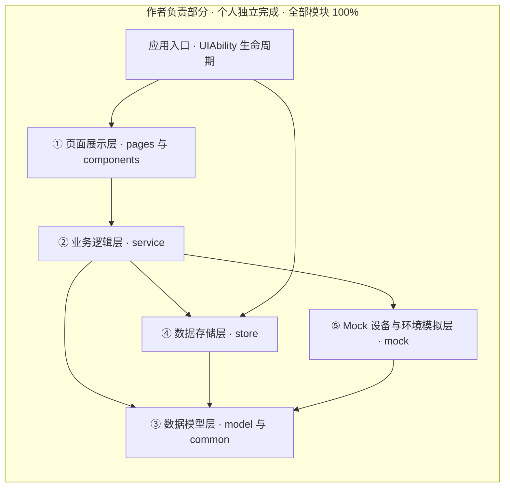
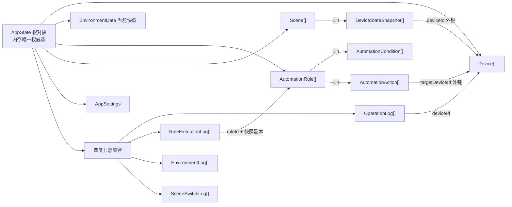

# 智寓——HarmonyOS 智能宿舍管家　软件需求说明书

| 项目 | 内容 |
| --- | --- |
| 文档名称 | 智寓——HarmonyOS 智能宿舍管家　软件需求说明书 |
| 文档版本 | V2.0（按功能模块、整体框架、成员分工、模块接口、数据结构与存储五部分重排，删除与需求无关内容） |
| 目标平台 | HarmonyOS 平板，HarmonyOS SDK 5.0.5（API 17） |
| 开发语言 | ArkTS + ArkUI + Ability Kit |
| 构建工具 | DevEco Studio 5.0.13.240、hvigor 5.17.6、Node v22.22.2 |
| 工程目录 | `D:\SmartDormHarmonyOS` |

> 本仓库为公开仓库，学生姓名、学号、班级、学院、专业及指导教师等个人真实信息均已匿名化，全文统一以「作者」称呼，GitHub 账号 `Yu-qiamWei` 为作者本人账号。

---

## 目录

1. [整体框架](#一整体框架)
2. [功能模块](#二功能模块)
3. [模块接口](#三模块接口)
4. [数据结构与存储方式](#四数据结构与存储方式)
5. [成员分工](#五成员分工)

---

# 一、整体框架

## 1.1 技术框架

| 层面 | 选型 | 在本项目中的作用 |
| --- | --- | --- |
| 应用模型 | Stage 模型 + UIAbility | 应用入口与生命周期宿主，承载全部页面与全局定时器 |
| 开发语言 | ArkTS（强类型，禁 `any`） | 领域模型、业务逻辑、状态管理均以类 / 接口 / 枚举表达 |
| UI 框架 | ArkUI 声明式 | 10 个页面、复用组件，`@State/@Prop/@Link/@Observed` 状态驱动刷新 |
| 页面路由 | `@ohos.router` 单栈 | 列表→详情 `pushUrl`、返回 `back`，参数用 `Record<string,string>` |
| 持久化 | 用户首选项 `preferences`（JSON 分区） | 10 个键分区落盘，启动同步读、运行异步写 + `flush` |
| 定时能力 | `TimerHost` 全局单例（`setInterval`） | 环境采样唯一入口，由 UIAbility 生命周期钩子驱动启停 |
| 图表 | ArkUI `Canvas` 自绘 | 柱状 / 折线统计图，零第三方库、零联网、零静态图 |
| 数据来源 | Mock 设备 + 环境模拟器 | 无真实物联网硬件时提供可读写的真实状态变化 |

## 1.2 运行框架

- **单实例**：全局仅一个 `AppDataRepository`、一个 `TimerHost`、一个 `WriteQueue`，避免多份状态与多份定时器。
- **页面无状态所有权**：页面只订阅与展示，不持有定时器、不直接读写存储。
- **前后台切换安全**：进入后台 `pause()` 并 `clearInterval`，回到前台 `resume()`。

## 1.3 分层架构

| 层 | 目录 | 职责 | 允许依赖 | 禁止 |
| --- | --- | --- | --- | --- |
| ① 页面展示层 | `pages/`、`components/` | ArkUI 声明式 UI、交互事件、状态订阅与展示 | ②、③ | 直接读写持久化、直接写日志、内嵌规则算法 |
| ② 业务逻辑层 | `service/` | 设备控制校验、环境更新、规则求值、场景编排、统计聚合、统一异常 | ③、④、⑤ | 直接持有 UI 组件、硬编码预设结果 |
| ③ 数据模型层 | `model/`、`common/` | 类 / 接口 / 枚举 / 类型定义、常量、统一结果类型与异常 | 无（最内层） | 反向依赖其他层、包含业务逻辑 |
| ④ 数据存储层 | `store/` | 单一数据源、序列化、持久化读写、版本迁移、串行写入队列 | ③、官方持久化能力 | 被页面层直接调用 |
| ⑤ Mock 层 | `mock/` | 设备打桩、传感器数值模拟、定时器托管 | ③ | 伪造执行结果、绕过业务逻辑直接改 UI |
| 应用入口 | `entryability/` | UIAbility 生命周期、初始化仓储、定时器注册/释放 | ④、② | 承载页面业务代码 |

**依赖方向**：① → ② →（③ / ④ / ⑤）；④ → ③；⑤ → ③。严格单向，禁止反向依赖。

## 1.4 关键运行时机制

| 机制 | 说明 |
| --- | --- |
| 统一数据管理入口 | 所有领域数据读写必经 `AppDataRepository`；内存态为唯一权威，页面通过订阅变更刷新 UI |
| 串行写入 | 全部写操作进入串行队列，同一时刻仅一个 flush，避免并发写入不一致 |
| 变更四面一致 | 内存态更新 → UI 同步 → 日志写入 → 持久化落盘，作为一个逻辑事务 |
| 统一异常处理 | 业务逻辑统一返回 `CommandResult`（成功 / 无变更 / 失败 + 原因码 + 消息），禁止静默失败 |
| 定时器托管 | `TimerHost` 全局单例，内部唯一 `setInterval` / `clearInterval`；由 UIAbility 生命周期钩子驱动 resume / pause / release，页面只订阅不持有定时器；默认采样间隔 4000ms |
| 规则去重 | `RuleEngine` 维护每条规则的 `lastSatisfied`，边沿触发；编辑 / 启停 / 总开关切换时显式重置 |
| 冲突处理 | 按 `priority` → `createdAt` → `id` 确定性排序，先执行者优先写入；同设备同参数后续动作记 `SKIPPED_CONFLICT` 并写日志，禁止隐式覆盖 |
| 真实性护栏 | 规则执行日志仅允许 `RuleEngine` 写入，UI / 初始化 / 演示代码不得写该日志 |

---

# 二、功能模块

## 2.1 功能模块总览

全文统一口径：**7 个功能模块 / 10 个页面文件**。

| 功能模块 | 页面文件 | 核心功能点 |
| --- | --- | --- |
| F1 首页控制中心 | `Index.ets` | 环境概览、聚合统计、6 类设备卡片快捷开关、当前运行模式、状态实时同步 |
| F2 设备管理 | `DeviceList.ets`、`DeviceDetail.ets` | 设备列表与详情、参数调节、新增 / 删除设备、门锁控制、故障离线模拟、悬空引用清理 |
| F3 环境监测 | `Environment.ets` | 五传感器实时展示、手动调整、模拟采样开关与间隔、环境变化日志、跨页持续采样 |
| F4 自动化规则 | `RuleList.ets`、`RuleEdit.ets` | 规则列表与编辑、多条件 AND + 多动作、规则求值、边沿去重、冲突跳过、执行日志 |
| F5 场景模式 | `SceneList.ets`、`SceneEdit.ets` | 预置 4 场景、自定义场景、一键应用、离寝快照、回寝恢复、切换日志 |
| F6 数据统计 | `Statistics.ets` | 操作分布柱状图、规则执行折线图、环境曲线、时间筛选、日志查询、FIFO 淘汰 |
| F7 设置 | `Settings.ets` | 自动化总开关、环境模拟开关、采样间隔、日志上限、数据重置、数据导出、版本信息 |

## 2.2 设备类型与传感器基线

**6 类设备**

| 设备类型 | 枚举值 | 可控参数 | 合法范围 / 取值 | 默认值 |
| --- | --- | --- | --- | --- |
| 智能灯光 | `LIGHT` | `powerOn`、`brightness` | 亮度 0—100（整数，%） | 关 / 60 |
| 智能空调 | `AIR_CONDITIONER` | `powerOn`、`temperature`、`mode` | 温度 16—30（℃）；模式 制冷 / 制热 / 送风 / 除湿 / 自动 | 关 / 26 / 自动 |
| 智能窗帘 | `CURTAIN` | `powerOn`、`openPercent` | 开合程度 0—100（%） | 关 / 0 |
| 智能门锁 | `DOOR_LOCK` | `locked` | 上锁 / 解锁（布尔） | 上锁 |
| 智能风扇 | `FAN` | `powerOn`、`fanSpeed` | 档位 1—3（整数） | 关 / 1 |
| 智能插座 | `SOCKET` | `powerOn`、`powerWatt` | 功率模拟值 0—2500（W） | 关 / 0 |

**5 类传感器**

| 传感器 | 字段 | 类型 | 默认初值 | 合法范围 |
| --- | --- | --- | --- | --- |
| 温度 | `temperature` | number | 25 | -10—50 ℃ |
| 湿度 | `humidity` | number | 50 | 0—100 %RH |
| 光照 | `illuminance` | number | 300 | 0—10000 Lux |
| 空气质量 | `airQuality` | number | 50 | 0—500 AQI |
| 人体存在 | `humanPresence` | boolean | false | true / false |

## 2.3 功能需求

### FR-01 首页控制中心

| 编号 | 需求描述 | 验收判据 |
| --- | --- | --- |
| FR-01-01 | 展示环境概览：温度、湿度、光照、空气质量 | 四项数值来自实时内存态，非固定常量 |
| FR-01-02 | 展示聚合统计：在线设备数、异常设备数、规则数、当前运行模式 | 与设备列表、规则列表、场景状态实时一致 |
| FR-01-03 | 以卡片形式展示 6 类设备，各自独立状态 | 6 类设备状态互不影响 |
| FR-01-04 | 点击设备卡片进入对应设备详情页 | 路由携带设备 id，详情页显示真实状态 |
| FR-01-05 | 页面操作真实改变内部数据状态并同步 UI | 操作后聚合数值、设备卡片状态同步刷新 |
| FR-01-06 | 异常设备数有真实来源，可在设备详情 Mock 诊断区切换运行状态 | 由 `Device.status` 为 FAULT / OFFLINE 计数；置位经统一入口并写系统日志 |
| FR-01-07 | 提供当前运行模式标识（学习 / 睡眠 / 离寝 / 回寝 / 自定义 / 手动） | 切换场景后模式标识同步更新 |

### FR-02 设备管理

| 编号 | 需求描述 | 验收判据 |
| --- | --- | --- |
| FR-02-01 | 查看全部设备列表与单个设备详情 | 列表与详情取值一致 |
| FR-02-02 | 手动开关设备 | `powerOn` 真实变更并写操作日志 |
| FR-02-03 | 修改设备参数（亮度、温度、模式、开合度、门锁、风扇档位、功率） | 参数真实写入且落在合法区间 |
| FR-02-04 | 添加模拟设备 | 新设备 id 唯一、带默认参数、立即出现并持久化 |
| FR-02-05 | 删除设备 | 列表、首页聚合、规则中对该设备的引用同步处理，不留悬空引用 |
| FR-02-06 | 查看设备运行状态，支持故障 / 离线模拟 | 运行 / 空闲 / 故障 / 离线状态可见，置位经统一入口 |
| FR-02-07 | 查看设备历史操作记录 | 记录来自真实操作日志 |
| FR-02-08 | 重复开启给出合理反馈 | 幂等命令返回「无变更」，日志不新增 |
| FR-02-09 | 不存在的设备不可控 | 传入无效 id 返回失败原因，数据不被改写 |
| FR-02-10 | 非法参数不得写入 | 越界 / 类型错误被拒绝，保证原子性无部分写入 |

### FR-03 环境监测

| 编号 | 需求描述 | 验收判据 |
| --- | --- | --- |
| FR-03-01 | 模拟 5 类传感器 | 环境数据含 5 个字段 |
| FR-03-02 | 数值可变化，不固定 | 调整后数值真实变更并刷新 UI 与图表 |
| FR-03-03 | 手动调整各传感器数值（含人体存在置位 / 复位） | 调整后写入环境日志并触发规则求值 |
| FR-03-04 | 支持「模拟变化」，按采样间隔自动产生合理波动 | 定时采样数值随时间变化，不跳变到非法值 |
| FR-03-05 | 环境数值变化触发规则求值，形成联动闭环 | 可复现的联动链路 |
| FR-03-06 | 展示环境历史记录 | 记录来自真实环境日志 |
| FR-03-07 | 定时模拟考虑页面退出与生命周期，避免资源泄漏 | 定时器全局单例，反复进出页面不产生多个定时器 |
| FR-03-08 | 设置页控制环境模拟开关与采样间隔 | 关闭后不再自动采样，手动调整仍可用 |
| FR-03-09 | 传感器数值做合法性约束 | 越界输入被拒绝或钳制并记日志 |

### FR-04 自动化规则编排（核心模块）

| 编号 | 需求描述 | 验收判据 |
| --- | --- | --- |
| FR-04-01 | 规则包含名称、触发条件、运算符、阈值、动作、目标设备、启用状态、执行记录 | 字段与数据模型一致 |
| FR-04-02 | 条件支持 6 类：温度大于 / 小于、湿度大于、光照小于、检测到有人 / 无人、空气质量超阈值 | 运算符枚举覆盖 `GT / LT / IS_TRUE / IS_FALSE` |
| FR-04-03 | 支持多条件 AND 组合 | 任一条件不满足则不执行，并复位去重标记 |
| FR-04-04 | 动作支持开 / 关灯、空调、调温、窗帘、风扇、插座 | 动作枚举与目标设备类型匹配校验 |
| FR-04-05 | 规则可启用 / 停用 | 停用规则不参与求值 |
| FR-04-06 | 实现真实规则引擎，环境变化自动重新求值 | 非点击「模拟执行」按钮 |
| FR-04-07 | 满足条件时真实执行动作，设备状态真实更新 | 内存态与 UI 同步变化，可逐字段核对 |
| FR-04-08 | 执行结果界面可见：设备状态、执行记录、数据统计三处一致 | 三处取值可互相印证 |
| FR-04-09 | 规则可改、删、启停，编辑后重新参与求值 | 修改后立即按新规则生效 |
| FR-04-10 | 避免条件持续成立时重复执行 | 边沿触发 + `lastSatisfied` 去重，不产生重复日志 |
| FR-04-11 | 多条规则满足时有明确执行顺序 | 按 `priority` → `createdAt` → `id` 确定性排序 |
| FR-04-12 | 有明确冲突处理策略 | 先执行者优先写入，同设备同参数冲突动作记 `SKIPPED_CONFLICT`，禁止隐式覆盖 |
| FR-04-13 | 执行失败有错误处理 | 统一捕获异常，写失败日志，不中断整轮求值、不崩溃 |
| FR-04-14 | 执行日志可查，禁止假执行记录 | 日志只能由 `RuleEngine` 在真实调用后生成 |
| FR-04-15 | 每条执行记录含环境快照、命中条件、动作清单、状态、失败原因、耗时 | 支撑事后核查 |
| FR-04-16 | 自动化总开关关闭时全部规则不参与求值 | 关闭期间不产生自动记录，手动控制仍可用 |

**规则示例**（用于说明，不作为硬编码预设）

| 示例 | 条件（AND） | 动作（有序） | 预期真实结果 |
| --- | --- | --- | --- |
| R-EX-01 | 光照小于 100 Lux 且检测到有人 | 开灯（亮度 70） | 灯光开启、亮度 70 |
| R-EX-02 | 温度大于 28℃ | 开空调 → 制冷模式 → 调至 26℃ | 空调三个字段依次更新 |
| R-EX-03 | 空气质量超 100 AQI | 开风扇 2 档 | 风扇开启、档位 2 |
| R-EX-04 | 检测到无人 | 关灯 → 关插座 | 两类设备状态变更，产生一条含两动作的记录 |

### FR-05 场景模式

| 编号 | 需求描述 | 验收判据 |
| --- | --- | --- |
| FR-05-01 | 提供预置场景：学习、睡眠、离寝、回寝 | 四个场景首次启动即存在 |
| FR-05-02 | 支持自定义场景，可创建、编辑、删除 | 自定义场景保存后重启仍存在 |
| FR-05-03 | 切换场景真实改变多个设备状态 | 逐设备核对，写操作日志与场景切换日志 |
| FR-05-04 | 回寝恢复用户预设状态，而非系统默认值 | 使用离寝前保存的状态快照 |
| FR-05-05 | 场景可配置目标设备状态集合 | 编辑界面可为每类设备设定目标状态 |
| FR-05-06 | 场景切换记录日志并更新首页运行模式 | 日志、模式标识、设备状态三方一致 |
| FR-05-07 | 场景执行遇设备缺失 / 非法参数按统一异常处理 | 失败项写入日志并在 UI 可见 |
| FR-05-08 | 场景切换后可触发规则重新求值 | 联动可配置，不产生意外重复执行 |

### FR-06 数据统计与历史

| 编号 | 需求描述 | 验收判据 |
| --- | --- | --- |
| FR-06-01 | 记录并可查 4 类记录：设备操作、规则执行、环境变化、场景切换 | 四类日志均有真实数据来源 |
| FR-06-02 | 以图表展示温度、湿度、设备运行统计 | 图表基于真实日志数据渲染 |
| FR-06-03 | 数据来自真实记录，不用静态图片代替 | 采用 Canvas 自绘，数据可与日志逐条对应 |
| FR-06-04 | 支持按时间范围或类型筛选历史 | 筛选结果来自真实日志过滤 |
| FR-06-05 | 展示规则成功率、设备运行时长等派生指标 | 由真实日志计算，非硬编码 |
| FR-06-06 | 日志有容量上限与滚动策略 | FIFO 按时间丢最旧，避免无限增长 |
| FR-06-07 | 统计与历史数据随持久化一同恢复 | 重启后历史记录与退出前一致 |

### FR-07 设置与数据管理

| 编号 | 需求描述 | 验收判据 |
| --- | --- | --- |
| FR-07-01 | 提供自动化总开关 | 关闭后全部规则停止求值 |
| FR-07-02 | 提供环境模拟开关 | 关闭后停止定时采样 |
| FR-07-03 | 提供数据重置：恢复默认设备、规则、场景、设置与日志 | 重置前二次确认，不清空 schema 版本 |
| FR-07-04 | 提供数据导出（JSON / CSV 到应用沙箱） | 设置页显示导出路径与内容预览 |
| FR-07-05 | 展示应用基本信息（名称、版本、目标 SDK / API） | 与实际版本一致，不虚构 |
| FR-07-06 | 提供持久化管理入口（查看状态、手动保存） | 与统一数据管理入口一致 |
| FR-07-07 | 设置项持久化，重启后保持 | 重启后设置不丢失 |
| FR-07-08 | 展示持久化读取异常的降级提示 | 与存储降级策略一致 |

### FR-08 横向全局约束

| 编号 | 需求描述 | 验收判据 |
| --- | --- | --- |
| FR-08-01 | 不允许出现只有装饰效果没有实际功能的按钮 | 每个可点击控件都有真实数据 / 状态 / 导航结果 |
| FR-08-02 | 设备控制、条件判断、状态变化、规则联动均为真实可运行逻辑 | 源码可追溯到业务逻辑层 |
| FR-08-03 | 分层落实，页面与逻辑分离 | 不把所有代码写在一个页面文件 |
| FR-08-04 | 有统一异常处理与统一数据管理入口 | 见整体框架与模块接口 |
| FR-08-05 | 禁止大量硬编码假装实现 | 需求—源码可追溯 |
| FR-08-06 | 数据变更同时满足内存态更新 → UI 同步 → 日志写入 → 持久化落盘 | 四处一致性可核查 |
| FR-08-07 | 删除设备 / 规则、数据重置后相关引用与聚合同步 | 不留悬空状态 |
| FR-08-08 | 应用不因 Mock 异常、反序列化失败、非法参数而崩溃 | 与存储降级策略一致 |

---

# 三、模块接口

> 以下为本项目自定义模块接口约定（非 HarmonyOS 系统 API），用于界定模块职责、入参、返回与失败语义。

## 3.1 设备域

| 编号 | 提供方 | 接口 | 入参 | 返回 | 失败 / 异常语义 |
| --- | --- | --- | --- | --- | --- |
| MI-01 | 存储层 | `listDevices()` | 无 | `Device[]` | 读取失败返回默认设备集并记系统日志 |
| MI-02 | 业务层 | `setPower(id, on)` | `id: string`、`on: boolean` | `CommandResult<Device>` | 设备不存在 / 离线→失败；状态相同→无变更 |
| MI-03 | 业务层 | `setParam(id, key, value)` | `id`、`key: ParamKey`、`value: ParamValue` | `CommandResult<Device>` | 越界 / 类型不符 / 不适用→失败，不写入 |
| MI-04 | 业务层 | `addDevice(type, name)` | 设备类型、名称 | `CommandResult<Device>` | 类型非法→失败；生成唯一 id 与默认参数 |
| MI-05 | 业务层 | `removeDevice(id)` | `id` | `CommandResult<void>` | 不存在→失败；成功时清理悬空引用与首页聚合 |
| MI-06 | Mock 层 | `setDeviceStatus(id, status)`、`setOnline(id, online)` | 设备状态 / 在线标志 | `CommandResult<Device>` | 模拟故障 / 离线返回失败，置位经统一入口并写系统日志 |

## 3.2 环境域

| 编号 | 提供方 | 接口 | 入参 | 返回 | 失败 / 异常语义 |
| --- | --- | --- | --- | --- | --- |
| MI-07 | 业务层 | `getSnapshot()` | 无 | `EnvironmentData` | 恒返回当前内存态 |
| MI-08 | 业务层 | `adjust(sensorType, value)` | 传感器类型、数值 | `CommandResult<EnvironmentData>` | 越界 / 类型不符→失败；成功写环境日志并触发求值 |
| MI-09 | Mock 层 | `EnvironmentSimulator.start() / stop() / tick()` | 采样间隔 | `void` | 由 `TimerHost` 统一托管，页面退出释放 |
| MI-10 | Mock 层 | `TimerHost.register() / release()` | 回调与句柄 | `void` | 重复注册返回同一句柄，释放后不再触发 |

## 3.3 规则域

| 编号 | 提供方 | 接口 | 入参 | 返回 | 失败 / 异常语义 |
| --- | --- | --- | --- | --- | --- |
| MI-11 | 业务层 | `RuleService.create / update / remove / toggle` | 规则或 id | `CommandResult<AutomationRule>` | 条件 / 动作为空、设备不存在、参数非法→失败；编辑后重置去重标记 |
| MI-12 | 业务层 | `RuleEngine.evaluate(snapshot)` | `EnvironmentData` | `Promise<RuleEvaluationReport>` | 总开关关闭返回跳过原因；单条异常被捕获，不中断整轮 |
| MI-13 | 业务层 | `LogService.query(filter)` | 时间范围、类型、设备 / 规则 id | `LogRecord[]` | 空结果为空数组 |
| MI-14 | 业务层 | `SceneService.apply(sceneId)` | `id` | `SceneApplyReport` | 逐设备执行，失败项记入报告与日志；回寝读取用户快照 |

## 3.4 存储域

| 编号 | 提供方 | 接口 | 入参 | 返回 | 失败 / 异常语义 |
| --- | --- | --- | --- | --- | --- |
| MI-15 | 存储层 | `AppDataRepository.load()` | 无 | `AppState`（同步） | 首次启动→默认数据；读取 / 反序列化失败→降级默认值，不崩溃 |
| MI-16 | 存储层 | `AppDataRepository.flush()` | 状态分区 | `CommandResult<void>` | 串行写入，失败可重试并记日志 |
| MI-17 | 存储层 | `AppDataRepository.reset(scope)` | `ResetScope` | `AppState` | 按粒度恢复默认 / 清日志；不清空 schema 版本、不调用 deletePreferences |
| MI-18 | 存储层 | `AppDataRepository.subscribe(handler)` | 变更回调 | 取消订阅函数 | 页面销毁时取消订阅，避免内存泄漏 |
| MI-19 | 存储层 | `PreferencesStore.init / get / has / put / delete / clear / flush` | 键、JSON 字符串 | `CommandResult` / `void` | 启动同步读、运行异步写；异常统一包成存储错误，不抛到 UI |

## 3.5 统一结果类型

| 字段 | 类型 | 说明 |
| --- | --- | --- |
| `success` | boolean | 是否成功执行 |
| `changed` | boolean | 是否产生真实状态变更（用于幂等判断） |
| `code` | `ResultCode` | `OK / NO_CHANGE / NOT_FOUND / INVALID_PARAM / DEVICE_OFFLINE / CONFLICT_SKIPPED / STORAGE_ERROR / UNKNOWN` |
| `message` | string | 面向用户的简体中文提示 |
| `data` | 泛型 | 成功时返回的对象 |
| `timestamp` | number | 结果产生时间 |

## 3.6 接口调用矩阵

| 调用方 ↓ ＼ 被调用方 → | 组件 | 业务 | 模型 | 存储 | Mock | 公共 |
| --- | --- | --- | --- | --- | --- | --- |
| 页面层 | 允许 | 允许 | 允许（只读） | 禁止 | 禁止 | 允许 |
| 组件 | 允许 | 受限（仅展示回调） | 允许 | 禁止 | 禁止 | 允许 |
| 业务层 | 禁止 | 允许 | 允许 | 允许 | 允许 | 允许 |
| 模型层 | 禁止 | 禁止 | 允许 | 禁止 | 禁止 | 受限（仅常量） |
| 存储层 | 禁止 | 禁止 | 允许 | 允许 | 禁止 | 允许 |
| Mock 层 | 禁止 | 受限（经统一入口） | 允许 | 禁止 | 允许 | 允许 |
| 应用入口 | 禁止 | 允许 | 允许 | 允许 | 允许 | 允许 |

**接口数量**：设备域 6 + 环境域 4 + 规则域 4 + 存储域 5 = **19 个接口（MI-01~MI-19）**，覆盖 7 个功能模块与全部五层。统一失败语义：业务接口统一返回 `CommandResult<T>`，禁止静默失败、禁止把异常抛到 UI，状态相同返回 `NO_CHANGE`。

---

# 四、数据结构与存储方式

## 4.1 核心对象清单

| 编号 | 对象 | 用途 |
| --- | --- | --- |
| DM-01 | `Device` | 智能设备状态与参数 |
| DM-02 | `EnvironmentData` | 五类传感器当前快照 |
| DM-03 | `AutomationRule` | 规则主体 |
| DM-04 | `AutomationCondition` | 单个触发条件 |
| DM-05 | `AutomationAction` | 单个执行动作 |
| DM-06 | `Scene` | 场景及目标设备状态集合 |
| DM-07 | `OperationLog` | 设备操作记录 |
| DM-08 | `RuleExecutionLog` | 规则执行记录 |
| DM-09 | `EnvironmentLog` | 环境变化记录 |
| DM-10 | `SceneSwitchLog` | 场景切换记录 |
| DM-11 | `AppSettings` | 总开关、模拟设置、schema 版本 |

## 4.2 核心对象字段

**DM-01 `Device`**

| 字段 | 类型 | 约束 / 说明 |
| --- | --- | --- |
| `id` | string | 唯一标识，首次启动与新增时生成 |
| `name` | string | 非空 |
| `type` | `DeviceType` | 6 类设备枚举 |
| `powerOn` | boolean | 门锁类型以 `locked` 表达 |
| `params` | `DeviceParams` | 按 type 取值，禁止任意字段 |
| `online` | boolean | Mock 层可置 false 支撑异常设备计数 |
| `status` | `DeviceStatus` | `RUNNING / IDLE / FAULT / OFFLINE` |
| `locked` | boolean | 仅门锁有效 |
| `createdAt` / `lastUpdated` | number | 时间戳，排序与统计依据 |

**DM-02 `EnvironmentData`**：`temperature`、`humidity`、`illuminance`、`airQuality`、`humanPresence`、`timestamp`、`source: EnvSource`（范围见 2.2）。

**DM-03 `AutomationRule`**

| 字段 | 类型 | 约束 |
| --- | --- | --- |
| `id` / `name` | string | 唯一 / 非空 |
| `enabled` | boolean | 停用后不参与求值 |
| `logic` | `ConditionLogic` | 当前固定 AND，OR 为扩展 |
| `conditions` | `AutomationCondition[]` | 至少 1 条 |
| `actions` | `AutomationAction[]` | 至少 1 条 |
| `priority` | number | 执行顺序第一关键字，数值小者优先 |
| `lastSatisfied` | boolean | 边沿去重标记，持久化保存 |
| `lastTriggeredAt` / `executionCount` | number | 最近执行时间 / 累计执行次数 |
| `createdAt` / `updatedAt` | number | 排序第二关键字 / 编辑时间 |

**DM-04 `AutomationCondition`**：`id`、`sensorType: SensorType`、`operator: Operator`、`threshold: number`、`unit: string`。

**DM-05 `AutomationAction`**：`id`、`targetDeviceId: string`（须指向存在的设备）、`command: DeviceCommand`、`value`、`order: number`。

**DM-06 `Scene`**：`id` / `name`、`type: SceneType`、`deviceStates: DeviceStateSnapshot[]`、`isPreset: boolean`、`returnSnapshot: DeviceStateSnapshot[]`（离寝预设快照，供回寝恢复）、`createdAt` / `updatedAt`。

**DM-07~DM-11 日志与设置**

| 对象 | 关键字段 | 约束 |
| --- | --- | --- |
| `OperationLog` | `id`、`timestamp`、`actor`（USER / RULE / SCENE / SYSTEM）、`deviceId`、`action`、`before`、`after`、`result`、`message` | 由真实命令产生，禁止伪造 |
| `RuleExecutionLog` | `id`、`timestamp`、`ruleId`、`ruleName`、`snapshot`、`matchedConditions`、`executedActions[]`、`skippedActions[]`、`status: RuleExecStatus`、`errorMsg`、`durationMs` | 仅 `RuleEngine` 可写 |
| `EnvironmentLog` | `id`、`timestamp`、`sensorType`、`before`、`after`、`source` | 每次真实变化一条 |
| `SceneSwitchLog` | `id`、`timestamp`、`fromSceneId`、`toSceneId`、`appliedCount`、`failedCount` | 场景切换真实产生 |
| `AppSettings` | `automationEnabled`、`simulationEnabled`、`sampleIntervalMs`（默认 4000）、`logLimit`（默认 1000）、`schemaVersion`、`appVersion` | 全部持久化，重启后恢复 |

## 4.3 枚举清单

共 **14 个枚举 / 类型**：

| 类别 | 枚举 |
| --- | --- |
| 基础枚举（11 个） | `DeviceType`、`DeviceStatus`、`DeviceCommand`、`SensorType`、`Operator`、`ConditionLogic`、`SceneType`、`LogActor`、`RuleExecStatus`、`EnvSource`、`ResultCode` |
| 补充枚举（3 个） | `ACMode`（空调模式）、`RunMode`（首页运行模式）、`ParamKey`（强类型参数键） |

> 枚举消歧：`ResultCode.CONFLICT_SKIPPED`（命令结果码）与 `RuleExecStatus.SKIPPED_CONFLICT`（执行日志状态）是两个不同枚举的成员，不得混用。

## 4.4 对象关系

| 关系约束 | 说明 |
| --- | --- |
| 引用完整性 | 动作 / 快照的设备 id 必须指向存在的设备，执行时报 `NOT_FOUND`；删除设备时同步清理悬空引用 |
| 快照隔离 | 执行日志中的环境快照存副本，不引用可变对象，保证事后可核查 |
| 去重标记持久化 | 规则 `lastSatisfied` 随规则落盘，重启后不重复触发 |
| 外键可悬空但需降级 | 历史日志中设备已删除时以「已删除设备」降级呈现，不崩溃 |
| 类型强约束 | 全部字段使用类 / 接口 / 枚举，禁止 `any` 与字符串魔法值 |

## 4.5 存储方案选型

| 项 | 方案 | 说明 |
| --- | --- | --- |
| 持久化介质 | HarmonyOS 官方用户首选项 `preferences`（轻量键值存储），各分区以 JSON 字符串按 key 存取 | 导入 `import { preferences } from '@kit.ArkData'`；启动同步读、运行异步写，统一存 JSON 字符串 |
| 关系型存储 | 不启用 | 仅 10 个 JSON 分区、日志上限 ≤ 4500 条，内存过滤即可，引入关系型数据库增加迁移复杂度 |
| 不采用 | 云端 / 网络存储、LocalStorage、以 deletePreferences 做重置、以 `on('change')` 作主订阅 | 离线可运行，重置采用逐键覆写，订阅由仓储自维护 |
| 统一入口 | `AppDataRepository`，内存单一数据源 + 串行写入队列 | 所有读写必经，页面层不直接调用系统存储 |

## 4.6 持久化键设计

| 编号 | Key | 内容 | 触发写入时机 |
| --- | --- | --- | --- |
| KEY-01 | `smartdorm.schema.version` | 数据结构版本号 | 首次初始化、迁移后 |
| KEY-02 | `smartdorm.devices` | 全部设备列表 | 设备增删改、状态变更后 |
| KEY-03 | `smartdorm.rules` | 全部规则（含 lastSatisfied） | 规则增删改、启停、去重标记变化 |
| KEY-04 | `smartdorm.scenes` | 全部场景 | 场景增删改、切换后 |
| KEY-05 | `smartdorm.settings` | 应用设置 | 设置变更后 |
| KEY-06 | `smartdorm.environment.current` | 当前环境快照 | 环境变化后 |
| KEY-07 | `smartdorm.logs.operations` | 操作日志 | 每次设备命令后 |
| KEY-08 | `smartdorm.logs.ruleExec` | 规则执行日志 | 每次规则求值后 |
| KEY-09 | `smartdorm.logs.environment` / `smartdorm.logs.sceneSwitch` | 环境 / 场景切换日志 | 对应事件后 |
| KEY-10 | `smartdorm.scene.returnSnapshot` | 离寝预设快照 | 切换到离寝场景时 |

## 4.7 生命周期与一致性机制

| 机制 | 需求约束 |
| --- | --- |
| 首次启动初始化 | 无版本键时生成默认 6 类设备、5 类传感器、4 个预置场景、0 条规则、空日志、默认设置，立即落盘 |
| 修改后保存 | 状态变更经 `flush()` 串行落盘，不依赖页面退出时机 |
| 重启恢复 | 恢复后设备、规则、场景、环境设置、历史记录逐项与退出前一致 |
| 读取失败默认恢复 | JSON 异常 / 键缺失 / 类型不符时保留可读分区，缺失分区回退默认值并记系统日志，不崩溃 |
| 版本兼容 | 按版本逐级迁移并回写新版本号，旧数据不丢失 |
| 日志容量 | 操作 1000 / 规则 1000 / 环境 2000 / 场景 500，合计 ≤ 4500 条；FIFO 按时间淘汰最旧 |
| 数据重置 | 全部 / 仅日志两级（设置级为扩展），逐键覆写 + flush，不清空 schema 版本、不调用 deletePreferences |

## 4.8 读写路径

**启动读路径（同步，保证首屏不闪空）**：构造仓储单例 → 同步遍历 10 个键判存在并取值 → 逐分区 `JSON.parse` 为强类型对象 → 版本迁移 → 渲染首页；单键缺失或解析异常时该分区回退默认，不影响其余分区、不崩溃。

**运行写路径（异步，两车道 debounce + 单链串行）**：

| 步 | 动作 |
| --- | --- |
| 1 | 修改内存态（唯一权威源），同步通知 UI 刷新 |
| 2 | 标记分区脏（先标记再通知） |
| 3 | 写队列按分区合并，同分区多次脏只保留一次 |
| 4 | 车道判定：用户车道（设备 / 规则 / 场景 / 设置）debounce 200ms；日志车道 debounce 30s |
| 5 | 单链串行执行，重入 flush 返回同一 Promise |
| 6 | 逐分区 `put` 写入并 flush 提交 |
| 7 | 失败时保留脏标记待下次重试，不阻塞 UI、不弹错到用户 |

**三条硬约束**：导出前先 `await flush()` 确保文件与磁盘一致；退出前执行末次 flush 保证日志不丢；页面只调服务方法，不直接 `put`、不持有写队列。

---

# 五、成员分工

## 5.1 个人独立完成

本项目为**个人独立完成**的期末大作业，项目成员仅 1 人：

| 项目 | 内容 |
| --- | --- |
| 项目成员 | 作者（个人信息已匿名）——唯一成员 |
| 团队规模 | 1 人（无队友、无外包、无他人代写代码） |
| 承担范围 | 全部功能模块与全部开发阶段的全部工作，占比 **100%** |
| 代码归属 | `entry/src/main/ets/` 下 75 个 `.ets` 文件、13,919 行全部为作者编写 |
| 仓库归属 | GitHub 仓库 `Yu-qiamWei/SmartDorm-HarmonyOS` 为作者本人账号，提交记录可核验 |

作者一人依次承担需求分析、架构设计、数据建模、编码实现、集成联调、测试验证、文档撰写、GitHub 提交与最终交付共 8 类工作，不存在他人分工，也不存在「只做某一个模块」的情况。

## 5.2 一人多角色阶段对照

角色为工作性质划分，不是其他成员：

| 阶段 | 承担角色 | 主要工作 | 真实产出 |
| --- | --- | --- | --- |
| ST-01 需求分析 | 需求分析 | 拆解需求、定义功能 / 约束 / 交付项、建立优先级与追溯 | 本说明书、阶段一报告 |
| ST-02 架构设计 | 架构设计 | 定五层架构与目录、核验 API 17 接口、锁定页面命名与模块接口 | 系统架构设计、本说明书 |
| ST-03 编码实现 | 开发 | 写 75 个 `.ets` 文件 / 13,919 行：五层架构、规则引擎、串行写队列、Canvas 图表 | 源码、构建日志 |
| ST-04 集成联调 | 开发 + 自测 | 打通页面→服务→仓储→持久化链路，修复联调缺陷 | 缺陷登记、回归记录 |
| ST-05 测试验证 | 测试 | L2 纯逻辑 307 断言 + L4 设备端 22 用例，逐项留存证据 | 测试目录、截图、证据 |
| ST-06 文档交付 | 文档 + 运维 | 写 README、说明书、架构设计、阶段报告，配置 Git 与推送 | 各文档、远程仓库 |
| ST-07 最终交付 | 交付核对 | 交付项逐字核对、交付物归档、目标自检 | 交付包、证据 |

## 5.3 模块职责与规模

| 模块 | 源码路径 | 承担内容 | 实际规模 |
| --- | --- | --- | --- |
| 页面展示层 | `pages/` | 10 个页面 ArkUI 实现、单栈路由、状态订阅 | 3,678 行 |
| 复用 UI 组件 | `components/` | 各类卡片、图表组件、设计令牌 | 1,152 行 |
| 业务逻辑层 | `service/` | 设备 / 环境服务、规则引擎、场景 / 统计 / 日志服务 | 3,235 行 |
| 数据模型层 | `model/` | 核心对象与补充对象的类 / 接口 / 枚举 | 656 行 |
| 数据存储层 | `store/` | 统一入口、持久化封装、序列化、版本迁移、写队列 | 3,755 行 |
| Mock 层 | `mock/` | 设备打桩、环境模拟、定时器托管 | 652 行 |
| 公共基础层 | `common/` | 常量、枚举、统一结果类型、异常、工具、主题 | 655 行 |
| 应用入口 | `entryability/` | UIAbility 生命周期、初始化、定时器注册/释放 | 136 行 |

> 全部模块 100% 由作者一人承担，行数为实测值。

---

> **文档结束**。本说明书仅描述功能模块、整体框架、成员分工、模块接口、数据结构与存储方式五部分需求。
