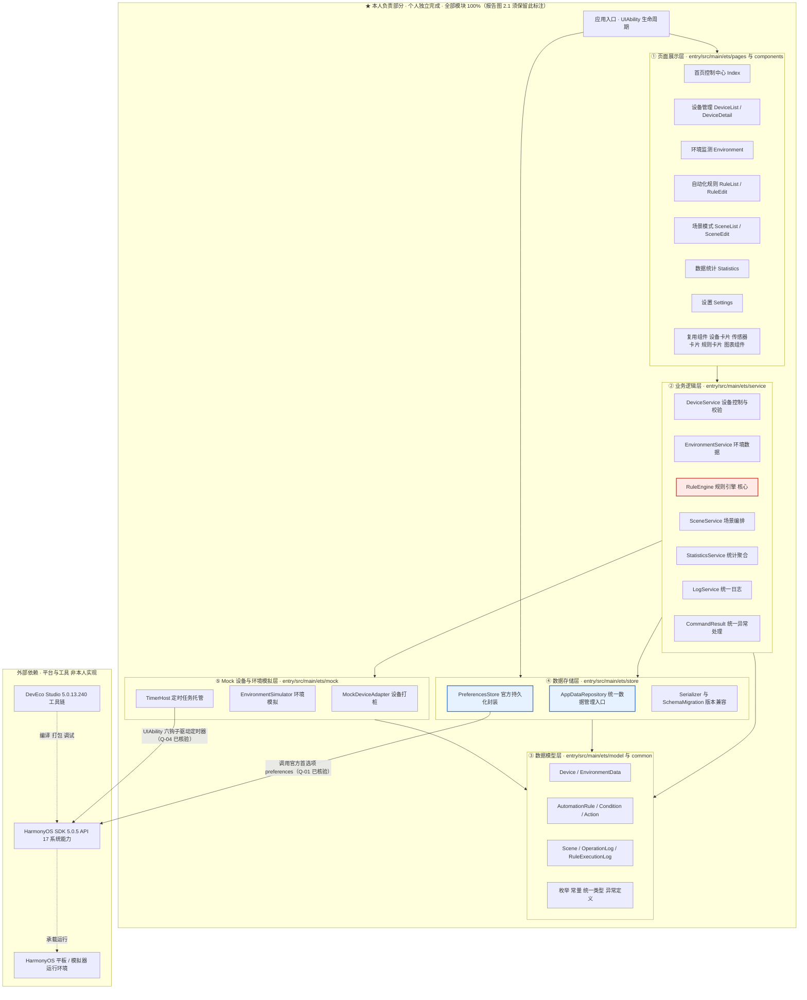
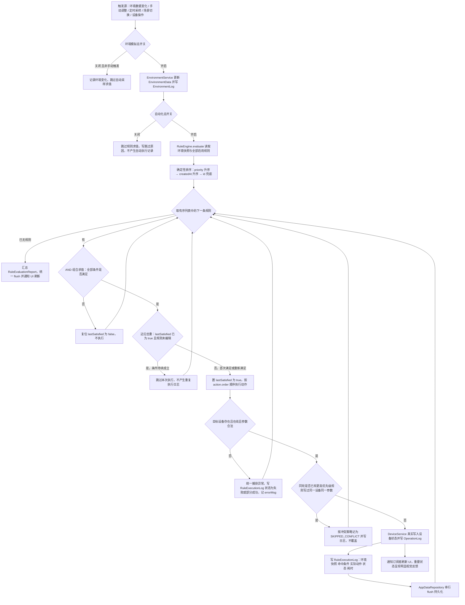
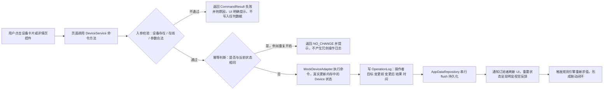
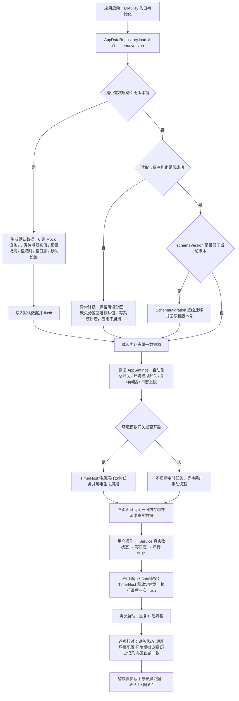
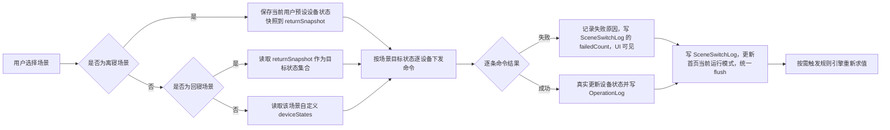

# 智寓——HarmonyOS 智能宿舍管家　软件需求说明书

> **文档性质**：第一阶段需求分析交付物（Software Requirements Specification，SRS）
> **适用范围**：期末大作业「主题三：智能场景规则编排与交互仿真系统」，个人独立完成
> **状态说明**：本文档为**需求基线**，描述「必须做成什么样」，**不代表已实现**。所有进度、构建结果、测试结论、Git 提交记录均以各阶段真实产出为准，本文档不作任何已完成声明。

---

## 文档控制信息

| 项目 | 内容 |
| --- | --- |
| 文档名称 | 智寓——HarmonyOS 智能宿舍管家　软件需求说明书 |
| 文档版本 | V1.1（依据架构师 API 17 实测核验结论修订） |
| 编制日期 | 2026-11-09 |
| 编制人 | 许清楚（产品经理）· 团队 software-smartdorm |
| 审核人 | 齐活林（主理人）、高见远（架构师）【待评审】；**设计基线已对齐 V1.1（主理人齐活林 2026-11-09 转交确认并采纳架构核验结论），正式评审签署待最终验收统一办理** |
| 文档状态 | V1.1 定稿（架构核验结论已对齐、主理人四项裁定已落地）；正式评审签署待最终验收统一办理 |
| 目标平台 | HarmonyOS 平板，HarmonyOS SDK 5.0.5（API 17） |
| 开发语言 | ArkTS + ArkUI + Ability Kit |
| 工程根目录 | `D:\SmartDormHarmonyOS` |
| 对应报告模板 | 1 项目概述 / 2 系统架构 / 3 模块设计 / 4 代码实现与贡献 / 5 模块测试 / 6 运行与总结 |
| 变更纪律 | 后续阶段（架构设计、编码、测试、交付）发生需求或方案变更时，**必须回头更新本文档**并递增版本号，保持文档与实现一致 |

### 封面信息（与 Word 报告封面严格一致）

| 项目 | 内容 |
| --- | --- |
| 课程名称 | 移动应用开发基础 |
| 学院 | （匿名） |
| 专业 | （匿名） |
| 指导教师 | （匿名） |
| 开课时间 | 2026—2027 学年 一 学期 |
| 学生姓名 | 【待填写】 |
| 学号 | 【待填写】 |
| 班级 | 【待填写】 |
| 项目名称 | 智寓——HarmonyOS 智能宿舍管家 |
| 选题 | 主题三：智能场景规则编排与交互仿真系统 |

> **纪律**：学生姓名、学号、班级三项为空白，**必须保留【待填写】标记，禁止编造、禁止以占位符姓名替代**。

### 文档目的与范围

- **目的**：把用户任务书、课程评分标准、报告模板、环境实测结论转化为**可分配、可实现、可测试、可核查**的需求基线，供架构师做详细设计、供开发做编码、供测试做用例、供报告做追溯。
- **范围内**：功能需求、非功能需求、分层架构、模块划分与接口约定、数据结构、数据存储方案、核心业务流程、成员分工、优先级、评分映射、追溯矩阵、测试基线、交付合规要求、阶段计划、待确认问题。
- **范围外**：详细架构设计与类图（架构师负责）、具体 HarmonyOS 系统 API 的最终签名与实现细节（已在 `design/系统架构设计.md` 第 9 章裁决，本文档 V1.1 只引用结论）、源码实现、构建与真机调试、GitHub 仓库操作、Word 报告撰写。

### 术语与缩略语

| 术语 | 含义 |
| --- | --- |
| Mock 设备 | 用内存对象模拟的智能设备，不连接真实物联网硬件，但具备真实可读写的状态与参数 |
| 规则引擎 | 本项目自研的 `RuleEngine`，负责条件求值、动作执行、去重、排序、冲突处理与执行日志 |
| 边沿触发 | 条件由「不满足」变为「满足」时执行一次；条件持续满足时不重复执行 |
| 统一数据管理入口 | `AppDataRepository`，所有领域数据的读写与持久化必经此层 |
| 单一数据源 | 内存中唯一一份权威状态，UI 订阅其变更，避免多份状态不一致 |
| 真实执行 | 业务逻辑确实改变应用内部数据状态并同步 UI 与日志；非预设动画、非静态展示、非伪造记录 |
| 一票否决 | 成绩认定前提，未满足则整个期末大作业成绩计 0 分 |
| 装饰性按钮 | 仅有视觉效果、点击后不产生任何真实数据或状态变化的控件，本项目**禁止出现** |

---

## 0 前置约定与约束基线

### 0.1 环境实测基线（第一阶段已实测，不得假设）

| 编号 | 项 | 实测结论 | 需求侧影响 |
| --- | --- | --- | --- |
| ENV-01 | DevEco Studio | 5.0.13.240（`product-info.json` 实测） | 需求方案须能被该版本工具链编译 |
| ENV-02 | HarmonyOS SDK | 5.0.5 / API 17（`sdk-pkg.json` 实测 `apiVersion=17`，`version=5.0.5.165`） | **所有方案必须可在 API 17 实施**，禁止引用旧版接口 |
| ENV-03 | Node / npm | Node v22.22.2 / npm 10.9.7 | 前端工具链可用 |
| ENV-04 | 构建工具 | hvigor、ohpm、Emulator.exe、hdc.exe 3.1.0e 齐备 | 具备编译与调试条件 |
| ENV-05 | hdc 路径 | `D:\DevEco Studio\sdk\default\openharmony\toolchains` | 设备连接命令来源 |
| ENV-06 | 设备连接 | `hdc list targets` 当前为 `[Empty]`（无真机/模拟器连接）；已部署镜像最高 API 12，与 SDK API 17 不匹配（`evidence/环境检查记录-阶段一.md` 第 76 行实测） | **运行展示、截图、录屏与 10.4 八步验收的前置阻塞项**，见 Q-08 与 0.6 四层验证路径 |
| ENV-07 | 磁盘 | D 盘可用 96GB | 足够容纳 SDK、模拟器镜像、录屏与构建产物 |
| ENV-08 | Git | Git 2.55.0.windows.3 | 分阶段提交可用 |
| ENV-09 | GitHub CLI | **未安装** | 若需 CLI 操作须另行安装，见 Q-09 |
| ENV-10 | GitHub 账号 | 官方 OAuth 授权账号 `Yu-qiamWei` 已存在 | 与一票否决中的「本人 GitHub 账号名称」需核对一致 |
| ENV-11 | 工程目录 | `D:\SmartDormHarmonyOS` 已建 `docs / design / tests / evidence / deliverables / screenshots / videos / build / stages` 分类目录 | 交付物按目录归档，需求见 DL-06 |
| ENV-12 | 工程 Git 状态 | 尚未初始化 Git 仓库（第一阶段实测） | 阶段六初始化并提交，禁止伪造历史 |

### 0.2 成绩认定一票否决前提（最高优先级，P0-00）

| 编号 | 要求 | 说明 | 对应评分 |
| --- | --- | --- | --- |
| **P0-00** | 期末提交时，**必须在学习通作业答案处同时填写**：① 有效的 GitHub 仓库链接；② 本人 GitHub 账号名称 | 缺少任意一项，**整个期末大作业成绩计 0 分**；Word 电子报告或纸质报告**均不能单独作为佐证** | 一票否决（非加分项，是前提） |

> 该项不是普通功能需求，必须作为**交付检查清单的第一条**，在阶段七最终交付时由本人逐字核对。相关工作项见 DL-01、DL-02、ST-07。

### 0.3 课程评分指标与分值（需求优先级排序依据）

| 编号 | 评分指标 | 分值 | 需求侧关键落点 |
| --- | --- | --- | --- |
| SC-01 | ArkTS 编程与数据建模 | 5 | DM-01~DM-11 数据结构、ArkTS 类/接口/枚举/类型的合理使用 |
| SC-02 | 核心业务逻辑与算法 | 10 | **规则真实执行，不以预设界面代替实际逻辑**（FR-04 全部、FLOW-01） |
| SC-03 | Mock 打桩与模块测试 | 5 | FR-03 / FR-08 / 第 16 章测试基线 |
| SC-04 | 需求分析与整体架构 | 10 | 本文档、第 6 章架构图**明确标出本人负责部分** |
| SC-05 | 页面设计与交互体验 | 15 | 第 5 章 UI 非功能需求、FR-01、FR-08 |
| SC-06 | 个人模块设计与接口约定 | 10 | 第 7 章模块划分、第 8 章模块接口、第 12 章成员分工 |
| SC-07 | 创新表现与报告表达 | 5 | 边沿去重、冲突策略、可追溯矩阵、报告章节对齐 |
| SC-08 | ArkUI 组件与 Ability Kit 应用 | 15 | 分层页面、复用组件、UIAbility 生命周期与定时器托管 |
| SC-09 | 工程运行与数据持久化 | 10 | 第 10 章存储方案、FLOW-03 恢复流程、强制验收用例 |
| SC-10 | GitHub 开发与个人代码贡献 | 10 | DL-01~DL-03 分阶段真实 Commit |
| SC-11 | README 与实际运行展示 | 5 | DL-04 README 13 项、DL-05 运行录屏 |
| — | **合计** | **100** | 目标：常规成绩 **≥ 90** |
| SC-12 | 独立开发奖励 | 0—10（附加） | 常规总分 <80 不奖励；80—89 可奖 0—5；≥90 可奖 0—10；**非自动获得，须结合 GitHub 提交记录核验**，见 DL-03、Q-13 |

### 0.4 报告模板章节与固定图表基线

| 报告章 | 标题 | 固定图表 | 本文档对应章节 |
| --- | --- | --- | --- |
| 1 | 项目概述（1.1 基本信息 / 1.2 项目简介 / 1.3 需求完成情况） | 表 1.1 项目基本信息 | 封面信息、第 1~2 章、第 13 章 |
| 2 | 系统架构（2.1 整体架构 / 2.2 模块划分 / 2.3 本人职责） | 表 2.1 系统模块及接口关系、图 2.1 系统架构图 | 第 6、7、8、12 章 |
| 3 | 模块设计（3.1 功能设计 / 3.2 数据设计 / 3.3 接口设计） | 表 3.1 主要数据模型、表 3.2 模块接口、图 3.1 模块业务流程图 | 第 4、8、9、11 章 |
| 4 | 代码实现与贡献（4.1 核心代码 / 4.2 技术应用 / 4.3 Git 提交记录） | 表 4.1 本人 Git 提交记录 | 第 12 章、DL-01~DL-03 |
| 5 | 模块测试（5.1 Mock 测试设计 / 5.2 测试结果 / 5.3 问题与修复） | 表 5.1 模块测试记录 | 第 16 章 |
| 6 | 运行与总结（6.1 运行效果 / 6.2 数据恢复与集成 / 6.3 个人总结） | 图 6.1 应用运行效果、图 6.2 数据恢复与集成结果 | 第 10 章、DL-05、FLOW-03 |

> 详细「需求—报告章节可追溯矩阵」见第 15 章。

### 0.5 本文档编写纪律

1. 全文简体中文，结构化、表格化，需求编号唯一且可追溯。
2. 只写**真实、能在 API 17 实施**的方案。V1.0 中标注「待架构师核验」的 API 已由架构师在本机 `D:\DevEco Studio\sdk\default\openharmony\ets\` 声明文件逐项实测（35 项清单见 `design/系统架构设计.md` 第 9.1 节），V1.1 起按核验结论写入确定名称；**仅写入已核验的能力**，不臆造、不引用旧版或废弃接口，任何未核验能力一律不得写入源码、报告或 README。声明文件存在 ≠ 构建成功，实际编译通过性留待阶段二实测（R-08）。
3. 不虚构已完成功能、构建成功、测试通过、运行截图或 Commit 记录；所有「实际结果 / 是否通过 / 证据路径」列一律留【待阶段五真实执行后填写】。
4. 第 8 章接口、第 9 章数据结构均为**本项目自定义领域约定**，不是 HarmonyOS 系统 API；最终方法签名以 `design/系统架构设计.md` 第 4.1 节为准，本 SRS 保留需求层语义示意，职责边界与失败语义不得偏离本基线。
5. 需求说明书须与实际开发保持一致；后续阶段变更需回头更新本文档。

### 0.6 运行载体风险与四层验证路径（实测，非虚构）

> 依据 `evidence/环境检查记录-阶段一.md` 第 76、80、82、85 行与 `design/系统架构设计.md` 第 10 章。以下为**实测限制与待办路径**，不代表任何验证已完成。

| 实测项 | 结论 |
| --- | --- |
| 设备连接 | `hdc list targets` = `[Empty]`，无已连接真机或模拟器 |
| 已部署镜像 | `%LOCALAPPDATA%/Huawei/Emulator/deployed` 仅 `Huawei_Phone`（API 11 / 12）；`emulator.json` 含 `Huawei_Tablet` 模板但 `api=12` |
| SDK | HarmonyOS 5.0.5 / API 17 |
| **核心矛盾** | **已部署镜像最高 API 12，与 SDK API 17 不匹配**，且目标设备为 HarmonyOS 平板 |
| 后果 | 当前**无法**进行 API 17 HAP 的真机/模拟器安装、运行、截图与连续录屏；DL-05 录屏、图 6.1、图 6.2、10.4 八步验收的前置条件不具备 |

| 层 | 验证内容 | 真实证据归档 | 能证明 / 不能证明 |
| --- | --- | --- | --- |
| **L1 构建产物** | 工程在 API 17 工具链下可编译、ArkTS 严格类型检查通过 | `build/`、构建日志 | ✔ 可编译、类型合规；✘ 不能证明运行正确 |
| **L2 Node 侧纯逻辑真实单元测试** | 规则排序、AND 求值、边沿去重、`WriteGuard` 冲突、参数校验、日志 FIFO、序列化降级、版本迁移 | `tests/`、单元测试日志、表 5.1 | ✔ 核心业务逻辑（SC-02）真实执行且符合 TC-N/TC-B/TC-E；✘ 不覆盖 ArkUI 渲染与系统 API 调用 |
| **L3 DevEco Previewer UI** | 10 个页面布局、卡片、状态反馈、Canvas 图表、平板断点 | `screenshots/`（**须标注「Previewer 截图，非真机运行」**）、走查记录 | ✔ 页面可渲染、视觉统一（SC-05）；✘ **不得冒充图 6.1** |
| **L4 真机 / 匹配镜像补测** | HAP 安装、10.4 八步验收、连续录屏、图 6.1 / 图 6.2 | `videos/`（连续无剪辑）、`screenshots/`、`evidence/` | ✔ 真机证据闭环（SC-09 / SC-11）；**当前状态：条件未具备，列为未完成事项** |

> **纪律红线**：不得虚构真机运行成功、不得虚构运行截图/录屏、不得把 Previewer 截图冒充真机截图、不得预填第 16 章「实际结果 / 是否通过 / 证据路径」。DL-05「连续真实录屏」是用户任务书硬要求，**保持 P0 不降级**，仅在状态上标注「当前阻塞、待 L4 补测」；图 6.1 / 图 6.2 在 L4 前如实标注「待真机接入后补测」；阶段二~五报告与 README「运行截图 / 功能演示」两项均须如实标注「未进行真机运行验证」；**在 L4 真机补测完成前，各阶段报告与最终交付一律标注「未进行真机运行验证」**（主理人裁定 4）。

---

## 1 项目背景

### 1.1 业务背景

大学生宿舍内的照明、空调、窗帘、门锁、风扇、插座等设备通常各自独立控制，缺少统一视图与联动能力。学生需要在多个入口之间来回切换，且无法把「回寝自动开灯」「高温自动开空调」「离寝统一断电」这类重复性操作固化下来。真实物联网硬件存在采购成本、协议适配、实验环境不可控等问题，不适合作为课程大作业的实现前提。

### 1.2 课程背景

本课程「移动应用开发基础」期末大作业指定**主题三：智能场景规则编排与交互仿真系统**，要求**个人独立完成**，以 HarmonyOS 平板为目标设备，使用 ArkTS + ArkUI + Ability Kit 与 DevEco Studio 开发，重点考察**核心业务逻辑真实执行、数据建模、页面交互、数据持久化、模块测试、工程运行与 GitHub 个人贡献**。评分标准特别强调：**核心规则必须真实执行，不得以预设界面代替实际逻辑**（SC-02，10 分）。

### 1.3 项目定位

「智寓」定位为**面向大学生宿舍的智能设备管理 + 自动化规则编排应用**：

- **全部设备与传感器用 Mock 模拟**，不连接真实物联网硬件；
- 但**设备控制、条件判断、状态变化、规则联动必须是真实可运行的业务逻辑**，禁止预设假效果、禁止静态图代替图表、禁止伪造执行日志；
- 以「环境数据变化 → 规则引擎求值 → 设备状态真实改变 → 日志与统计可查 → 数据持久化可恢复」作为一条完整可验证的主链路。

### 1.4 现状与必要性

| 现状 | 带来的问题 | 本项目的应对 |
| --- | --- | --- |
| 设备状态分散、无统一视图 | 无法快速掌握宿舍整体状况 | FR-01 首页控制中心聚合温湿度、光照、空气质量、在线/异常设备数、规则数、运行模式 |
| 重复手动操作 | 每次回寝/离寝都要逐个开关 | FR-05 场景模式一键改变多个设备状态 |
| 缺少条件联动 | 环境变化无法自动响应 | FR-04 真实规则引擎（多条件 AND + 多动作 + 去重 + 冲突策略） |
| 操作与结果不可核查 | 无法证明逻辑确实执行 | FR-06 四类日志 + 真实数据图表；第 16 章测试基线 |
| 课程要求可复现运行 | 无持久化证据难以佐证 | 第 10 章强制验收「退出→重启→恢复」流程 |

---

## 2 项目目标

### 2.1 产品目标（三个正交目标）

| 编号 | 目标 | 可测量判据 |
| --- | --- | --- |
| G-01 | **真实可控**：设备与环境全部 Mock，但每一次操作都真实改变应用内部数据状态并同步 UI 与日志 | 任一设备操作后，首页数值、详情页状态、操作日志三处一致；不存在「点了没变化」的控件 |
| G-02 | **真自动化**：规则引擎基于环境数据真实求值并驱动设备，行为可预测、可去重、可排查 | 满足条件的规则产生真实设备变更与一条 `RuleExecutionLog`；条件持续成立不产生重复执行；多规则冲突有确定结果 |
| G-03 | **可验证交付**：全部状态与记录可持久化、可恢复、可测试、可追溯到源码与提交 | 「首次启动→改状态→建规则→保存→退出→重启→验证恢复」全程通过；测试三类用例有真实记录；报告章节与需求编号可双向追溯 |

### 2.2 工程与成绩目标

| 编号 | 目标 | 判据 |
| --- | --- | --- |
| G-04 | 满足一票否决前提 | 学习通答案处同时填写有效 GitHub 仓库链接 + 本人 GitHub 账号名称 |
| G-05 | 常规成绩 ≥ 90（满分 100） | 第 14 章映射的 11 项指标逐项有可核查证据 |
| G-06 | 具备独立开发奖励核验条件 | 全部模块由本人独立完成，GitHub 提交记录真实、分阶段、有语义、可核验 |
| G-07 | 方案 100% 可在 API 17 实施 | 所有不确定 API 均已由架构师在本机 SDK 声明文件实测核验，V1.1 已写入确定名称并完成闭环（残留 R-08 编译实测待阶段二） |

### 2.3 明确不做的事（范围边界）

- 不接入真实物联网硬件、不调用真实设备 SDK、不依赖网络服务与云端；
- 不实现多用户账号体系、权限系统、远程控制；
- 不引入需要联网下载的运行时依赖（离线可编译、可运行）；
- 不做预设假效果：所有界面数值、图表、日志、执行记录必须由真实数据驱动；
- 本文档不产出详细架构设计、不产出源码、不操作 GitHub。

---

## 3 应用使用场景

| 编号 | 场景 | 角色与前置 | 主要流程 | 期望结果 | 对应需求 |
| --- | --- | --- | --- | --- | --- |
| UC-01 | 晚自习回寝自动照明 | 学生；环境模拟开启；已建规则「光照小于 100 Lux 且检测到有人 → 开灯」 | 学生把光照调到 80 Lux、人体存在置为「有人」→ 环境数据变化 → 规则引擎求值 | 智能灯光真实变为「开」，首页在线/运行设备状态刷新，规则执行记录新增一条成功记录 | FR-03、FR-04、FR-01、FLOW-01 |
| UC-02 | 高温自动降温 | 学生；规则「温度大于 28℃ → 开空调并调至 26℃ 制冷」 | 温度调到 30℃ → 条件满足 → 执行两个动作 | 空调开关、模式、温度三项状态真实更新，且按动作顺序执行、日志可查 | FR-04、FR-02 |
| UC-03 | 一键切换睡眠场景 | 学生准备就寝 | 场景页点击「睡眠」→ 批量下发设备命令 | 多类设备状态一次性真实改变；场景切换记录与逐条操作记录可查；当前运行模式更新 | FR-05、FR-01、FR-06 |
| UC-04 | 离寝与回寝状态恢复 | 学生离寝前设备处于自定义状态 | 切换「离寝」→ 保存离寝前用户预设状态快照 → 统一关灯/断电/上锁 → 回寝时切换「回寝」 | 回寝后设备状态**恢复为用户离寝前的预设值**，而非系统默认值 | FR-05、FR-06、DM-06 |
| UC-05 | 手动控制与异常反馈 | 学生在设备详情页操作 | 重复点击「开」、对已删除设备下发命令、输入超范围亮度 | 重复开启给合理提示且不产生冗余日志；不存在的设备拒绝控制；非法参数不得写入；UI 给出明确反馈 | FR-02、FR-08、FLOW-02 |
| UC-06 | 规则冲突与去重核查 | 已建多条可能同时满足的规则 | 一次环境变化同时满足 2 条规则、且条件持续成立数个采样周期 | 按确定顺序执行；同设备冲突按策略处理并记日志；条件持续成立期间**不重复执行、不产生重复日志** | FR-04、FLOW-01、Q-10 |
| UC-07 | 数据统计核查 | 学生/评分者查看统计页 | 查看温度、湿度、设备运行图表与四类历史记录 | 图表数据来自真实记录（非静态图片），可与操作日志、执行日志逐条对应 | FR-06、FR-08 |
| UC-08 | 期末验收：数据恢复 | 评分者 | 首次启动 → 改设备状态 → 建规则 → 保存 → 退出 → 重启 → 逐项核对 | 设备状态、规则、场景配置、环境模拟设置、历史记录全部与退出前一致，并留存真实截图/录屏证据（图 6.2） | 第 10 章、DL-05、FLOW-03 |
| UC-09 | 期末验收：全链路录屏演示 | 评分者 | 启动→首页→手动控制→环境变化→创建规则→触发规则→查看执行记录→切场景→查看历史→重启验证数据恢复 | 一段连续真实录屏覆盖全部环节，无剪辑拼接、无预设演示数据 | DL-05、SC-11 |

---

## 4 功能需求

### 4.1 功能需求总览

| 编号域 | 模块 | 条目数 | 优先级基调 | 对应评分指标 |
| --- | --- | --- | --- | --- |
| FR-01 | 首页控制中心 | 8 | P0 | SC-05、SC-08 |
| FR-02 | 设备管理 | 10 | P0 | SC-01、SC-02、SC-05 |
| FR-03 | 环境监测 | 9 | P0 | SC-02、SC-03、SC-08 |
| FR-04 | 自动化规则编排（**核心**） | 16 | P0 | **SC-02（10 分）**、SC-07 |
| FR-05 | 场景模式 | 8 | P0 | SC-02、SC-05 |
| FR-06 | 数据统计与历史 | 7 | P0 / P1 | SC-05、SC-07 |
| FR-07 | 设置与数据管理 | 8 | P0 / P1 | SC-09 |
| FR-08 | 横向全局约束 | 8 | P0 | SC-02、SC-05、SC-09 |
| DL-xx | 交付与合规需求 | 8 | P0 | 一票否决、SC-10、SC-11 |

> **不得删减核心模块**：FR-01~FR-07 七个模块全部为必须实现的模块，任何模块缺失都会导致对应功能清单与评分指标失分。

### 4.2 FR-01 首页控制中心

| 编号 | 需求描述（必须 / 应该） | 优先级 | 验收判据 |
| --- | --- | --- | --- |
| FR-01-01 | 必须展示环境概览：温度、湿度、光照、空气质量 | P0 | 四项数值来自 `EnvironmentData` 实时内存态，非固定常量 |
| FR-01-02 | 必须展示聚合统计：在线设备数、异常设备数、规则数、当前运行模式 | P0 | 与设备管理列表、规则列表、场景状态实时一致 |
| FR-01-03 | 必须以卡片形式展示**至少 6 类设备**，各自独立状态：智能灯光（开关 + 亮度）、智能空调（开关 + 温度 + 模式）、智能窗帘（开关 + 开合程度）、智能门锁（上锁/解锁）、智能风扇（开关 + 档位）、智能插座（开关 + 功率模拟值） | P0 | 6 类设备状态互不影响；参数字段与 DM-02 一致 |
| FR-01-04 | 必须支持点击设备卡片进入对应设备详情页 | P0 | 路由携带设备 id，详情页显示该设备真实状态 |
| FR-01-05 | 首页及任意页面上的操作**必须真实改变应用内部数据状态并同步 UI** | P0 | 操作后首页聚合数值、设备卡片状态同步刷新 |
| FR-01-06 | 「异常设备数」必须有真实来源 | P0 | 由 `Device.status` 为 FAULT / OFFLINE 的设备计数得出；Mock 层必须能模拟离线/故障设备；**`pages/DeviceDetail.ets` 增设明确标注「模拟/调试」的 Mock 诊断区**，可对单个设备切换 `RUNNING / IDLE / FAULT / OFFLINE` 与 `online`，必须经 `DeviceService` 统一入口、写 `OperationLog(actor=SYSTEM)` 并刷新首页聚合，**禁止 UI 直接改内存态**（Q-15 已裁决） |
| FR-01-07 | 应该提供当前运行模式的可视化标识（学习 / 睡眠 / 离寝 / 回寝 / 自定义 / 手动）并随场景切换更新 | P0 | 切换场景后首页模式标识同步变化 |
| FR-01-08 | 应该提供到设备管理、环境监测、自动化规则、场景模式、数据统计、设置六个页面的自然入口 | P1 | 入口均可跳转，无装饰性入口 |

### 4.3 FR-02 设备管理

| 编号 | 需求描述 | 优先级 | 验收判据 |
| --- | --- | --- | --- |
| FR-02-01 | 必须支持查看全部设备列表与单个设备详情（含全部参数与运行状态） | P0 | 列表与详情取值一致 |
| FR-02-02 | 必须支持手动开关设备（电源状态切换） | P0 | `powerOn` 真实变更并写 `OperationLog` |
| FR-02-03 | 必须支持修改设备参数（亮度、空调温度与模式、窗帘开合程度、门锁上锁/解锁、风扇档位、插座功率模拟值） | P0 | 参数真实写入且落在合法区间 |
| FR-02-04 | 必须支持添加模拟设备 | P0 | 新设备 id 唯一、带默认参数、立即出现在列表并持久化 |
| FR-02-05 | 必须支持删除设备 | P0 | 删除后列表、首页聚合数值、规则中对该设备的引用**同步处理**（相关状态同步，不留悬空引用） |
| FR-02-06 | 必须支持查看设备运行状态 | P0 | 运行 / 空闲 / 故障 / 离线状态可见；并可在设备详情页「模拟/调试」Mock 诊断区置位（Q-15），置位经 `DeviceService` 统一入口并记 `OperationLog`，供 FR-01-06 与 TC-E-05 现场复现 |
| FR-02-07 | 必须支持查看该设备的历史操作记录 | P0 | 记录来自真实 `OperationLog` |
| FR-02-08 | **状态校验**：重复开启必须给出合理反馈，不得产生无意义写入与冗余日志 | P0 | 幂等命令返回「无变更」并提示，日志不新增 |
| FR-02-09 | **状态校验**：不存在的设备不可控 | P0 | 传入无效 id 返回失败原因，任何数据不被改写 |
| FR-02-10 | **状态校验**：非法参数不得写入 | P0 | 超范围/类型错误参数被拒绝，UI 明确提示，原子性保证无部分写入 |

**设备类型与参数基线 —— 工程默认常量（待用户确认，对应表 3.1）**

| 设备类型 | 枚举值 | 可控参数 | 合法范围 / 取值 | 默认值（首次启动） |
| --- | --- | --- | --- | --- |
| 智能灯光 | `LIGHT` | `powerOn`、`brightness` | 亮度 0—100（整数，%） | 关 / 60 |
| 智能空调 | `AIR_CONDITIONER` | `powerOn`、`temperature`、`mode` | 温度 16—30（整数，℃）；模式 制冷 / 制热 / 送风 / 除湿 / 自动 | 关 / 26 / 自动 |
| 智能窗帘 | `CURTAIN` | `powerOn`、`openPercent` | 开合程度 0—100（整数，%） | 关 / 0 |
| 智能门锁 | `DOOR_LOCK` | `locked` | 上锁 / 解锁（布尔） | 上锁 |
| 智能风扇 | `FAN` | `powerOn`、`fanSpeed` | 档位 1—3（整数） | 关 / 1 |
| 智能插座 | `SOCKET` | `powerOn`、`powerWatt` | 功率模拟值 0—2500（数值，W） | 关 / 0 |

> **Q-11 状态（主理人裁定 3）**：上表数值为**工程默认常量（待用户确认）**，架构师可据此锁定 `Constants.ets` 实现；但该锁定**仅为工程实现取值，不构成用户确认**（不能用 PRD 原值锁定 PRD 原值形成循环论证）。**任何文档、报告、README 均不得宣称用户已确认**。用户如调整，须同步更新本表、4.4 传感器基线与 `Constants.ets` 三处，并回头递增本文档版本号。

### 4.4 FR-03 环境监测

| 编号 | 需求描述 | 优先级 | 验收判据 |
| --- | --- | --- | --- |
| FR-03-01 | 必须模拟 **5 类传感器**：温度、湿度、光照、空气质量、人体存在 | P0 | `EnvironmentData` 含 5 个字段，类型与 DM-03 一致 |
| FR-03-02 | 数值**不得固定**，必须可变化 | P0 | 手动调整或模拟变化后数值真实变更并刷新 UI 与图表 |
| FR-03-03 | 必须支持手动调整各传感器数值（含人体存在的置位/复位） | P0 | 调整后写入 `EnvironmentLog` 并触发规则求值 |
| FR-03-04 | 必须支持「模拟变化」：按采样间隔自动产生合理波动 | P0 | 定时采样开启后数值随时间变化，非随机跳变到非法值 |
| FR-03-05 | 环境数值变化必须能**触发规则求值**，形成联动闭环 | P0 | 见 FLOW-01；可复现 UC-01 / UC-02 |
| FR-03-06 | 必须展示环境历史记录 | P0 | 记录来自真实 `EnvironmentLog` |
| FR-03-07 | **定时模拟必须考虑页面退出与应用生命周期，避免资源泄漏** | P0 | `TimerHost` 全局单例，内部唯一 `setInterval` / `clearInterval`（`ets/api/@internal/full/global.d.ts` 573 / 641 行）持有 `number` 句柄；由 UIAbility 六钩子 `onCreate / onWindowStageCreate / onForeground / onBackground / onWindowStageDestroy / onDestroy` 驱动 resume / pause / release（`ets/api/@ohos.app.ability.UIAbility.d.ts` 363 / 391 / 497 / 522 / 426 / 472 行）；页面 `aboutToAppear` 只订阅、`aboutToDisappear` 只取消订阅，**不注册也不持有定时器**；反复进出环境监测页不产生多个定时器；`simulationEnabled=false` 时 `resume()` 不启动；默认采样间隔 4000ms |
| FR-03-08 | 应该支持设置页控制环境模拟总开关与采样间隔 | P1 | 关闭后不再自动采样，手动调整仍可用 |
| FR-03-09 | 传感器数值必须做合法性约束（禁止越界值进入规则求值） | P0 | 越界输入被拒绝或钳制并记日志 |

**传感器基线 —— 工程默认常量（待用户确认）**

| 传感器 | 字段 | 类型 | 默认初值 | 合法范围 | 备注 |
| --- | --- | --- | --- | --- | --- |
| 温度 | `temperature` | number | 25 | -10—50 ℃ | 规则：大于 / 小于 |
| 湿度 | `humidity` | number | 50 | 0—100 %RH | 规则：大于 |
| 光照 | `illuminance` | number | 300 | 0—10000 Lux | 规则：小于 |
| 空气质量 | `airQuality` | number | 50 | 0—500 AQI | 规则：超阈值（大于） |
| 人体存在 | `humanPresence` | boolean | false | true / false | 规则：检测到有人 / 检测到无人 |

> 同 4.3：**工程默认常量（待用户确认，Q-11）**，仅作工程实现取值，不构成用户确认；任何文档 / 报告 / README 不得宣称用户已确认。越界值按 FR-03-09 拒绝或钳制并记日志。

### 4.5 FR-04 自动化规则编排（核心模块）

> **本节是 SC-02「核心业务逻辑与算法 10 分」的直接承载，也是「禁止预设假效果」纪律的最严约束对象。**

#### 4.5.1 规则数据要求

| 编号 | 需求描述 | 优先级 | 验收判据 |
| --- | --- | --- | --- |
| FR-04-01 | 规则必须包含：名称、触发条件（可多条）、条件运算符、阈值、执行动作（可多条）、目标设备、是否启用、执行记录 | P0 | 字段与 DM-04 / DM-05 一致 |
| FR-04-02 | 条件至少支持 6 类：温度大于、温度小于、湿度大于、光照小于、检测到有人、检测到无人、空气质量超阈值 | P0 | 运算符枚举覆盖 `GT / LT / IS_TRUE / IS_FALSE`；示例「光照小于 100 Lux 且检测到有人 → 开灯」可真实创建并触发 |
| FR-04-03 | 必须支持**多条件 AND 组合**（全部条件满足才触发） | P0 | 任一条件不满足则不执行，且复位去重标记 |
| FR-04-04 | 动作至少支持：开/关灯、开/关空调、调空调温度、开/关窗帘、开/关风扇、控制插座 | P0 | 动作枚举与目标设备类型匹配校验 |
| FR-04-05 | 规则必须可**启用 / 停用**，停用后不参与求值 | P0 | 停用规则在任何环境变化下都不产生执行记录 |

#### 4.5.2 真实规则引擎要求（禁止假执行）

| 编号 | 需求描述 | 优先级 | 验收判据 |
| --- | --- | --- | --- |
| FR-04-06 | 必须实现**真实规则引擎**：创建并保存规则后，环境数据变化会**重新求值** | P0 | 保存规则后调整环境数值即触发求值，非点击「模拟执行」按钮 |
| FR-04-07 | 满足条件时**必须真实执行动作**，设备状态随之**真实更新** | P0 | `Device` 内存态与 UI 同步变化，可逐字段核对 |
| FR-04-08 | 执行结果必须**界面可见**：首页设备状态、规则执行记录、数据统计三处一致 | P0 | 三处取值可互相印证 |
| FR-04-09 | 规则必须可**改、删、启停**；编辑后重新参与求值 | P0 | 修改阈值/动作后立即按新规则生效 |
| FR-04-10 | **必须避免条件持续成立时重复无意义执行** | P0 | 采用**边沿触发 + `lastSatisfied` 去重**：条件由不满足→满足时执行一次；持续满足不重复执行；条件变为不满足时复位；规则被编辑/重新启用/自动化总开关重新打开时显式重置去重标记。去重期间**不得产生重复执行日志** |
| FR-04-11 | **多条规则同时满足时必须有明确执行顺序** | P0 | 确定性排序：`priority` 升序 → `createdAt` 升序 → `id` 字典序兜底；同轮求值遍历该有序列表 |
| FR-04-12 | **必须有明确冲突处理策略（Q-10 已锁定）** | P0 | **确定性排序 `priority` 升序 → `createdAt` 升序 → `id` 字典序兜底**；**先执行者优先写入**；后续**同设备同参数**（`(deviceId, paramKey)` 二元组）冲突动作记 `SKIPPED_CONFLICT` 并写日志；不同参数可共存（如「开空调」+「调 26℃」合并生效）；**禁止隐式覆盖**。落地为 `WriteGuard` + `RuleActionExecutor` 强制 `claim()` 前置检查，代码级护栏 B-1~B-8 见 6.4 节；`CONFLICT_SKIPPED`（命令结果码）与 `SKIPPED_CONFLICT`（执行日志状态）不得混用 |
| FR-04-13 | **执行失败必须有错误处理** | P0 | 目标设备不存在/离线/参数非法/动作类型不匹配时，统一捕获异常，写 `RuleExecutionLog` 状态为「失败/部分成功」并记 `errorMsg`，**不中断整轮求值、不导致应用崩溃** |
| FR-04-14 | 执行日志**必须可查**，且**禁止假执行记录** | P0 | `RuleExecutionLog` **只能由 `RuleEngine` 在真实调用 `DeviceService` 后生成**；UI 层、演示代码、初始化代码一律不得直接写入该日志 |
| FR-04-15 | 每条执行记录必须包含：触发时的环境快照、命中的条件、实际执行的动作清单、执行状态、失败原因、耗时 | P0 | 可支撑 UC-06、UC-07 的核查与表 5.1 测试记录 |
| FR-04-16 | 自动化总开关关闭时，全部规则不参与求值，并给出明确界面提示 | P0 | 关闭期间不产生任何自动执行记录；手动控制仍可用 |

#### 4.5.3 规则示例（用于测试用例设计，非预设结果）

| 示例 | 条件（AND） | 动作（有序） | 预期真实结果 |
| --- | --- | --- | --- |
| R-EX-01 | 光照小于 100 Lux **且** 检测到有人 | 开灯（亮度 70） | 灯光 `powerOn=true`、`brightness=70` |
| R-EX-02 | 温度大于 28℃ | 开空调 → 设定制冷模式 → 调至 26℃ | 空调三个字段依次真实更新 |
| R-EX-03 | 空气质量超阈值 100 AQI | 开风扇 2 档 | 风扇 `powerOn=true`、`fanSpeed=2` |
| R-EX-04 | 检测到无人 | 关灯 → 关插座 | 两类设备状态真实变更，产生一条含两个动作的执行记录 |

> 示例仅用于说明需求与测试用例，**不得**作为应用内的硬编码预设效果。规则必须由用户在界面上创建并保存后生效（对应约束见 FR-08-02、FR-08-05）。

### 4.6 FR-05 场景模式

| 编号 | 需求描述 | 优先级 | 验收判据 |
| --- | --- | --- | --- |
| FR-05-01 | 必须提供预置场景：学习、睡眠、离寝、回寝 | P0 | 四个场景首次启动即存在 |
| FR-05-02 | 必须支持**自定义场景**，用户可创建、编辑、删除 | P0 | 自定义场景保存后重启仍存在 |
| FR-05-03 | 切换场景**必须真实改变多个设备状态**，不得只改界面标签 | P0 | 逐设备核对状态变更，且写 `OperationLog` 与 `SceneSwitchLog` |
| FR-05-04 | **回寝必须恢复用户预设设备状态**，而不是恢复系统默认值 | P0 | 见 UC-04；使用离寝前保存的状态快照（DM-06 / KEY-10） |
| FR-05-05 | 场景必须可配置其目标设备状态集合 | P0 | 编辑界面可为每类设备设定目标状态 |
| FR-05-06 | 场景切换必须记录场景切换日志，并更新首页「当前运行模式」 | P0 | 日志、模式标识、设备状态三方一致 |
| FR-05-07 | 场景执行遇设备缺失/非法参数时必须按统一异常处理，不得部分静默失败 | P0 | 失败项写入日志并在 UI 可见 |
| FR-05-08 | 应该提供场景切换后的规则求值联动（场景改变设备状态后可触发规则重新求值） | P1 | 联动行为可配置，且不产生意外重复执行 |

### 4.7 FR-06 数据统计与历史

| 编号 | 需求描述 | 优先级 | 验收判据 |
| --- | --- | --- | --- |
| FR-06-01 | 必须记录并可查 **4 类记录**：设备操作记录、规则执行记录、环境变化记录、场景切换记录 | P0 | 四类日志均有真实数据来源 |
| FR-06-02 | 必须以图表展示温度、湿度、设备运行统计 | P0 | 图表基于真实 `EnvironmentLog` / `OperationLog` 数据渲染 |
| FR-06-03 | **数据必须来自真实记录，不得用静态图片代替** | P0 | 新增操作/环境变化后图表随之变化；**采用 ArkUI `Canvas` 自绘**（Q-03 已裁决：零第三方库、零联网、零静态图片，`ets/component/canvas.d.ts` 5978 / 5039 / 2227 / 5850 / 5936 行及绘图方法）；`LineChartModel → ChartPoint[]` 来自 `EnvironmentLog[]`，`BarChartModel → ChartBar[]` 来自 `OperationLog[]` / `RuleExecutionLog[]`；`onReady` + `@Watch` 重绘；图表数据须可与日志逐条对应 |
| FR-06-04 | 必须支持按时间范围或类型筛选历史记录 | P1 | 筛选结果来自真实日志过滤 |
| FR-06-05 | 应该展示规则执行成功率、设备运行时长等派生指标 | P1 | 由真实日志计算，非硬编码 |
| FR-06-06 | 日志必须有容量上限与滚动策略，避免无限增长拖慢应用 | P1 | 上限（Q-12 已裁决）：`OperationLog` 1000 / `RuleExecutionLog` 1000 / `EnvironmentLog` = `logLimit × 2` = 2000 / `SceneSwitchLog` 500，合计 ≤ 4500 条；`AppSettings.logLimit` 默认 1000 可配；**FIFO 按 `timestamp` 升序丢最旧**，在 `LogService.trimFifo()` 中执行 |
| FR-06-07 | 统计与历史数据必须随持久化一同恢复 | P0 | 重启后历史记录与退出前一致 |

### 4.8 FR-07 设置与数据管理

| 编号 | 需求描述 | 优先级 | 验收判据 |
| --- | --- | --- | --- |
| FR-07-01 | 必须提供**自动化总开关**（关闭后全部规则停止求值） | P0 | 与 FR-04-16 一致 |
| FR-07-02 | 必须提供**环境模拟开关**（关闭后停止定时采样） | P0 | 与 FR-03-07/08 一致 |
| FR-07-03 | 必须提供**数据重置**：恢复默认设备、规则、场景、设置与日志 | P0 | 重置前二次确认；三级粒度（Q-12 已裁决）：`ResetScope.ALL` 与 `ResetScope.LOGS_ONLY` 为 P0 已定，`ResetScope.SETTINGS_ONLY` 为 **P2 候选**；逐键 `put` 覆写 + `flush`，**不清空 `schemaVersion`、不调用 `deletePreferences`**；重置后 `TimerHost.pause()`、全部 `lastSatisfied=false`、`WriteGuard` 清空 |
| FR-07-04 | 应该提供**数据导出**（能力允许时） | **P1** | **Q-05 已裁决：沙箱导出可行，`FR-07-04` 保留 P1 不降级**。收窄为「导出 JSON / CSV 文本到应用沙箱 `context.filesDir/exports/` + 设置页显示导出路径、字节数与应用内内容预览」（`ets/api/application/Context.d.ts` 196 行 `filesDir`；`ets/kits/@kit.CoreFileKit.d.ts` 26 / 34 行 `fileIo`；`ets/api/@ohos.file.fs.d.ts` 3917 / 6215 / 797 / 2864 / 640 行）；**跨应用系统分享列 P2**（需额外权限与系统能力，且当前无 API 17 设备可验证）；实际文件写入与「应用内查看」交互留 L4 补测（R-11） |
| FR-07-05 | 必须展示应用基本信息（名称、版本、目标 SDK/API、工程信息） | P0 | 与 ENV-01/02 一致，不得虚构版本 |
| FR-07-06 | 必须提供数据持久化管理入口（查看当前持久化状态、手动触发保存） | P0 | 与第 10 章统一数据管理入口一致 |
| FR-07-07 | 设置项必须持久化，重启后保持 | P0 | 与 KEY-05 一致 |
| FR-07-08 | 应该展示持久化读取异常的降级提示 | P1 | 与 DM/存储降级策略一致 |

### 4.9 FR-08 横向全局约束

| 编号 | 需求描述 | 优先级 | 验收判据 |
| --- | --- | --- | --- |
| FR-08-01 | **不允许出现只有装饰效果没有实际功能的按钮** | P0 | 逐个控件走查：每个可点击控件都有对应的真实数据/状态/导航结果 |
| FR-08-02 | 所有设备控制、条件判断、状态变化、规则联动必须是**真实可运行业务逻辑**，禁止预设假效果 | P0 | 与 SC-02 对应；源码可追溯到 `service` 层 |
| FR-08-03 | 分层必须落实：页面与逻辑分离，**不把所有代码写在一个页面文件** | P0 | 见第 6、7 章源码路径规划 |
| FR-08-04 | 必须有**统一异常处理**与**统一数据管理入口** | P0 | 见第 6.3、8 章 |
| FR-08-05 | 禁止大量硬编码假装实现（禁止预设结果表、静态图表、伪造日志） | P0 | 需求—源码可追溯，见第 15 章 |
| FR-08-06 | 任一数据变更必须同时满足：内存态更新 → UI 同步 → 日志写入 → 持久化落盘 | P0 | 四处一致性可在 UC-08 中核查 |
| FR-08-07 | 删除设备、删除规则、数据重置后，相关引用与聚合数值必须同步，不留悬空状态 | P0 | 与 FR-02-05、FR-05 联动 |
| FR-08-08 | 应用不得在任何路径下因 Mock 异常、反序列化失败、非法参数而崩溃 | P0 | 与 NFR-02、第 10 章降级策略一致 |

### 4.10 交付与合规需求（DL）

| 编号 | 需求描述 | 优先级 | 验收判据 |
| --- | --- | --- | --- |
| DL-01 | 期末提交时在学习通作业答案处**同时填写有效的 GitHub 仓库链接和本人 GitHub 账号名称** | **P0-00（一票否决）** | 缺少任意一项则总成绩计 0 分；Word/纸质报告不能单独作为佐证 |
| DL-02 | 建立**独立仓库** `SmartDorm-HarmonyOS`；分阶段、真实、有意义的 Commit；**禁止伪造提交** | P0 | 提交时间分布与阶段产物对应，可支撑 SC-10 与 SC-12 核验 |
| DL-03 | **不得把 Token / 密码写入源码、配置、日志或提交记录** | P0 | 全仓库检索无敏感凭据；`.gitignore` 排除本地配置与构建产物 |
| DL-04 | README 必须包含 **13 项**：项目名称、介绍、开发背景、功能、技术架构、开发环境、目录说明、编译运行方法、运行截图、功能演示、持久化说明、测试说明、贡献说明 | P0 | 逐项核对齐全 |
| DL-05 | 运行录屏必须展示**真实应用**连续流程：启动 → 首页 → 手动控制 → 环境变化 → 创建规则 → 触发规则 → 查看执行记录 → 切场景 → 查看历史 → 重启验证数据恢复 | P0 | 一段连续录屏，无预设演示数据、无静态图替代、无剪辑拼接 |
| DL-06 | 交付物按工程既有目录分类归档（`docs / design / tests / evidence / deliverables / screenshots / videos / build / stages`） | P1 | 路径清晰、可核查 |
| DL-07 | 测试必须覆盖**正常 / 边界 / 异常**三类，每项含：测试目的、Mock 输入、预期结果、实际结果、是否通过、可核查证据；**必须真实执行** | P0 | 见第 16 章；结果列不得预先填写 |
| DL-08 | Word 电子报告必须严格对齐 6 章模板与固定图表；架构图明确标出本人负责部分 | P0 | 见第 15 章追溯矩阵、第 6 章 Mermaid 架构图 |

---

## 5 非功能需求

| 编号 | 类别 | 需求描述 | 优先级 | 可测量判据 |
| --- | --- | --- | --- | --- |
| NFR-01 | 真实性 | 所有界面数值、图表、日志、执行记录由真实数据驱动；禁止预设假效果与静态图 | P0 | 变更后界面同步变化，源码可追溯 |
| NFR-02 | 可靠性 | 统一异常处理；非法参数、设备缺失、反序列化失败均不导致崩溃；读取失败有默认恢复机制 | P0 | 异常场景测试全部通过（第 16 章） |
| NFR-03 | 一致性 | 内存态单一数据源；写操作串行化，避免并发写入不一致 | P0 | 同轮规则求值与手动操作交叉执行后状态可预测 |
| NFR-04 | 生命周期 | 定时任务随页面退出 / 应用生命周期正确释放或暂停，无资源泄漏；`TimerHost` 全局单例 + `setInterval` / `clearInterval` + UIAbility 六钩子驱动，页面只订阅不注册 | P0 | 反复进出页面不产生多重定时器；`onBackground` 立即 `clearInterval`；`simulationEnabled=false` 时 `resume()` 不启动 |
| NFR-05 | 性能 | 规则求值对「启用规则数 × 条件数 × 动作数」线性完成；采样间隔可配（默认 4000ms）；四类日志上限 1000 / 1000 / 2000 / 500，合计 ≤ 4500 条（Q-12） | P1 | 常规规模下 UI 无明显卡顿；日志写入后由 `LogService.trimFifo()` 执行 FIFO 淘汰 |
| NFR-06 | 可维护性 | 五层分离、页面与逻辑分离、统一数据入口、不把所有代码写在一个页面文件、可追踪到源码 | P0 | 见第 6/7/12 章路径规划 |
| NFR-07 | 兼容性 | 仅使用 API 17 可用能力；目标 HarmonyOS 平板；适配平板屏幕（含横竖屏考虑），采用 `mediaquery.matchMediaSync` + `GridRow` / `GridCol` 断点切列 | P0 | 在 SDK 5.0.5 / API 17 下编译通过；**当前 `hdc list targets = [Empty]`、已部署镜像最高 API 12 与 SDK 17 不匹配，实机验证待设备接入（Q-08、0.6）**；阶段二~五按 L1~L3 分层留证并如实标注「未进行真机运行验证」 |
| NFR-08 | 版本兼容 | 持久化数据结构带 `schemaVersion`，支持逐级迁移与旧数据兼容 | P1 | 见第 10 章 |
| NFR-09 | 安全性 | 不写入 Token/密码；无网络请求；导出数据不含凭据 | P0 | DL-03 |
| NFR-10 | 易用性 / UI | 现代化智能家居控制中心风格：卡片布局、圆角、层次与留白；统一字体/颜色/图标/间距；重要设备状态有**明显视觉反馈**；页面切换自然；避免堆砌按钮与模板化页面 | P0 | 逐页走查；无装饰性按钮（FR-08-01） |
| NFR-11 | 可测试性 | 逻辑层与 UI 解耦；Mock 可注入；测试可读取真实内存态与日志 | P0 | 支持第 16 章三类测试 |
| NFR-12 | 可追溯性 | 建立「需求编号 → 模块/源码路径 → 接口 → 测试用例 → 报告章节 → Git 提交」链路 | P0 | 第 14、15、18 章 |
| NFR-13 | 离线可运行 | 不依赖网络服务、云端 API 或需联网下载的运行时依赖 | P0 | 断网条件下应用功能完整可用 |

---

## 6 系统整体架构

### 6.1 分层架构图（Mermaid，可编辑，对应报告图 2.1）

> **架构图明确标出「本人负责部分」**：本项目**个人独立完成**，下图中 `★ 本人负责部分` 边界内的**全部业务模块与全部层次**均由本人承担；边界外的 HarmonyOS 系统能力、DevEco Studio 工具链与设备运行环境为平台依赖，非本人实现。该边界须在 Word 报告图 2.1 中原样保留，以对应评分指标 SC-04「架构图明确标出本人负责部分」。

### 6.2 分层职责与依赖方向

| 层 | 目录 | 职责 | 允许依赖 | 禁止 |
| --- | --- | --- | --- | --- |
| ① 页面展示层 | `pages/`、`components/` | ArkUI 声明式 UI、交互事件、状态订阅与展示 | ② 业务逻辑层、③ 数据模型层 | 直接读写持久化、直接写日志、内嵌规则算法 |
| ② 业务逻辑层 | `service/` | 设备控制校验、环境更新、规则求值、场景编排、统计聚合、统一异常 | ③ 数据模型层、④ 存储层、⑤ Mock 层 | 直接持有 UI 组件、硬编码预设结果 |
| ③ 数据模型层 | `model/`、`common/` | ArkTS 类 / 接口 / 枚举 / 类型定义、常量、统一结果类型与异常 | 无（最内层） | 反向依赖其他层、包含业务逻辑 |
| ④ 数据存储层 | `store/` | 单一数据源、序列化、持久化读写、版本迁移、串行写入队列 | ③、HarmonyOS 官方持久化能力 | 被页面层直接调用 |
| ⑤ Mock 层 | `mock/` | 设备打桩、传感器数值模拟、定时器托管 | ③ | 伪造执行结果、绕过业务逻辑直接改 UI |
| 应用入口 | `entryability/` | UIAbility 生命周期、初始化仓储、定时器注册/释放 | ④、② | 承载页面业务代码 |

**依赖方向**：① → ② →（③ / ④ / ⑤）；④ → ③；⑤ → ③。**严格单向，禁止反向依赖**。

### 6.3 关键运行时机制（需求侧约束，详细设计由架构师负责）

| 机制 | 需求约束 |
| --- | --- |
| 统一数据管理入口 | 所有领域数据读写必经 `AppDataRepository`（D1）；内存态为唯一权威；页面通过订阅变更刷新 UI |
| 串行写入 | 全部写操作进入串行队列，同一时刻仅一个 flush；避免并发写入不一致（NFR-03） |
| 变更四面一致 | 内存态更新 → UI 同步 → 日志写入 → 持久化落盘，四步作为一个逻辑事务（FR-08-06） |
| 统一异常处理 | 业务逻辑统一返回 `CommandResult`（成功 / 无变更 / 失败 + 原因码 + 消息）；UI 依据结果码给出反馈，禁止静默失败 |
| 定时器托管 | `TimerHost` 全局单例，内部唯一 `setInterval` / `clearInterval` 持有 `number` 句柄；由 UIAbility 六钩子 `onCreate / onWindowStageCreate / onForeground / onBackground / onWindowStageDestroy / onDestroy` 驱动 resume / pause / release；页面 `aboutToAppear` 只订阅、`aboutToDisappear` 只取消订阅，**不注册也不持有定时器**；默认采样间隔 4000ms（Q-04 已裁决） |
| 规则去重 | `RuleEngine` 维护每条规则的 `lastSatisfied`，边沿触发；编辑/启停/总开关切换时显式重置 |
| 冲突处理 | Q-10 已锁定：`priority` 升序 → `createdAt` 升序 → `id` 字典序兜底；先执行者优先写入；同设备同参数 `(deviceId, paramKey)` 后续动作记 `SKIPPED_CONFLICT` 并写日志；不同参数可共存；**禁止隐式覆盖**。落地为 `WriteGuard` + `claim()` 前置检查，见 6.4 节 B-1~B-8 |
| 真实性护栏 | `RuleExecutionLog` 仅允许 `RuleEngine` 写入；任何 UI/初始化/演示代码不得写该日志（FR-04-14） |

### 6.4 规则引擎代码级护栏（Q-10 锁定 + FR-04-14 真实性）

> 本节为需求侧可核查护栏，详细实现见 `design/系统架构设计.md` 第 4.3 / 4.4 节。护栏不依赖真机，可在 L2 Node 侧纯逻辑单测中验证。

| # | 护栏措施（B：冲突策略强制检查点） | 可核查检查点 |
| --- | --- | --- |
| B-1 | 每轮 `evaluate()` 首行创建 `const guard = new WriteGuard()`，轮首 `reset()`，**不跨轮持有** | `RuleEngine.ets` 静态检查 |
| B-2 | `RuleActionExecutor.execute(action, guard)` 调用 `DeviceService` **之前**必须先 `guard.claim(deviceId, paramKey, ruleId)`；返回 false 时直接构造 `ActionOutcome{ code: CONFLICT_SKIPPED }` 并 `continue`，**不得**调用 `DeviceService` | 每一处 `deviceService.` 上一行必须有 `guard.claim` |
| B-3 | `WriteGuard` 内部为 `Map<string, Set<string>>`：key = `deviceId`，value = 已写入的 `paramKey` 集合，`claim()` 用 `Set.has` 判定 | 纯函数，Node 侧可单测（TC-E-06） |
| B-4 | `paramKey` 由 `DeviceCommand → ParamKey` 映射表唯一确定：`POWER_ON` / `POWER_OFF` / `SOCKET_ON` / `SOCKET_OFF` → `powerOn`；`SET_BRIGHTNESS` → `brightness`；`SET_TEMPERATURE` → `temperature`；`SET_MODE` → `mode`；`SET_OPEN_PERCENT` → `openPercent`；`LOCK` / `UNLOCK` → `locked`；`SET_FAN_SPEED` → `fanSpeed`；`SET_POWER` → `powerWatt` | `commandToParamKey()` 单一映射函数 |
| B-5 | `DeviceService.setPower` / `setParam` **不提供** `force` / `overwrite` 参数，从接口层杜绝隐式覆盖 | `service/` 内检索 `force` / `overwrite` 结果为空 |
| B-6 | 冲突结果必须落日志：`RuleExecutionLog.status` 取 `SKIPPED_CONFLICT`（全部动作被跳过）或 `PARTIAL`（部分成功），`skippedActions[]` 逐条登记；`ActionOutcome.code = CONFLICT_SKIPPED` | 与 DM-08、8.5 一致 |
| B-7 | 场景服务 / 手动控制**不经过** `WriteGuard`（非同轮规则求值），但仍走 `DeviceService` 统一校验与 `OperationLog` | 分层走查 |
| B-8 | 静态检查脚本 `tests/check-guards.mjs` 扫描 `RuleEngine.ets` / `RuleActionExecutor.ets`，断言 B-2 前置 claim 存在 | 阶段三真实执行 |

| # | 护栏措施（A：执行日志真实性） | 可核查检查点 |
| --- | --- | --- |
| A-1 | `LogService` 只暴露 `appendOperation` / `appendEnvironment` / `appendSceneSwitch` / `query`，**不定义、不导出**规则日志写入方法 | 检索 `appendRuleExecution` 结果为空 |
| A-2 | 规则日志唯一提交入口 `AppDataRepository.commitRuleLogs(report)`，参数只能是 `RuleEngine` 产出的完整报告 `newLogs` | `commitRuleLogs` 仅出现在 `RuleEngine.ets` 与 `AppDataRepository.ets` |
| A-3 | `RuleEvaluationReport` 由 `RuleEngine` 私有工厂构造，`newLogs` 元素只在 `buildExecutionLog()` 内创建 | 检索 `newLogs` 限定三个文件 |
| A-4 | `pages/` / `components/` / `mock/` / `entryability/` 禁止 import 规则日志写入路径，只允许 `import type` 只读展示 | 分层走查 |
| A-5 | 初始化 / 演示代码不得预置任何 `RuleExecutionLog`；`MockDataFactory` 产出的 `logs.ruleExecutions` 恒为空数组 | `mock/` 内检索仅允许空数组 |
| A-6 | Node 侧断言 UI 层模块无法获得规则日志写入函数（导出面断言） | `tests/`（阶段五真实执行） |

---

## 7 模块划分

> 对应报告表 2.1「系统模块及接口关系」。

| 模块编号 | 模块名称 | 规划源码路径 | 主要职责 | 上游调用方 | 下游依赖 | 对应需求 |
| --- | --- | --- | --- | --- | --- | --- |
| MOD-01 | 页面展示层 | `entry/src/main/ets/pages/` | **7 个功能模块 / 10 个页面文件**（命名见 7.1 锁定清单） | 用户 | MOD-02、MOD-03 | FR-01~FR-07 |
| MOD-02 | 复用 UI 组件 | `entry/src/main/ets/components/` | 设备卡片、传感器卡片、规则卡片、场景卡片、图表组件、统一状态徽标 | MOD-01 | MOD-04 | NFR-10、FR-06 |
| MOD-03 | 业务逻辑层 | `entry/src/main/ets/service/` | `DeviceService`、`EnvironmentService`、`RuleEngine`、`SceneService`、`StatisticsService`、`LogService` | MOD-01 | MOD-04/05/06/07 | FR-02~FR-06 |
| MOD-04 | 数据模型层 | `entry/src/main/ets/model/` | 8 个核心对象 + 补充对象的 ArkTS 类、接口、枚举、类型定义 | 全部层 | MOD-07 | SC-01、第 9 章 |
| MOD-05 | 数据存储层 | `entry/src/main/ets/store/` | `AppDataRepository`、`PreferencesStore`、`Serializer`、`SchemaMigration` | MOD-03 | MOD-04、系统持久化能力 | 第 10 章、SC-09 |
| MOD-06 | Mock 设备与环境模拟层 | `entry/src/main/ets/mock/` | `MockDeviceAdapter`、`EnvironmentSimulator`、`TimerHost` | MOD-03 | MOD-04、MOD-07 | FR-03、SC-03 |
| MOD-07 | 公共基础层 | `entry/src/main/ets/common/` | 常量、枚举、统一结果类型、异常定义、工具类、主题与样式令牌 | 全部层 | 无 | NFR-02、NFR-10 |
| MOD-08 | 应用入口 | `entry/src/main/ets/entryability/` | UIAbility 生命周期、初始化仓储、定时器注册与释放、页面路由入口 | 系统 | MOD-03/05/06 | SC-08、NFR-04 |
| MOD-09 | 测试与证据 | `tests/`、`evidence/`、`screenshots/`、`videos/` | Mock 测试设计、测试记录、运行截图、录屏、持久化恢复证据 | 阶段五/六 | 全部模块 | DL-05、DL-07、SC-03 |

### 7.1 建议页面清单（与实际开发保持一致）

| 页面文件（**Q-02 已锁定**） | 对应模块 | 对应需求 |
| --- | --- | --- |
| `pages/Index.ets` | 首页控制中心 | FR-01 |
| `pages/DeviceList.ets` | 设备管理列表 | FR-02 |
| `pages/DeviceDetail.ets` | 设备详情（含 Mock 诊断区） | FR-02、FR-01-06 |
| `pages/Environment.ets` | 环境监测 | FR-03 |
| `pages/RuleList.ets` | 自动化规则列表 | FR-04 |
| `pages/RuleEdit.ets` | 规则编辑 | FR-04 |
| `pages/SceneList.ets` | 场景模式列表 | FR-05 |
| `pages/SceneEdit.ets` | 场景编辑 | FR-05 |
| `pages/Statistics.ets` | 数据统计 | FR-06 |
| `pages/Settings.ets` | 设置 | FR-07 |

> **路由与适配（Q-02 已裁决，不再标待核验）**：采用 `@ohos.router`（Kit 化 `import { router } from '@kit.ArkUI'`，`ets/kits/@kit.ArkUI.d.ts` 68 行），`main_pages.json` 注册上述 10 项、首项 `pages/Index`；**单栈**：列表 → 详情 `pushUrl({ url, params })`、详情 `back()`、保存后 `back()`、重置后 `clear()` + `pushUrl('pages/Index')`；`params` 用 `Record<string, string>` 严格解析设备 / 规则 / 场景 id。平板适配用 `mediaquery.matchMediaSync`（`ets/api/@ohos.mediaquery.d.ts` 334 行）+ `GridRow`（`ets/component/grid_row.d.ts` 1048 行）/ `GridCol`（`grid_col.d.ts` 535 行）断点切列，**不采用 `Navigation` 组件式导航**。
>
> 口径统一：全文以 **7 个功能模块 / 10 个页面文件** 表述。6.1 架构图页面层以 7 个功能模块节点呈现，其中设备管理、自动化规则、场景模式三个节点各承载 2 个页面文件，合计 10 个。

---

## 8 模块接口

> 对应报告表 3.2「模块接口」。

> **说明**：以下为**本项目自定义模块接口约定**（非 HarmonyOS 系统 API），用于界定模块职责、入参、返回与失败语义。本 SRS 保留**需求层语义示意签名**；**最终方法签名以 `design/系统架构设计.md` 第 4.1 节为准**，报告表 3.2 引用该节最终签名，避免两份文档双份维护漂移。职责边界与失败语义不得偏离本基线。

| 重点差异（本表示意 → 最终签名） | 说明 |
| --- | --- |
| MI-02 / MI-03 | 增加 `actor: LogActor`；`key: string` 收窄为强类型 `ParamKey`，`value` 为 `ParamValue` |
| MI-12 | 返回 `Promise<RuleEvaluationReport>`；总开关关闭时报告含 `skipReason` |
| MI-15 | `load(): AppState` 为**同步**读取 |
| MI-17 | `reset(scope: ResetScope)` 增加重置粒度参数 |
| MI-06 | 扩展 `setDeviceStatus` / `setOnline`（Q-15 Mock 诊断入口） |
| MI-13 / MI-19 | `LogService` 不暴露规则日志写入（护栏 A-1）；`PreferencesStore` 签名按 Q-01 核验结论落地 |

### 8.1 设备域

| 编号 | 提供方 | 接口（示意） | 入参 | 返回 | 失败 / 异常语义 | 调用方 |
| --- | --- | --- | --- | --- | --- | --- |
| MI-01 | MOD-05 | `listDevices()` | 无 | `Device[]` | 读取失败返回默认设备集并记系统日志 | MOD-03、MOD-01 |
| MI-02 | MOD-03 | `setPower(id, on)` | `id: string`、`on: boolean` | `CommandResult<Device>` | 设备不存在 / 离线 → 失败；状态相同 → 「无变更」 | MOD-01、规则引擎、场景服务 |
| MI-03 | MOD-03 | `setParam(id, key, value)` | `id`、`key: string`、`value: number｜string｜boolean` | `CommandResult<Device>` | 越界 / 类型不符 / 参数不适用于该设备类型 → 失败，**不写入** | MOD-01、规则引擎、场景服务 |
| MI-04 | MOD-03 | `addDevice(type, name)` | 设备类型、名称 | `CommandResult<Device>` | 类型非法 → 失败；生成唯一 id 与默认参数 | MOD-01 |
| MI-05 | MOD-03 | `removeDevice(id)` | `id` | `CommandResult<void>` | 不存在 → 失败；成功时同步清理规则/场景中的悬空引用与首页聚合 | MOD-01 |
| MI-06 | MOD-06 | `MockDeviceAdapter.apply(command)`；`setDeviceStatus(id, status)`；`setOnline(id, online)` | 设备命令 / 设备状态 / 在线标志 | `CommandResult<Device>` | 模拟故障 / 离线设备时返回失败，供 FR-04-13 错误路径与 TC-E-05 测试；**Q-15 已裁决**：置位必须经 `DeviceService` 统一入口、写 `OperationLog(actor=SYSTEM)` 并刷新首页聚合，禁止 UI 直接改内存态 | MOD-03 |

### 8.2 环境域

| 编号 | 提供方 | 接口（示意） | 入参 | 返回 | 失败 / 异常语义 | 调用方 |
| --- | --- | --- | --- | --- | --- | --- |
| MI-07 | MOD-03 | `getSnapshot()` | 无 | `EnvironmentData` | 恒返回当前内存态 | 全部 |
| MI-08 | MOD-03 | `adjust(sensorType, value)` | 传感器类型、数值 | `CommandResult<EnvironmentData>` | 越界 / 类型不符 → 失败；成功则写 `EnvironmentLog` 并触发规则求值 | MOD-01 |
| MI-09 | MOD-06 | `EnvironmentSimulator.start() / stop() / tick()` | 采样间隔 | `void` | 由 `TimerHost` 统一托管；页面退出释放 | MOD-08、MOD-03 |
| MI-10 | MOD-06 | `TimerHost.register() / release()` | 回调与句柄 | `void` | 重复注册返回同一句柄；释放后不再触发 | MOD-08、MOD-01 |

### 8.3 规则域

| 编号 | 提供方 | 接口（示意） | 入参 | 返回 | 失败 / 异常语义 | 调用方 |
| --- | --- | --- | --- | --- | --- | --- |
| MI-11 | MOD-03 | `RuleService.create / update / remove / toggle` | `AutomationRule` 或 `id` | `CommandResult<AutomationRule>` | 条件/动作为空、目标设备不存在、参数非法 → 失败；编辑后重置去重标记 | MOD-01 |
| MI-12 | MOD-03 | `RuleEngine.evaluate(snapshot)` | `EnvironmentData` | `RuleEvaluationReport` | 总开关关闭 → 返回跳过原因；单条规则/动作异常被捕获并记失败日志，**不中断整轮** | MOD-03（环境/设备/场景变更后） |
| MI-13 | MOD-03 | `LogService.query(filter)` | 时间范围、类型、设备/规则 id | `LogRecord[]` | 返回真实记录，空结果为空数组 | MOD-01、MOD-03 |
| MI-14 | MOD-03 | `SceneService.apply(sceneId)` | `id` | `SceneApplyReport` | 逐设备命令执行，失败项记入报告与日志；回寝时读取用户预设快照 | MOD-01 |

### 8.4 存储域

| 编号 | 提供方 | 接口（示意） | 入参 | 返回 | 失败 / 异常语义 | 调用方 |
| --- | --- | --- | --- | --- | --- | --- |
| MI-15 | MOD-05 | `AppDataRepository.load()` | 无 | `AppState` | 首次启动 → 默认数据；读取/反序列化失败 → 降级默认值 + 系统日志，不崩溃 | MOD-08 |
| MI-16 | MOD-05 | `AppDataRepository.flush()` | 状态分区 | `CommandResult<void>` | 串行写入；失败可重试并记日志 | 全部写路径 |
| MI-17 | MOD-05 | `AppDataRepository.reset(scope)` | `ResetScope.ALL` / `LOGS_ONLY`（`SETTINGS_ONLY` 为 P2 候选） | `AppState` | 按粒度恢复默认 / 清四类日志；二次确认由 UI 负责；**不清空 `schemaVersion`、不调用 `deletePreferences`** | MOD-01 |
| MI-18 | MOD-05 | `AppDataRepository.subscribe(handler)` | 变更回调 | 取消订阅函数 | 页面销毁时必须取消订阅，避免内存泄漏 | MOD-01 |
| MI-19 | MOD-05 | `PreferencesStore.init / get / has / put / delete / clear / flush` | `key`、JSON 字符串 | `CommandResult` / `void` | **Q-01 已核验**：`import { preferences } from '@kit.ArkData'`；启动同步读 `getSync` / `hasSync`，运行异步写 `put` / `flush`；异常统一包成 `STORAGE_ERROR`，不抛到 UI | MOD-05 内部 |

### 8.5 统一结果类型（需求侧约定）

| 字段 | 类型 | 说明 |
| --- | --- | --- |
| `success` | boolean | 是否成功执行 |
| `changed` | boolean | 是否产生真实状态变更（用于幂等判断，FR-02-08） |
| `code` | 枚举 `ResultCode` | `OK / NO_CHANGE / NOT_FOUND / INVALID_PARAM / DEVICE_OFFLINE / CONFLICT_SKIPPED / STORAGE_ERROR / UNKNOWN`；**`CONFLICT_SKIPPED` 为命令结果码，仅用于冲突动作的 `ActionOutcome.code`** |
| `message` | string | 面向用户的简体中文提示 |
| `data` | 泛型 | 成功时返回的对象 |
| `timestamp` | number | 结果产生时间 |

---

## 9 数据结构

> 对应报告表 3.1「主要数据模型」。

> 要求：ArkTS 核心业务逻辑中**合理使用类 / 接口 / 枚举 / 类型**，禁止用松散的 `any` 对象堆砌；8 个核心对象必须齐全。

### 9.1 核心对象清单（用户任务书指定）

| 编号 | 对象 | 用途 | 优先级 |
| --- | --- | --- | --- |
| DM-01 | `Device` | 智能设备状态与参数 | P0 |
| DM-02 | `EnvironmentData` | 五类传感器当前快照 | P0 |
| DM-03 | `AutomationRule` | 规则主体 | P0 |
| DM-04 | `AutomationCondition` | 单个触发条件 | P0 |
| DM-05 | `AutomationAction` | 单个执行动作 | P0 |
| DM-06 | `Scene` | 场景及目标设备状态集合 | P0 |
| DM-07 | `OperationLog` | 设备操作记录 | P0 |
| DM-08 | `RuleExecutionLog` | 规则执行记录 | P0 |
| DM-09 | `EnvironmentLog` | 环境变化记录（补充） | P0 |
| DM-10 | `SceneSwitchLog` | 场景切换记录（补充） | P0 |
| DM-11 | `AppSettings` | 总开关、模拟设置、schema 版本（补充） | P0 |

### 9.2 DM-01 `Device`

| 字段 | 类型 | 约束 / 说明 |
| --- | --- | --- |
| `id` | string | 唯一标识，首次启动与新增设备时生成 |
| `name` | string | 非空 |
| `type` | `DeviceType` | `LIGHT / AIR_CONDITIONER / CURTAIN / DOOR_LOCK / FAN / SOCKET` |
| `powerOn` | boolean | 门锁类型以 `locked` 表达，仍需保留一致性语义 |
| `params` | `DeviceParams` | 按 `type` 取值，见 4.3 设备类型与参数基线；接口 + 类型判别，禁止任意字段 |
| `online` | boolean | Mock 层可置 false 以支撑首页「异常设备数」 |
| `status` | `DeviceStatus` | `RUNNING / IDLE / FAULT / OFFLINE` |
| `locked` | boolean | 仅门锁有效 |
| `createdAt` / `lastUpdated` | number | 时间戳；排序与统计依据 |

### 9.3 DM-02 `EnvironmentData`

| 字段 | 类型 | 约束 |
| --- | --- | --- |
| `temperature` | number | -10—50 ℃ |
| `humidity` | number | 0—100 %RH |
| `illuminance` | number | 0—10000 Lux |
| `airQuality` | number | 0—500 AQI |
| `humanPresence` | boolean | 有人 / 无人 |
| `timestamp` | number | 采样时间 |
| `source` | `EnvSource` | `MANUAL / SIMULATED / INIT` |

### 9.4 DM-03 `AutomationRule`

| 字段 | 类型 | 约束 |
| --- | --- | --- |
| `id` / `name` | string | 唯一 / 非空 |
| `enabled` | boolean | 停用后不参与求值 |
| `logic` | `ConditionLogic` | 当前固定 `AND`（P0）；`OR` 为 P2 扩展 |
| `conditions` | `AutomationCondition[]` | 至少 1 条 |
| `actions` | `AutomationAction[]` | 至少 1 条 |
| `priority` | number | 执行顺序第一关键字，数值小者优先 |
| `lastSatisfied` | boolean | **边沿去重标记**，持久化保存 |
| `lastTriggeredAt` | number | 最近一次真实执行时间 |
| `executionCount` | number | 累计执行次数，来自真实执行 |
| `createdAt` / `updatedAt` | number | 排序第二关键字 / 编辑时间 |

### 9.5 DM-04 `AutomationCondition`

| 字段 | 类型 | 约束 |
| --- | --- | --- |
| `id` | string | 唯一 |
| `sensorType` | `SensorType` | `TEMPERATURE / HUMIDITY / ILLUMINANCE / AIR_QUALITY / HUMAN_PRESENCE` |
| `operator` | `Operator` | `GT / LT / IS_TRUE / IS_FALSE`；至少覆盖 FR-04-02 六类条件 |
| `threshold` | number | 数值型条件必填；布尔条件忽略 |
| `unit` | string | `℃ / %RH / Lux / AQI`，用于界面展示与校验 |

### 9.6 DM-05 `AutomationAction`

| 字段 | 类型 | 约束 |
| --- | --- | --- |
| `id` | string | 唯一 |
| `targetDeviceId` | string | 必须指向存在的设备，否则执行失败并记日志 |
| `command` | `DeviceCommand` | `POWER_ON / POWER_OFF / SET_BRIGHTNESS / SET_TEMPERATURE / SET_MODE / SET_OPEN_PERCENT / LOCK / UNLOCK / SET_FAN_SPEED / SET_POWER / SOCKET_ON / SOCKET_OFF` |
| `value` | number｜string｜boolean | 依 `command` 校验类型与范围 |
| `order` | number | 单条规则内动作执行顺序 |

### 9.7 DM-06 `Scene`

| 字段 | 类型 | 约束 |
| --- | --- | --- |
| `id` / `name` | string | 唯一 / 非空 |
| `type` | `SceneType` | `STUDY / SLEEP / AWAY / RETURN / CUSTOM` |
| `deviceStates` | `DeviceStateSnapshot[]` | 目标设备状态集合，逐条下发 |
| `isPreset` | boolean | 预置场景不可删除（可编辑），自定义可删 |
| `returnSnapshot` | `DeviceStateSnapshot[]` | **离寝前的用户预设状态快照**，供「回寝」恢复（FR-05-04、KEY-10） |
| `createdAt` / `updatedAt` | number | 时间戳 |

### 9.8 DM-07~DM-11 日志与设置对象

| 对象 | 关键字段 | 约束 |
| --- | --- | --- |
| `OperationLog` | `id`、`timestamp`、`actor`（`USER / RULE / SCENE / SYSTEM`）、`deviceId`、`action`、`before`、`after`、`result`、`message` | 由真实命令产生，禁止伪造 |
| `RuleExecutionLog` | `id`、`timestamp`、`ruleId`、`ruleName`、`snapshot`（触发时环境快照）、`matchedConditions`、`executedActions[]`、`skippedActions[]`、`status`（`RuleExecStatus`：`SUCCESS / PARTIAL / FAILED / SKIPPED_DEDUP / SKIPPED_CONFLICT / SKIPPED_DISABLED`）、`errorMsg`、`durationMs` | **仅 `RuleEngine` 可写**；`snapshot` 支持事后核查；**`SKIPPED_CONFLICT` 是执行日志状态，与 `ResultCode.CONFLICT_SKIPPED` 分属不同枚举、不得混用** |
| `EnvironmentLog` | `id`、`timestamp`、`sensorType`、`before`、`after`、`source` | 每次真实变化一条 |
| `SceneSwitchLog` | `id`、`timestamp`、`fromSceneId`、`toSceneId`、`appliedCount`、`failedCount` | 场景切换真实产生 |
| `AppSettings` | `automationEnabled`、`simulationEnabled`、`sampleIntervalMs`（默认 4000）、`logLimit`（默认 1000）、`schemaVersion`、`appVersion` | 全部持久化；重启后恢复；`logLimit` 驱动四类日志上限（Q-12） |

### 9.9 枚举清单（ArkTS 枚举 / 联合类型，SC-01）

`DeviceType`、`DeviceStatus`、`DeviceCommand`、`SensorType`、`Operator`、`ConditionLogic`、`SceneType`、`LogActor`、`RuleExecStatus`、`EnvSource`、`ResultCode`，以及架构设计补充的 **`ACMode`**（空调模式，对应 4.3）、**`RunMode`**（首页当前运行模式，对应 FR-01-07）、**`ParamKey`**（`setParam` 强类型参数键，对应 MI-03），共 **14 个枚举 / 类型**（Q-12 建议 #9 已采纳）。

> 支撑类型另需 `ResetScope`、`StoragePartition`、`LogType`、`ParamValue`、`DeviceStateSnapshot`、`CommandResult<T>`、`RuleEvaluationReport`、`SceneApplyReport`、`AppState` 等（见 `design/系统架构设计.md` 第 3.9~3.12、4.1 节）。
>
> **枚举消歧（Q-10）**：`ResultCode.CONFLICT_SKIPPED`（命令结果码，见 8.5）与 `RuleExecStatus.SKIPPED_CONFLICT`（执行日志状态，见 9.8）是**两个不同枚举的不同成员**；冲突动作返回前者，执行日志状态使用后者，**不得混用**。

> 明确要求：使用类 / 接口 / 枚举 / 类型别名表达领域模型；不使用大量字符串字面量与硬编码数值假装实现（FR-08-05）。

---

## 10 数据存储方案

### 10.1 方案选型（只写可在 API 17 实施的方案）

| 项 | 方案 | 说明 |
| --- | --- | --- |
| 首选持久化介质 | **HarmonyOS 官方「用户首选项」`preferences`**（轻量键值存储），各领域分区以 JSON 字符串按 key 存取 | 导入 `import { preferences } from '@kit.ArkData';`（证据 `ets/kits/@kit.ArkData.d.ts` 28 / 37 行）；等价直连 `import preferences from '@ohos.data.preferences';`（`ets/api/@ohos.data.preferences.d.ts` 1836 行 `export default preferences`）。`Options` = `{ name: string; dataGroupId 可选（string / null / undefined）}`（163—198 行）。**选用签名组**：`getPreferencesSync(context, options)`（416 行）取句柄 → 启动同步读 `getSync(key, defValue)`（1068 行）/ `hasSync(key)`（1265 行）→ 运行异步写 `put(key, value)`（1371 行）/ `flush()`（1665 行）/ `delete(key)`（1500 行）/ `clear()`（1592 行）。统一存 **JSON 字符串**，不用 `ValueType.object` |
| 关系型存储 `relationalStore` | **本项目不启用**（能力存在但不采用） | `ets/api/@ohos.data.relationalStore.d.ts` 6844 行 `getRdbStore` 存在；但本项目仅 10 个 JSON 分区、四类日志合计上限 ≤ 4500 条，内存过滤即可满足 FR-06-04，引入 RDB 会增加表结构 / SQL / 事务 / 迁移复杂度 |
| 不采用 | 云端数据库、网络存储、`LocalStorage` 等浏览器 API、以 `deletePreferences` 做数据重置、以 `preferences.on('change')` 作主订阅、任何旧版 / 已废弃接口 | 与 NFR-13 离线可运行、ENV-02 API 17 约束一致；重置采用逐键 `put` 覆写，订阅由 `AppDataRepository` 自维护 |
| 统一入口 | `AppDataRepository`，内存态单一数据源 + 串行写入队列 | 所有读写必经，页面层不得直接调用系统存储 |

> **核验状态**：Q-01 已由架构师在本机 SDK 声明文件逐项实测完成（35 项清单见 `design/系统架构设计.md` 第 9.1 节），本节不再标注「待核验」。**但声明文件存在 ≠ 构建成功**：`@kit.*` Kit 化导入在 hvigor 5.17.6 + API 17 下的实际编译通过性须由阶段二 T-01 构建实测，异常时回退已核验的 `@ohos.*` 直连路径（残留风险 R-08）。

### 10.2 持久化键设计

| 编号 | Key（建议） | 内容 | 触发写入时机 |
| --- | --- | --- | --- |
| KEY-01 | `smartdorm.schema.version` | 数据结构版本号 | 首次初始化、迁移后 |
| KEY-02 | `smartdorm.devices` | 全部 `Device` 列表 | 增/删/改设备、设备状态变更后 |
| KEY-03 | `smartdorm.rules` | 全部 `AutomationRule`（含 `lastSatisfied`） | 规则增改删、启停、求值后去重标记变化 |
| KEY-04 | `smartdorm.scenes` | 全部 `Scene` | 场景增改删、切换后 |
| KEY-05 | `smartdorm.settings` | `AppSettings`（总开关 / 模拟开关 / 采样间隔 / 日志上限） | 设置变更后 |
| KEY-06 | `smartdorm.environment.current` | 当前 `EnvironmentData` 快照 | 环境变化后 |
| KEY-07 | `smartdorm.logs.operations` | `OperationLog[]` | 每次设备命令后 |
| KEY-08 | `smartdorm.logs.ruleExec` | `RuleExecutionLog[]` | 每次规则求值产生执行结果后 |
| KEY-09 | `smartdorm.logs.environment` / `smartdorm.logs.sceneSwitch` | 环境变化 / 场景切换记录 | 对应事件后 |
| KEY-10 | `smartdorm.scene.returnSnapshot` | 离寝前用户预设设备状态快照 | 切换到「离寝」场景时 |

### 10.3 生命周期与一致性机制

| 机制 | 需求约束 |
| --- | --- |
| 首次启动初始化 | 无 `schema.version` 键 → 生成默认 6 类 Mock 设备、5 类传感器初值、4 个预置场景 + 1 个自定义位、0 条规则、空日志、默认设置 → 立即落盘 |
| 修改后保存 | 任一状态变更经 `AppDataRepository.flush()` 串行落盘，不依赖页面退出时机 |
| 重启恢复 | 启动流程见 FLOW-03；恢复后设备状态、规则、场景配置、环境模拟设置、历史记录逐项与退出前一致 |
| 读取失败默认恢复 | JSON 解析异常 / 键缺失 / 类型不符 → 尽量保留可读分区，缺失分区回退默认值，写一条系统日志，应用不崩溃 |
| 避免并发写入不一致 | 串行写入队列；同一时刻仅一个 flush；写期间读取内存态不受影响 |
| 版本兼容 | `schemaVersion` + `SchemaMigration` 按版本逐级迁移，迁移后回写新版本号；旧数据不丢 |
| 日志容量 | 上限（Q-12 已裁决）：`OperationLog` 1000 / `RuleExecutionLog` 1000 / `EnvironmentLog` = `logLimit × 2` = 2000 / `SceneSwitchLog` 500，合计 ≤ 4500 条；`AppSettings.logLimit` 默认 1000 可配。**FIFO 按 `timestamp` 升序淘汰最旧**，在 `LogService.trimFifo()` 中写入后 `slice(length - limit)`，随后标记分区 dirty 并串行 flush |
| 数据重置 | 三级粒度：`ResetScope.ALL`（恢复首次启动全状态，保留 `schemaVersion`）、`ResetScope.LOGS_ONLY`（仅清四类日志）、`ResetScope.SETTINGS_ONLY`（**P2 候选**，阶段二~四不实现）；采用逐键 `put` 覆写 + `flush`，**不清空 `schemaVersion`、不调用 `deletePreferences`**；重置后 `TimerHost.pause()`、全部 `lastSatisfied=false`、`WriteGuard` 清空 |
| 生命周期收尾 | UIAbility 六钩子驱动：`onCreate` 初始化仓储 → `onWindowStageCreate` 执行 `loadContent` → `onForeground` 调用 `TimerHost.resume()` → `onBackground` 调用 `pause()` 并立即 `clearInterval` → `onWindowStageDestroy` pause + 末次 flush → `onDestroy` 调用 `release()` + 末次 flush。页面 `aboutToAppear` 只订阅、`aboutToDisappear` 只取消订阅，**不注册也不持有定时器**；`simulationEnabled=false` 时 `resume()` 不启动；默认采样间隔 4000ms |

### 10.4 强制验收用例（必须真实执行并留存证据，对应报告图 6.2）

| 步骤 | 操作 | 核查点 | 证据要求 |
| --- | --- | --- | --- |
| 1 | 首次启动应用 | 默认 6 类设备 + 5 传感器初值 + 预置场景出现 | `screenshots/` 真实截图 |
| 2 | 修改某设备状态（如开灯并设亮度 75） | 首页、详情、操作日志三处一致 | 截图 + 操作日志 |
| 3 | 新建并保存一条规则（如温度大于 28℃ → 开空调） | 规则列表可见、已落盘 | 截图 |
| 4 | 触发一次规则执行 | 设备状态真实变化、执行日志新增一条 | 截图 + 执行日志 |
| 5 | 主动保存 / 退出应用 | 无崩溃、无异常提示 | 录屏片段 |
| 6 | **重新启动应用** | 进入恢复流程，无「首次启动」初始化 | 录屏片段 |
| 7 | **逐项验证恢复** | 设备状态（含亮度 75）、规则、场景配置、环境模拟设置、历史操作记录、规则执行记录与退出前完全一致 | 对照截图（重启前 / 重启后） |
| 8 | 归档证据 | 截图、录屏、测试记录齐备 | `evidence/`、`videos/`、表 5.1 / 图 6.2 |

> 上表为**必须执行的验收流程**，当前状态为**未执行**；「实际结果 / 是否通过」在阶段五真实执行后填写，禁止预先填写。

---

## 11 核心业务流程

> 以下流程图均使用 Mermaid 编写、可编辑；FLOW-01 对应报告图 3.1「模块业务流程图」，FLOW-03 对应报告图 6.2「数据恢复与集成结果」。

### 11.1 FLOW-01 规则引擎求值主流程（对应报告图 3.1，SC-02 核心）

### 11.2 FLOW-02 设备控制与状态同步流程

### 11.3 FLOW-03 首次启动 / 退出 / 重启数据恢复流程（对应报告图 6.2）

### 11.4 FLOW-04 场景切换流程（简述）

---

## 12 成员分工

### 12.1 分工总述（个人独立完成）

本项目为**个人独立完成**的期末大作业，**不存在多人分工**。全部模块（页面展示层、业务逻辑层、数据模型层、数据存储层、Mock 设备与环境模拟层、公共基础层、应用入口、测试与证据、文档与交付）均由**本人一人承担**：需求分析、架构配合、数据建模、编码、测试、持久化验证、截图录屏、GitHub 提交、README、Word 报告、学习通答案填写，全部为本人工作。

- 报告 **2.3 本人职责** 一节须写明：**全部模块由本人独立承担，占比 100%**。
- 报告 **图 2.1 系统架构图** 须保留第 6.1 节的 `★ 本人负责部分` 边界标注。
- 报告 **表 4.1 本人 Git 提交记录** 须与真实提交历史一致，禁止伪造。
- 独立开发奖励（SC-12）**非自动获得**，须结合 GitHub 提交记录核验，见 DL-02、Q-13。

### 12.2 模块—规划源码路径—本人职责对照表

| 模块 | 规划源码路径 | 本人承担内容 | 对应需求 / 报告章节 |
| --- | --- | --- | --- |
| 页面展示层 | `entry/src/main/ets/pages/` | 10 个页面文件 ArkUI 声明式实现、单栈路由跳转、状态订阅 | FR-01~FR-07 / 报告 3.1、6.1 |
| 复用 UI 组件 | `entry/src/main/ets/components/` | 设备/传感器/规则/场景卡片、图表组件、统一设计令牌 | NFR-10 / 报告 3.1 |
| 业务逻辑层 | `entry/src/main/ets/service/` | 设备服务、环境服务、**规则引擎**、场景服务、统计服务、日志服务 | FR-02~FR-06 / 报告 3.1、4.1 |
| 数据模型层 | `entry/src/main/ets/model/` | 8 个核心对象 + 3 个补充对象的类 / 接口 / 枚举 / 类型 | 第 9 章 / 报告 3.2、表 3.1 |
| 数据存储层 | `entry/src/main/ets/store/` | 统一数据管理入口、官方持久化封装、序列化、版本迁移 | 第 10 章 / 报告 3.2、6.2 |
| Mock 层 | `entry/src/main/ets/mock/` | 设备打桩、环境模拟、定时器托管 | FR-03、SC-03 / 报告 5.1 |
| 公共基础层 | `entry/src/main/ets/common/` | 常量、枚举、统一结果类型、异常定义、工具类、主题样式 | NFR-02 / 报告 4.2 |
| 应用入口 | `entry/src/main/ets/entryability/` | UIAbility 生命周期、初始化、定时器注册/释放 | SC-08 / 报告 4.2 |
| 测试与证据 | `tests/`、`evidence/`、`screenshots/`、`videos/` | 三类测试用例、测试记录、截图、录屏、恢复对照证据 | DL-05、DL-07 / 报告 5、6 |
| 文档与交付 | `docs/`、`design/`、`deliverables/`、`stages/`、`README.md` | 本需求说明书、架构配合、阶段报告、README 13 项、Word 报告 | DL-04、DL-08 / 报告 1~6 |

> 上表路径为**规划**，最终以实际源码为准；若架构师调整目录，须回头更新本表并同步报告表 2.1。

### 12.3 协作边界（说明，非分工）

| 角色 | 与本文档相关的边界 |
| --- | --- |
| 许清楚（产品经理，本人） | 负责本《软件需求说明书》与需求基线；不写代码、不做详细架构设计、不操作 GitHub |
| 高见远（架构师） | 负责详细架构设计、系统 API 核验（Q-01~Q-05、Q-10、Q-12、Q-15）、目录与接口最终命名；**核验结论已回传**（`design/系统架构设计.md` 第 9.1 节 35 项实测清单、9.3 节裁决表、4.1 节最终签名），本文档 V1.1 已据此修订 |
| 齐活林（主理人） | 负责阶段编排、环境实测、整合交付、最终一票否决项核对 |

---

## 13 需求优先级池（P0 / P1 / P2）

> 定义：**P0 = Must have**，缺失将直接导致功能清单不完整或评分指标显著失分，且是一票否决/≥90 目标的地基；**P1 = Should have**，重要增强，资源允许时全部完成；**P2 = Nice to have**，加分候选，不得挤占 P0 资源。

### 13.1 P0（必须，全部实现）

| 分组 | 需求编号 | 说明 |
| --- | --- | --- |
| **一票否决** | **P0-00 / DL-01** | 学习通答案处同时填写有效 GitHub 仓库链接 + 本人 GitHub 账号名称 |
| 首页 | FR-01-01 ~ FR-01-07 | 环境概览、聚合统计、6 类设备卡片、详情入口、真实状态同步、异常设备数来源、运行模式 |
| 设备管理 | FR-02-01 ~ FR-02-10 | 增删改查、手动控制、参数修改、运行状态、操作记录、三类状态校验 |
| 环境监测 | FR-03-01 ~ FR-03-07、FR-03-09 | 5 类传感器、非固定值、手动调整、模拟变化、触发规则、历史记录、生命周期无泄漏、合法性约束 |
| **规则引擎（核心）** | **FR-04-01 ~ FR-04-16（全部）** | 6 类条件、AND 组合、6 类动作、真实求值、边沿去重、执行顺序、冲突策略、错误处理、真实执行日志、启停改删、总开关 |
| 场景模式 | FR-05-01 ~ FR-05-07 | 4 预置 + 自定义 + 真实多设备变更 + 回寝恢复用户预设 + 日志 + 异常处理 |
| 数据统计 | FR-06-01 ~ FR-06-03、FR-06-07 | 4 类记录、真实图表、禁止静态图、随持久化恢复 |
| 设置与数据 | FR-07-01 ~ FR-07-03、FR-07-05 ~ FR-07-07 | 自动化总开关、环境模拟开关、数据重置、应用信息、持久化管理入口、设置持久化 |
| 横向约束 | FR-08-01 ~ FR-08-08（全部） | 无装饰性按钮、禁止假效果、分层、统一异常处理与数据入口、禁止硬编码假装实现、四面一致、引用同步、不崩溃 |
| **持久化** | 第 10 章全部 + 10.4 强制验收 8 步 | 保存 6 类数据、首次初始化、修改即保存、重启恢复、读取失败降级、串行写入、版本兼容 |
| **测试** | DL-07 + 第 16 章 | 正常 / 边界 / 异常三类真实执行，六要素齐全 |
| **GitHub** | DL-02、DL-03 | 独立仓库、分阶段真实 Commit、禁止伪造、禁止写入凭据 |
| **README / 录屏** | DL-04、DL-05 | 13 项齐全；连续真实录屏覆盖 10 个环节 |
| **报告对齐** | DL-08 + 第 15 章 | 6 章模板、固定图表、架构图标出本人负责部分、【待填写】保留 |
| 非功能 | NFR-01 ~ NFR-04、NFR-06 ~ NFR-13 | 真实性、可靠性、一致性、生命周期、可维护性、兼容性、安全、UI、可测试、可追溯、离线 |

### 13.2 P1（应该，重要增强）

| 需求编号 | 说明 |
| --- | --- |
| FR-01-08 | 首页六模块快捷入口 |
| FR-03-08 | 环境模拟开关与采样间隔配置 |
| FR-05-08 | 场景切换后的规则联动 |
| FR-06-04 / FR-06-05 / FR-06-06 | 历史筛选、派生指标、日志容量上限 |
| **FR-07-04** | **数据导出（Q-05 已裁决：沙箱导出可行，保留 P1 不降级）**；范围收窄为 `context.filesDir/exports/` 导出 + 设置页应用内预览，实际文件写入与查看交互留 L4 补测（R-11） |
| FR-07-08 | 持久化读取异常降级提示 |
| NFR-05 / NFR-08 | 性能指标、`schemaVersion` 版本迁移 |
| DL-06 | 交付物按目录分类归档 |
| 第 15 章 | 完整可追溯矩阵落地到 Word 报告 |

### 13.3 P2（可选，加分候选，不挤占 P0）

| 编号 | 说明 |
| --- | --- |
| P2-01 | 规则 `OR` 逻辑与条件分组（当前 P0 固定 AND） |
| P2-02 | 规则模板库、设备分组 / 房间分区 |
| P2-03 | 深色模式、主题切换、页面转场动效增强 |
| P2-04 | 更多图表类型（柱状 / 饼图 / 热力）、更长周期统计 |
| P2-05 | 数据导出格式扩展、多语言、无障碍适配；**跨应用系统分享 / 文件分享**（Q-05 裁决：需额外权限与系统能力且当前无 API 17 设备可验证，本次不纳入） |
| P2-06 | 设备运行评分、能耗估算等创新展示（须仍基于真实数据） |
| P2-07 | `ResetScope.SETTINGS_ONLY` 第三级重置粒度（Q-12 裁决为 P2 候选，阶段二~四不实现） |

### 13.4 优先级裁剪原则

1. 任何 P0 未完成，**不得**启动 P2。
2. **Q-05 已核验**：沙箱导出可行，FR-07-04 **保留 P1 不降级**，原「核验不通过则降级 P2」条款随之失效；跨应用系统分享因需额外权限且无 API 17 设备可验证，已明确列为 P2（13.3 P2-05），本次不纳入。后续任何 P1 若核验不通过，方降级为 P2 并记录原因，**不得**以虚假实现充数。
3. 一票否决项 P0-00 在任何裁剪下均不可移除。

---

## 14 需求—评分指标映射表

| 评分指标 | 分值 | 主责需求编号 | 需求侧落地要点 | 可核查证据 |
| --- | --- | --- | --- | --- |
| **一票否决** | 计 0 分风险 | P0-00、DL-01 | 学习通答案同时填写 GitHub 仓库链接 + 本人 GitHub 账号名称 | 学习通提交内容截图 |
| SC-01 ArkTS 编程与数据建模 | 5 | DM-01~DM-11、第 9 章、FR-08-03 | 8 核心对象齐全，合理使用类/接口/枚举/类型，分层不堆在一个文件 | `model/`、`common/` 源码；报告表 3.1 |
| **SC-02 核心业务逻辑与算法** | **10** | **FR-04-01~16、FLOW-01、FR-08-02、FR-08-05** | **规则真实执行，不用预设界面代替；边沿去重、确定性顺序、冲突策略、错误处理、真实执行日志** | `service/RuleEngine` 源码；规则执行记录；录屏「创建规则→触发→查看记录」 |
| SC-03 Mock 打桩与模块测试 | 5 | FR-03、MOD-06、DL-07、第 16 章 | Mock 设备/传感器可注入、可置故障；正常/边界/异常三类测试真实执行 | `mock/` 源码；表 5.1 测试记录 |
| SC-04 需求分析与整体架构 | 10 | 本文档、第 6 章、第 7 章、第 12 章 | 五层架构清晰、**架构图明确标出本人负责部分**、需求—设计可追溯 | 本 SRS；报告图 2.1、表 2.1 |
| SC-05 页面设计与交互体验 | 15 | FR-01、FR-02、FR-05、NFR-10、FR-08-01 | 卡片/圆角/留白/统一设计语言、状态明显反馈、页面切换自然、平板适配、无装饰性按钮 | `screenshots/`；录屏；逐控件走查 |
| SC-06 个人模块设计与接口约定 | 10 | 第 7、8、12 章、MI-01~MI-19 | 模块划分清晰、接口含入参/返回/失败语义、成员分工 100% 本人 | 报告表 2.1、表 3.2、2.3 节 |
| SC-07 创新表现与报告表达 | 5 | FR-04-10/11/12、FR-06-05、第 15 章 | 边沿去重、确定性顺序与冲突策略、需求—报告追溯矩阵、报告表达完整 | 本报告 SRS 与 Word 报告 |
| SC-08 ArkUI 组件与 Ability Kit 应用 | 15 | MOD-01/02/08、NFR-04、FR-03-07 | 声明式 UI、复用组件、UIAbility 生命周期驱动定时器注册/释放、页面不承载业务逻辑 | `pages/`、`components/`、`entryability/` 源码 |
| SC-09 工程运行与数据持久化 | 10 | 第 10 章、FLOW-03、FR-07、DL-05 | 6 类数据持久化、首次初始化、修改即存、重启恢复、读取失败降级、串行写入、版本兼容 | 10.4 强制验收 8 步；报告图 6.2 |
| SC-10 GitHub 开发与个人代码贡献 | 10 | DL-02、DL-03、第 18 章七阶段 | 独立仓库、分阶段真实有意义 Commit、无凭据泄漏、提交可核验 | `git log`；报告表 4.1 |
| SC-11 README 与实际运行展示 | 5 | DL-04、DL-05、UC-09 | README 13 项齐全；连续真实录屏覆盖 10 环节 | `README.md`；`videos/` |
| **合计** | **100** | 目标 ≥ 90 | 逐项证据闭环 | 交付清单 |
| SC-12 独立开发奖励（附加 0—10） | — | 第 12 章、DL-02、Q-13 | 常规总分 ≥90 才可能获 0—10；须结合 GitHub 提交记录核验，非自动获得 | `git log` 时间分布 |

---

## 15 需求—报告章节可追溯矩阵

| 报告章节 / 固定图表 | 应引用的需求编号 | 本文档对应章节 | 需产出的证据 |
| --- | --- | --- | --- |
| 封面 + 1.1 基本信息 / **表 1.1** | 封面信息、ENV-01/02、P0-00 | 文档控制信息、0.1 | 课程/学院/专业/指导教师/开课时间；学生三项【待填写】 |
| 1.2 项目简介 | 第 1 章、第 2 章、FR-01~FR-07 | 1、2 | 产品定位与范围边界 |
| 1.3 需求完成情况 | 第 13 章优先级池、第 14 章 | 13、14 | P0 逐项完成状态（阶段七真实填写） |
| 2.1 整体架构 / **图 2.1** | 第 6 章、NFR-06、FR-08-03 | 6.1、6.2、6.3 | Mermaid 架构图 + `★ 本人负责部分` 标注 |
| 2.2 模块划分 / **表 2.1** | 第 7 章、MOD-01~MOD-09 | 7、8 | 系统模块及接口关系表 |
| 2.3 本人职责 | 第 12 章 | 12.1、12.2 | 全部模块本人独立承担 100% |
| 3.1 功能设计 | FR-01~FR-08、UC-01~UC-09 | 3、4 | 功能清单与设计说明 |
| 3.2 数据设计 / **表 3.1** | DM-01~DM-11、第 9 章 | 9 | 主要数据模型表 |
| 3.3 接口设计 / **表 3.2** | MI-01~MI-19、第 8 章 | 8 | 模块接口表（含失败语义） |
| **图 3.1 模块业务流程图** | FLOW-01、FR-04-06~15 | 11.1 | Mermaid 规则引擎流程图 |
| 4.1 核心代码 | FR-04、FR-08-02/03/05、MOD-03 | 6.3、11.1 | `service/RuleEngine` 等真实源码片段 |
| 4.2 技术应用 | ENV-02、NFR-04、SC-08 | 0.1、5、6.2 | ArkTS / ArkUI / Ability Kit / 官方持久化应用说明（API 以核验结论为准） |
| 4.3 Git 提交记录 / **表 4.1** | DL-02、DL-03、第 18 章 | 12.1、18 | 真实 `git log`，禁止伪造 |
| 5.1 Mock 测试设计 | FR-03、MOD-06、DL-07 | 0.1、7、16 | 三类测试用例设计 |
| 5.2 测试结果 / **表 5.1** | 第 16 章、DL-07 | 16 | 六要素齐备，实际结果真实填写 |
| 5.3 问题与修复 | FR-04-13、NFR-02、第 10 章 | 6.3、10.3 | 真实问题与修复记录 |
| 6.1 运行效果 / **图 6.1** | FR-01、NFR-10、DL-05 | 4.2、5 | 真实应用截图 |
| 6.2 数据恢复与集成 / **图 6.2** | 第 10 章、FLOW-03、10.4 | 10、11.3 | 重启前后对照截图 + 录屏 |
| 6.3 个人总结 | 第 2 章、第 12 章、SC-12 | 2、12 | 独立完成说明 |
| README 13 项 | DL-04 | 4.10 | `README.md` 逐项核对 |
| 运行录屏 | DL-05、UC-09 | 3、4.10 | `videos/` 连续录屏 |
| 学习通答案 | **P0-00 / DL-01** | 0.2 | 链接 + 账号名称填写截图 |

---

## 16 测试需求基线（正常 / 边界 / 异常）

> **纪律**：下表「实际结果」「是否通过」「证据路径」三列**一律留空为【待阶段五真实执行后填写】**。本文档不声明任何测试已通过。每项测试必须含六要素：测试目的、Mock 输入、预期结果、实际结果、是否通过、可核查证据。无真机期间，纯逻辑用例可在 L2 Node 侧真实执行并如实填写；**依赖真机的 TC-N-07 与 DL-05 连续录屏在 L4 前结果三列保持空白**（见 0.6、Q-08）。

### 16.1 正常用例（TC-N）

| 编号 | 测试目的 | Mock 输入 | 预期结果 | 实际结果 | 是否通过 | 证据路径 |
| --- | --- | --- | --- | --- | --- | --- |
| TC-N-01 | 手动开灯真实改状态 | 灯光默认关；下发 `setPower(true)` | `powerOn=true`，首页/详情/操作日志三处一致 | 【待阶段五真实执行后填写】 | 【待填写】 | 【待填写】 |
| TC-N-02 | 规则 AND 组合触发 | 光照 80 Lux + 有人；规则 R-EX-01 | 灯真实开启且亮度 70，产生 1 条成功执行记录 | 【待阶段五真实执行后填写】 | 【待填写】 | 【待填写】 |
| TC-N-03 | 多动作按顺序执行 | 温度 30℃；规则 R-EX-02 | 空调开关/模式/温度依次真实更新 | 【待阶段五真实执行后填写】 | 【待填写】 | 【待填写】 |
| TC-N-04 | 场景批量改多设备 | 点击「睡眠」场景 | 多设备状态真实变更，写场景切换日志与逐条操作日志 | 【待阶段五真实执行后填写】 | 【待填写】 | 【待填写】 |
| TC-N-05 | 回寝恢复用户预设 | 自定义灯光亮度 75 后离寝，再回寝 | 亮度恢复为 75（非默认值 60） | 【待阶段五真实执行后填写】 | 【待填写】 | 【待填写】 |
| TC-N-06 | 图表来自真实记录 | 连续 5 次调整温度 | 温度折线图随之变化，与 `EnvironmentLog` 一致 | 【待阶段五真实执行后填写】 | 【待填写】 | 【待填写】 |
| TC-N-07 | **持久化 8 步验收** | 按 10.4 全流程 | 重启后 6 类数据逐项一致；**依赖 L4 真机 / 匹配镜像补测，L4 前结果三列保持空白** | 【待阶段五真实执行后填写】 | 【待填写】 | 【待填写】 |

### 16.2 边界用例（TC-B）

| 编号 | 测试目的 | Mock 输入 | 预期结果 | 实际结果 | 是否通过 | 证据路径 |
| --- | --- | --- | --- | --- | --- | --- |
| TC-B-01 | 阈值边界不触发 | 温度恰好 28℃，规则「大于 28」 | 不触发，无执行记录 | 【待阶段五真实执行后填写】 | 【待填写】 | 【待填写】 |
| TC-B-02 | 阈值边界触发 | 温度 28.1℃，规则「大于 28」 | 触发一次真实执行 | 【待阶段五真实执行后填写】 | 【待填写】 | 【待填写】 |
| TC-B-03 | 参数上下界 | 亮度 0 / 100、空调 16 / 30、窗帘 0 / 100、风扇 1 / 3 | 边界值允许写入，日志正确 | 【待阶段五真实执行后填写】 | 【待填写】 | 【待填写】 |
| TC-B-04 | 空条件 / 空动作规则 | 创建时条件或动作为空 | 保存被拒绝并提示 | 【待阶段五真实执行后填写】 | 【待填写】 | 【待填写】 |
| TC-B-05 | 空数据首次启动 | 清空全部持久化键后启动 | 生成默认 6 设备 + 5 传感器 + 预置场景，不崩溃 | 【待阶段五真实执行后填写】 | 【待填写】 | 【待填写】 |
| TC-B-06 | 条件持续成立去重 | 条件满足后连续 5 个采样周期 | 仅执行 1 次，仅 1 条执行日志 | 【待阶段五真实执行后填写】 | 【待填写】 | 【待填写】 |

### 16.3 异常用例（TC-E）

| 编号 | 测试目的 | Mock 输入 | 预期结果 | 实际结果 | 是否通过 | 证据路径 |
| --- | --- | --- | --- | --- | --- | --- |
| TC-E-01 | 重复开启 | 灯已开，再次下发开启 | 返回「无变更」并提示，不新增冗余日志 | 【待阶段五真实执行后填写】 | 【待填写】 | 【待填写】 |
| TC-E-02 | 不存在的设备 | 传入已删除/随机 id | 返回失败原因，任何数据不被改写 | 【待阶段五真实执行后填写】 | 【待填写】 | 【待填写】 |
| TC-E-03 | 非法参数 | 亮度 150、空调温度 99、档位 9 | 拒绝写入，UI 明确提示，原子性无部分写入 | 【待阶段五真实执行后填写】 | 【待填写】 | 【待填写】 |
| TC-E-04 | 删除设备后规则悬空引用 | 删除某规则的目标设备后触发规则 | 执行失败并记 `RuleExecutionLog` 失败原因，不崩溃、不中断整轮求值 | 【待阶段五真实执行后填写】 | 【待填写】 | 【待填写】 |
| TC-E-05 | 设备离线/故障（Q-15） | 在 `DeviceDetail` 「模拟/调试」Mock 诊断区把设备置 `OFFLINE` 后下发控制 | 返回 `DEVICE_OFFLINE`，首页异常设备数 +1，错误可见；写 `OperationLog(actor=SYSTEM)`，置位经统一入口 | 【待阶段五真实执行后填写】 | 【待填写】 | 【待填写】 |
| TC-E-06 | 多规则同设备冲突（Q-10） | 2 条同优先级规则对同一灯写不同亮度 | 按 `priority → createdAt → id` 确定性排序执行；`WriteGuard.claim()` 前置检查使后续同 `(deviceId, paramKey)` 动作返回 `CONFLICT_SKIPPED`、`skippedActions[]` 逐条登记；执行日志状态为 `SKIPPED_CONFLICT` 或 `PARTIAL`，**无隐式覆盖** | 【待阶段五真实执行后填写】 | 【待填写】 | 【待填写】 |
| TC-E-07 | 持久化读取失败降级 | 人为写入损坏的 JSON | 应用不崩溃，缺失分区回退默认值，写系统日志 | 【待阶段五真实执行后填写】 | 【待填写】 | 【待填写】 |
| TC-E-08 | 定时器生命周期 | 反复进出环境监测页 10 次 | 始终只有 1 个采样定时器，无泄漏、无重复采样 | 【待阶段五真实执行后填写】 | 【待填写】 | 【待填写】 |
| TC-E-09 | 自动化总开关关闭 | 关闭总开关后改变环境 | 不产生任何自动执行记录，手动控制仍可用 | 【待阶段五真实执行后填写】 | 【待填写】 | 【待填写】 |

---

## 17 GitHub / README / 证据与交付要求

### 17.1 GitHub

| 项 | 要求 |
| --- | --- |
| 仓库 | 独立仓库 `SmartDorm-HarmonyOS` |
| 提交 | 分阶段、真实、有意义；与第 18 章七阶段产物对应；**禁止伪造提交、禁止一次性打包提交** |
| 安全 | **不得把 Token / 密码写入源码、配置、日志或提交记录**；`.gitignore` 排除本地配置、构建产物、密钥文件 |
| 环境注意 | GitHub CLI **未安装**（ENV-09），如需 CLI 操作须先安装（Q-09）；官方 OAuth 授权账号 `Yu-qiamWei` 已存在（ENV-10），须与「本人 GitHub 账号名称」核对一致 |
| 一票否决 | 学习通作业答案处同时填写**有效 GitHub 仓库链接**和**本人 GitHub 账号名称**（P0-00） |
| 奖励核验 | 独立开发奖励须结合提交记录核验（SC-12、Q-13） |

### 17.2 README 13 项（DL-04，逐项必备）

| 序号 | 项目 | 序号 | 项目 |
| --- | --- | --- | --- |
| 1 | 项目名称 | 8 | 编译运行方法 |
| 2 | 项目介绍 | 9 | 运行截图 |
| 3 | 开发背景 | 10 | 功能演示 |
| 4 | 功能 | 11 | 持久化说明 |
| 5 | 技术架构 | 12 | 测试说明 |
| 6 | 开发环境 | 13 | 贡献说明 |
| 7 | 目录说明 | — | — |

> 开发环境一项须与 0.1 实测基线一致（DevEco Studio 5.0.13.240 / SDK 5.0.5 API 17 / Node v22.22.2），**不得虚构版本或构建成功结论**。

### 17.3 运行录屏 10 环节（DL-05）

`启动 → 首页 → 手动控制 → 环境变化 → 创建规则 → 触发规则 → 查看执行记录 → 切场景 → 查看历史 → 重启验证数据恢复`

要求：连续真实录屏、展示真实应用、无剪辑拼接、无预设演示数据、无静态图替代图表；归档至 `videos/`，截图归档至 `screenshots/`，持久化对照证据归档至 `evidence/`。

---

## 18 七阶段开发计划与验收条件

> 阶段划分与主理人任务列表一致。所有「验收条件」均为**未来应达成**的条件，当前**仅 ST-01 进行中**，其余未开始；不得表述为已完成。

| 阶段 | 名称 | 主要工作 | 交付产物 | 对应需求 / 评分 | 验收条件 |
| --- | --- | --- | --- | --- | --- |
| **ST-01** | 环境检查与需求设计（**当前**） | 环境实测（已完成）、目录骨架（已完成）、读取参考文件（已完成）、**需求分析 + 本《软件需求说明书》**、架构与模块/数据初步约定、第一阶段阶段报告 | `docs/软件需求说明书.md`、`stages/` 阶段一报告 | SC-04、SC-06、第 6/7/9 章 | 需求说明书完整覆盖 12 项逐项成节、方案可在 API 17 实施、不确定 API 已由架构师实测核验并写入确定名称（V1.1）、无虚构完成声明 |
| ST-02 | 基础工程与 UI 开发 | 创建 DevEco 工程、五层目录落地、**10 个页面文件**与复用组件、统一设计语言、Ability Kit 入口 | 可运行工程骨架、页面与组件源码、`screenshots/` 初稿 | FR-01、NFR-10、SC-05、SC-08 | 页面可在 API 17 编译、卡片布局与状态反馈到位、**无装饰性按钮**、页面与逻辑已分离；**本阶段及 ST-03~ST-05 报告须标注「未进行真机运行验证」** |
| ST-03 | 核心业务逻辑 | 8 核心对象建模、设备服务、环境服务、**规则引擎（去重/顺序/冲突/错误/日志）**、场景服务、Mock 打桩 | `model/`、`service/`、`mock/` 源码 | FR-02~FR-05、**SC-01、SC-02、SC-03** | UC-01/02/06 可复现；规则真实执行且日志可查；条件持续成立不重复执行 |
| ST-04 | 数据持久化 | 统一数据管理入口、官方持久化封装、序列化、版本迁移、串行写入、生命周期收尾 | `store/` 源码、10.4 验收证据 | 第 10 章、SC-09 | **强制 8 步验收通过**；重启后 6 类数据逐项一致；读取失败不崩溃 |
| ST-05 | 测试与修复 | 执行 TC-N / TC-B / TC-E 全部用例、修复问题、留存六要素记录、图表与统计联调 | 表 5.1 测试记录、`evidence/`、`videos/` 初稿 | DL-07、SC-03、SC-07 | 三类测试**真实执行**并填写实际结果；失败项有修复记录；图表由真实记录驱动 |
| ST-06 | GitHub 与项目文档 | 初始化独立仓库、分阶段真实 Commit、README 13 项、运行截图与录屏、Word 报告 6 章与固定图表 | `README.md`、`git log`、报告、`videos/` | DL-01~DL-05、DL-08、SC-10、SC-11 | 提交真实可核验、无凭据泄漏、README 13 项齐、报告模板与追溯矩阵对齐、架构图标出本人负责部分 |
| ST-07 | 最终交付 | **一票否决项逐字核对**、交付物归档、阶段报告汇总、成绩目标自检（≥90） | 完整交付包、`deliverables/` | P0-00、全部指标 | **学习通答案处同时填写有效 GitHub 仓库链接 + 本人 GitHub 账号名称**；全部 P0 完成；证据链闭环；**L4 前最终交付须标注「未进行真机运行验证」** |

### 18.1 阶段门禁

- ST-03 未完成前不得宣称「规则引擎可用」；ST-04 未完成前不得宣称「持久化通过」；
- ST-05 的测试结果必须在真实执行后填写，**严禁预填**；
- **ST-02~ST-05 阶段报告均须标注「未进行真机运行验证」**，并按 0.6 节 L1 构建产物 / L2 Node 侧纯逻辑单测 / L3 Previewer UI 分层留存真实证据；图 6.1 / 图 6.2 在 L4 前标注「待真机接入后补测」，**禁止**用静态图或 Previewer 截图冒充；
- **L4 真机补测完成前，各阶段报告与最终交付一律标注「未进行真机运行验证」**；DL-05 连续真实录屏**保持 P0，不降级、不以 Previewer 截图替代**（主理人裁定 4）；
- ST-07 的一票否决核对为最后一道门禁，未通过则整个大作业成绩计 0 分。

---

## 19 待确认问题清单

| 编号 | 问题 | 影响需求 | 建议责任方 | 状态 |
| --- | --- | --- | --- | --- |
| **Q-01** | 官方持久化在 API 17 的 kit 导入路径、模块名、方法签名 | 第 10 章、MI-19、FLOW-03、SC-09 | 架构师高见远 | **已裁决**：`import { preferences } from '@kit.ArkData'` + 10.1 签名组；关系型存储不启用。出处 `design/系统架构设计.md` 9.1 第 1~14 项、9.3 Q-01 |
| **Q-02** | 页面路由方案与页面文件最终命名 | 第 7 章、MOD-01、SC-08 | 架构师 | **已裁决**：`@ohos.router` 单栈 + 10 页命名 + `main_pages.json`，不用 `Navigation`；见 7.1、9.3 Q-02 |
| **Q-03** | 图表实现方案（禁静态图） | FR-06-02/03、NFR-13 | 架构师 | **已裁决**：ArkUI `Canvas` 自绘，零第三方 / 零联网 / 零静态图；见 FR-06-03、9.3 Q-03 |
| **Q-04** | 定时器托管、后台暂停与生命周期钩子 | FR-03-07、NFR-04、SC-08 | 架构师 | **已裁决**：`TimerHost` 单例 + `setInterval` / `clearInterval` + UIAbility 六钩子，页面只订阅不注册；见 10.3、9.3 Q-04 |
| **Q-05** | 数据导出在 API 17 的可行范围 | FR-07-04、P1 | 架构师 | **已裁决（部分可行）**：沙箱 `filesDir/exports/` 导出可行，FR-07-04 保留 P1 不降级；跨应用系统分享列 P2；见 FR-07-04、9.3 Q-05 |
| **Q-06** | 学生姓名 / 学号 / 班级三项空白 | 封面信息、DL-08 | **用户补填**（保留【待填写】） | 待填写 |
| **Q-07** | 学习通作业答案的提交时间、填写格式与最终核对人 | P0-00 / 一票否决 | **用户 / 主理人** | 待确认 |
| **Q-08** | `hdc list targets=[Empty]` 无真机/模拟器；**已部署镜像最高 API 12 与 SDK API 17 不匹配**；运行展示、截图、录屏、图 6.1/6.2、10.4 八步验收的前置条件何时具备（实测与四层验证路径见 0.6）。**该状态阻断 DL-05 连续真实录屏、报告图 6.1 / 图 6.2、10.4 八步持久化验收，牵连 SC-09（10 分）与 SC-11（5 分）共 15 分**（主理人裁定 4：**阶段一最高遗留风险**） | DL-05、NFR-07、SC-09、SC-11 | **主理人 / 用户** | 阻塞待解 |
| **Q-09** | GitHub CLI 未安装，是否需要安装以支持分阶段提交与核验 | DL-02、SC-10 | **主理人 / 用户** | 待确认 |
| **Q-10** | 规则冲突策略最终选型 | FR-04-12、FLOW-01、TC-E-06 | 架构师 + 用户 | **已锁定**：`priority↑ → createdAt↑ → id 字典序`；先执行者优先写入；同 `(deviceId, paramKey)` 冲突记 `SKIPPED_CONFLICT` 并写日志；禁止隐式覆盖；`WriteGuard` 护栏 B-1~B-8 见 6.4。出处 9.3 Q-10、4.4 |
| **Q-11** | 设备参数范围（亮度/温度/窗帘/档位/功率）与传感器范围（含 AQI 0—500、人体存在布尔）是否符合预期；4.3 / 4.4 现值统一表述为**工程默认常量（待用户确认）** | 4.3、4.4、DM-01/02 | **用户 / 架构师** | 待确认（主理人裁定 3：V1.1 不写「已确认」，任何文档 / 报告 / README 不得宣称用户已确认） |
| **Q-12** | 日志保留上限、滚动淘汰策略与数据重置粒度 | FR-06-06、FR-07-03、NFR-05 | 架构师 | **已裁决**：1000 / 1000 / 2000 / 500，合计 ≤ 4500；FIFO `trimFifo()`；`ResetScope.ALL` / `LOGS_ONLY`（`SETTINGS_ONLY` 为 P2 候选）；见 10.3、9.3 Q-12 |
| **Q-13** | 独立开发奖励（SC-12）核验所需的 Commit 粒度、时间分布与证明材料要求 | SC-12、DL-02 | **用户 / 主理人** | 待确认 |
| **Q-14** | Word 报告与本文档的版本同步责任人、更新时机 | 文档控制信息、NFR-12 | **主理人** | 待确认 |
| **Q-15** | 首页「异常设备数」故障/离线模拟是否需 UI 显式置位入口 | FR-01-06、TC-E-05 | 架构师 / 用户 | **已裁决（提供入口）**：`DeviceDetail` 「模拟/调试」Mock 诊断区，经 `DeviceService` 统一入口写 `OperationLog`；见 FR-01-06、MI-06、9.3 Q-15 |

> **纪律**：Q-01~Q-05、Q-10、Q-12、Q-15 共 8 项已由架构师裁决（出处见上表状态列），本文档 **V1.1 已据此回头更新并递增版本号**；**仅已核验的能力可写入源码、报告与 README**。Q-06 / 07 / 08 / 09 / 11 / 13 / 14 仍按原责任方与状态推进，其中 Q-08 为运行展示与图 6.1 / 6.2 的前置阻塞项（见 0.6）。**声明文件存在 ≠ 构建成功**，实际编译通过性留待阶段二实测（R-08）。

### 19.1 残留风险（摘自架构设计第 11 章，均为**待实测**，不得写成已完成）

| 编号 | 事项 | 归属 / 阶段 | 对需求与评分的影响 | 应对 |
| --- | --- | --- | --- | --- |
| R-08 | `@kit.*` Kit 化导入在 hvigor 5.17.6 + API 17 下的**实际编译通过性**；声明文件存在 ≠ 构建成功 | 阶段二 T-01 实测 | 全部 import、SC-09 | T-01 构建时验证；异常则回退已核验的 `@ohos.*` 直连路径 |
| R-09 | Previewer 对 `preferences` / `Canvas` / `GridRow` 的支持程度 | 阶段二 T-05 实测 | L3 验证、SC-05 | 若受限，L3 仅走查布局，图表改由 L2 断言数据模型 |
| R-10 | `main_pages.json` 10 页注册与 `router.pushUrl` 的 url 大小写 / 参数解析 | 阶段二实测 | 页面导航、FR-01-04 | Previewer + 构建日志核实；`params` 用 `Record<string,string>` 严格解析 |
| R-11 | FR-07-04 导出文件在 `filesDir/exports/` 的实际写入与「应用内查看」交互 | 阶段三 / L4 | FR-07-04、P1 | 无真机时仅能 L1 / L2 验证序列化结果；文件写入留 L4 补测 |
| R-01 | Q-08 运行载体：无真机、已部署镜像最高 API 12 | 主理人 / 用户 | DL-05、图 6.1 / 6.2、SC-09 + SC-11 共 15 分 | 按 0.6 四层验证逐层留证，L4 待设备接入后补测 |
| R-12 | 首页「异常设备数」Mock 诊断入口在录屏中的呈现方式 | 阶段二 / 阶段五 | Q-15、TC-E-05 | 界面须明确标注「模拟/调试」，避免评分者误认为真实硬件故障 |

---

## 20 变更记录

| 版本 | 日期 | 变更内容 | 变更人 | 备注 |
| --- | --- | --- | --- | --- |
| V1.0 | 2026-11-09 | 第一阶段需求基线建立：12 项逐项成节 + 优先级池 + 评分映射 + 追溯矩阵 + 测试基线 + 七阶段计划 + 待确认问题清单 + Mermaid 架构图与 4 张业务流程图 | 许清楚（产品经理） | 待评审；后续阶段变更须回头更新 |
| V1.1 | 2026-11-09 | 依据架构师高见远本机 API 17 声明文件实测核验结论（35 项）修订：① Q-01/02/03/04/05/10/12/15 共 8 项裁决闭环；② 10.1 写入持久化确定签名组、10.3 补六钩子与 Q-12 数值、6.4 新增 WriteGuard 与日志真实性护栏；③ 7.1 锁定 10 页命名与单栈路由；④ 9.9 补 3 个枚举、8.5 / 9.8 枚举消歧；⑤ 0.6 新增运行载体四层验证路径、19.1 新增残留风险；⑥ 统一「7 个功能模块 / 10 个页面文件」口径，修正 13.4 与 Q-05 的优先级矛盾 | 许清楚（产品经理） | 主理人转交后修订；**第 16 章结果列、封面【待填写】、架构图「本人负责部分」标注均保持原样** |

---

> **文档结束**。本说明书为需求基线，不代表任何功能已实现、任何测试已通过、任何提交已存在。所有实现、构建、测试、截图、录屏与 Git 记录以各阶段真实产出为准。
